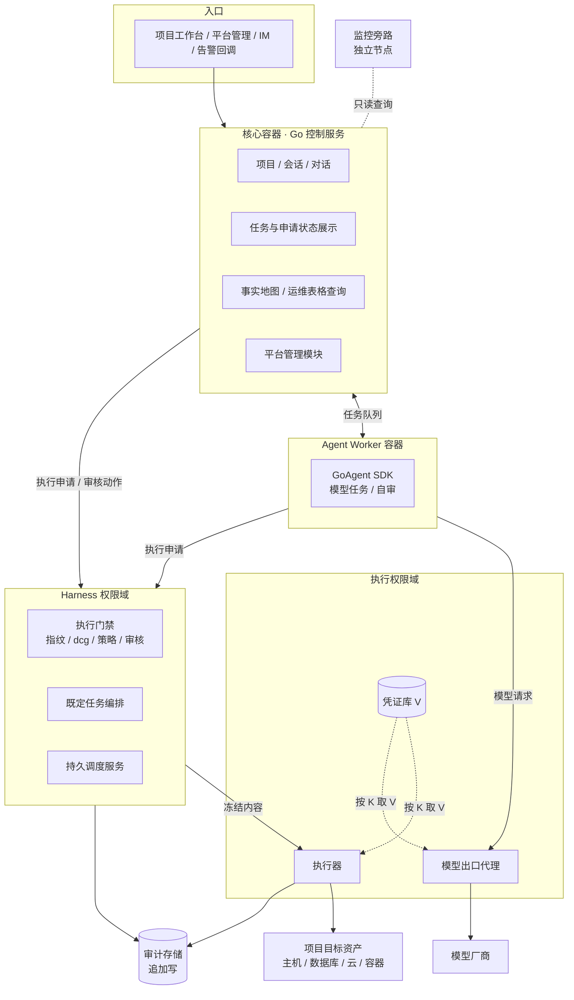

# 组件与权限边界

## 1. 总览

## 2. 组件职责与边界

| 组件 | 职责 | 能做 | 不能做 |
|---|---|---|---|
| 核心容器 | 项目、会话、对话、任务状态展示、事实地图与运维表格查询、审核界面、平台管理模块。按模块组织，一个控制服务进程。 | 读写自己的业务状态；向 Harness 提交申请和人工审核动作。 | 持有资产凭证；直接执行命令或 SQL；写运维表格。 |
| Agent Worker | 运行模型任务：理解、计划、写执行预期、自审、分析。嵌入 GoAgent SDK。 | 经任务队列和核心交互；经 Harness 提交执行申请；经模型出口代理调用模型。 | 持有任何 V、Docker socket 或宿主 shell（K-18）；直接访问目标。 |
| Harness | 执行门禁和既定任务编排（见 [Harness](../20-execution/23-harness-tasks.md)）。运行 dcg 和策略判定。 | 校验、冻结、编排、写审计；把冻结内容交给执行器。 | 接触 V；跳过门禁；相信外部传来的"已通过"标记。 |
| 持久调度服务 | 按时间表达式和项目自然日触发既定任务。 | 保存计划和周期；提交任务触发。 | 授予执行权；跳过门禁。 |
| 执行器 | 唯一真正操作目标的组件。 | 按 K 取 V 注入环境变量；执行前重算指纹；执行冻结内容；mask 输出。 | 执行未冻结或摘要不符的内容。 |
| 凭证库 | 保存 V。 | 增、删、改（人工经受控入口）；向执行器和模型出口代理提供 V。 | 向任何人或 Agent 返回 V（K-16）。 |
| 模型出口代理 | 实现 SDK 的鉴权传输端口（AuthenticatedTransportPort）：注入模型 API key，限制出口端点。 | 转发已批准端点的模型请求。 | 接受模型返回的 URL 作为新端点。 |
| 审计存储 | 追加写记录所有申请、修订、审核、执行和结果。 | 被写入；被审计页面读取。 | 被修改或删除，包括被 Agent。 |
| 监控旁路 | 采集、规则、告警和通知（K-25）。 | 独立运行；被核心只读查询；告警时异步提交诊断任务。 | 依赖 LLM、Worker 或核心存活。 |
| 底座 | Supervisor 托管的底座控制服务和节点代理，部署平台自身。见 [部署底座](12-deployment-substrate.md)。 | 管理平台容器的启停、更新和回退。 | 把宿主管理权限交给 Agent。 |

## 3. 关键规则

- 权限边界按独立进程或容器划分，不靠代码约定。
- 核心接口不等待模型调用完成。Worker 故障只影响相关任务，核心页面和记录仍可用。
- Worker 独立设置资源限额和重启策略，积压不能耗尽核心资源。
- 一个项目只归属一个核心实例。不同 VM 上的核心实例使用不同的实例 ID 和数据边界。
- 项目归属限定工作范围，不代替环境策略和执行门禁。切换项目或环境时重新核验范围。

## 4. 通信

| 链路 | 方式 |
|---|---|
| 核心 ↔ Worker | 本项目定义的版本化任务队列协议，持久保存。 |
| 核心 / Worker → Harness | 版本化 HTTP/JSON 接口，提交执行申请、任务触发、审核动作。 |
| Harness → 执行器 | 只传冻结后的申请；执行器独立核验摘要。 |
| 底座控制服务 → 节点代理 | 已认证的节点通道。 |
| 核心 → 监控旁路 | 只读查询接口。 |
| 监控旁路 → 核心 | 告警事件异步提交诊断任务，不等待回应。 |
| 监控旁路 → Harness、持久调度服务 | 旁路拉取它们暴露的状态指标（检查与维护计划的最近状态、最近成功时间）。用于对失败和超期未运行告警；拉取不到本身也告警。 |
| 核心 → 监控旁路（事实） | 核心的事实服务经只读接口拉取旁路结果，写入事实地图。旁路不直接写事实库（Q22）。 |

## 5. 首版部署形态（草案，Q8）

| 组件 | 首版形态 |
|---|---|
| 核心容器、Agent Worker | 各一个容器，由 Docker Engine 管理重启。 |
| Harness、持久调度服务 | 一个独立容器内的两个进程，或两个容器。 |
| 执行器、模型出口代理 | 独立容器，单独的运行身份。 |
| 凭证库 | 独立存储，只有执行器和模型出口代理的账号能读 V。 |
| PostgreSQL | 独立容器或托管数据库。核心、Harness、审计使用不同的库或 schema 和不同账号。 |
| 监控旁路 | 独立 VM。 |
| 底座 | 宿主上的 supervisord 托管底座控制服务和节点代理。 |

首版面向单人使用，可以全部部署在一台 VM 上（监控旁路除外）。高可用不在首版范围内。
