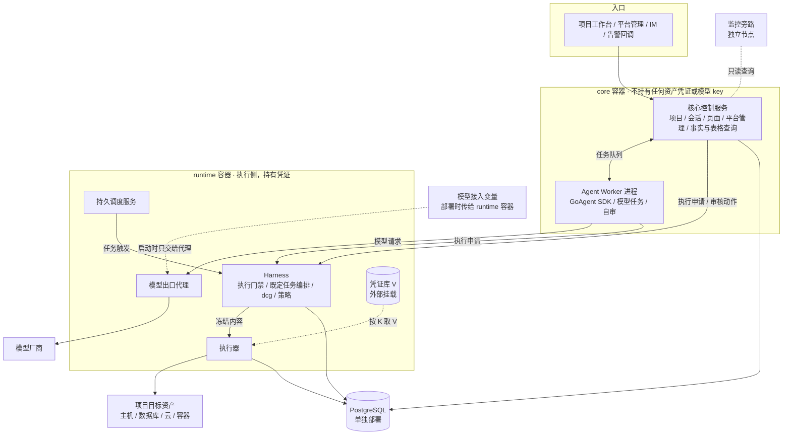
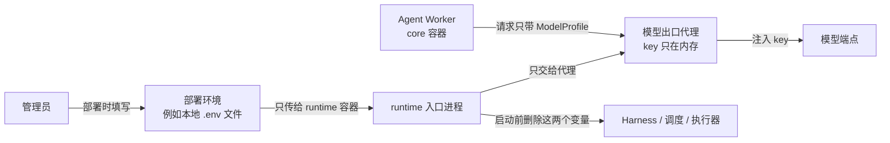

# 组件与权限边界

## 1. 总览

## 2. 组件职责与边界

| 组件 | 职责 | 能做 | 不能做 |
|---|---|---|---|
| 核心控制服务 | 项目、会话、对话、任务状态展示、事实地图与运维表格查询、审核界面、平台管理模块。按模块组织，一个进程，运行在 core 容器。 | 读写自己的业务状态；向 Harness 提交申请和人工审核动作。 | 持有资产凭证；直接执行命令或 SQL；写运维表格。 |
| Agent Worker | 运行模型任务：理解、计划、写执行预期、自审、分析。嵌入 GoAgent SDK。core 容器内的独立进程，独立运行身份。 | 经任务队列和核心交互；经 Harness 提交执行申请；经模型出口代理调用模型。 | 持有任何 V、Docker socket 或宿主 shell（K-18）；直接访问目标。 |
| Harness | 执行门禁和既定任务编排（见 [Harness](../20-execution/23-harness-tasks.md)）。运行 dcg 和策略判定。 | 校验、冻结、编排、写审计；把冻结内容交给执行器。 | 接触 V；跳过门禁；相信外部传来的"已通过"标记。 |
| 持久调度服务 | 按时间表达式和项目自然日触发既定任务。 | 保存计划和周期；提交任务触发。 | 授予执行权；跳过门禁。 |
| 执行器 | 唯一真正操作目标的组件。 | 按 K 取 V 注入环境变量；执行前重算指纹；执行冻结内容；mask 输出。 | 执行未冻结或摘要不符的内容。 |
| 凭证库 | 保存 V。 | 增、删、改（人工经受控入口）；向执行器提供 V。 | 向任何人或 Agent 返回 V（K-16）。 |
| 模型出口代理 | 实现 SDK 的鉴权传输端口（AuthenticatedTransportPort）：注入模型 API key，限制出口端点。首版的端点和 key 来自模型接入变量（第 5.4 节）。 | 转发已批准端点的模型请求。 | 接受模型返回的 URL 作为新端点；跟随重定向；把 key 写进凭证库、数据库、日志或任何输出。 |
| 审计存储 | 追加写记录所有申请、修订、审核、执行和结果。 | 被写入；被审计页面读取。 | 被修改或删除，包括被 Agent。 |
| 监控旁路 | 采集、规则、告警和通知（K-25）。 | 独立运行；被核心只读查询；告警时异步提交诊断任务。 | 依赖 LLM、Worker 或核心存活。 |
| 底座 | Supervisor 托管的底座控制服务和节点代理，部署平台自身。见 [部署底座](12-deployment-substrate.md)。 | 管理平台容器的启停、更新和回退。 | 把宿主管理权限交给 Agent。 |

## 3. 关键规则

- 权限边界按独立进程或容器划分，不靠代码约定。
- 核心接口不等待模型调用完成。Worker 故障只影响相关任务，核心页面和记录仍可用。
- Worker 与核心控制服务同在 core 容器，但是两个进程、两个运行身份。Worker 有自己的并发、队列和内存上限，积压不能耗尽核心资源。
- 一个项目只归属一个核心实例。不同 VM 上的核心实例使用不同的实例 ID 和数据边界。
- 项目归属限定工作范围，不代替环境策略和执行门禁。切换项目或环境时重新核验范围。

## 4. 通信

| 链路 | 方式 |
|---|---|
| 核心 ↔ Worker | 本项目定义的版本化任务队列协议，持久保存。 |
| 核心 / Worker → Harness | 版本化 HTTP/JSON 接口，提交执行申请、任务触发、审核动作。 |
| Harness → 执行器 | 只传冻结后的申请；执行器独立核验摘要。 |
| 底座控制服务 → 节点代理 | 已认证的节点通道。 |
| 核心 → 监控旁路 | 只读查询接口。 |
| 监控旁路 → 核心 | 告警事件异步提交诊断任务，不等待回应。 |
| 监控旁路 → Harness、持久调度服务 | 旁路拉取它们暴露的状态指标（检查与维护计划的最近状态、最近成功时间）。用于对失败和超期未运行告警；拉取不到本身也告警。 |
| 核心 → 监控旁路（事实） | 核心的事实服务经只读接口拉取旁路结果，写入事实地图。旁路不直接写事实库（Q22）。 |

## 5. 首版部署形态

### 5.1 两个应用容器

| 容器 | 进程（各用独立运行身份） | 凭证 | 说明 |
|---|---|---|---|
| core | 核心控制服务、Agent Worker | 不持有资产凭证和模型 key；只有核心控制服务能读自己的数据库口令 | 面向用户和模型的一侧 |
| runtime | Harness、持久调度服务、执行器、模型出口代理 | 持有凭证库，只有执行器能读其中的 V；模型 API key 只在模型出口代理的内存里 | 执行侧 |

- Agent 和凭证分在两个容器，K-18 由容器边界保证。
- 容器内的入口进程启动全部子进程。任一子进程退出，入口进程即退出，由 Docker Engine 重启整个容器。容器内不再设第二个重启者（单一重启责任方，见 [部署底座](12-deployment-substrate.md)）。重启按恢复处理（K-24）。
- PostgreSQL 单独部署（独立容器或托管数据库），不在这两个容器内。core、Harness、审计使用不同的库或 schema 和不同账号。
- 监控旁路是独立节点（K-25），不在这两个容器内。
- 底座在宿主上，由 supervisord 托管底座控制服务和节点代理。
- 首版面向单人，core、runtime、PostgreSQL 可以在同一台 VM 上；监控旁路在另一台。高可用不在首版范围内。

### 5.2 运算与数据分离（K-31）

镜像只含程序。配置、密钥、数据全部来自外部挂载。删除或重建容器不丢任何东西，换镜像版本不改任何配置。

| 内容 | 放在哪里 |
|---|---|
| 程序（Go 二进制、页面静态文件） | 镜像，按 digest 固定 |
| 配置 | 外部目录，只读挂载；版本由部署包的 config_revision 固定 |
| 引导密钥（数据库口令、凭证库主密钥） | 外部目录，只读挂载，文件权限只给对应运行身份 |
| 模型端点和模型 API key | runtime 容器的环境变量，部署时传入（第 5.4 节） |
| 持久数据 | PostgreSQL；少量必须落盘的文件放外部数据目录 |
| 临时文件 | 外部临时目录，可清空，不备份 |
| 日志 | 输出到 stdout，由 Docker 日志驱动收集；不写容器内文件 |

### 5.3 挂载表

宿主路径统一放在 `${DATA_ROOT}/${instance_id}/` 下，`DATA_ROOT` 默认 `/srv/devops-agent`。容器内路径固定，代码只认容器内路径。

**core 容器**

| 容器内路径 | 宿主路径 | 方式 | 内容 | 备份 |
|---|---|---|---|---|
| `/etc/devops-agent` | `config/core/` | 只读 | 核心控制服务和 Worker 的配置：监听地址、数据库地址与账号名、runtime 地址、模型路由（指向模型出口代理） | 随配置版本保存 |
| `/run/secrets/devops-agent` | `secrets/core/` | 只读，0400 | core 数据库口令（只给核心控制服务的运行身份） | 离线保存 |
| `/var/lib/devops-agent` | `data/core/` | 读写 | 项目上传的资料文件、知识索引文件 | 是 |
| `/var/tmp/devops-agent` | `tmp/core/` | 读写 | 临时文件 | 否 |

**runtime 容器**

| 容器内路径 | 宿主路径 | 方式 | 内容 | 备份 |
|---|---|---|---|---|
| `/etc/devops-agent` | `config/runtime/` | 只读 | Harness、调度、执行器、模型出口代理的配置：数据库地址与账号名、跳板与网络出口、超时与并发；dcg 配置文件。模型端点不写在这里（第 5.4 节） | 随配置版本保存 |
| `/run/secrets/devops-agent` | `secrets/runtime/` | 只读，0400 | runtime 各账号的数据库口令、凭证库主密钥（各文件只给对应运行身份） | 离线保存 |
| `/var/lib/devops-agent/vault` | `data/vault/` | 读写，0700 | 凭证库存储（V，加密保存）。只有执行器的运行身份能访问 | 是，加密备份 |
| `/var/lib/devops-agent/artifacts` | `data/artifacts/` | 读写 | 部署制品的版本化暂存（例如从 OSS 下载的制品） | 可选 |
| `/var/lib/devops-agent/workspaces` | `data/workspaces/` | 读写 | 工具工作区与任务临时空间（Q24） | 否 |
| `/opt/devops-agent/assets` | `assets/<版本>/` | 只读 | 出厂资产包：内置 dcg 规则包、内置 mask 规则、内置命令模板。导入后仍需登记（K-20） | 随发布清单保存 |
| `/var/tmp/devops-agent` | `tmp/runtime/` | 读写 | 临时文件 | 否 |

**容器外**

| 组件 | 外部数据 | 备份 |
|---|---|---|
| PostgreSQL | 数据目录放在外部磁盘 `${DATA_ROOT}/${instance_id}/pgdata/`（或托管数据库） | 是，按库定期备份 |
| 监控旁路 | 自己节点上的外部磁盘（Prometheus 数据、告警记录） | 按旁路设计 |
| 底座 | 宿主上的配置和底座门禁的本地追加日志（见 [部署底座](12-deployment-substrate.md) 第 6.1 节） | 是 |

规则：

- 挂载表就是部署契约。新增任何需要落盘的内容，先改这张表。
- 部署时由底座按受控环境模板创建宿主目录，核对属主和权限，再启动容器。目录缺失或权限不对就不启动。
- 模型 API key 不放在挂载目录里，由环境变量传入（第 5.4 节）。凭证库的完整设计见 Q10。

### 5.4 环境变量表

环境变量表和挂载表一样，是部署契约（K-31）。表外的环境变量不生效。首版只有两个变量，合称模型接入变量。

| 变量 | 接收容器 | 使用进程 | 内容 | 必填 |
|---|---|---|---|---|
| `DEVOPS_LLM_BASE_URL` | runtime | 模型出口代理 | 模型端点的基础地址。接口格式为 OpenAI Chat Completions | 是 |
| `DEVOPS_LLM_API_KEY` | runtime | 模型出口代理 | 模型 API key | 是 |

**谁做什么**

1. 管理员在部署环境里填写两个变量。本地 Docker 部署时，docker compose 从宿主的 `.env` 文件读取，只写进 runtime 服务。`.env` 不进仓库。
2. runtime 入口进程把两个变量只交给模型出口代理。Harness、持久调度服务和执行器启动前，入口进程从它们的环境里删除这两个变量。
3. 模型出口代理启动时检查两个变量：
   - `DEVOPS_LLM_BASE_URL` 必须是 `https` 地址，不含用户名、密码、查询参数和片段。地址末尾不带 `/chat/completions`，例如 `https://<模型服务地址>/v1`。
   - `DEVOPS_LLM_API_KEY` 不能为空。
4. 检查通过后，代理把 key 登记为 K `DEVOPS_LLM_API_KEY`，来源为"环境变量"，状态为可用；把地址登记为已批准端点 `DEVOPS_LLM_BASE_URL`。这是首版唯一的模型端点。
5. 管理员在平台管理模块登记 ModelProfile：端点填 `DEVOPS_LLM_BASE_URL`，凭证填 K `DEVOPS_LLM_API_KEY`，基础协议为 Chat Completions，模型名按模型服务填写（K-20）。
6. 代理只把请求发到 `<DEVOPS_LLM_BASE_URL>/chat/completions`，并在请求头注入 key。

**约束**

- core 容器不接收这两个变量。core 容器启动时发现任一变量，就拒绝启动并报错。这样部署配置写错时会立即暴露。
- key 只在模型出口代理的内存里。代理不把 key 写进凭证库、数据库、日志、事件或错误信息。代理对自己的所有输出按 key 的精确值做 mask（K-17）。
- 执行器及其子进程不用 root 运行，也不和入口进程、模型出口代理共用运行身份。这样它们读不到其他进程的初始环境。
- 变量缺失或检查不通过时，代理不退出。它拒绝所有模型请求，并把模型可用性报告为"未配置"或"配置无效"，原因里只写变量名，不写值。其他服务照常运行，对话入口显示模型不可用。
- 配置文件里不写模型端点。模型端点只有 `DEVOPS_LLM_BASE_URL` 一个来源。
- 更换端点或 key：管理员修改部署环境里的变量，再重建 runtime 容器。重建按重启处理，进入恢复模式（K-24）。
- 能使用宿主 Docker 的人可以用 `docker inspect` 看到变量值。首版单人使用，宿主 Docker 权限等同宿主管理员，接受这一点。
