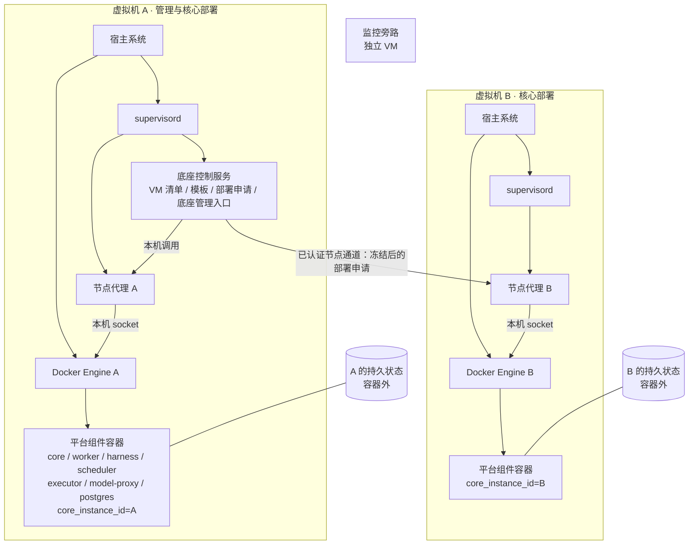

# 部署底座与运行环境

## 1. 定位

底座只负责部署和维护**平台自身**的组件：核心容器、Agent Worker、Harness、持久调度服务、执行器、模型出口代理、PostgreSQL 等。

- 底座不操作项目资产。项目上的容器、服务和数据库属于项目资产，由执行器按项目权限操作（见 [工具包装](../20-execution/26-tool-wrapping.md) 第 3 节）。
- 底座的每个动作（部署、更新、回退、重启、迁移）都是一次实际执行，同样先检验再执行（K-01）。见第 6 节。
- 底座管理入口运行在核心容器外。核心停机时，管理员仍能查看部署、日志，并恢复核心。见第 9 节。

## 2. 运行主体与职责

| 运行主体 | 管理对象 | 职责 | 不做 |
|---|---|---|---|
| 宿主系统（systemd 等） | Docker daemon、supervisord | 开机启动并维护这两个基础服务。 | 不托管平台业务进程。 |
| Supervisor（宿主侧 supervisord） | 底座控制服务、节点代理 | 托管这两个宿主进程，记录进程状态，按配置启动或拉起。 | 不托管 Docker daemon；不托管任何容器。 |
| 底座控制服务 | VM 清单、受控环境模板、部署包、部署申请 | 核验目标和配置，生成部署申请，经节点通道把冻结后的申请发给目标 VM 的节点代理；汇总各 VM 的进程、容器和健康状态。与核心控制服务无关。 | 不直接调用 Docker socket；不接触项目资产。 |
| 节点代理 | 本机 Docker Engine | 接收已认证的部署申请，核验冻结摘要和指纹，调用**本机** Docker API，返回实际状态。 | 不接受未认证或未冻结的申请；不调用其他 VM 的 Docker。 |
| Docker Engine | 平台组件容器 | 按各容器已审核的配置创建、启动、停止、删除容器；按各自的重启策略维护运行状态。 | 不决定部署内容。 |

Docker 管理权限（本机 socket）只授予节点代理。核心容器、Agent Worker、Harness 和执行器容器都不挂载本机 Docker socket。Agent Worker 的限制另见 K-18。

> 节点代理和执行器是两个不同的组件。节点代理属于底座，只管理平台自身容器；执行器属于执行权限域，操作项目目标。两者权限域分开。

## 3. 底座管理的平台组件

底座除了核心和 Worker，还要管理 [组件与边界](11-components-and-boundaries.md) 第 5 节中的其他组件。具体容器划分是草案（Q8）。

| 组件 | 首版形态（草案，Q8） | 重启责任方 | 持久状态 | 底座管理动作 |
|---|---|---|---|---|
| 核心容器 | 一个容器 | Docker Engine | 容器外：核心业务库、事实库 | 部署、启停、更新、回退、查看日志与健康 |
| Agent Worker | 一个容器，独立资源限额 | Docker Engine | 无独有持久状态；任务在核心的任务队列里 | 同上；可单独重启，不影响核心 |
| Harness | 一个容器 | Docker Engine | 容器外：Harness 库 | 同上 |
| 持久调度服务 | 与 Harness 同容器两个进程，或独立容器 | Docker Engine（同容器时，两个进程的拉起由容器内唯一的进程管理者负责，见第 4 节） | 容器外：调度服务库 | 同上 |
| 执行器 | 独立容器，单独运行身份 | Docker Engine | 容器外："开始执行"记录与执行结果（存放位置随 Q8 定）；审计追加写 | 同上 |
| 模型出口代理 | 独立容器，单独运行身份 | Docker Engine | 无 | 同上；变更允许的模型端点要发新配置版本 |
| PostgreSQL | 独立容器或托管数据库 | Docker Engine（容器时）/ 托管方 | 数据卷在容器外 | 部署、升级、备份、恢复、迁移执行 |
| 凭证库 | 独立存储（Q10） | 视形态而定 | 容器外 | 部署与备份；不读出 V |
| 审计存储 | 独立库或 schema，追加写 | 随 PostgreSQL | 容器外 | 部署与备份；不提供修改和删除 |
| 监控旁路 | 独立 VM | 监控 VM 上的 Docker Engine 或 systemd | 监控自己的存储 | 可以用底座分发部署；运行时不依赖底座、核心或 Worker（K-25） |

规则：

- 删除容器不等于删除业务状态。所有持久状态都在容器外（见 [状态与恢复](13-state-and-recovery.md) 第 1 节）。
- 核心、Harness、审计使用不同的库或 schema 和不同的数据库账号。迁移账号和运行账号分开。
- 平台数据库迁移是一次受控执行（K-23），由底座发起，不在服务启动时自动运行。见第 6.3 节。
- Worker 的模型任务输出绑定任务版本。任务已停止或已重新分配后，迟到的输出不能触发执行（见 [状态与恢复](13-state-and-recovery.md) 第 3 节）。模型失败只让相关任务降级，核心仍返回任务状态。

## 4. 单一重启责任方

同一个对象只有一个重启责任方。两个机制同时拉起同一对象，会让状态互相覆盖，也无法判断是谁重启的。

| 对象 | 唯一的重启责任方 | 禁止的做法 |
|---|---|---|
| Docker daemon、supervisord | 宿主系统 | 让 Supervisor 托管 Docker daemon |
| 底座控制服务、节点代理 | Supervisor | 再用 systemd 单独拉起同一进程 |
| 平台组件容器 | Docker Engine 的重启策略 | 在宿主上再用 Supervisor 拉起同一容器；在容器外用脚本循环 `docker start` |
| 同一容器内的多个进程（例如 Harness 与调度服务同容器） | 容器内唯一的进程管理者 | 容器内进程管理者和 Docker 重启策略同时重启同一个进程 |

规则：

- 重启策略是部署配置的一部分，随配置版本审核。改重启策略要发新配置版本（K-21）。
- 重启策略带重试上限和间隔，例如 `on-failure` 加最大次数。超过上限就停住，由监控旁路告警，不无限重启。
- 已审核的重启策略相当于一个预授权（K-11）：重启本身不需要每次经过平台审核。
- 服务被重启后进入恢复模式：在途任务标为"已停止（恢复中断）"，执行中的申请标为"结果未知"，调度计划暂停（K-24、Q4、Q5，流程见 [状态与恢复](13-state-and-recovery.md) 第 2 节）。
- 容器处于 running 不等于服务健康。底座另外探测应用健康，分别显示。

## 5. 跨 VM 分发

同一个部署包可以分发到不同的 VM，每个 VM 运行一个独立的核心实例。

规则：

- 每个节点代理只调用本机 Docker Engine。跨 VM 的请求只通过已认证的节点通道，由底座控制服务发出。
- 每个核心实例有自己的 `core_instance_id` 和数据边界。一个项目只归属一个核心实例（见 [组件与边界](11-components-and-boundaries.md) 第 3 节）。
- 图中 A、B 表示部署角色，不是已采集的资产。
- 同一逻辑实例同一时间只有一个活动实例。跨 VM 迁移按 [状态与恢复](13-state-and-recovery.md) 第 4 节执行：先停旧实例并确认已停，再备份、恢复、启动新实例并进入恢复模式。
- 监控旁路在独立节点上，分发和迁移期间继续运行（K-25）。

## 6. 底座操作的检验与执行

### 6.1 用同一个执行申请结构

底座的每个改变状态的动作，都用 [执行模型](../20-execution/21-execution-model.md) 第 3 节的执行申请结构记录，并走"检验 → 审核 → 冻结 → 执行前指纹核验 → 执行 → 对比"。

| 环节 | 在底座中的内容 |
|---|---|
| 目标 | `host_id`、`core_instance_id`、组件名。不能只凭名称或 IP 选择目标。 |
| 执行预期 | 组件、镜像 digest（从哪个到哪个）、`config_revision` 差异、资源与端口变化、预期健康结果、能否回退及回退到哪个版本。 |
| 原生预演 | 只读核验：镜像摘要和来源核验、配置 schema 校验与差异、宿主与架构兼容检查、磁盘和端口占用检查、迁移文件的分析结果。 |
| 指纹 | 当前容器 ID、镜像 digest、容器状态、重启次数、已加载配置摘要。 |
| 审核 | 首版底座动作一律人工：▶ 执行、✕ 拒绝。底座不运行 Agent；管理员要改内容就修改申请，同一 CallID 的 Revision 加一，重新检验（K-13）。 |
| 执行 | 节点代理只执行冻结后的申请，执行前重算指纹，不一致就不执行（K-04）。 |
| 对比 | 容器实际状态、镜像 digest、实际配置、应用健康探测。结果不明时记为"结果未知"，先查询实际状态（K-05）。 |
| 审计 | 每次申请、修订、审核、执行和结果追加写入审计。 |

底座要能在 Harness 和核心停机时恢复它们，所以底座的门禁不能依赖 Harness 或核心在线。底座自带的门禁与 Harness 的关系待定（Q23；当前默认：底座内置最小门禁，复用同一执行申请 schema 和审核语义，首版全部人工；审计先写底座本地追加日志，审计库可用时同步）。

### 6.2 管理动作

| 动作 | 说明 |
|---|---|
| 部署 | 首次在 VM 上创建全部平台组件。按依赖顺序：PostgreSQL → 平台库迁移 → 凭证库与审计 → 执行器、模型出口代理 → Harness、持久调度服务 → 核心 → Agent Worker。每一步核验健康后再做下一步。 |
| 更新 | 换镜像 digest 或配置版本。更新会重启服务，在途任务会按恢复即停止处理（K-24）。所以更新前先暂停调度、等待或停止在途任务，更新后查看恢复报告。 |
| 回退 | 回到上一已审核的镜像和配置版本。镜像回退不等于数据库或远端操作回滚。 |
| 启动、停止、重启 | 按组件分别操作。Worker 可以单独重启。 |
| 查看日志与健康 | 只读；日志经过 mask（K-17）。 |
| 迁移 | 跨 VM 迁移，见第 5 节。 |

### 6.3 平台数据库迁移

- 迁移文件是平台自身的固定 SQL，在构建期分析和测试，随版本发布（K-23，见 [SQL](../20-execution/24-sql.md) 第 1 节）。
- 迁移的执行本身是一次受控执行：执行预期写明迁移集版本、目标库、是否可逆；执行前先备份；用迁移账号执行，运行账号没有改结构的权限。
- 服务启动时不自动运行迁移。
- 数据库按"先扩展兼容结构 → 迁移数据 → 最后收缩旧结构"演进（见 [测试与发布](../50-engineering/55-testing-and-release.md)）。

## 7. 部署包

部署包是一次部署的完整、固定输入。

| 内容 | 说明 |
|---|---|
| 镜像 | 每个平台组件各自的固定镜像 digest。镜像标签不能代替摘要。 |
| 配置 | 每个组件的版本化配置，以 `config_revision` 标识。非敏感参数和密钥 K 引用分开记录。 |
| 状态映射 | 各组件的数据库、schema、账号、数据卷、备份位置；核心与 Worker 之间的任务队列映射。 |
| 迁移集 | 平台各库的迁移文件版本。 |
| 出厂资产包 | 内置 dcg 规则包、内置 mask 规则、内置命令模板等的固定版本。导入后由管理员登记才生效（K-20）。 |
| 兼容声明 | 支持的宿主系统、CPU 架构（amd64 / arm64）、Docker 运行时版本。 |
| 运行模板 | 引用的受控环境模板版本（第 8 节）。 |
| 发布清单引用 | 对应的发布清单（见 [测试与发布](../50-engineering/55-testing-and-release.md)）。 |

部署包不含任何 V。凭证只以 K 引用，部署时由受控后端注入目标组件（K-16）。

部署流程：管理员选择已登记且兼容的 VM → 底座控制服务生成部署申请并完成检验 → 管理员 ▶ 执行 → 节点代理按第 6.2 节的顺序创建容器 → 逐个核验健康、实际配置和镜像摘要 → 记录结果和审计。

## 8. 受控环境模板

每个 VM 和组件的运行约束写在受控环境模板里，登记并固定版本（K-20、K-21）。

| 配置项 | 运行约束 |
|---|---|
| 目标身份 | `host_id`、`core_instance_id`、环境、云账号或资源管理域。禁止只凭名称或 IP 选择目标。 |
| 运行时兼容 | 宿主系统、CPU 架构和 Docker 运行时必须符合部署包的兼容声明。 |
| 镜像与配置 | 可信镜像来源、固定 `image_digest`、`config_revision`、启动参数。 |
| 资源 | 每个组件分别设置 CPU、内存、磁盘配额。Worker 另设队列容量和并发上限，积压不能耗尽核心资源。部署前核验容量和实际空间。 |
| 网络 | 端口映射、接入网段、允许的出口。见下表。 |
| 参数与凭证 | 非敏感参数与密钥 K 引用分开。部署凭证和资产凭证都不进入 Agent Worker（K-18）。 |
| 持久化 | 各组件的存储映射、备份和恢复权限。临时文件与持久状态分开。 |
| 观测与重启 | 每个组件独立探测和重启（第 4 节）。分别显示：平台进程、容器状态、核心健康、Worker 状态、Harness 与执行器健康、模型可用性、VM 可达性、监控旁路状态。 |

网络边界（与 [组件与边界](11-components-and-boundaries.md) 第 4 节一致）：

| 组件 | 允许访问 | 不允许访问 |
|---|---|---|
| 核心容器 | PostgreSQL（自己的库）、Harness 接口、监控旁路只读接口 | 项目目标、模型厂商、凭证库 |
| Agent Worker | 核心任务队列、Harness 接口、模型出口代理 | 项目目标、模型厂商（直连）、凭证库、Docker socket |
| Harness / 持久调度服务 | PostgreSQL（自己的库）、审计库、执行器 | 项目目标、凭证库 |
| 执行器 | 项目目标（按项目网络范围）、凭证库、审计库 | 模型厂商 |
| 模型出口代理 | 已批准的模型端点、凭证库（只限模型 API key） | 项目目标；模型返回的新 URL |
| PostgreSQL | 只在平台内部网络 | 公网 |

## 9. 底座管理入口在核心外

- 底座管理入口由底座控制服务提供，运行在核心容器外（见 [运维入口](../30-features/37-ops-entrypoints.md) 第 1 节）。
- 它和 [平台管理模块](../30-features/38-platform-admin.md) 不是一回事：平台管理模块在核心里，管策略、登记、模型配置和审计页面；底座管理入口只管 VM 登记、平台组件部署、日志、健康和恢复。
- 核心停机时，管理员仍可用它检查部署、查看日志和恢复核心。
- 它不是破窗通道（K-26）：只能管理平台自身组件，不能操作项目资产，也不能跳过第 6 节的检验。
- 远程管理请求只通过已认证的节点通道到达节点代理。
- 首版单人使用。底座入口的身份认证不依赖核心在线；SSO 和 MFA 结构预留（Q9）。

## 10. 工具隔离与工作区

工具运行时和平台组件容器分开管理。执行器通过统一接口创建或恢复任务环境、导出工作区、执行工具、回收环境。

管理员为工具绑定沙盒策略。沙盒策略是登记资产（K-20），写明运行时、镜像、资源、工作区和网络。

| 策略能力 | 约束 |
|---|---|
| MicroVM 快照路径 | 启用时，从内核与工具已就绪的干净基线快照恢复任务环境，减少重复启动。基线不含任务数据或凭证。每个任务用独立的临时空间。恢复后重置实例标识、随机状态、时钟和网络连接。快照、磁盘和运行版本分别核验。任务结束后回收实例。 |
| Docker 只读工作区路径 | 启用时，只导出白名单目录，以 `readonly` / `ro` 挂载。敏感文件过滤或不导出。临时产物用独立的可写目录。所有文件工具和终端使用同一个工作区边界。禁用递归子挂载，或核验所有子挂载也是只读。 |
| 共同边界 | 工具环境不持有 Docker socket 或宿主管理权限。环境恢复和文件访问遵守同一白名单、审计和审核规则。V 只在执行时由执行器注入（K-16），工具环境不能读取凭证源或注入副本。含密钥文件不导出到工作区。审计保存在沙盒外。 |

需要注意的边界：

- 只读挂载只阻止经该挂载写入，不能隐藏已导出的内容。所以导出前就要过滤。
- 沙盒快照只恢复本地状态，不能回滚远端操作。
- 快照恢复不能代替冻结摘要核验和执行前指纹核验（K-04、K-15）。
- 创建沙盒需要宿主权限。执行器容器本身不挂 Docker socket。沙盒由哪个受控后端创建、首版启用哪条路径，待定（Q24；当前默认：首版只启用 Docker 只读工作区路径，由独立的沙盒后端创建，MicroVM 快照路径暂不启用）。
- 每个具体工具的能力和预演方式，见 Q12。

## 11. 待定事项

- Q8：Harness、执行器、调度服务、凭证库、PostgreSQL、审计的具体容器划分。
- Q9：底座入口和平台管理的 SSO、MFA。
- Q10：凭证库的存储、加密、备份和迁移。
- 底座自带门禁与 Harness 的关系（第 6.1 节，Q23）。
- 工具沙盒的宿主权限归属和首版启用路径（第 10 节，Q24）。

## 12. 参考

- [Supervisor 进程管理](https://supervisord.org/introduction.html)
- [Docker 重启策略](https://docs.docker.com/engine/containers/start-containers-automatically/)
- [Docker bind mount](https://docs.docker.com/engine/storage/bind-mounts/)
- [Firecracker 快照支持](https://github.com/firecracker-microvm/firecracker/blob/main/docs/snapshotting/snapshot-support.md)
