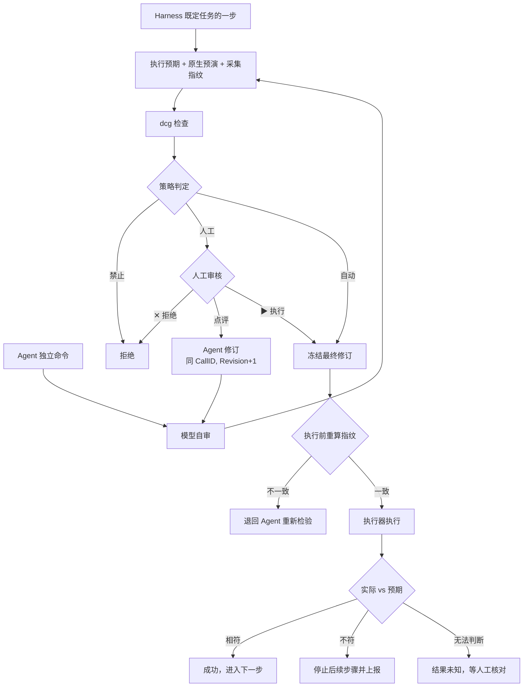

# 执行模型

## 1. 两类执行来源

| 来源 | 说明 | 审核方式 |
|---|---|---|
| Harness 既定任务 | 已登记的脚本或命令模板，按固定步骤和分支运行。日常运维大多走这里。见 [既定任务](23-harness-tasks.md)。 | 登记时审核一次。运行时按策略执行，默认自动。每步仍做执行预期对比和指纹核验。 |
| Agent 独立命令 | Agent 临时组合、未登记的命令。 | 模型自审 → dcg → 策略。首版只能人工执行（K-10）。 |

两类来源都走同一个执行申请结构和同一条执行路径。区别只在执行预期的来源（任务定义里写好 / Agent 现写）和策略结果。

## 2. 执行路径

要点：

- 既定任务的步骤不经过模型自审，因为它的内容在登记时已审核。
- 修订后从自审重新开始，旧的检验结果和人工批准全部作废（K-09、K-13）。
- 指纹不一致时不执行，也不自动重试。Agent 重新观察目标，重新写执行预期。

## 3. 执行申请结构

执行申请是 Harness 保存和传递的唯一结构。字段用 schema 固定（K-22）。

| 字段组 | 字段 |
|---|---|
| 身份 | CallID、Revision、内容摘要、来源（既定任务步骤 / Agent 调用已登记工具或命令模板 / Agent 发起既定任务 / 独立命令 / 预授权 / 人工终端）、任务与步骤 ID、会话 ID |
| 范围 | 项目、环境、目标稳定 ID 列表 |
| 内容 | 工具或模板 ID 与版本、展开后的完整内容、参数、需要的密钥 K 列表 |
| 执行预期 | 见第 4 节 |
| 指纹 | 采集方法、采集时间、指纹值 |
| 检验结果 | 原生预演结果、自审结论、dcg 结果（命中的规则 ID）、策略判定及其来源层级 |
| 审核 | 人工动作、点评、审核人、时间、绑定的修订 |
| 执行 | 开始与结束时间、退出状态、mask 后的输出、实际结果对比、最终状态 |

原生协议里的模型 call ID 只用于协议关联，不能当作执行权限或幂等依据。

## 4. 执行预期

用户的要求是：Agent 对自己要执行的命令必须有明确预期，而不是执行完才发现错了。执行预期就是这个要求的落地。

| 字段 | 说明 | 例子 |
|---|---|---|
| 意图 | 一句话说明要做什么、为什么 | 清理 app-01 上 30 天前的日志 |
| 目标 | 稳定 ID，不能只写名称或 IP | host:vm-demo-01 |
| 读写类别 | 只读 / 写入 / 删除 / 权限变更 / 启停 / 计费（购买或释放） | 删除 |
| 预期变更 | 会改变什么，范围多大 | 删除 /var/log/app 下约 120 个 *.log 文件，约 3.2 GB |
| 预期输出 | 正常时输出什么样 | 退出码 0；输出删除文件数 |
| 成功判据 | 执行后用什么判断成功 | 目录剩余文件均在 30 天内；磁盘使用率下降 |
| 可逆性 | 可逆 / 不可逆；可逆时写回退方法 | 不可逆 |
| 原生预演 | 有没有；有就附结果 | `find ... -print` 列出待删文件 |
| 风险自评 | 模型自己判断的风险 | 低：路径固定，只匹配 *.log |

规则：

- 读写类别由系统确定，不只信模型的说法。命令模板在登记时声明；独立命令由 dcg 和解析器判断。判断不出来就转人工（K-08）。
- 不可逆且没有原生预演的操作，不能自动执行（K-08）。
- 既定任务的执行预期写在任务定义里，参数代入后生成。

## 5. 原生预演

有原生预演的工具必须先跑预演。预演结果是执行预期的一部分，也是人工审核时的主要依据。

| 场景 | 原生预演 |
|---|---|
| 文件删除、同步 | `find ... -print`、`rsync -n` |
| 软件包 | `apt-get -s`、`dnf --assumeno` |
| Kubernetes | `kubectl apply --dry-run=server`、`kubectl diff` |
| 基础设施即代码 | `terraform plan`、`ansible --check --diff` |
| 云 API | 厂商的 DryRun 参数（各厂商含义不同，由适配器解释，见 [云服务商](../30-features/35-cloud-providers.md)） |
| SQL | 解析分类；适配器声明支持时用不带 ANALYZE 的 `EXPLAIN`。`EXPLAIN ANALYZE` 会真实执行，不能当预演。见 [SQL](24-sql.md)。 |

`bash -n` 只检查语法，不算预演。模型口头推演也不算预演，只能写进执行预期的"风险自评"。

## 6. 状态指纹

指纹解决"检验和执行之间，目标被别人改了"的问题。系统不加锁，而是让 Agent 发现变化。

| 目标类型 | 指纹内容（示例） |
|---|---|
| 文件、目录 | 路径、大小、修改时间、内容哈希、属主与权限 |
| 系统服务 | unit 状态、启动定义摘要、主进程 PID、版本 |
| 容器 | 容器 ID、镜像 digest、状态、重启次数 |
| 数据库对象 | 目标表结构摘要、影响条件下的行数 |
| 云资源 | 资源状态、版本号或 ETag、最后更新时间 |
| 配置 | 配置文件哈希、已加载版本 |

规则：

- 指纹方法由工具或命令模板在登记时声明。
- 检验时采集一次，冻结时记录，执行前由执行器重算比对。
- 不一致：不执行，申请状态变为"目标已变化"，退回 Agent 重新观察和写执行预期。重新检验仍是同一 CallID，Revision 加一，从头开始；之前的检验结果和人工批准作废。
- 采集不到指纹：转人工（K-08）。
- 只读操作也采集指纹，用于说明读到的是哪个状态。

## 7. 执行后对比

- 执行器保存退出状态和 mask 后的输出（K-17）。
- 执行器按成功判据检查实际结果，和预期变更、预期输出对比，给出"成功 / 与预期不符 / 失败 / 结果未知"。Harness 记录结论，并据此推进既定任务或选择分支。
- 相符：成功。既定任务进入下一步或按分支条件选路。
- 不符：停止后续步骤，上报差异，不自动补救。补救是新的执行申请。
- 无法判断（超时、连接断开）：记为"结果未知"，先查询目标实际状态，不盲目重做（K-05）。

## 8. 状态枚举

| 状态 | 含义 |
|---|---|
| 草稿 | 已提出，未开始检验 |
| 检验中 | 正在写执行预期、预演、采集指纹、自审、dcg |
| 待人工 | 策略或升级条件要求人工审核 |
| 已拒绝 | 人工拒绝，或策略、dcg 禁止 |
| 待修订 | 人工点评后等 Agent 修订 |
| 已冻结 | 最终修订通过检验，等待执行 |
| 目标已变化 | 执行前指纹不一致 |
| 执行中 | 执行器正在执行 |
| 成功 | 实际结果与预期相符 |
| 与预期不符 | 执行完成但结果不符，后续步骤已停止 |
| 失败 | 执行报错 |
| 结果未知 | 无法确认实际结果 |
| 已停止 | 被人工取消，或因恢复而停止（K-24） |

## 9. 未定事项

- 独立命令首版是否只能人工执行：Q1。
- dcg 命中后转人工还是直接禁止：Q2。
- 不可逆且无预演的操作是否强制人工：Q3。
