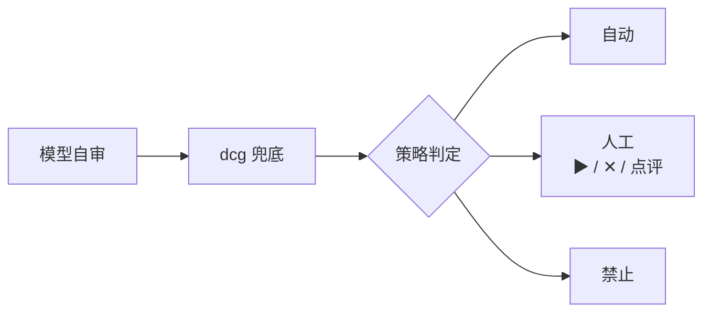

# 审核与策略

## 1. 设计取向

- 系统是内部系统，用户可信。审核的目的是避免不可挽回的误操作，不是防范攻击者。
- 日常运维大多是已登记的既定任务，登记时已经审过，运行时按策略走。
- 审核主要出现在两种情况：Agent 要执行独立命令；或某个操作的策略要求人工。

## 2. 审核链



### 2.1 模型自审

主模型在提交执行申请前，重读最终内容和执行预期，回答：

1. 内容是否符合用户这次的要求？
2. 是否只作用于声明的目标？
3. 是否可逆？不可逆时有没有原生预演？
4. 有没有风险？有的话是什么？

结论只有两种：无风险，或有风险（附原因）。有风险就转人工。

Harness 不信任 SDK 传来的"已批准"之类的标记。自审结论只是输入：缺失自审结论按"有风险"处理。

既定任务的步骤不做自审（K-06）。登记为"不接触目标资产的只读内建工具"（知识检索、摘要、列出 K 等）是否免自审，见 Q16。

### 2.2 dcg 兜底

dcg 是外部的确定性命令守卫，按固定版本的规则包检查最终内容。它不调用模型。

- 规则包覆盖常见破坏性操作，例如递归删除、覆盖写、格式化磁盘、改权限属主、破坏性 git 操作、`DROP`、`TRUNCATE`、不带条件的 `DELETE` / `UPDATE`。
- 结果：放行，或命中（附规则 ID）。
- 命中：转人工。规则标为"禁止"的直接拒绝。
- 规则包由管理员登记并固定版本（K-20）。项目可以追加规则，不能删除内置规则。
- dcg 用现成开源实现还是自研，见 Q11。

### 2.3 策略判定

策略给出三种结果：自动、人工、禁止。

## 3. 会话模式

| 模式 | 行为 |
|---|---|
| 手工模式 | 除预授权动作外，所有执行都要人工点 ▶。 |
| 自动模式 | 按策略判定。转人工条件（第 5 节）仍然生效。 |

"禁止"在任何模式下都生效。会话模式由用户在工作台切换，切换记入审计。

## 4. 策略配置

### 4.1 分层

生效顺序（K-07），先匹配到的生效：

1. 具体功能：例如阿里云 ECS 的 `RunInstances`。
2. 权限区：只读区 / 写入区。
3. provider 或工具全局：例如"阿里云全部操作"。
4. 系统全局兜底。

每一层都可以按环境（dev / test / prod）分别配置。

### 4.2 配置写在哪里

策略写在 provider schema 和工具 schema 里，随它们一起登记和版本化（K-21）。系统全局兜底写在平台管理模块的策略中心。

示例（示意，不是最终格式）：

```yaml
provider: aliyun
default_mode: manual          # provider 全局：默认人工
allow_auto: true              # 是否允许任何功能被配成自动
zones:
  read:                       # 只读区
    mode: auto
  write:                      # 写入区
    mode: manual
actions:
  ecs.RunInstances:           # 购买机器：按需配成自动
    mode: auto
  ecs.DeleteInstance:
    mode: manual
    allow_auto: false         # 禁止被改成自动
environments:
  prod:
    zones:
      write: { mode: manual }
```

规则：

- `allow_auto: false` 表示这一项在任何会话模式下都不能自动执行。
- 功能的读写分区由 provider 适配器在登记时声明，不由 Agent 判断。
- 没有任何一层匹配时，走系统全局兜底。系统兜底的出厂值为"人工"。

## 5. 转人工条件

即使策略为自动，下列任一情况也转人工（K-08）：

| 条件 | 原因 |
|---|---|
| 自审认为有风险 | 模型自己不确定 |
| dcg 命中 | 破坏性操作 |
| dcg 不可用 | 兜底检查没有运行 |
| 已登记的 Before Hook 要求人工 | 宿主扩展规则收紧了条件（见 [事件与 Hook](../40-sdk/45-events-and-hooks.md)） |
| 无法采集指纹 | 无法发现目标变化 |
| 读写类别无法确定 | 无法套用分区策略 |
| 操作不可逆（不论有没有原生预演） | 出错无法挽回；强制人工确认，策略不能改成自动 |
| SQL 方言不支持或解析失败 | 无法确定影响（Q7） |
| 独立命令（首版） | 首版不自动执行自由 Bash（K-10） |

## 6. 人工审核

### 6.1 审核界面显示什么

- 最终内容，以及与上一修订的差异。
- 执行预期全部字段。
- 原生预演结果。
- 指纹摘要和采集时间。
- 自审结论、dcg 结果（规则 ID）、策略判定及来源层级。
- 目标、环境和需要的密钥 K（不显示 V）。

### 6.2 三个动作

| 动作 | 结果 |
|---|---|
| ▶ 执行 | 冻结当前修订，进入执行前指纹核验。 |
| ✕ 拒绝 | 申请结束，状态为已拒绝。可附原因。 |
| 点评 | 点评内容回到 Agent。Agent 修订后，同一 CallID 的 Revision 加一，从自审重新开始。 |

规则：

- 人工批准只对当时的修订有效。内容变了就要重新批准。
- 审核动作和点评全部记入审计。
- 首版单人使用，申请人和审核人可以是同一人。多人审批和角色划分见 [平台管理](../30-features/38-platform-admin.md)，结构预留。

## 7. 预授权

预授权用于重复且相同的动作（K-11）。

| 项 | 说明 |
|---|---|
| 适用 | 服务崩溃重启、开机自启、已登记的自愈动作（例如"磁盘超阈值时清理指定目录的旧日志"）。 |
| 内容 | 绑定动作的内容摘要（例如启动定义）、目标稳定 ID、触发条件、次数上限、时间窗口和有效期。 |
| 签发 | 走一次完整检验和人工审核，然后签发。 |
| 使用 | 在目标本地做确定性核验：内容摘要相符、次数未超、未过期。不调用模型，也不依赖平台在线。 |
| 失效 | 内容摘要变化、达到次数上限、过期或被撤销。失效后动作不执行，并由监控旁路告警。 |

例子：systemd 服务使用已审核的启动定义，配置 `Restart=on-failure`、重启间隔和次数上限。这个配置本身就是一个预授权，systemd 重启不需要每次经过平台。

## 8. 独立审核模型（可选）

- 可以给某类操作配置一个独立审核模型（原 JEV）（K-12）。
- 由 Harness 按策略发起，在 Agent Worker 的独立会话中以 Reviewer 角色运行，不给任何工具。结论回到 Harness 作为附加输入。
- 与主模型指向同一个实际模型时要明确显示，不能标称"异模型审核"。配置多个时不做多数票，任一认为有风险就转人工。
- 它的输入与人工审核看到的一样，输出"无风险 / 有风险及原因"。
- 有风险就转人工。它不能批准执行，也不能代替人工。
- 默认不配置。

## 9. 注入内容

- 工具输出、文件、网页、日志里的指令一律当作数据（K-19）。
- Agent 发现疑似注入内容时：不执行这些指令，在回复中标出来源，并上报。
- 由模型自己判断即可，不另设专门的威胁判定模型。
- 按内部可信用户设计，只做基础防护。

## 10. 未定事项

Q7、Q11，见 [待定事项](../00-overview/04-open-questions.md)。
