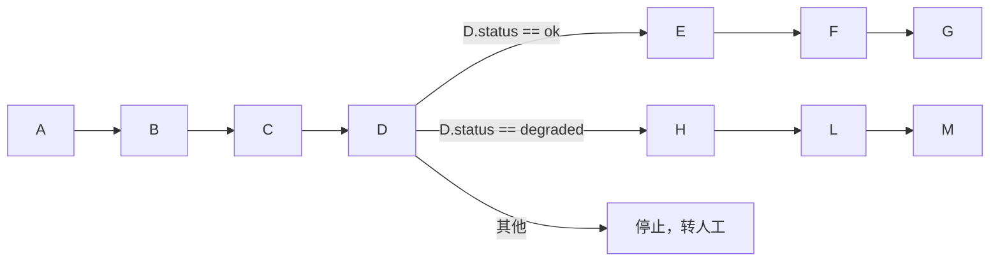

# Harness 与既定任务

## 1. Harness 的两项职责

| 职责 | 内容 |
|---|---|
| 执行门禁 | 对每一次执行申请走 [执行模型](21-execution-model.md) 的路径：执行预期、原生预演、指纹、自审结论、dcg、策略、人工审核、冻结、执行前指纹核验。 |
| 既定任务编排 | 按登记的任务定义，依次运行步骤，按步骤结果选择分支。 |

Harness 位于核心容器外，是独立进程和权限边界（见 [组件](../10-architecture/11-components-and-boundaries.md)）。它不信任核心容器或 SDK 提交的"已通过"标记，自己核验。

## 2. 既定任务

运维场景里的工作，大多是编排好的固定任务。理论上就是：执行脚本 A、B、C、D，判断 D 的结果，再执行 E、F、G 或 H、L、M。

### 2.1 任务定义

| 字段 | 说明 |
|---|---|
| 身份 | task_id、版本、内容摘要、所属规程包 |
| 参数 schema | 输入参数的类型、范围、必填项；需要的密钥 K |
| 适用范围 | 项目、环境、目标类型 |
| 步骤列表 | 每步见 2.2 |
| 分支 | 每个分支点的条件和去向，见 2.3 |
| 补偿步骤 | 失败或不符时可以选用的补偿步骤（本身也是执行，需检验） |
| 默认策略 | 每步默认自动或人工；可在步骤上覆盖 |
| 说明 | 给 Agent 和人看的用途说明 |

### 2.2 步骤

每一步引用一个已登记的执行单元（命令模板、Bash 脚本、Python 脚本或工具），并声明：

- 参数如何从任务参数或前序步骤输出代入。
- 执行预期模板（参数代入后生成完整执行预期）。
- 指纹方法。
- 成功判据。
- 结构化输出：从执行结果中提取哪些字段，供后续分支使用。
- 超时与重试上限。重试只用于明确的暂时故障，且执行单元声明为幂等。

### 2.3 分支条件

- 条件是固定、类型化的表达式，只读步骤的结构化输出，例如 `D.exit_code == 0 && D.status == "ok"`。
- 分支判断不调用模型。
- 必须有兜底分支：没有任何条件匹配时，停止任务并转人工。
- 步骤结果"与预期不符"或"结果未知"时，不进入任何分支，直接停止。

### 2.4 登记

1. Agent 和用户在对话中整理任务草稿（步骤、参数、分支、预期、恢复）。
2. 草稿中的每个执行单元必须已登记，或随任务一起提交登记。
3. 用户（首版即管理员）审核并登记，固定版本和摘要（K-20）。
4. 修改步骤、分支、参数范围或执行单元版本，建立新版本（K-21）。

登记是准入，不是对每次运行的批准。每次运行的每一步仍走执行门禁。

### 2.5 运行

| 阶段 | 行为 |
|---|---|
| 触发 | 人工点击、持久调度服务、告警规则或预授权。触发时绑定任务版本和参数。 |
| 每步 | 生成执行预期 → 原生预演 → 采集指纹 → dcg → 策略（已登记步骤默认自动） → 冻结 → 执行前指纹核验 → 执行 → 对比结果。 |
| 选路 | 按分支条件进入下一步。 |
| 结束 | 全部步骤成功，或停止于某步。保存每步状态和证据。 |

- 既定任务的步骤不需要模型自审，因为内容在登记时已审核。
- 策略可以把某些步骤设为人工，例如生产环境的切换步骤。
- Agent 可以发起任务、查看进度、分析结果，不能跳步或改步骤内容。
- 恢复后任务停止，不自动续跑（K-24）。

### 2.6 任务运行状态

一次任务运行的状态（每一步自身的状态用执行申请状态，见 [执行模型](21-execution-model.md) 第 8 节）：

| 状态 | 含义 |
|---|---|
| 待开始 | 已触发，绑定了任务版本和参数，尚未执行第一步 |
| 运行中 | 有步骤正在检验或执行 |
| 等待人工 | 当前步骤处于"待人工"或"待修订" |
| 等待输入 | 缺少必需输入，例如需要用户新增某个 K |
| 已完成 | 走完一条分支的全部步骤，且都成功 |
| 已停止 | 停在某一步：步骤结果与预期不符、失败、结果未知、被拒绝、目标已变化未处理，或没有分支匹配。记录停止的步骤和原因 |
| 已取消 | 用户取消 |
| 已停止（恢复中断） | 因恢复而停止（K-24） |

部署、运维表格等功能的运行状态都用这一套，可以在"原因"里细分，不另定义枚举。

### 2.7 版本与回滚

适用于既定任务、规程包、命令模板和脚本等所有已登记资产。

| 规则 | 说明 |
|---|---|
| 版本不可变 | 每次登记生成一个新版本，带版本号、内容摘要、变更说明和审核记录。登记后内容不能修改或删除（K-21）。 |
| 当前启用版本 | 每个资产有一个"当前启用版本"指针。新触发的运行使用它。 |
| 回滚 | 把当前启用版本指针切回某个历史版本。版本号不变，不复制内容。需要人工点 ▶ 确认，记入审计。前滚（切到较新的版本）同理。 |
| 切换前检查 | 目标版本引用的执行单元必须仍处于登记状态；否则不能切换，先处理依赖。 |
| 在途运行 | 一次运行在开始时绑定当时的启用版本，直到结束都不变。切换只影响之后的新运行。 |
| 定时计划 | 计划引用资产本身，每次触发时取当时的启用版本，并把版本号写进这次运行。回滚或升级后，下一次触发自动使用新的启用版本。 |
| 历史检索 | Agent 可以只读地列出版本、读取某个版本的内容、比较两个版本的差异，用来起草新版本或解释变化。 |

页面上的列表、详情和回滚操作见 [侧边栏与主要页面](../30-features/39-console-views.md) 第 3 节。

## 3. 命令模板库

命令模板是最小的已登记执行单元，用于把常用命令变成可自动执行的操作。

| 字段 | 说明 |
|---|---|
| 模板 | 参数化命令，例如 `systemctl restart {{unit}}` |
| 参数语法 | 每个参数的类型和允许值，例如 unit 必须匹配已登记服务 |
| 读写类别 | 只读 / 写入 / 删除 / 权限变更 / 启停 / 计费（与 [执行模型](21-execution-model.md) 第 4 节一致） |
| 执行预期模板 | 参数代入后生成执行预期 |
| 原生预演 | 有就声明调用方式 |
| 指纹方法 | 见执行模型第 6 节 |
| 默认策略 | 自动 / 人工 / 禁止 |

Agent 调用模板时只填参数，不能改模板内容。参数不符合语法就拒绝。首版 Agent 能自动执行的命令只来自命令模板和既定任务（K-10）。

## 4. 规程包

规程包是某类工作的已登记资产，例如"Java 应用从 OSS 部署为 systemd 服务"。

| 内容 | 说明 |
|---|---|
| 用途与适用范围 | 给 Agent 引导对话用的说明 |
| 参数 schema | 本类工作需要的输入 |
| 任务定义 | 一个或多个既定任务 |
| 执行单元 | 任务引用的模板和脚本 |
| 人工输入点 | 例如需要人工填写密钥（以 K 形式保存） |
| 健康判据 | 完成后的验收标准 |
| 监控要求 | 需要接入的监控项 |
| 恢复步骤 | 失败后的补偿与恢复 |

- 首次形成规程包时，通过多轮对话确定方法和参数范围，必要时在测试环境试运行（试运行也要先检验）。
- 用户审核后登记，以 procedure_id、版本和摘要定位。
- 规程包的批准不代替每次运行的检验。
- 超出参数范围或方法改变时，建立新版本。
- 真实执行记录、对话和审核记录保存在规程包外，以引用关联。

部署类规程包的具体流程见 [项目部署](../30-features/32-project-deployment.md)。

## 5. Harness 与其他组件

| 对方 | 关系 |
|---|---|
| Agent Worker | 提交执行申请和任务触发；接收状态和 mask 后的结果。 |
| 核心容器 | 页面展示、人工审核动作的入口；查询任务状态。 |
| 执行器 | Harness 把冻结后的内容交给执行器；执行器再次核验指纹和冻结摘要后执行。 |
| 持久调度服务 | 按计划触发既定任务。 |
| 凭证库 | 执行器按 K 取 V 注入环境变量，Harness 不接触 V。 |
| 审计 | 每次申请、修订、审核、执行和结果写入追加式审计。 |
