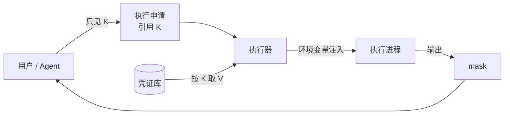

# 密钥 K→V 与 mask 规则

## 1. 核心规则

- 模型和用户只看到 K：名称、非敏感备注、状态（K-16）。
- 执行器在执行时按 K 取 V，以环境变量注入执行进程。
- 系统没有任何读取 V 的接口。工具读不到，模型就拿不到。
- 旧稿的"密钥剪贴板"只是比喻，表达的就是"模型只能通过 K 传递 V"。不再使用这个名称。

## 2. K 的操作

| 操作 | 谁能做 | 说明 |
|---|---|---|
| 增 | 人工，在受控输入框中填写 | 生成 K 和备注。不回显 V。 |
| 删 | 人工 | 删除后旧 K 不能再用。 |
| 改 | 人工 | 修改 V 或备注，不显示旧值和新值。 |
| 列出 | 用户、Agent | 只返回 K、备注、状态（可用 / 缺失 / 已删除；来自环境变量的 K 另有"无效"，见第 7 节）。 |
| 使用 | 执行器 | 只在执行冻结后的申请时，按申请里列出的 K 注入。 |

Agent 不能增、删、改 K，只能在执行申请里引用已存在的 K，或提示用户补充缺失的 K。

## 3. 注入方式

- 默认以环境变量注入，变量名由执行单元声明，例如 `DB_PASSWORD`。
- 需要写入目标配置文件时，由已登记的执行单元完成（例如部署步骤写入启动配置）。写入的目标路径登记为"含密钥文件"。
- 命令内容里不能出现 V。执行预期、审核界面和审计里只显示 K。

## 4. mask 规则

| 类别 | 说明 |
|---|---|
| 内置规则 | 常见形态，例如 `api-key = sk-...`、`password=...`、`Authorization: Bearer ...`、云厂商 AccessKey、私钥块 `-----BEGIN ... PRIVATE KEY-----`。 |
| 人工规则 | 用户在平台管理模块中配置的正则或关键字规则。 |
| 已知值 | 凭证库中所有 V 的精确匹配。模型 API key 不在凭证库里，由模型出口代理按它的精确值遮盖自己的输出（第 7 节）。 |

mask 作用于：

- 用户输入（进入模型之前）。
- 执行输出、错误信息、日志。
- 模型上下文、事件、审计记录。

## 5. 输入侧自动转 K

用户在对话中直接粘贴了命中规则的值时：

1. 在进入模型之前识别出来。
2. 把值存入凭证库，生成一个 K（用户可改名和补备注）。
3. 对话中用 K 替换原值。模型只看到 K。

## 6. 输出侧防泄漏

- 执行输出按规则和已知值 mask，例如命令 `echo $DB_PASSWORD` 的输出会被遮盖。
- dcg 规则包可加入"读取含密钥文件"的规则，命中转人工。
- 审计记录保存 mask 后的内容。

## 7. 模型 API key

模型 API key 也是 K。ModelProfile 只引用 K，由模型出口代理注入请求头（它实现 SDK 的鉴权传输端口）。SDK 和 Worker 看不到 V（见 [SDK 概览](../40-sdk/41-sdk-overview.md)）。

首版的模型 API key 来自环境变量，不进凭证库：

| 项 | 内容 |
|---|---|
| 来源 | runtime 容器的环境变量 `DEVOPS_LLM_API_KEY`，只交给模型出口代理（[组件与边界](../10-architecture/11-components-and-boundaries.md) 第 5.4 节） |
| K | 名称为 `DEVOPS_LLM_API_KEY`，来源"环境变量"。状态为可用、缺失或无效 |
| V 存放 | 只在模型出口代理的内存里。不写进凭证库、数据库、日志、事件或错误信息 |
| 增、删、改 | 不在平台里操作。管理员修改部署环境里的变量，再重建 runtime 容器 |
| 列出 | 和其他 K 一样，只返回 K、备注和状态 |
| mask | 模型出口代理按 V 的精确值遮盖自己的所有输出；其他组件按内置规则遮盖（第 4 节） |

## 8. 待设计（Q10）

K 的命名规则、存储加密、主密钥管理、备份、跨 VM 迁移和轮换，后续单独设计。
