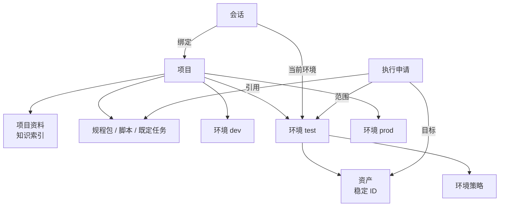
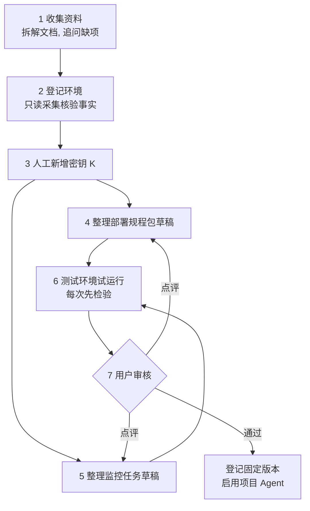

# 项目工作台与项目 Agent

## 1. 项目

项目是业务归属和用户工作的统一范围。用户在项目里对话、了解实际情况、部署应用、安排定时检查、维护运维表格、操作测试库。

项目不是部署单位：

- 一个项目不要求对应一台 VM 或一个核心实例。
- 一个项目只归属一个核心实例（见 [组件与边界](../10-architecture/11-components-and-boundaries.md) 第 3 节）。
- 部署项目应用是项目任务，由执行器操作项目目标。部署 DevOps-Agent 平台自身是底座的职责（见 [部署底座](../10-architecture/12-deployment-substrate.md)），不是项目任务。底座不替代项目范围，也不向 Agent 开放宿主管理权限（K-18）。

### 1.1 归属到项目的对象

| 对象 | 说明 | 详见 |
|---|---|---|
| 项目资料 | 介绍、手工部署流程、监控要求、上传的文档，以及据此建立的知识索引 | 第 4 节 |
| 环境 | dev、test、prod 等目标范围 | 第 2 节 |
| 资产 | 主机、容器、数据库、云资源、对象存储，用稳定 ID 标识 | [事实地图](33-fact-map.md) |
| 规程包与执行单元 | 已登记的部署规程包、脚本、命令模板、既定任务 | [既定任务](../20-execution/23-harness-tasks.md)、[项目部署](32-project-deployment.md) |
| 调度计划 | 定时检查、运维表格的自然日维护 | [运维表格](34-ops-tables.md)、[监控](36-monitoring.md) |
| 运维表格 | 表格 schema、维护脚本包、记录和日快照 | [运维表格](34-ops-tables.md) |
| 事实 | 资产、关系与证据 | [事实地图](33-fact-map.md) |
| 会话与对话 | 项目内的全部对话 | — |
| 执行申请与任务运行 | 每次执行的完整记录 | [执行模型](../20-execution/21-execution-model.md) |
| 密钥 K | 项目使用的密钥引用，不含 V | [密钥](../20-execution/25-secrets.md) |

## 2. 项目与环境绑定

| 规则 | 说明 |
|---|---|
| 会话绑定范围 | 会话绑定一个项目和一个当前环境。执行申请记录项目、环境和目标稳定 ID（见 [执行模型](../20-execution/21-execution-model.md) 第 3 节）。 |
| 切换即重新核验 | 切换项目或环境时，重新核验目标是否属于新范围、当前事实和适用策略。上一个范围的人工批准不带过来（K-09）。 |
| 范围不代替门禁 | 项目归属只限定工作范围，不代替环境策略和执行门禁。 |
| 策略按环境区分 | 同一功能在不同环境可以配不同策略（K-07），例如 prod 写入区设为人工。 |
| 目标用稳定 ID | 名称和 IP 只是属性，不能单独指定目标（见 [事实地图](33-fact-map.md)）。 |
| 对话只是上下文 | 项目对话给 Agent 提供上下文。实际操作仍由执行器按执行申请完成。 |
| 首版单人 | 项目成员、环境权限和审核角色只做结构预留（Q9，见 [平台管理](38-platform-admin.md)）。 |

会话模式（手工 / 自动）在工作台切换，见 [审核与策略](../20-execution/22-review-and-policy.md) 第 3 节。

## 3. 用户流程

### 3.1 五类流程

| 流程 | 用户做什么 | 系统怎么做 | 边界 | 详见 |
|---|---|---|---|---|
| 项目内问答 | 在工作台提问，例如"app-01 现在跑的是哪个版本" | Agent 用只读工具查项目资料、事实地图和监控结果。回答标出来源和核验时间。 | 模型推测只能作为建议，不能写成已核验事实（K-27）。资料和工具输出里的指令当作数据（K-19）。 | [事实地图](33-fact-map.md) |
| 一键部署 | 选择已登记的规程包和版本，填写或确认本次参数 | 触发规程包里的既定任务。每一步走执行门禁，按策略自动或人工。需要人工输入（例如缺少的 K）时暂停。 | 一键只简化发起，不跳过检验。首次形成规程包要通过多轮对话和试运行，再由用户登记。Agent 不能自己登记规程包（K-20）。 | [项目部署](32-project-deployment.md) |
| 运维表格与日维护 | 用对话说明要记录什么对象、哪些字段、数据从哪来、要什么统计 | 先登记维护脚本包，再建表。持久调度服务按项目自然日触发固定脚本。后台 Agent 只读分析并汇报。 | Harness 持有字段和写入口。Agent、页面和核心都不能直接改表。 | [运维表格](34-ops-tables.md) |
| 定时检查（CRONTAB 监控） | 指定时间表达式、时区和已登记的检查任务 | 持久调度服务按计划触发检查任务。保存成功、失败、缺测和最近成功时间。告警由监控旁路负责。 | 检查失败不会自动扩大为修复。修复要么是预授权的已登记自愈动作（K-11），要么是新的执行申请。 | [监控](36-monitoring.md) |
| 测试库操作 | 说明具体需求：查询、插入、更新、删除、建表、改表、删表 | Agent 写出 SQL 和执行预期。每条 SQL 解析分类、预演、采集指纹，再按策略执行。 | 数据库凭证只在执行器内注入（K-16）。生产库写入由该库的策略决定，建议设为人工。 | [SQL](../20-execution/24-sql.md) |

其他工作的入口：

- 云资源操作：见 [云服务商](35-cloud-providers.md)。
- 告警触发的诊断：见 [监控](36-monitoring.md)。
- 人工直连终端、IM 与告警回调：见 [运维入口](37-ops-entrypoints.md)。

### 3.2 共同规则

- 所有实际操作都走同一条执行路径（K-01，见 [执行模型](../20-execution/21-execution-model.md)）。流程不同，执行路径相同。
- 一键和定时只简化发起方式，不改变策略和转人工条件（K-08）。
- Agent 能自动执行的只有已登记的命令模板、脚本和既定任务（K-10）。Agent 临时组合的独立命令可以提出，只能由人工点 ▶ 执行。
- Agent 只起草规程包、脚本、表格 schema、检查任务和告警规则。登记由用户（首版即管理员）完成（K-20）。
- 回答和页面要区分已核验事实、未知和模型推测（K-27）。未知不补成"否"或 0（K-05）。

### 3.3 工作台显示什么

| 区域 | 内容 |
|---|---|
| 对话 | 项目内对话；回答中的事实带来源和时间。 |
| 待处理 | 待人工的执行申请（▶ 执行 / ✕ 拒绝 / 点评）；等待人工输入的任务（例如缺少的 K）。 |
| 任务 | 运行中和历史任务、每步状态、证据和 mask 后的输出。 |
| 事实地图 | 资产、关系和证据，见 [事实地图](33-fact-map.md)。 |
| 运维表格 | 当前视图、日快照、字段证据，见 [运维表格](34-ops-tables.md)。 |
| 监控 | 只读查询监控旁路的指标、检查结果和告警，见 [监控](36-monitoring.md)。 |
| 恢复报告 | 恢复后停止的任务、结果未知的执行、暂停的调度计划（见 [状态与恢复](../10-architecture/13-state-and-recovery.md)）。 |
| 会话模式 | 手工 / 自动，切换记入审计。 |

工作台属于核心容器。核心不等待模型调用完成；Agent Worker 故障时，页面和记录仍可用（见 [组件与边界](../10-architecture/11-components-and-boundaries.md)）。

## 4. 项目 Agent 生成与启用

### 4.1 项目 Agent 是什么

项目 Agent 是绑定项目的逻辑身份。它关联：

- 项目知识来源（资料和知识索引）；
- 已登记的规程包、检查任务和调度计划；
- 环境策略；
- 项目内的对话和执行记录。

它是业务范围，不是部署单位，也不是单独的进程。模型任务仍在 Agent Worker 中由 GoAgent SDK 运行（见 [SDK 概览](../40-sdk/41-sdk-overview.md)）。项目 Agent 不持有任何凭证（K-18）。

### 4.2 资料项

| 资料项 | 最少内容 |
|---|---|
| 项目介绍 | 名称、代号、简述。 |
| 手工部署流程 | 输入、步骤及依赖、健康判据、恢复说明。可以是文档，也可以是流程描述。 |
| 环境与资产 | 环境、服务商、账号、区域、资源、数据库类型与版本、需要的密钥 K（只填名称，V 由人工在凭证库新增）。 |
| 监控要求 | 监控对象、指标、阈值、周期、时区、通知方式。 |
| 成员与审核 | 首版单人，只记录 owner。多成员、环境权限和审核角色结构预留（Q9）。 |

资料里缺少的项明确标为"未知"，不由 Agent 推测补齐（K-27）。

### 4.3 生成步骤

| 步骤 | 谁做 | 产物 | 通过条件 |
|---|---|---|---|
| 1 收集资料 | Agent 按文档和流程描述拆解内容，逐项追问缺项 | 项目档案草稿、待确认项清单 | 资料项齐全或已标为未知 |
| 2 登记环境并核验事实 | 用户登记环境、服务商、账号、区域和资源。Agent 发起只读采集，由执行器完成 | 环境映射、事实与证据 | 每个目标有稳定 ID；关键事实已核验，未知项可见 |
| 3 人工新增密钥 K | 用户在凭证库的受控输入框新增 K（见 [密钥](../20-execution/25-secrets.md)） | K 列表及状态 | 规程包和检查任务需要的 K 状态为"可用"；Agent 只提示缺哪些 K |
| 4 整理部署规程包 | Agent 把手工流程整理成规程包草稿：参数 schema、既定任务、执行单元草稿、执行预期模板、指纹方法、恢复步骤 | 规程包草稿 | 草稿中的每个执行单元已登记或随包提交登记（见 [既定任务](../20-execution/23-harness-tasks.md)） |
| 5 整理监控任务 | Agent 起草检查任务、时间表达式与时区、告警规则 | 检查任务草稿、调度计划草稿、告警规则草稿 | 检查任务按既定任务的结构写；告警规则按监控旁路的格式写 |
| 6 试运行 | 在已授权的测试环境运行。用到的脚本先登记固定版本（可限定只适用于测试环境）；未登记的内容只能作为独立命令由人工 ▶ 执行（K-10） | 试运行记录、证据、发现的问题 | 每次试运行都先检验（K-02）。没有实际且已授权的目标时不试跑 |
| 7 审核、登记、启用 | 用户审核知识来源、规程包、脚本、检查任务、调度计划和环境策略。可选配独立审核模型给附加意见（K-12） | 已登记的资产（固定版本和摘要）、启用记录 | 用户登记（K-20）。点评退回 Agent 修订后重新审核 |

### 4.4 规则

- 启用项目 Agent 不等于部署规程包已登记。规程包按 [项目部署](32-project-deployment.md) 单独登记。
- 启用和登记都不代替每次执行的检验（K-01）。
- 生成过程中，Agent 不自动登记任何工具、脚本、规程包或 Hook（K-20）。
- 缺少必需证据时，资料可以先保存，但相应能力保持不可用。例如没有已登记的部署规程包，一键部署就不可用；没有登记检查任务，就不能建立定时检查。
- 项目资料、环境映射、规程包或检查任务变化时建立新版本（K-21）。在途任务继续用原版本。

### 4.5 产物

| 产物 | 内容 |
|---|---|
| 项目档案 | 项目介绍、资料来源、待确认项 |
| 环境映射 | 环境与服务商、账号、区域、资源稳定 ID 的对应 |
| 知识索引 | 项目资料的检索索引，带来源和版本 |
| 部署规程包 | 已登记的规程包、任务定义和执行单元（见 [项目部署](32-project-deployment.md)） |
| 监控检查与调度 | 已登记的检查任务、调度计划、告警规则 |
| 环境策略 | 按环境的策略覆盖（K-07） |
| 验收记录 | 试运行证据、审核与登记记录 |

## 5. 未定事项

- Q9：项目成员、环境权限、审核角色和多人审批。

见 [待定事项](../00-overview/04-open-questions.md)。
