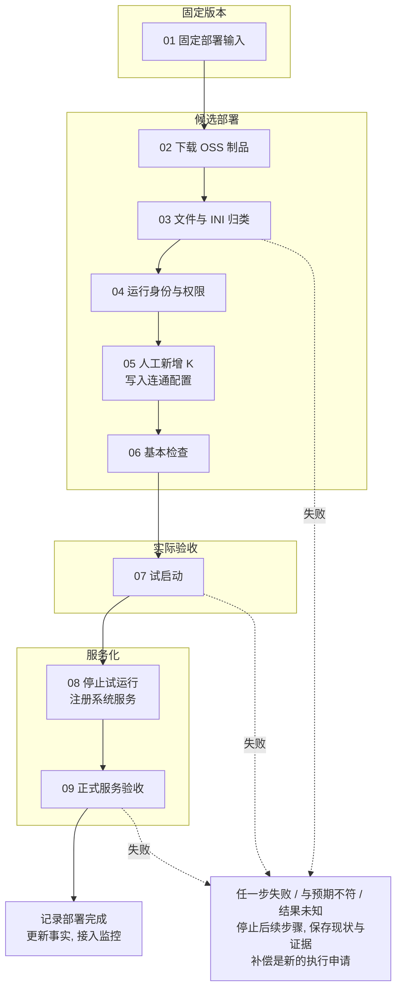
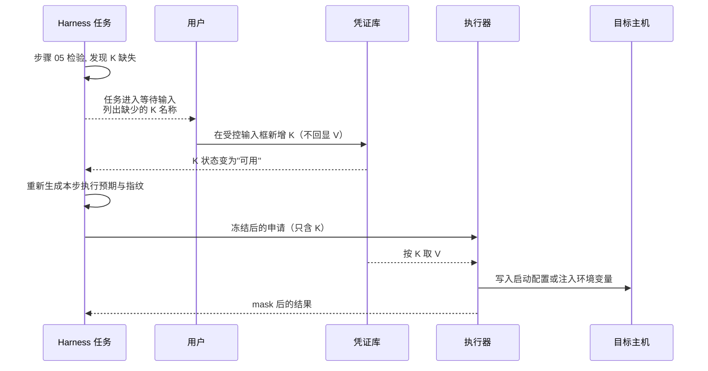
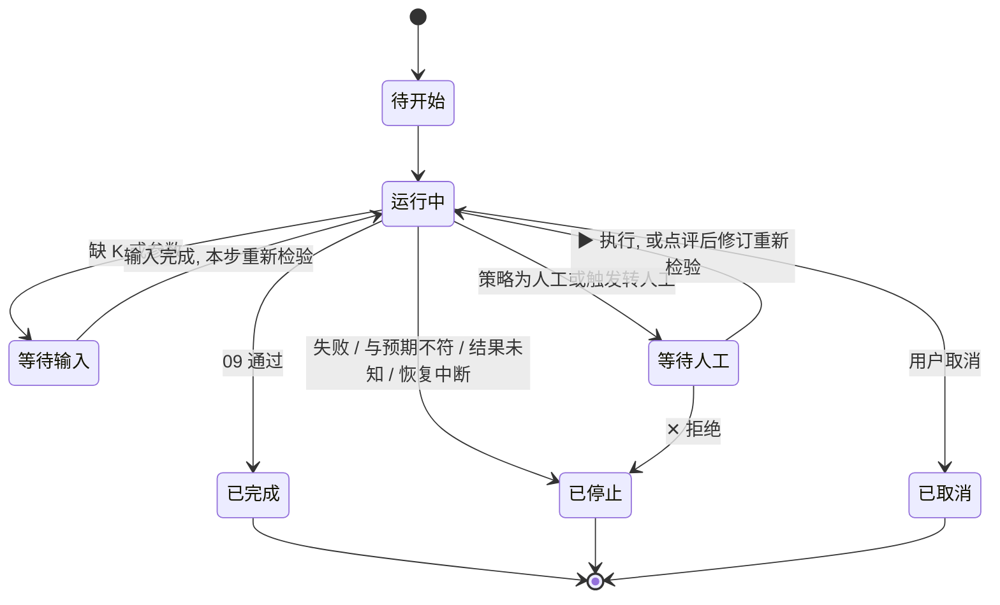

# 项目部署

## 1. 定位

- 项目部署 = 运行一个已登记部署规程包里的既定任务（见 [既定任务](../20-execution/23-harness-tasks.md)）。
- "一键部署"就是：选规程包和版本、确认本次参数、触发任务。一键只简化发起，不跳过检验（K-01）。
- Agent 负责引导对话、整理参数、发起任务、看进度、分析结果。Agent 不能跳步，也不能改步骤内容。
- 本文只讲项目应用的部署。部署平台自身见 [部署底座](../10-architecture/12-deployment-substrate.md)。
- 首版由平台自带的限域状态机编排部署任务（Q15）。

## 2. 检验阶段与执行阶段

部署沿用"先检验，再执行"（K-01）。每一步都有自己的执行申请，各自完成检验再执行。

| 维度 | 检验阶段 | 执行阶段 |
|---|---|---|
| 目标 | 明确本次规程包版本、参数、目标、事实和验收标准。 | 按检验通过的内容逐步执行。 |
| 对话 | 首次形成规程包时多轮提问，保存已答问题和待确认项。复用规程包时只确认本次参数和变化，缺必需信息就补问。 | 展示每步状态和结果。需要人工输入（例如缺少的 K）时暂停，输入后受影响的步骤重新检验。 |
| 输入与事实 | 按参数 schema 核验项目、环境、目标稳定 ID、制品、配置、所需 K 的状态和关键事实，形成本次部署清单。 | 只用本次检验过的输入。目录、内容、参数、配置或目标变化时，停止相关步骤并重新检验。 |
| 每步检验 | 生成执行预期（K-03），有原生预演就跑，采集指纹（K-04），过 dcg，按策略判定（K-06、K-07）。 | 冻结后执行器重算指纹，一致才执行，执行后对比实际与预期。 |
| 产物 | 需求确认、事实证据、部署清单、每步执行预期与预演结果、策略判定、人工审核记录。 | 每步状态、mask 后的输出、实际健康结果、事实更新、审计。 |
| 失败 | 补证据或改参数，再重新检验。当前申请不能执行。 | 停止后续步骤，核对目标现状，按规程包的补偿步骤处理（第 9 节）。 |

### 2.1 进入执行阶段的条件

- **需求明确**：项目、环境、目标、规程包版本、参数和验收标准都已确定。必需的待确认项为空。关键事实有效、没有冲突（K-27）。
- **本步检验完成**：执行预期齐全；有原生预演的已运行并附结果；指纹已采集；dcg 已检查。Bash 里调用 SQL 时，Bash 和 SQL 两部分都已检验（见 [SQL](../20-execution/24-sql.md) 第 6 节）。
- **策略通过**：策略判定为自动，或人工已对当前修订点了 ▶ 执行。转人工条件见 K-08。
- **K 齐全**：本步需要的 K 状态都是"可用"。

## 3. 部署规程包

部署规程包是一种规程包（见 [既定任务](../20-execution/23-harness-tasks.md) 第 4 节），以 procedure_id、版本和内容摘要定位。部署类规程包另外包含：

| 内容 | 说明 |
|---|---|
| 部署模板 | 本类部署的参数和步骤描述，字段见第 7 节。 |
| 布局规则 | 文件名、文件类型、INI 字段到批准目录的映射规则及版本。 |
| 派生适配器 | 本项目使用的制品获取、布局、配置解析、健康检查、服务注册适配器及版本（第 8 节）。 |
| 启动定义 | 运行用户、工作目录、启动命令、环境变量名（对应 K）、重启策略。 |
| 健康判据 | 日志判据、就绪检查、观察期长度。 |
| 监控要求 | 部署完成后需要接入监控旁路的指标和检查。 |
| 恢复步骤 | 每一步失败时可选用的补偿步骤。 |

### 3.1 首次形成

1. 多轮对话确定方法、参数范围和必需输入。
2. 候选脚本和适配器先登记，固定版本（K-20）。
3. 需要时在测试环境试部署。试部署本身是执行，每一步先检验（K-02）。
4. 用户审核方法、范围、依赖、失败处理和试部署证据，然后登记规程包。可以选配独立审核模型给附加意见（K-12）。

登记记录保存审核状态、适用范围和验证证据。每次部署的执行记录、对话和审核记录保存在规程包外，以引用关联。

### 3.2 固定的是什么

- 固定的是部署方法和允许的参数范围。
- 在参数范围内选用新的制品版本，不需要新版本规程包，只需要本次检验。
- 规程包的登记不代替每次运行的检验。

### 3.3 方法变更

下列变化超出原规程包时，建立新版本草稿并重新审核（K-21）：

| 变化 | 例子 |
|---|---|
| 目录映射 | 新增一类文件、改变安装目录 |
| INI 语义 | 新增字段含义、改变字段到路径的映射 |
| 启动定义 | 改启动命令、运行用户、重启策略 |
| 运行身份与权限 | 改用户、组或目录权限 |
| 适配器 | 换适配器或升级适配器版本、新增格式的派生处理器 |
| 健康判据 | 改就绪检查或观察期 |
| 恢复方法 | 新增或改变补偿步骤 |
| 参数范围 | 参数超出原 schema 允许的范围 |

规则：

- 参数范围内的变化只重新检验本次输入，规程包版本不变。
- 新草稿继承现有规程和证据，只追问变化和未定事项。
- 在途任务继续用原版本（K-21）。
- 规程包依赖的资产被停用或失效时，暂停依赖它的新运行，并在工作台提示。
- 修订草稿不会自动改动正在运行的服务。服务变更是一次新的部署运行。

## 4. 九步流程：OSS 制品到 systemd 服务

本例是 Linux VM 上的应用进程部署。每次部署固定制品、配置和步骤版本。人工输入、步骤证据和当前状态持久保存，Agent 对话中断不会丢失部署进度。

图中只画了三条失败线，实际上每一步都一样处理。

### 4.1 每步的执行者、产物和通过条件

| 步骤 | 执行者与产物 | 通过条件 | 失败处理 |
|---|---|---|---|
| 01 固定部署输入 | 用户指定项目、环境、目标和制品版本。Agent 整理部署清单：规程包版本、对象位置与可信摘要、布局规则版本、运行身份、配置、所需 K、启动定义、健康判据。 | 清单字段齐全；目标有稳定 ID；适配器和脚本均为已登记版本。 | 必需信息缺失时暂停补问。 |
| 02 下载 OSS 制品 | 执行器通过已登记的对象存储适配器下载到版本化暂存目录，保存对象身份、版本、摘要和来源（见 [云服务商](35-cloud-providers.md) 第 7 节）。 | 内容摘要与可信清单一致。不接受未固定的"最新文件"。 | 下载不完整或摘要不符：停止，清理暂存目录作为补偿。 |
| 03 文件与 INI 归类 | 布局处理器按文件名、文件类型和已登记的 INI 字段生成目录映射清单。执行器按清单准备候选版本目录。 | 映射只用批准根目录内的路径。 | 路径逃逸、未知文件或映射冲突：明确报错并停止。INI 只作为数据解析，不能注入命令或外部路径。 |
| 04 运行身份与权限 | 执行器核验或创建服务用户和组，设置目录与文件权限，保存差异记录。 | 代码和配置默认不允许服务用户修改；日志和业务数据只用指定的可写目录。 | 用户、目录或权限与清单不符：停止。 |
| 05 人工新增 K 与连通配置 | 缺 K 时任务进入"等待输入"，用户在凭证库新增 K。执行器按 K 取 V 写入启动配置或注入环境变量；非敏感连接参数进入版本化配置（第 5 节）。 | 所需 K 全部可用；配置差异只显示 K。 | V 不进入对话、制品、执行预期或审计。写入失败：停止，恢复旧配置。 |
| 06 基本检查 | 执行器按固定版本的检查项核验依赖、CPU 架构、配置、目录权限、磁盘空间、端口和允许的外部连接。 | 全部必需检查通过才允许试启动。检查里的数据库查询按 [SQL](../20-execution/24-sql.md) 检验。 | 任一必需检查不通过：停止，报告具体项。 |
| 07 试启动 | 执行器用候选版本、固定运行用户、工作目录、配置和 K 启动应用，收集 mask 后的 stdout/stderr、退出状态、就绪结果和观察期证据。 | 日志判据、就绪检查和观察期一起通过。不能只凭一条"启动成功"输出。 | 停止试运行进程，不进入 08。启动过程中的数据库变更见第 4.3 节。 |
| 08 停止试运行并注册系统服务 | 执行器先确认试运行进程已停止，再通过服务注册适配器写入 unit 文件，启用并启动同一候选版本。 | 启动定义、用户、工作目录、制品和配置版本与 07 相同。试运行和正式服务不争用同一实例或端口。 | 恢复旧 unit 和旧版本（规程包里的补偿步骤）。 |
| 09 正式服务验收 | 执行器核验服务状态和应用健康。把主机、版本、配置、服务身份和依赖写入事实地图，按监控要求提交监控接入申请。 | 正式服务健康通过后才记"部署完成"。"服务已注册"不等于部署成功（K-05）。 | 记录实际状态，停止，等用户决定补偿。监控旁路照常告警。 |

08 会签发服务重启的预授权（第 6 节）。签发预授权要经过人工审核（见 [审核与策略](../20-execution/22-review-and-policy.md) 第 7 节），所以 08 是人工步骤：审核界面显示 07 的试启动证据和启动定义，用户看过后点 ▶ 执行（是否允许按模板自动签发，见 Q17）。

### 4.2 每步的检验要点

| 步骤 | 读写类别 | 原生预演 | 指纹 | 可逆性 |
|---|---|---|---|---|
| 01 | 只读 | 不需要 | 目标主机与现有服务的基线状态 | — |
| 02 | 写入（暂存目录） | 查询对象元数据，核对版本、大小、ETag 与清单一致 | 暂存目录状态；对象版本与 ETag | 可逆：删除暂存目录 |
| 03 | 写入 | 布局处理器只生成映射清单，不写文件；用 rsync 时加 `-n` | 目标目录树与文件哈希 | 可逆：候选目录独立，旧版本保留 |
| 04 | 权限变更 | 生成当前与期望的用户、组、属主、权限差异清单 | 用户与组；目录属主与权限 | 可逆：按差异记录回退 |
| 05 | 写入（含密钥文件） | 配置差异，只显示 K | 配置文件哈希 | 可逆：旧配置保留 |
| 06 | 只读 | 不需要 | 检查时的状态 | — |
| 07 | 启停 | 无 | 端口占用、同名进程、服务状态 | 只启动进程时可逆（停止进程）；会改数据库时见 4.3 |
| 08 | 启停、写入 | unit 文件差异。`systemd-analyze verify` 只是静态校验，不算预演 | unit 状态、启动定义摘要、主进程 PID | 可逆：停用并恢复旧 unit |
| 09 | 只读（写事实地图由平台完成） | 不需要 | 服务状态与版本 | — |

读写类别、预演方式和指纹方法都写在执行单元的登记信息里（见 [工具包装](../20-execution/26-tool-wrapping.md)），不由 Agent 临时决定。

### 4.3 启动过程中的数据库变更

有些应用在启动时自动做数据库迁移。这会让试启动变成对数据库的不可逆操作（Q18）。

- 规程包应把数据库迁移拆成独立步骤，由 SQL 执行器或已登记的迁移命令运行，按 [SQL](../20-execution/24-sql.md) 逐次检验。启动定义里关闭应用自带的自动迁移。
- 做不到时，07 的执行预期必须写明"启动会变更数据库"，可逆性记为不可逆。没有原生预演时按 K-08 转人工。
- 启动、停止、重载和清理钩子（如 `ExecStartPre`、`ExecStop`）里的命令和 SQL，在登记启动定义时一并审核。

## 5. 人工新增 K，执行器注入 V

规则（见 [密钥](../20-execution/25-secrets.md)）：

- 规程包的参数 schema 声明需要哪些 K，以及注入的环境变量名或写入的配置项。
- K 由人工新增，不经过 Agent。Agent 只能提示用户缺哪些 K（K-16）。
- 写入 V 的配置文件登记为"含密钥文件"。Agent 读取这类文件会转人工。
- 非敏感的连接参数（主机、端口、库名）进入版本化配置，可以在执行预期里显示。
- K 新增或修改后，等待中的步骤重新生成执行预期和指纹，再继续。
- 执行输出按 mask 规则处理（K-17）。

## 6. 服务重启与预授权

系统服务的崩溃重启不经过平台，用预授权（K-11）。

| 项 | 做法 |
|---|---|
| 预授权的内容 | 08 步注册的启动定义，包括 `Restart=on-failure`、重启间隔（`RestartSec`）和次数上限（`StartLimitIntervalSec`、`StartLimitBurst`）。这个启动定义经过 08 的检验和人工审核，本身就是预授权（见 [审核与策略](../20-execution/22-review-and-policy.md) 第 7 节）。 |
| 绑定 | 启动定义的内容摘要、目标稳定 ID、次数上限、时间窗口、有效期。 |
| 运行 | systemd 按启动定义重启，不调用模型，不依赖平台在线。 |
| 达到上限 | systemd 停止重试，监控旁路告警（K-25）。 |
| 开机自启 | `systemctl enable` 在服务策略里单独声明，同样属于预授权。 |
| 定义被改动 | 启动定义的内容摘要变了，预授权就失效。systemd 自己不核对摘要（Q20），所以用一个已登记的只读检查任务定期比对 unit 文件与登记的摘要，不一致时由监控旁路告警。改启动定义是一次新的部署运行。 |
| 重启管理者 | 每个实例只有一个重启管理者：systemd、Supervisor 或 Docker 重启策略三选一。已有 Supervisor 的环境用对应的服务注册适配器；Docker 应用用容器重启策略。 |
| Agent | 不参与服务保活循环。 |

## 7. 部署模板最少字段

| 字段组 | 字段 |
|---|---|
| 范围 | 项目、环境、目标资源稳定 ID |
| 制品 | 对象存储位置（provider、账号、区域、bucket、object key）、对象版本或可信内容摘要 |
| 布局 | 布局规则版本、批准根目录、安装目录、可写目录 |
| 运行身份 | 运行用户、组、目录与文件权限 |
| 配置与密钥 | 配置文件及版本、所需 K 列表、对应的环境变量名或配置项 |
| 网络依赖 | 监听端口、允许的外部连接 |
| 启动定义 | 启动命令、工作目录、启停与重载钩子、重启策略、开机自启 |
| 健康判据 | 日志判据、就绪检查、观察期 |
| 监控要求 | 需要接入的指标和检查 |
| 恢复步骤 | 每一步的补偿步骤 |
| 人工步骤 | 哪些步骤默认人工，及按环境的策略覆盖 |

制品暂存目录和安装目录由执行器管理。Agent 对它们没有写权限。

## 8. 可派生的适配器

项目可以派生下列适配器，只重写对应的业务方法。执行门禁、状态机、mask 和审计由框架固定，派生不能改（K-28）。

| 适配器 | 职责 | 派生例子 | 不能做 |
|---|---|---|---|
| 制品获取与校验 | 定位、下载、核对摘要 | 换成另一个对象存储产品 | 接受未固定的"最新文件"；把含签名的下载地址交给 Agent |
| 文件布局 | 按规则生成目录映射 | 某项目的特殊目录结构 | 写到批准根目录以外 |
| 配置解析 | 解析 INI 等配置，生成映射输入 | 新的配置格式 | 把配置内容当命令执行 |
| 健康检查 | 就绪检查、日志判据 | 某应用的专用健康接口 | 只凭一条日志判定成功 |
| 服务注册 | 生成并注册服务定义 | systemd、Supervisor、Docker | 同一实例设两个重启管理者 |

- 用 Go 的接口和组合实现。派生适配器的方法通过接口调用，契约测试要证明重写确实生效。
- 每个项目的派生文件独立维护，用户登记并固定版本后启用（K-20）。
- 适配器也是执行单元，要按 [工具包装](../20-execution/26-tool-wrapping.md) 声明读写分区、原生预演、指纹方法和执行预期模板。
- 由模板生成的适配器草稿不会自动登记。

## 9. 失败、补偿与恢复

### 9.1 运行记录

每次部署运行保存：任务运行 ID、规程包 ID 与版本、每步的 step_id 和 CallID/Revision、目标与版本、每步状态、证据引用、补偿计划。

### 9.2 运行状态

部署运行使用 [既定任务](../20-execution/23-harness-tasks.md) 第 2.6 节的任务运行状态，不另定义枚举。

"已停止"记录停止原因和停在哪一步。每步的执行申请状态见 [执行模型](../20-execution/21-execution-model.md) 第 8 节。

### 9.3 失败与补偿

- 任一步失败、与预期不符或结果未知：停止后续步骤，保存实际状态和证据（见 [执行模型](../20-execution/21-execution-model.md) 第 7 节）。
- 结果未知时先查询目标实际状态，不盲目重做（K-05）。
- 补偿只用规程包里已登记的补偿步骤。每次补偿都是新的执行申请，先检验再执行。
- 候选制品、旧配置和服务状态分别保存。本地文件回退不等于数据库或远端状态回滚。

### 9.4 恢复即停止

- 核心、Worker、Harness 或执行器重启，以及备份恢复、跨 VM 迁移之后，在途部署标为"已停止（恢复中断）"；中断时正在执行的步骤记为"结果未知"（K-24，见 [状态与恢复](../10-architecture/13-state-and-recovery.md)）。
- 不自动续跑。用户在恢复报告里选择从哪一步重新开始，从该步重新检验。
- 指纹会发现中断期间目标的变化（K-04）。因此重新运行不会在不知情的情况下重复创建用户、覆盖文件或启动第二个进程。
- 已注册的系统服务按预授权继续由 systemd 管理，不受平台恢复影响。

## 10. 平台事件

部署运行状态变化时，由平台产生 `devops.deployment.state_changed`。事件只用于展示和通知，不是授权。平台事件总表见 [事件与 Hook](../40-sdk/45-events-and-hooks.md)。

## 11. 技术依据

- [OSS GetObject 与对象版本](https://www.alibabacloud.com/help/en/oss/developer-reference/getobject)
- [systemd 服务与重启策略](https://github.com/systemd/systemd/blob/main/man/systemd.service.xml)
- [Docker 容器重启策略](https://docs.docker.com/engine/containers/start-containers-automatically/)

具体服务能力按目标运行时的版本核验。

## 12. 未定事项

- Q5：普通重启是否也按"恢复即停止"处理（影响 9.4）。
- Q10：凭证库细节。
- Q15：长流程编排器的选择；首版用平台自带的限域状态机。

见 [待定事项](../00-overview/04-open-questions.md)。
