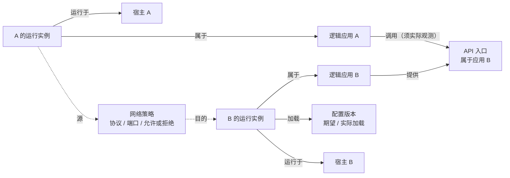

# 运维事实地图

## 1. 定位

事实地图的底层是结构化事实库。系统视图、部署视图和网络视图共用同一份事实。

| 用途 | 说明 |
|---|---|
| 选择目标 | 执行申请的目标用稳定 ID 指定（见 [执行模型](../20-execution/21-execution-model.md) 第 4 节）。 |
| 写执行预期 | Agent 根据事实判断前置条件和影响范围。 |
| 分析影响 | 沿有证据的关系查调用方、下游和依赖。 |
| 项目内问答 | 回答带来源和核验时间（见 [项目工作台](31-project-workbench.md)）。 |

事实是记录，不是授权。执行前的目标状态以指纹为准（K-04），不以事实库为准（见第 9 节）。

## 2. 稳定 ID

| 规则 | 说明 |
|---|---|
| 作用域 | 每个 ID 绑定项目、云服务商、账号或资源管理域、区域和环境。 |
| 唯一身份 | 名称、IP、主机名都只是属性，不能单独作为身份。IP 变化不改变 ID。 |
| 格式 | 由 schema 定义（K-22），形如 `host:vm-demo-01`（示意）。 |
| 厂商 ID | 云资源保存厂商原生资源 ID，作为属性和映射。 |
| 重建 | 厂商原生 ID 变化（例如资源被删除重建）视为新对象。旧对象标为已下线，保留历史。 |
| 重复 | 同一资源出现两个 ID 时标为冲突，由人工确认合并。 |

## 3. 对象

| 对象 | 记录内容 | 主要关系 |
|---|---|---|
| 项目与环境 | 项目 ID、环境定义，以及资料、应用、数据库、脚本版本和调度计划的归属 | 业务对象 → 归属 → 项目；任务 → 指向 → 环境 |
| 宿主 | 云主机、VM 或物理机的稳定 ID、环境、账号、区域、网络接口、负责人 | 实例 → 运行于 → 宿主 |
| 应用与实例 | 逻辑应用 app_id；进程、容器或 Pod 实例的 ID、版本、端口、健康状态 | 实例 → 属于 → 应用 |
| 配置 | 配置来源、期望版本、实际加载版本、mask 后的差异、适用实例 | 实例 → 加载 → 配置版本 |
| API 与入口 | 所属应用、域名、路径、协议、端口、网关映射 | 应用 → 提供 → API；应用 → 调用 → API |
| 网络 | 虚拟私有网络、子网、路由、接口、安全组、防火墙、地址转换、域名解析 | 网关 → 路由到 → 实例；策略 → 允许 → 源/目的 |
| 数据依赖 | 数据库、缓存、队列、外部 API。数据库记录供应商产品、基础类型、派生类型、版本、库和 schema | 应用 → 读写 / 发布 / 订阅 → 依赖 |
| 云产品与能力 | 供应商、产品、API 版本、账号、区域、资源 ID、适配器版本、已核验能力 | 抽象资源 → 映射到 → 厂商产品资源（见 [云服务商](35-cloud-providers.md)） |
| 运维表格 | TableID、脚本与 schema 版本、记录引用 | 表格记录 → 引用 → 事实；记录 → 绑定 → 稳定 ID（见 [运维表格](34-ops-tables.md)） |
| 平台自身 | VM、核心实例、镜像摘要、配置映射、各组件运行状态 | 核心实例 → 部署于 → VM |

## 4. 关系

关系有方向，每条关系都带证据。

| 关系 | 方向 | 能确认它的证据 |
|---|---|---|
| 运行于 | 实例 → 宿主 | 实际观测（主机进程、容器、云资源归属） |
| 属于 | 实例 → 应用 | 部署结果；人工声明 |
| 加载 | 实例 → 配置版本 | 实际观测（已加载版本、加载日志）。配置文件存在不等于已加载。 |
| 提供 | 应用 → API | 配置声明（路由、网关映射）；实际观测 |
| 调用 | 应用 → API | 只有实际观测（API 日志、调用链）能确认 |
| 允许访问 | 网络策略：源 → 目的 | 网络策略本身。不证明可达，也不证明发生过调用 |
| 读写 / 发布 / 订阅 | 应用 → 数据依赖 | 配置声明（连接配置）；实际观测（连接、调用链） |
| 映射到 | 抽象资源 → 厂商资源 | 云 provider 适配器的只读采集 |
| 归属 | 业务对象 → 项目 | 登记记录 |

下图是事实模型示意，不代表已经发现这些资产或调用。A、B 是角色名称。

图里的网络策略是独立记录。它说明规则允许 A 访问 B，不能当作 A 调用了 B 的 API 的证据。

## 5. 每条事实的字段

每个对象、关系和关键属性都是一条事实，带下列字段（K-27）：

| 字段 | 说明 |
|---|---|
| 事实 ID 与版本 | 每次变化产生新版本，旧版本保留。 |
| 主体 | 对象的稳定 ID；或关系的起点 ID、关系类型、终点 ID。 |
| 属性与值 | 敏感值只保存 K 或 mask 后的值（K-16、K-17）。 |
| 作用域 | 项目、环境。 |
| 证据类型 | 配置声明 / 网络策略 / 实际观测 / 人工声明 / 模型推测。 |
| 来源 | 采集器或适配器的 ID 与版本；产生它的执行申请 CallID；人工声明人；提出候选的会话。 |
| 采集时间 | 实际观测或读取的时间，不是入库时间。 |
| 有效期 | 到期后自动变为"过期"。 |
| 证据引用 | 指向原始证据（mask 后）。 |
| 覆盖范围 | 实际观测必填：时间窗口、采样率、已知的丢失。 |
| 核验状态 | 见第 7 节。 |

## 6. 三类证据分开呈现

| 证据类型 | 能说明什么 | 不能说明什么 | 例子 |
|---|---|---|---|
| 配置声明 | 配置里声明了某个依赖或设置 | 实例已经加载了这个版本；依赖真的被使用 | 配置文件写了数据库地址 |
| 网络策略 | 源、目的、协议、端口的允许或拒绝规则 | 端到端可达；曾经发生过调用 | 安全组允许 A 访问 B 的 8080 |
| 实际观测 | 在观测范围内确实发生了什么 | 观测范围以外的情况 | API 日志、调用链、流日志、进程列表 |

规则：

- 视图上三类证据分开显示，不合并成一个结论。
- 只有实际观测能确认"调用"关系。显示调用关系时必须附 API 日志或调用链证据。
- 流日志只记录其观测范围内的流量和处理结果。采样和丢失要写进覆盖范围。
- 指标只说明它测量的东西。CPU 数值不能证明应用之间发生了 API 调用。
- 缺少观测不能推导出"没有依赖"。
- 人工声明和模型推测单独标记。模型可以提出候选关系，但只能由可信采集或人工核验确认。

## 7. 核验状态

| 状态 | 含义 |
|---|---|
| 已核验 | 可信采集或人工核验确认，且在有效期内。 |
| 候选 | 模型推测或单一弱来源，尚未确认。 |
| 待核验 | 曾经核验过，但目标可能被系统外改动，例如系统外应急访问之后（见 [运维入口](37-ops-entrypoints.md) 第 4 节）。等待重新采集。 |
| 过期 | 超过有效期。 |
| 冲突 | 多个来源结论不一致。 |
| 未知 | 没有证据，或本次采集失败。 |

- 未知、过期和冲突要明确显示，不能补成已确认事实（K-27）。
- 缺测记为未知，不填"否"或 0（K-05）。
- 采集失败时保留旧值并标为过期，不清空已有证据。

## 8. 采集方式

### 8.1 来源

| 来源 | 采集什么 | 证据类型 | 方式 |
|---|---|---|---|
| 云 provider 适配器 | 主机、网络、安全组、负载均衡、数据库实例、对象存储 | 配置声明、网络策略 | 执行器运行已登记的只读采集任务（只读区功能，见 [云服务商](35-cloud-providers.md)） |
| 目标主机上的 Docker（经执行器采集） | 容器、镜像 digest、状态、重启次数 | 实际观测 | 同上 |
| 主机与服务 | systemd unit、进程、端口、软件包版本 | 实际观测 | 同上 |
| 配置适配器 | 配置文件版本、哈希、mask 后的差异 | 配置声明 | 同上 |
| 网关与路由适配器 | 域名、路径、网关映射 | 配置声明 | 同上 |
| 监控旁路 | 指标、检查结果、监控模块输出 | 实际观测 | 事实服务通过旁路的只读查询接口拉取 |
| API 日志、调用链、流日志 | 调用关系、流量 | 实际观测 | 接入已有存储，只读查询 |
| 部署结果 | 实例、版本、服务身份、配置版本、依赖 | 实际观测 | 部署第 09 步的执行结果（见 [项目部署](32-project-deployment.md)） |
| 人工 | 负责人、用途等 | 人工声明 | 工作台受控输入 |
| Agent | 候选关系 | 模型推测 | 只能提为候选 |

### 8.2 规则

- 采集是一次只读执行，走执行模型（K-01）。采集任务登记为既定任务或命令模板，只读区默认自动（K-07）。
- 采集可以由持久调度服务周期触发，也可以由人工或 Agent 发起。
- 只用已登记的只读工具和功能（K-20）。
- 敏感配置在入库前 mask（K-17）。事实库只保存 K，不保存 V。
- 监控旁路不直接写事实库，也不等待事实库（K-25）。事实服务从旁路拉取，保留旁路的证据引用（Q22）。
- 来源冲突、采集失败和过期值必须可见。

## 9. 与执行门禁的关系

| 环节 | 做法 |
|---|---|
| 写执行预期 | Agent 根据事实选择目标、判断前置条件和影响范围。执行申请记录目标稳定 ID、事实版本和配置版本。 |
| 关键事实有问题 | 关键事实未知、过期或冲突时，Agent 先发起只读补采或请用户核验，不能当作已确认事实写进执行预期。 |
| 执行前核验 | 以执行器重算的指纹为准（K-04）。事实库可能过期，指纹是执行时的实际状态。 |
| 执行之后 | 执行结果可以更新事实，来源记为该执行申请的 CallID。结果未知时不更新为确认值（K-05）。 |
| 审计 | 执行申请引用的事实版本和执行前的核验结果都进入审计。 |

## 10. 查询与筛选

- 按项目、环境、供应商、宿主、应用、证据类型、核验状态筛选。
- 查询遵守项目和环境的访问范围。
- 选择一个 API：沿有实际观测证据的调用关系，查调用方和下游。只有配置声明或网络策略的关系单独列出。
- 选择一个实例：追溯宿主、加载的配置和相关网络策略。
- 关系详情显示证据、时间窗口、覆盖范围和事实版本。
- Agent 通过只读工具查询，回答中带来源和时间。

## 11. 写入与历史

- 只有核心容器里的事实服务写事实库。输入来自：执行器的采集结果、部署结果、从监控旁路拉取的观测、工作台的人工声明、Agent 的候选。
- Agent 不能直接写"已核验"的事实。
- 事实库保留全部变更历史。恢复后事实保留，新鲜度按原采集时间显示（见 [状态与恢复](../10-architecture/13-state-and-recovery.md)）。

## 12. 平台事件

事实服务产生 `devops.fact.updated`、`devops.fact.expired`、`devops.fact.conflict`。事件只用于展示和通知，不是授权，也不代替事实库。平台事件总表见 [事件与 Hook](../40-sdk/45-events-and-hooks.md)。

## 13. 技术依据

- [AWS 安全组规则](https://docs.aws.amazon.com/vpc/latest/userguide/vpc-security-groups.html)：说明网络策略只描述允许或拒绝。
- [AWS 流日志字段](https://docs.aws.amazon.com/vpc/latest/userguide/flow-log-records.html)：说明流日志的观测范围。
- [OpenTelemetry 采样](https://opentelemetry.io/docs/concepts/sampling/)：说明调用链有采样，覆盖范围要标明。
