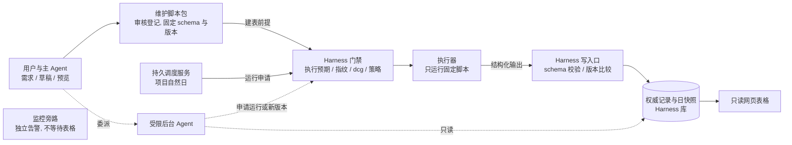
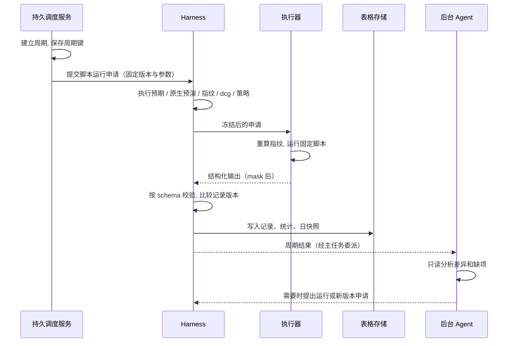

# 运维表格

> **雏形。** 本功能尚未实现。已确定的是：脚本准入、写入边界和自然日维护方式。具体字段、页面组件和数据源在项目接入时再定。维护脚本包登记之前，页面预览只用样例数据，不建真实表格。

## 1. 定位

运维表格是项目工作台里的通用结构化表格。

- 支持自定义列、排序、筛选、分组、计数和数值汇总。
- 可以用来记录机器属性、容量、配额、部署任务、到期事项等。证书只是其中一个例子。
- 用户通过对话说明：记录什么对象、要哪些字段、数据从哪来、要什么统计。

## 2. 两条核心规则

| 规则 | 说明 |
|---|---|
| 脚本先行 | 没有已登记的维护脚本包，就不能建表。脚本包定义字段 schema、数据来源、计算和更新规则（K-20）。 |
| Harness 持有字段和写入口 | 表格建立后，字段定义和写入口归 Harness。执行器运行固定脚本，脚本的结构化输出由 Harness 按 schema 校验后写入。 |

没有后门：

- Agent、页面和核心容器都不能通过 SQL、文件、HTML、页面编辑接口或其他工具直接改表。
- 人工补录也是维护脚本的一个受控输入，经过同一个写入口。
- 没有已登记脚本、脚本与 schema 不匹配、或本次检验不通过时，不能建表，也不能更新。

实线是固定脚本维护链路，虚线是后台分析和申请。监控旁路独立运行，不等待日维护或 Agent（K-25）。

## 3. 组成

| 部分 | 固定内容 | 控制 |
|---|---|---|
| 字段定义（schema） | 表和列的定义，见第 4 节。 | 自定义列先成为待审核定义。Harness 按固定 schema 校验。Agent 不能临时加字段，也不能登记可执行公式。 |
| 维护脚本包 | 建表、采集、归一、计算、行增删改、日快照和统计规则，见第 5 节。 | 登记前审查完整脚本和测试证据，固定版本和摘要。 |
| 结构化记录 | 稳定 RecordID、资源稳定 ID、类型化的值、来源引用、观测时间、核验状态、记录版本、日快照。 | 只由固定脚本维护，见第 6 节。 |
| 统计与页面 | 当前视图、日期快照、排序、筛选、分组、行数、按资源去重计数、枚举分布、同单位数值汇总。 | 统计由已登记脚本或固定查询规则计算，见第 6 节。 |
| Agent 与输入 | 对话设计、只读分析、异常解释、脚本运行申请、脚本新版本申请、人工输入的非敏感备注。 | 输入必须符合固定参数和来源规则，经同一写入口。密钥只显示 K 和备注（K-16）。 |

## 4. 字段定义（schema）

schema 用版本化定义固定（K-22），保存在 Harness 库。

### 4.1 表级

| 字段 | 说明 |
|---|---|
| TableID | 稳定的表编号 |
| 范围 | 项目、环境 |
| schema 版本 | 每次字段或规则变化加一 |
| 维护脚本包 | 绑定的脚本包 ID、版本和摘要 |
| 记录稳定键 | 一行代表什么，例如"一台机器"或"一个证书绑定" |
| 维护责任 | 负责的人 |

### 4.2 列级

| 字段 | 说明 |
|---|---|
| 列 ID、名称 | 列 ID 稳定，名称可读 |
| 类型 | 文本、数值、布尔、日期、时间、结构化引用（指向稳定 ID） |
| 枚举 | 允许的取值 |
| 单位 | 数值列必须有单位 |
| 空值与未知语义 | 区分"没有值"和"不知道"。未知不能填"否"或 0（K-05） |
| 来源 | 采集器、事实、人工声明、计算 |
| 观测时间 | 每个值的实际观测时间 |
| 有效期 | 超过后标为过期 |

## 5. 维护脚本包

维护脚本包按规程包的方式登记（见 [既定任务](../20-execution/23-harness-tasks.md) 第 4 节）。

| 内容 | 说明 |
|---|---|
| 建表与初始化 | 首次采集和初始记录 |
| 采集 | 从哪些已登记的只读工具或功能取数据 |
| 归一与计算 | 单位换算、派生字段、去重规则 |
| 行增删改规则 | 什么时候新增、修改、标记下线一行 |
| 日快照 | 每个业务日保存什么 |
| 统计规则 | 分组、计数、汇总的口径 |
| 参数约束与目标范围 | 参数类型和范围；可以访问哪些目标 |
| 依赖 | 运行环境、库、工具版本 |
| schema 兼容版本 | 脚本输出对应哪个 schema 版本 |
| 执行预期模板、原生预演、指纹方法 | 见 [执行模型](../20-execution/21-execution-model.md) |
| 恢复方案 | 失败后如何处理 |

规则：

- 数据来源只能是已登记的只读工具和功能。
- 脚本对项目目标库发出的 SQL（例如统计查询），每次执行都按 [SQL](../20-execution/24-sql.md) 检验。
- 脚本不直接向表格存储发 SQL。脚本输出符合 schema 的结构化记录，由 Harness 写入口写入。写入口使用平台自身的固定 SQL，在构建期分析（K-23）。
- 例行脚本不能夹带新字段、任意 SQL 或资产操作。签发、安装、切换等操作另建任务。
- Harness 写入口提供"只校验不写入"模式（写入路径见 Q21）：按 schema 校验脚本输出，给出将新增、修改、标记下线的记录数和字段差异。这是表格写入的原生预演（K-03）。
- 表格写入的指纹是当前记录版本和 schema 版本（K-04）。

## 6. 记录、统计与页面规则

### 6.1 记录

- 每行有稳定 RecordID，并绑定资源的稳定 ID（见 [事实地图](33-fact-map.md)）。
- 实际观测的值引用事实证据。人工声明和 Agent 推测分开标记。
- 缺测时保留"未知"，或保留旧值并标为过期。不能清空已有证据，也不能改成"否"（K-05、K-27）。

### 6.2 统计

- 统计结果注明：筛选条件、业务日或时间窗口、去重依据、单位、脚本与 schema 版本。
- 未知值单独计数，不能当作 0。
- 不同单位的数值不能相加。
- 行数和资源数分开统计。同一机器有多条记录时，行数不等于机器数。

### 6.3 页面

- 页面只读。
- 分别显示：业务日、页面生成时间、任务完成时间、最后成功时间、各字段的实际观测时间。
- 维护失败时保留最后有效的页面，不能只把日期改成今天。
- 来源文本做转义；访问限于项目和环境范围。
- 用户可以查看字段证据，并通过主 Agent 提出新的任务。

## 7. 建立、更新和字段变更

| 步骤 | 做法 |
|---|---|
| 1 整理需求 | 主 Agent 和用户确定记录对象、稳定键、字段、来源、统计口径、自然日计划和验收标准，起草脚本包和 schema。草稿和页面预览都没有写权限。 |
| 2 审核登记脚本包 | 用户审核 schema、脚本全文、依赖、范围、执行预期模板、原生预演、样例输出和恢复方案，然后登记，固定版本和摘要（K-20）。可选配独立审核模型（K-12）。登记是准入，不是对以后每次运行的批准。 |
| 3 建表 | 运行已登记的建表脚本，是一次执行申请。绑定项目、环境、TableID、脚本摘要、schema 版本、参数和目标。按策略判定；建议设为人工，用户看过"只校验不写入"的结果后点 ▶ 执行。 |
| 4 日常更新 | 持久调度服务或 Agent 提交脚本运行申请。已登记脚本按策略执行，默认自动；每步仍做执行预期对比、指纹核验和 dcg（见 [既定任务](../20-execution/23-harness-tasks.md) 第 2.5 节）。 |
| 5 字段和规则变更 | 增删列，改名称、类型、默认值、来源、唯一键、计算方法或统计口径，都要新的脚本和 schema 版本（K-21）。提供字段差异、兼容影响、迁移预演、历史数据处理和恢复方案。审核登记后才能切换。 |

规则：

- Harness 在写入前和发布前按 schema 校验。脚本写入未批准的字段、改变规则或扩大范围时，拒绝写入并记入审计。
- 新版本不影响在途运行（K-21）。旧版本的记录和快照保持可追溯。
- 按已登记规则做的例行行增删改，不算改结构。

## 8. 样例

以下数据全部虚构，只用于说明页面。不代表服务、脚本或资源已经存在。

**机器属性表 · 项目 demo / 测试环境**

业务日：2026-10-05 · 时区：Asia/Shanghai · 维护：完成且有缺项 · schema v3 / 脚本 v5 / 记录 v7

筛选：测试环境全部记录 · 行数 3 · 去重机器 3 · 已核验运行中 2 · 运行状态未知 1 · 已知内存合计 48 GiB，内存未知 1

| 机器 ID | 属性系列 | 负责人 | 运行状态 | 内存（GiB） | 来源与新鲜度 |
|---|---|---|---|---|---|
| vm-demo-01 | API 服务 | 应用组 | 已核验：运行中 | 16 | 固定采集器，2026-10-05 09:05；负责人为人工声明 |
| vm-demo-02 | API 服务 | 应用组 | 已核验：运行中 | 32 | 固定采集器，2026-10-05 09:05；负责人为人工声明 |
| vm-demo-03 | 批处理 | 未知 | 未知：本日未采集成功 | 未知 | 资源 ID 来自已登记清单；缺测没有记为停机或 0 |

分组示例：API 服务 2 台，批处理 1 台。

"日维护完成"表示已按规则处理了数据和缺项，不表示所有字段都已核验。

可选范例：证书字段如何组织

证书只是一种表格用途，不限于 SSL 证书。下面按 X.509 证书说明。证书对象和实际部署绑定分开保存；一张证书被多个入口使用时，共用证书信息，按绑定键展示和统计。

| 字段组 | 示例与边界 |
|---|---|
| 机器与实际证书 | 宿主 ID、属性系列、应用、入口、用途、负责人；CertificateID、指纹、签发者、NotBefore、NotAfter。证书时间来自证书解析。签发得到的证书和入口实际使用的证书分别核验。 |
| 采购与服务权益 | 订单、服务开始和结束、额度、重新签发规则及来源。购买一年和每张证书的有效期分开记。"180 天一签"只是某些供应商的待核验规则，不是通用期限。 |
| 预备项 | 保留供应商的原始叫法，再区分待签权益、待签请求、已签发未部署的证书。有购买权益不能推出已有备用证书；含义没核验就标未知。 |
| 自动化能力 | 自动签发和自动部署分别记录：支持 / 不支持 / 未知、是否启用、前置条件。签发成功不等于部署完成；没到期不能证明信任链、用途和服务健康。 |
| 证据与密钥 | 每个字段保存来源、观测时间、有效期和核验状态。私钥、账户密钥、DNS 或 API 凭证都按 K→V 处理（K-16），只在执行器内使用。页面、Agent、用户、Hook 和摘要只看到 K。 |

维护脚本只处理这张表的数据。签发、安装、切换和服务验收各自另建任务，不能夹带在日维护或补跑里。

字段依据：[RFC 5280 证书有效期](https://www.rfc-editor.org/rfc/rfc5280.html#section-4.1.2.5)、[Go Certificate 字段](https://pkg.go.dev/crypto/x509#Certificate)、[RFC 8555 证书签发](https://www.rfc-editor.org/rfc/rfc8555.html#section-7.4)。

## 9. 按自然日运行固定脚本

### 9.1 自然日

- 项目登记一个 IANA 时区，例如 `Asia/Shanghai`。
- 自然日是该时区当天 00:00 到次日 00:00。
- 计划记录当地日期、时区数据版本和对应的 UTC 起止时间。
- 夏令时地区的自然日可能是 23 或 25 小时。不能用连续 24 小时或 Worker 所在机器的日期代替。
- 时间表达式和时区解析的依赖选型见 [Go 技术选型](../50-engineering/51-go-stack.md)。

### 9.2 角色

| 角色 | 职责 | 边界 |
|---|---|---|
| 主 Agent | 和用户确定范围、维护目标、脚本和计划草稿；管理后台分析任务；提出启用、修订、暂停或取消的申请。 | 不能直接改表、登记资产、扩大权限，也不能批准任何执行申请。 |
| 持久调度服务 | 保存计划：脚本版本、参数约束、时区、周期、触发时刻、截止时间和补跑策略。按周期提交脚本运行申请。 | 不授予执行权，不跳过门禁。业务 Agent 离线时照常提交。 |
| Harness | 持有 schema 和写入口；对每次运行走执行门禁；校验并写入脚本输出。 | 登记过的脚本也要逐次走门禁（K-01）。 |
| 执行器 | 执行前重算指纹；只运行冻结的固定脚本；保存 mask 后的输出。 | 不能运行未冻结或摘要不符的内容。 |
| 受限后台 Agent | 只读分析新旧快照和事实，解释差异，追踪缺项，申请运行固定脚本或提出新版本，向主任务汇报。 | 限定项目、环境、工具、期限、并发和预算。输出是建议或申请，不是事实，不能直接写入。它停机不影响调度。 |
| 页面与监控旁路 | 页面按范围展示当前视图、日快照和字段证据。旁路独立采集、计算规则和告警。 | 日维护失败时保留最后有效数据。旁路按自己的证据及时告警，不等待表格更新或后台分析（K-25）。 |

后台 Agent 在独立的 Agent Worker 中运行，使用 GoAgent SDK，通过 ParentRunID 关联主任务（见 [SDK 概览](../40-sdk/41-sdk-overview.md)）。Hermes 的后台任务机制只是设计参考。

### 9.3 运行步骤

| 步骤 | 做法 |
|---|---|
| 1 登记维护计划 | 绑定项目、环境、TableID、ScheduleID、维护脚本包（每次触发取当前启用版本，见 [既定任务](../20-execution/23-harness-tasks.md) 第 2.7 节；切换版本前核对与表格 schema 兼容）、参数约束、时区、触发时刻、截止时间、补跑策略、后台分析的工具与预算。计划变更建立新版本（K-21）。 |
| 2 建立周期 | 首版每个维护计划每天一轮。周期键 = 项目 + 环境 + TableID + ScheduleID + 当地日期。脚本版本是运行元数据，不进周期键，换版本不会让同一天多出一轮。先保存周期，再提交申请。 |
| 3 门禁 | Harness 按 [执行模型](../20-execution/21-execution-model.md) 处理本次申请。已登记脚本按策略执行，默认自动。转人工条件仍然生效（K-08）。 |
| 4 执行与写入 | 执行器运行固定脚本。来源缺失时保留未知或旧值并标为过期。Harness 校验通过后保存记录、统计、日快照和审计，再发布只读页面和平台事件。 |
| 5 分析 | 后台 Agent 整理差异和缺项，向主任务汇报。修复、部署或签发另行申请，不随表格更新自动执行。 |

### 9.4 周期状态

| 状态 | 含义 |
|---|---|
| 待运行 | 周期已建立，未到触发时刻 |
| 运行中 | 已提交，正在执行 |
| 待人工 | 策略或转人工条件要求人工审核 |
| 完成 | 全部步骤成功 |
| 完成且有缺项 | 步骤成功，但部分字段未采集到 |
| 失败 | 执行报错、与预期不符或被拒绝 |
| 结果未知 | 无法确认实际结果，等人工核对 |
| 漏跑 | 截止时间前没有运行 |
| 已暂停 | 计划被暂停 |
| 已停止（恢复中断） | 因恢复而停止（K-24） |

每个计划显示最后成功时间。最后成功时间也提供给监控旁路，超过截止时间未完成时由旁路告警（见 [监控](36-monitoring.md)）。

### 9.5 并发与重复

- 首版同一计划的运行不重叠。
- 周期键有持久唯一约束，同一周期不会重复提交。
- 写入用记录版本比较（CAS），防止并发覆盖。迟到的结果不能覆盖较新的记录（见 [状态与恢复](../10-architecture/13-state-and-recovery.md) 第 3 节）。
- 执行器开始执行前先持久保存"开始执行"记录。结果未知时先查询实际状态（K-05）。

### 9.6 漏跑、补跑和人工刷新

- 漏跑按登记的补跑策略处理：有界补跑，或跳过并记录原因。
- 补跑和人工刷新都是新的运行，关联原周期，逐次检验。不覆盖原运行的记录。

### 9.7 暂停、取消和撤销

- 暂停、取消和撤销通过持久的控制记录生效。
- 接受申请前、提交执行前、发布结果前，都核对当前控制版本。失效就停止后续申请和提交。
- 已经提交的外部操作先核对实际结果。取消不等于远端回滚。
- 切换脚本版本、同日修订和迁移时，保留旧记录和当时的统计口径。

### 9.8 恢复

- 恢复后，在途周期标为"已停止（恢复中断）"，正在执行的记为"结果未知"（K-24）。
- 维护计划全部暂停，等人工一键恢复（Q4）。恢复报告列出漏跑的周期。
- 用户恢复计划后，漏跑周期按补跑策略处理。重新运行从头检验。

### 9.9 业务 Agent 离线与检验未通过

以下状态均为虚构示例。

| 页面信息 | 主 / 后台 Agent 离线 | 检验未通过或脚本失败 |
|---|---|---|
| 本日维护 | 持久调度服务照常提交固定脚本；按策略执行，成功就正常更新。 | 停在该步：转人工时等人工；指纹不一致或结果与预期不符时停止并上报。不能直接写入或跳过检验。 |
| 快照与分析 | 有本日快照；后台分析等 Agent 恢复后再做。 | 保留最后有效快照及其原日期；本日状态单独显示。 |
| 字段新鲜度 | 按真实采集时间显示，未知单列。 | 旧数据、未知、过期明确标记；缺测不记为"无变化"。 |
| 监控告警 | 旁路照常采集和通知。 | 旁路照常；对超期未完成的维护计划告警。 |

日维护的检验链（执行预期对比、指纹、dcg、策略）都是确定性的本地检查，不调用模型。所以业务 Agent 离线不影响日维护。

## 10. 存储与边界

| 部分 | 位置 |
|---|---|
| 展示、查询、运行申请接口 | 核心容器 |
| 权威 schema、脚本登记、写入口、记录、统计、日快照 | Harness 权限域，Harness 库（见 [状态与恢复](../10-architecture/13-state-and-recovery.md)） |
| 周期、计划、预算 | 持久调度服务 |
| 后台分析 | Agent Worker，只读 |

核心容器和 Agent 没有直接写权限（见 [组件与边界](../10-architecture/11-components-and-boundaries.md)）。GoAgent SDK 复用已有的子 Agent、受控工具和事件契约，不持有表格写入口。

## 11. 平台事件

- `devops.table.updated`
- `devops.table.daily_cycle.completed`
- `devops.table.daily_cycle.failed`

事件在状态持久保存之后由可信服务产生，包含表格、周期、脚本与 schema 版本和运行引用。事件不代替授权、审计和独立告警。总表见 [事件与 Hook](../40-sdk/45-events-and-hooks.md)。

## 12. 未定事项

- Q4：恢复后调度计划暂停还是照常。
- Q5：普通重启是否也按"恢复即停止"处理。
- Q7：维护脚本中的 SQL 方言不支持时转人工还是阻断。

见 [待定事项](../00-overview/04-open-questions.md)。
