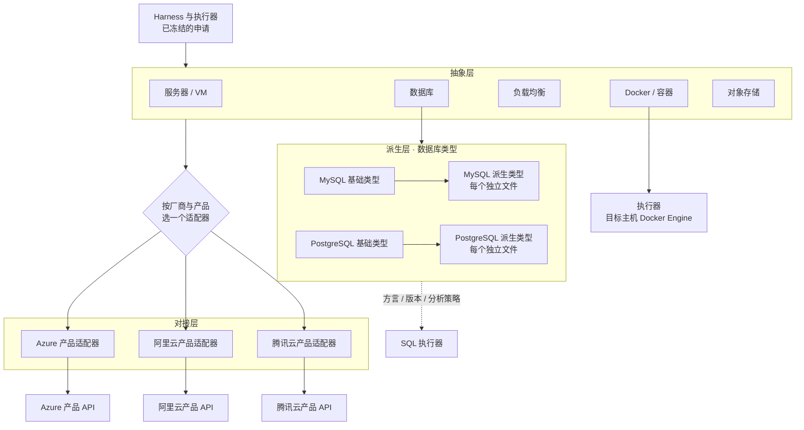

# 云服务商 API 层

## 1. 定位

- 云资源操作面向项目登记的 VM、负载均衡、数据库和对象存储等资产。
- 每次调用按项目、环境、账号、区域和稳定资源 ID 定位（见 [事实地图](33-fact-map.md)）。
- 每个 provider 是一个 tool call 形式的适配器，每个 API 是它的一个功能（见 [工具包装](../20-execution/26-tool-wrapping.md)）。
- 每次调用都走执行模型（K-01）。云凭证只在执行器内注入（K-16、K-18）。
- 首批接入 Azure、阿里云、腾讯云，逐产品扩展。

## 2. 三层结构

| 层 | 职责 | 边界 |
|---|---|---|
| 抽象层 | 定义服务器 / VM、Docker / 容器、负载均衡、数据库、对象存储的统一对象和能力接口。 | 只统一稳定的共同概念。保留产品差异，不虚构厂商没有的能力。 |
| 对接层 | 按厂商和产品调用各自 API，归一可比较的状态、错误和任务标识。 | 每个产品只实现它真正支持的 API。没有提供或没有验证的能力标为不可用。 |
| 派生层 | 适配具体数据库产品和版本：方言、能力、SQL 分析策略。 | 每个派生数据库类型独立维护，分析结果要匹配目标数据库的类型和版本。 |

统一对象模型不表示各厂商的 API、异步任务、状态和错误都一样。



图只表示接口位置，不代表各厂商产品能力都已实现。

## 3. provider schema

每个 provider 的 schema 随适配器一起登记和版本化（K-20、K-21）。它按功能声明读写分区和策略。策略的分层和基本格式见 [审核与策略](../20-execution/22-review-and-policy.md) 第 4 节；本节在那里的示例上补充每个功能的检验信息，不改变已有字段的含义。

### 3.1 每个功能必须声明

| 字段 | 说明 |
|---|---|
| 分区 | 只读区 / 写入区（K-07）。由适配器登记时声明，不由 Agent 判断。 |
| 读写类别 | 只读 / 写入 / 删除 / 权限变更 / 启停 / 计费（购买或释放）。 |
| 可逆性 | 可逆或不可逆；可逆时写回退方法。 |
| 原生预演 | 有没有；参数是什么；怎样算预演通过（第 5 节）。 |
| 指纹 | 取哪些字段，例如资源状态、版本号或 ETag、最后更新时间（K-04）。 |
| 幂等方式 | 例如厂商的 ClientToken。没有就写"无"。 |
| 异步任务 | 是否异步；用哪个查询功能、什么条件算完成。 |
| 结果未知时 | 用哪个只读功能查询实际状态。 |
| 密钥 | 需要哪些 K、注入到哪个参数；哪些输出字段含密钥。 |
| 策略 | `mode` 和 `allow_auto`，可按环境覆盖。 |

### 3.2 示例

示意，不是最终格式。字段名和厂商参数以适配器登记为准。

```yaml
provider: aliyun
default_mode: manual              # provider 全局：默认人工
allow_auto: true
zones:
  read:  { mode: auto }
  write: { mode: manual }
actions:
  ecs.DescribeInstances:
    zone: read
    category: read
    fingerprint: [InstanceId, Status]
  ecs.RunInstances:               # 购买机器：按需配成自动
    zone: write
    category: billing
    reversible: false             # 已产生的费用不能退回
    native_preview: { param: DryRun, pass_when: "Code == DryRunOperation" }
    idempotency: ClientToken
    async: { query: ecs.DescribeInstances, done_when: "Status == Running" }
    unknown_result: ecs.DescribeInstances
    mode: auto
  ecs.DeleteInstance:
    zone: write
    category: delete
    reversible: false
    native_preview: { param: DryRun, pass_when: "Code == DryRunOperation" }
    mode: manual
    allow_auto: false             # 禁止被改成自动
  rds.CreateAccount:
    zone: write
    category: permission
    secrets:
      AccountPassword: { from: K } # 执行器按 K 取 V 填入参数
environments:
  prod:
    zones:
      write: { mode: manual }
```

规则：

- schema 里没有的功能不能调用。没有验证过的能力不写进 schema。
- 会返回新密钥的功能（例如创建访问密钥）在 schema 里标出密钥输出字段（是否自动存为 K 见 Q19）。执行器在返回结果前遮盖这些字段（K-17），Agent 看不到。
- 读写类别和分区以登记为准。厂商文档或 SDK 里的"只读"描述只是提示（见 [工具包装](../20-execution/26-tool-wrapping.md) 第 2 节）。

## 4. 预演入口与执行入口

适配器有两类入口，在平台内使用不同权限。

| 入口 | 用途 | 谁调用 | 约束 |
|---|---|---|---|
| 预演入口 | 只读查询、厂商 DryRun、计划 | 检验阶段由 Harness 经执行器调用，属于本次执行申请的检验步骤 | 只能调用只读功能或预演。DryRun 参数由适配器固定写入，调用方不能去掉。 |
| 执行入口 | 正式调用 | 执行器，只接受已冻结的申请 | 执行前重算指纹（K-04）。 |

- 预演结果不能升级为执行授权。通过预演入口不能"顺便"执行。
- 厂商的 DryRun 通常要检查调用者是否有正式调用的权限，所以两个入口可以用同一个云账号的 K。分开的是平台内的调用权限。只读功能可以配只读权限的 K。
- 预演属于检验阶段，只观察不改变（K-02）。

## 5. 原生预演：各厂商含义不同

不同厂商、不同 API 的"预演通过"含义不同，由适配器解释。统一层保存归一后的结果和原始依据，不凭 HTTP 状态码猜。

| 厂商与 API | 怎样算预演通过 |
|---|---|
| 阿里云 ECS（如 CreateInstance、RunInstances），`DryRun=true` | 返回错误码 `DryRunOperation` 表示通过；其他错误码表示不通过。 |
| 腾讯云 CVM RunInstances，`DryRun=true` | 返回 RequestId、不创建实例，表示通过；返回错误码表示不通过。 |
| Azure VM REST API | 没有通用的 DryRun 参数。适配器声明"无原生预演"。某个功能能否用其他预览能力（例如 ARM 部署的 what-if），逐项核验后再声明。 |

没有原生预演的功能，按 K-08 处理：不可逆的转人工（Q3）。

## 6. 执行结果与未知

- 保存厂商请求 ID 和资源 ID。
- 异步任务：只有任务完成，并查询确认实际状态之后，才记为成功。厂商返回任务 ID 不等于成功（K-05）。
- 结果未知（超时、连接断开）：先用声明的查询功能查实际状态，不盲目重发。支持幂等令牌的功能，重发时用同一个令牌。
- 厂商 SDK 不提供本系统的门禁。门禁由 Harness 和执行器完成。

## 7. 对象存储

对象存储抽象为部署制品提供定位、版本核验和下载（见 [项目部署](32-project-deployment.md) 第 02 步）。首个实现是阿里云 OSS 产品适配器。

| 项 | 规则 |
|---|---|
| 对象位置 | 账号、区域、bucket、object key，以及对象版本 ID（开启版本控制时）和可信内容摘要。 |
| 版本 | 不接受未固定的"最新文件"。没有开启版本控制时，必须用可信摘要核验下载内容。 |
| 预演 | 下载前查询对象元数据（版本、大小、ETag），和清单核对。 |
| 凭证 | 读取凭证和签名链接只在执行器内使用。含签名的链接按密钥处理：不交给 Agent，不写入审计输出（K-17）。 |

## 8. 云数据库：管理 API 与 SQL 执行器

| 操作 | 入口 | 检验 |
|---|---|---|
| 实例、规格、网络、IP 白名单、备份、账号 | 云数据库管理 API（provider 适配器的功能） | 按功能的分区和策略。账号密码等参数来自 K。 |
| 库、表、数据 | 数据库连接 + SQL 执行器 | 按 [SQL](../20-execution/24-sql.md) 逐条检验，绑定基础类型、派生类型和引擎版本。 |

厂商提供 SQL API（用 HTTP 提交 SQL）时，这个入口也要产生同样的解析分类结果，不能绕过 SQL 检验。

## 9. 数据库类型派生层

| 项 | 说明 |
|---|---|
| 基础类型 | MySQL、PostgreSQL。 |
| 派生类型 | 云厂商的兼容产品、分布式变体等。每个派生类型独立一个文件，不能把多个派生产品混写在一个 MySQL 文件里。 |
| 声明内容 | 产品标识、版本范围、方言、SQL mode、使用的解析器、能力（例如是否支持不带 ANALYZE 的 `EXPLAIN`、事务内 DDL、多语句）、分析策略。 |
| 解析器 | PostgreSQL 候选 pg_query_go；MySQL 系候选 TiDB parser（见 [Go 技术选型](../50-engineering/51-go-stack.md)）。 |
| 覆盖矩阵 | 按产品、确切版本、SQL mode 和语句特性建立。MySQL 兼容不等于每个产品都完全等价。 |
| 不支持时 | 方言或版本不在覆盖矩阵内、解析失败：转人工（Q7）。 |

实现方式：

- 用 Go 的接口和组合（K-28）。派生类型嵌入基础类型，只重写差异。
- 调用方通过接口调用派生类型。Go 的嵌入只做方法提升，基础类型内部的调用不会自动转到派生类型的同名方法。契约测试要证明重写确实生效。
- 厂商产品适配和数据库类型适配相互独立。

## 10. Docker 抽象

- 项目容器由执行器调用目标主机的 Docker Engine（见 [工具包装](../20-execution/26-tool-wrapping.md) 第 3 节）。Agent 不持有 Docker socket（K-18）。
- 厂商托管的容器产品用独立的产品适配器。云 API 不是 Docker socket。
- 平台自身的 core 和 runtime 容器由底座管理（见 [部署底座](../10-architecture/12-deployment-substrate.md)），不经过本层。
- 容器重启由容器重启策略管理，属于预授权（K-11，见 [项目部署](32-project-deployment.md) 第 6 节）。

## 11. 文件组织约定

下面是 Go 实现的文件约定，放在平台的云适配器模块内。当前不创建源码文件（K-30）。

```text
cloud/
  abstractions/
    server.go
    docker.go
    load_balancer.go
    database.go
    object_storage.go
  providers/
    azure/
      virtual_machine.go
      load_balancer.go
      database.go
      object_storage.go
    aliyun/
      virtual_machine.go
      load_balancer.go
      database.go
      object_storage.go
    tencent/
      virtual_machine.go
      load_balancer.go
      database.go
      object_storage.go
  database_types/
    base/
      mysql.go
      postgresql.go
    variants/
      <mysql_variant>.go
      <postgresql_variant>.go
```

- 每个厂商目录只放该厂商实际提供的产品操作。
- 每个 provider 另有一份 provider schema（第 3 节），随适配器版本一起登记。放在哪里由 [仓库布局](../50-engineering/53-repo-layout.md) 决定。
- 数据库基础类型通过接口和组合共享能力；每个派生类型一个文件。
- Docker 抽象由执行器经目标主机的 Docker Engine 实现，不放在 providers 下。底座的节点代理只管理平台自身容器。
- 厂商 SDK 的类型只留在对应的对接层，不出现在抽象层和公共接口中。官方 SDK 和 Docker 客户端的选型见 [Go 技术选型](../50-engineering/51-go-stack.md)。

## 12. 技术依据

- [Azure VM API](https://learn.microsoft.com/en-us/rest/api/compute/virtual-machines)
- [阿里云 ECS CreateInstance](https://www.alibabacloud.com/help/en/ecs/developer-reference/api-ecs-2014-05-26-createinstance)
- [腾讯云 CVM RunInstances](https://cloud.tencent.com/document/api/213/15730)
- [OSS GetObject 与对象版本](https://www.alibabacloud.com/help/en/oss/developer-reference/getobject)
- [Go 接口与嵌入说明](https://go.dev/doc/effective_go#embedding)

## 13. 未定事项

- Q3：不可逆且没有原生预演的操作是否强制人工。
- Q7：SQL 方言不支持时转人工还是阻断。
- Q12：每个具体工具（包括每个 provider 功能）的详细需求。

见 [待定事项](../00-overview/04-open-questions.md)。
