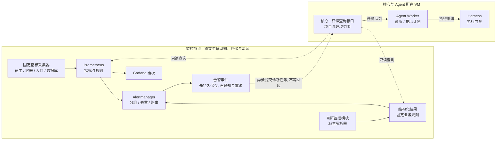
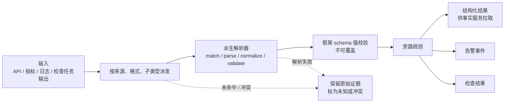
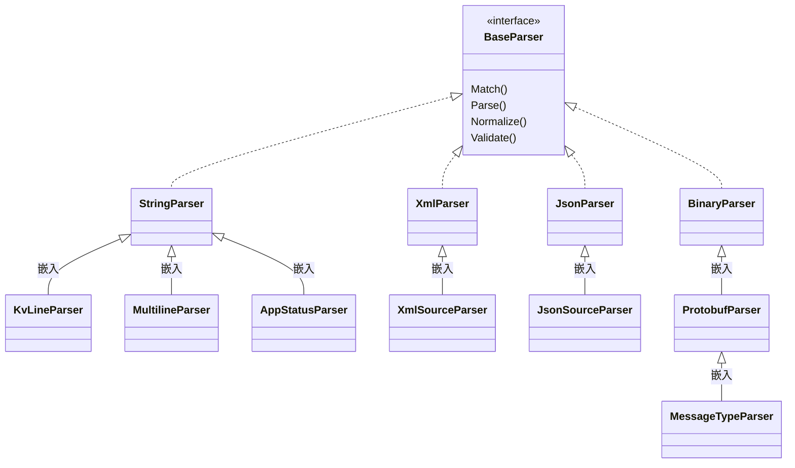

# 监控旁路与监控模块

## 1. 独立旁路（K-25）

监控、采集和告警是一条独立旁路：

- 固定的采集器把指标、日志和观测结果写入旁路自己的持久存储。
- 固定的规则服务计算状态。
- 告警服务先持久保存告警事件，再通知外部接收方，然后异步提交诊断任务。
- 通知失败由旁路自己重试，不等待 Agent 回应。
- 采集、规则计算和通知不依赖 LLM、Agent Worker 或核心容器。
- 旁路有独立的生命周期、存储和资源限额。监控节点默认部署在独立 VM（见 [组件与边界](../10-architecture/11-components-and-boundaries.md) 第 5 节）。
- Agent 停止时旁路照常运行，告警事件保留，供恢复后查询。



实线是固定处理，虚线是只读查询和异步事件。Agent Worker 或核心停止，只影响诊断和计划，不影响左侧的采集、规则、事件保存和通知。诊断得出的操作要经过 Harness 才能执行。

## 2. 默认组件

优先集成项目已有的外部监控和云监控。没有可用的指标系统时，默认使用：

| 组件 | 职责 |
|---|---|
| Prometheus | 指标采集和规则计算 |
| Alertmanager | 告警分组、去重、路由和通知 |
| Grafana | 看板 |

- 日志和调用链接入已有存储，不预设必须部署哪套产品。需要统一转发时可选 OpenTelemetry Collector，它只负责接收、处理和导出，存储另选。
- Prometheus、Alertmanager 的配置和告警规则作为配置登记，固定版本（K-20）。修改是一次受控执行。
- Grafana 有自己的内部数据库，走组件准入（K-23）：固定版本、独立库和账号；升级时的数据库迁移作为一次受控执行。

## 3. 采集组件

| 采集对象 | 组件与用途 |
|---|---|
| Linux 宿主机 | node_exporter：CPU、内存、磁盘、网络指标。 |
| Docker 容器 | cAdvisor：容器资源和性能指标。采集权限只授予专用的采集服务。 |
| 网络与入口 | blackbox_exporter：探测 HTTP、TCP、DNS 等入口的可达性。探测结果不等于应用依赖关系。 |
| 数据库 | 优先接入云监控或已有指标接口。需要时用 MySQL exporter 或 PostgreSQL exporter，按数据库产品派生配置，走组件准入（见 3.1）。 |
| 自研 app / manager | manager 指管理服务。由自研监控模块采集和解析（第 6 节），输出统一结果；适合的数值结果可以转成指标。 |
| 资产与应用关联 | 由事实采集任务完成，见 [事实地图](33-fact-map.md)。旁路的观测结果由事实服务只读拉取，旁路不直接写事实库。 |
| 日志与调用链 | 接入已有存储；可选 OpenTelemetry Collector。 |

指标只说明它测量的东西。CPU 数值不能证明应用之间发生了 API 调用。

### 3.1 数据库 exporter 的组件准入

数据库 exporter 对目标库运行固定的查询。它按组件准入处理（K-23），不对每次采集查询逐条检验。准入条件：

| 条件 | 说明 |
|---|---|
| 固定版本 | exporter 版本和内容摘要固定；升级是新的准入。 |
| 只读专用账号（Q26） | 只授予监控需要的权限，例如 MySQL 的 `PROCESS`、`REPLICATION CLIENT` 和必要的 `SELECT`，PostgreSQL 的 `pg_monitor` 角色。账号权限保证它只能读。 |
| 查询集审核 | 内置查询随版本审核。如果使用自定义查询，查询文件作为配置登记，变更建立新版本（K-21）。 |
| 安装与变更 | 安装、升级、改配置都是一次受控执行，走执行模型。 |
| 凭证 | 数据库账号的 V 由执行器在安装时写入 exporter 配置，该文件登记为"含密钥文件"（见 [密钥](../20-execution/25-secrets.md) 第 3 节）。旁路运行时不访问凭证库。轮换密码是一次新的执行。 |

## 4. 定时检查（CRONTAB）

| 项 | 做法 |
|---|---|
| 定义 | 检查内容是已登记的既定任务（见 [既定任务](../20-execution/23-harness-tasks.md)）。调度计划写明时间表达式、时区、目标环境和任务版本。 |
| 触发 | 持久调度服务按计划触发。每次触发绑定项目、环境、任务版本和唯一周期键。时间表达式和时区解析的选型见 [Go 技术选型](../50-engineering/51-go-stack.md)。 |
| 运行 | 走执行门禁。已登记任务按策略，默认自动；每步仍做执行预期对比、指纹核验和 dcg。不调用模型。 |
| 结果 | 保存成功、失败、缺测和最近成功时间。缺测不记为健康（K-05）。 |
| 告警 | Harness 以指标形式提供每个检查计划的最近状态和最近成功时间，监控旁路拉取。失败或超期未运行由旁路告警。拉取不到本身也告警。 |
| 修复 | 检查失败不会自动扩大为修复（见 [运维入口](37-ops-entrypoints.md) 第 2 节）。 |
| 恢复 | 恢复后调度计划暂停，等人工一键恢复（Q4）。 |

CRONTAB 只决定何时触发。检查什么、在哪个环境、按什么策略，都由登记内容决定。纯指标的 HTTP 拉取不经过调度服务，也不触发模型。

需要执行命令或 SQL 的检查都写成已登记的检查任务，经 Harness 运行。Harness 或执行器停机时，这类检查停止，由旁路按"超期未运行"告警；纯指标采集和告警不受影响。

运维表格的自然日维护也由持久调度服务触发，见 [运维表格](34-ops-tables.md) 第 9 节。到期事项和检查失败由旁路独立告警，表格更新失败不能延迟通知。

## 5. 告警、诊断与自愈

| 环节 | 做法 |
|---|---|
| 告警 | Alertmanager 按固定配置分组、去重、路由。告警事件先持久保存，再通知。 |
| 诊断 | 告警事件经告警回调异步提交诊断任务（见 [运维入口](37-ops-entrypoints.md)）。Agent 经只读接口分析，提出建议或执行申请。告警本身不授予执行权。 |
| 修复 | 修复是新的执行申请，按策略和转人工条件处理（K-08）。 |
| 自愈 | 预授权的已登记自愈动作（K-11），例如"磁盘超阈值时清理指定目录的旧日志"。在目标本地做确定性核验后执行，不调用模型，不依赖平台在线（见 [审核与策略](../20-execution/22-review-and-policy.md) 第 7 节）。 |
| 预授权失效 | 次数用完、过期、内容摘要变化或被撤销时，动作不执行，旁路告警。 |

旁路也监控预授权本身：例如 systemd 达到重启次数上限；定期检查任务发现服务 unit 文件与登记的启动定义摘要不一致。这两种情况都会告警（见 [项目部署](32-project-deployment.md) 第 6 节）。

## 6. 自研监控模块

自研 app、manager 和平台自身的监控都做成独立模块，通过固定版本的接口登记。模块共享处理链，个体差异留在模块内。模块只输出结构化结果，由旁路规则决定是否告警。

### 6.1 模块的组成

| 部分 | 内容 |
|---|---|
| 模块包 | 文件、配置、解析器、规则、输入与输出 schema、测试样例、依赖、权限和运行限额，各模块独立保存。 |
| 处理链 | 见 6.2。 |
| 输出契约 | 见 6.3。 |
| 故障隔离 | 模块失败单独隔离，进入可重试队列并报告错误，不影响其他模块、原始采集和通知。 |
| 变更 | Agent 只能提交模块草稿或配置变更申请。用户审核登记、固定版本后启用（K-20）。不运行未登记的代码。 |

模块只解析输入，自己不执行 Bash 或 SQL。输入来自 API、指标、日志，或已登记检查任务的输出。

### 6.2 处理链



常规指标和事件处理不依赖 LLM。

### 6.3 输出契约

| 字段 | 说明 |
|---|---|
| project_id、environment | 范围 |
| resource_id | 目标的稳定 ID |
| module_id、模块版本、配置版本 | 产生结果的模块 |
| schema_version、解析器版本 | 输出结构和解析器 |
| observed_at | 实际观测时间 |
| status、severity | 状态和严重程度 |
| evidence_ref | 原始证据引用 |

缺测、解析失败或证据缺失要明确标记，不能记为健康，也不能记为已确认事实（K-27）。

## 7. 派生解析器

### 7.1 结构



| 格式 | 派生规则 |
|---|---|
| 字符串 | 按业务子类型派生，例如 kv_line、multiline、app_status。名称只表示处理角色，不代表已有具体应用。 |
| XML / JSON | 按来源和已登记的 schema 派生，保留格式、来源和 schema 版本。 |
| 二进制 / Protobuf | ProtobufParser 从 BinaryParser 派生，使用已登记的 descriptor、消息类型和版本解码，再规范化为统一结果。只有二进制数据不足以确定业务字段含义。 |

### 7.2 扩展点

- 派生解析器可以重写 match、parse、normalize，并增加业务 validate。
- 最终的结构校验由框架固定执行，派生不能覆盖（K-28）。
- 解析器不能替换调度、门禁、凭证获取、审计或告警路由。

### 7.3 Go 实现要点

- 用接口和组合实现。Go 没有类继承。
- Go 的嵌入只提供方法提升，不提供虚方法分派。基础类型内部调用自己的方法时，不会因为外层定义了同名方法而转到外层。
- 所以固定派发器必须持有选定的解析器接口实例，每个扩展点都通过这个接口调用。基础格式只提供解码和校验的辅助能力，供派生解析器显式调用；不在基础类型里写"内部依次调用可重写步骤"的模板方法。
- 契约测试要证明重写确实生效：用只有派生解析器能正确处理的样例，经固定派发器调用，检查得到的是派生结果。

## 8. 匹配与失败规则

| 情况 | 处理 |
|---|---|
| 匹配顺序 | 先用明确的来源、格式和子类型，再用登记的规则和优先级。 |
| 同级冲突 | 同一优先级有多个最高匹配时，标为冲突。 |
| 未命中 | 保留原始证据，标为未知，不判为健康。 |
| 二进制 schema 缺失 | 不解码，保留原始证据，标为未知。 |
| 解析失败 | 单独记录，不判为健康。 |
| 乱码 | 不自动回退为字符串处理。 |
| 资源限制 | 框架限制输入大小、嵌套深度和处理时间。XML 禁用外部实体。 |
| 重放 | 用原始证据和当时的解析器、schema、配置版本核验结果。重放不重发历史告警，也不执行修复。 |

## 9. 模块登记

模块清单固定以下内容，用户审核、验收后登记（K-20）：

| 字段 | 说明 |
|---|---|
| module_id | 模块编号 |
| source、format、subtype | 输入来源、格式、子类型 |
| 解析器及版本 | 使用的派生解析器 |
| schema | 输入与输出 schema 及版本 |
| 匹配优先级 | 用于匹配顺序 |
| 依赖 | 运行依赖及版本 |
| 权限 | 可以读取哪些输入 |
| 运行限额 | CPU、内存、时间、并发 |
| 内容摘要 | 整个模块包的摘要 |

- 解析器只在有权限和资源限额约束的独立模块 Worker 中运行，不对核心进程做运行时替换。
- 新格式或子类型通过新增派生解析器扩展，建立新版本（K-21）。

## 10. 文件组织约定

下面是 Go 实现的文件约定，放在平台的监控模块内。每个派生解析器独立一个 `.go` 文件。当前不创建源码文件（K-30）。

```text
monitoring/parsers/
  base/
    string.go
    xml.go
    json.go
    binary.go
  derived/
    string/<subtype>.go
    xml/<source>.go
    json/<source>.go
    binary/protobuf/base.go
    binary/protobuf/<message_type>.go
```

## 11. Agent 能做什么

| 能做 | 不能做 |
|---|---|
| 经核心的只读接口查询指标、检查结果、事实和告警事件，限于项目和环境范围 | 直接改采集、告警或模块配置 |
| 提出采集器安装或升级申请 | 静默告警 |
| 提出采集或告警配置变更申请 | 取得宿主权限或 Docker socket（K-18） |
| 提出静默申请、修复申请 | 运行未登记的代码 |
| 提交模块草稿 | 登记或启用模块（K-20） |

这些申请都由用户审核登记，由 Harness 执行。

## 12. 敏感信息

- 含敏感信息的原始证据隔离保存。
- Agent 查询和解析器输出只给出允许的 mask 后字段或证据引用（K-17）。
- 采集组件需要的凭证由执行器在安装时写入，旁路运行时不访问凭证库（第 3.1 节）。

## 13. 恢复

- 监控数据、告警事件和检查结果保存在旁路自己的存储，不受核心恢复影响（见 [状态与恢复](../10-architecture/13-state-and-recovery.md)）。
- 平台恢复或跨 VM 迁移期间，旁路继续运行。Agent 重启不清理、不重建旁路。

## 14. 平台事件

告警服务产生 `devops.alert.opened`、`devops.alert.resolved`、`devops.alert.delivery_failed`。事件不是授权，Hook 或订阅器停机不影响旁路的告警和通知。总表见 [事件与 Hook](../40-sdk/45-events-and-hooks.md)。

## 15. 技术依据

- [Prometheus](https://prometheus.io/docs/introduction/overview/)、[Alertmanager](https://prometheus.io/docs/alerting/latest/alertmanager/)
- [node_exporter](https://prometheus.io/docs/guides/node-exporter/)、[cAdvisor](https://prometheus.io/docs/guides/cadvisor/)、[blackbox_exporter](https://github.com/prometheus/blackbox_exporter)
- [MySQL exporter](https://github.com/prometheus/mysqld_exporter)、[PostgreSQL exporter](https://github.com/prometheus-community/postgres_exporter)
- [OpenTelemetry Collector](https://opentelemetry.io/docs/collector/)
- [Go 接口与嵌入说明](https://go.dev/doc/effective_go#embedding)
- [Protobuf 编码说明](https://protobuf.dev/programming-guides/encoding/)

## 16. 未定事项

- Q4：恢复后调度计划暂停还是照常。
- Q8：监控旁路和其他组件的部署形态。

见 [待定事项](../00-overview/04-open-questions.md)。
