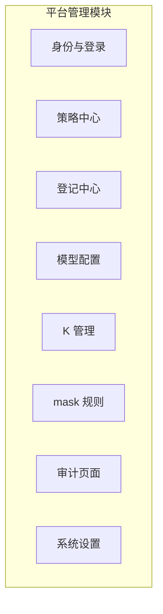

# 平台管理模块

## 1. 取向

- 首版只考虑单人使用，不做细粒度权限。
- 结构必须完整，为 SSO、MFA、多用户和角色预留位置。
- 本模块是核心容器内的一个业务模块。代码暂不写，先预留结构和接口。

## 2. 子模块

| 子模块 | 首版内容 | 预留 |
|---|---|---|
| 身份与登录 | 本地账号 + 密码登录；单一 owner 用户 | SSO（OIDC、SAML）、MFA（TOTP、WebAuthn）、多用户 |
| 会话与令牌 | Web 会话；API token（用于 IM 和外部集成） | 令牌作用域、过期策略 |
| 角色与授权 | owner 拥有全部权限 | 角色（平台管理员、项目管理员、审核人、只读）、多人审批、申请人与审核人分离 |
| 策略中心 | 系统全局兜底策略、会话模式默认值 | 按项目、按角色的策略 |
| 登记中心 | 登记、升级、停用工具、命令模板、脚本、既定任务、规程包、dcg 规则包、Hook、解析器（K-20） | 登记审批流 |
| 模型配置 | ModelProfile、ModelRole、可选独立审核模型；API key 以 K 引用 | 按项目的模型配置 |
| K 管理 | 增、删、改 K，查看 K 的状态；不显示 V（K-16） | 见 Q10 |
| mask 规则 | 查看内置规则；增删人工规则（K-17） | 规则测试工具 |
| 审计页面 | 查询全部审计记录 | 按角色限制可见范围 |
| 系统设置 | 时区、通知渠道、实例信息 | — |

## 3. 预留接口

接口在核心的业务规则层定义为端口，首版给出最简实现。

| 端口 | 职责 | 首版实现 |
|---|---|---|
| IdentityProvider | 认证用户，返回身份 | 本地账号 |
| MFAVerifier | 第二因素校验 | 关闭（接口存在，返回"未启用"） |
| Authorizer | 判断某身份能否做某动作 | owner 全部允许 |
| ApproverResolver | 给出某申请的审核人 | 返回 owner |
| IMIdentityMapper | IM 账号映射到平台身份 | 静态映射到 owner |

业务代码只调用这些端口，不直接判断"是不是 owner"。这样以后接入 SSO 和角色时不需要改业务代码。

## 4. 审计页面

- 能访问审计页面，就能看到所有内容。
- 内容包括：执行申请、各修订、执行预期、自审结论、dcg 结果、策略判定、人工动作与点评、执行输出（mask 后）、配置和登记变更、登录记录。
- 审计追加写，不可修改或删除（见 [组件与边界](../10-architecture/11-components-and-boundaries.md)）。
- 首版不做防篡改链和保留期限设置。

## 5. 管理操作也走检验

- 策略、登记资产、模型配置和 mask 规则的变更都建立新版本（K-21），并写入审计。
- 管理操作如果会导致实际执行，走执行模型。升级平台组件、迁移平台库属于底座操作，见 [部署底座](../10-architecture/12-deployment-substrate.md) 第 6 节。

## 6. 待设计（Q9）

SSO 协议选择、MFA 方式、角色模型、多人审批规则、令牌作用域，后续单独设计。
