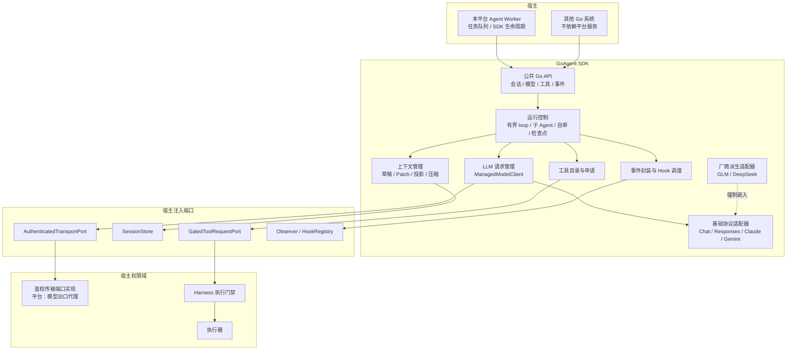

# GoAgent SDK 概览

## 1. 定位

- GoAgent SDK（下称 SDK）是本项目独立、版本化的 Go 模块。它有自己的 `go.mod`、版本号和公共导入 API。
- 其他 Go 系统可以在自己的进程里嵌入 SDK。本平台的 Agent Worker 也只是嵌入 SDK 的一个宿主。
- SDK 负责：模型访问与请求管理、会话与上下文、计划、工具目录与工具申请、模型自审、公开事件、Hook 扩展和检查点。
- SDK 不负责：执行门禁、策略判定、凭证、资产操作。这些属于宿主的 Harness 和执行器（K-18）。
- SDK 的可嵌入性不改变本平台的容器边界。Agent Worker 仍是独立进程（首版在 core 容器内，与凭证所在的 runtime 容器分开），不持有凭证和宿主权限（见 [组件与边界](../10-architecture/11-components-and-boundaries.md)）。
- 本文的类型名和接口名用来表达边界。具体签名在实现前的专项设计中确定（K-30）。

## 2. 结构图



要点：

- 宿主只通过公共 API 使用 SDK。SDK 只通过注入端口接触宿主能力。
- 模型请求经宿主的鉴权传输端口实现发出。API key 在后端注入，SDK 看不到。
- 所有工具申请只走 `GatedToolRequestPort`。没有这个端口，工具全关。

## 3. 公共 API 类型

| 类型 | 作用 | 详见 |
|---|---|---|
| `Session` | 会话：轮次、分支、上下文快照引用、运行列表 | [上下文管理](43-context-management.md) |
| `Run` | 一次有界 Agent 运行。有 RunID、ParentRunID、预算和状态 | 本文第 4 节 |
| `ModelRequest` / `ModelEvent` / `ModelResponse` | 统一模型请求、流事件和终态回复。保留有序内容块、工具调用关联和不透明续接引用 | [LLM 协议](42-llm-protocols.md) |
| `ModelProfile` / `ModelRole` / `RoleBinding` | 模型配置、职责角色和角色绑定 | 本文第 8 节 |
| `ContextDocument` / `ContextBlock` / `ContextSnapshot` / `ContextPatch` | 上下文结构、快照和版本化编辑 | [上下文管理](43-context-management.md) |
| `Plan` | 计划：步骤、依赖、未知事项。计划不是执行授权，审核计划也不产生执行申请 | |
| `ToolSpec` / `ToolCatalog` | 工具登记清单和本轮固定目录 | [工具目录](44-tool-catalog.md) |
| `ToolRequest` / `ExpectationDraft` / `SelfReview` | 工具申请、执行预期草稿、模型自审结论 | 本文第 9 节、[工具目录](44-tool-catalog.md) |
| `ToolRequestStatus` / `ToolResult` | 宿主回报的申请状态和结果 | [工具目录](44-tool-catalog.md) |
| `EventType` / `Event` / `EventData` | 公开事件 | [事件与 Hook](45-events-and-hooks.md) |
| `HookSpec` / `HookPoint` / `HookDecision` / `ObserverHook` / `BeforeHook` | Hook 契约 | [事件与 Hook](45-events-and-hooks.md) |
| `Checkpoint` | 会话与上下文的检查点 | 本文第 10 节 |
| `SecretRef` | 密钥 K 的引用：名称、非敏感备注、状态 | 本文第 7 节 |

规则：

- 调用者传入 `context.Context`，掌握取消和生命周期（参见 [context 取消](https://pkg.go.dev/context#Context)）。
- 公共 API 不暴露平台内部实体、数据库行、厂商类型或第三方 Agent 框架类型。
- `ModelRole`、`EventType`、`HookPoint`、`ToolRequestStatus` 等枚举是 SDK 自持的类型化常量，集中定义（K-22，参见 [类型化常量](https://go.dev/ref/spec#Constant_declarations)）。SDK 不为复用常量而导入平台模块。

## 4. SDK 内部职责

| 模块 | 维护内容 | 固定边界 |
|---|---|---|
| 统一模型接口 | 请求、回复、内容块、流事件、工具调用、结束原因、用量、不透明续接引用。按 ModelRole 路由到固定的 ModelProfile。 | 缺失能力明确报告不支持。不能把工具调用退化成普通文本，不能静默丢字段或切换模型。 |
| LLM 访问与请求管理 | HTTP/JSON 与 SSE 基线、协议编解码、路由、超时、取消、限流、退避、并发和预算。 | 只用宿主批准的端点和凭证 K。模型返回的 URL 不能成为新端点。详见 [LLM 协议](42-llm-protocols.md)。 |
| 上下文管理 | 会话、轮次、任务目标、资料引用、工具位、窗口预算、摘要、快照、分支。 | 保留固定约束和必要协议状态。压缩后的上下文不能代替事实库、执行申请或审计。 |
| 工具管理 | 目录、命名空间、schema、版本、调用状态、结果校验与关联、受控申请。 | 登记由管理员或可信宿主完成（K-20）。所有工具共用宿主门禁。SDK 不判定策略。 |
| 模型自审 | 对每个修订生成结构化自审结论，随申请提交。 | 自审结论只是 Harness 的输入，不是批准（第 9 节）。 |
| 运行与多 Agent | 有界 Agent loop、计划、子 Agent、流式事件、暂停、取消、等待输入、检查点。 | 限制轮数、时间、并发、队列和输出大小。子 Agent 只获得受限上下文和工具子集，与主 Agent 共用受控工具路径。 |
| 模板、资料与变量 | 版本化提示词、角色模板、资料检索端口、类型化变量。按会话、任务和宿主作用域组织。 | 模板和资料版本由宿主固定。外部内容保留来源和"不可信"标记（K-19）。敏感变量只保存 K。 |
| 事件与 Hook | 版本化 EventType、脱敏 EventData、Hook 注册表、有界调度、重放契约。 | 事件不授予权限。Hook 不能越过门禁。详见 [事件与 Hook](45-events-and-hooks.md)。 |
| 观测与复测 | 请求、运行、工具的关联 ID，延迟、排队、token、预算、错误，协议语料和契约回放。 | 不记录 V、敏感原生载荷或完整思考内容。未返回的用量记为未知（K-05）。回放用 fake 模型和工具结果，不重新操作资产。 |
| 可选能力 | 多模态、结构化输出、检索增强、模型侧缓存、服务端续接。 | 逐协议、逐模型检验后启用。不强制向量库、模型平台或存储。检索能力不扩大资料访问范围。 |

SDK 不做的事：不启动服务、不迁移数据库、不注册系统任务、不创建包级全局运行状态、不创建全局观测 exporter。

## 5. 宿主注入端口

| 端口 | 是否必需 | 职责 | 缺失时 |
|---|---|---|---|
| `ModelPort` | 必需 | 统一模型调用接口。 | 不能运行模型。 |
| `ManagedModelClient` | — | SDK 自带的 `ModelPort` 实现：协议编解码、请求管理、厂商派生适配器。经 `AuthenticatedTransportPort` 发送。 | 宿主可以自带 `ModelPort`，但须通过同等的协议与派生契约验收，不能绕过派生适配器准入。 |
| `AuthenticatedTransportPort` | 使用 `ManagedModelClient` 时必需 | 宿主的鉴权传输端口实现：按 K 注入 API key 和认证头，只允许已批准端点。本平台中即模型出口代理。 | 不发送模型请求。 |
| `SessionStore` | 必需 | 按版本（CAS）保存会话、上下文快照、追加日志和检查点。 | 不能运行。SDK 提供仅用于测试和样例的内存实现。 |
| `GatedToolRequestPort` | 工具执行必需 | 登记、修订、提交全部工具申请；接收宿主核验过的状态和结果。 | 所有工具执行关闭，包括内建工具。只开放对话和计划。 |
| `Observer` | 可选 | 接收脱敏事件。 | 不投递事件，运行不受影响。 |
| `HookRegistry` | 可选 | 可信宿主按固定版本登记 Hook。 | 无 Hook。 |
| `Redactor` | 可选 | 宿主注入的 mask 规则（内置与人工规则，K-17）。 | 只用 SDK 内置规则。 |
| `ResourcePort` | 可选 | 已授权、已 mask、带来源的资料检索。 | 无资料检索。 |

已知值（凭证库中的 V）的精确匹配只能在持有 V 的组件里做，例如执行器和模型出口代理。SDK 没有 V，只做规则匹配。

## 6. 执行安全边界

| 规则 | 说明 |
|---|---|
| 无门禁则工具全关 | 没有 `GatedToolRequestPort` 时，所有命名工具都不执行。SDK 的编码、预算、上下文维护和事件处理照常运行。 |
| SDK 标记不构成授权 | `approved=true`、"已自审"、Hook 返回 Continue、事件 `passed` 等都不是执行授权。Harness 自己核验（见 [Harness](../20-execution/23-harness-tasks.md)）。 |
| 门禁在宿主 | 执行预期、原生预演、状态指纹、dcg、策略、人工审核、受控改写、冻结都在宿主 Harness 完成（K-03、K-04、K-06）。SDK 只提交完整候选、执行预期草稿和自审结论。 |
| 执行在执行器 | 执行器执行前重算指纹并核验冻结摘要（K-04、K-15）。SDK 不信任也不替代这一步。 |
| 工具实现不在 SDK 里运行 | 工具实现不是 SDK 内可任意执行的回调。注册或构造时也不能提前操作资产。 |
| 不直接访问资产 | SDK 不访问平台数据库、Docker、云资源、Bash、SQL 或资产凭证。 |
| 宿主自写 I/O 不受 SDK 约束 | SDK 管不住宿主另行编写的直接 I/O。宿主的执行器和进程权限隔离要一并验收（第 11 节）。 |

## 7. 密钥只见 K

- SDK 只处理 K：名称、非敏感备注、状态（K-16）。见 [密钥](../20-execution/25-secrets.md)。
- 模型 API key 也是 K。`ModelProfile` 只引用 K，由鉴权传输端口实现注入。SDK 和 Worker 看不到 V。
- 工具申请里只列出需要的 K。V 由执行器在执行时注入环境变量。
- 模型输入、事件、工具结果、错误、日志和会话持久化先过 mask（K-17）。
- SDK 不提供读取 V 的接口，也不提供增、删、改 K 的工具。Agent 只能引用已存在的 K，或提示用户补充。

## 8. ModelProfile 与 ModelRole

模型按职责角色配置，不让所有任务共用一个隐含模型。管理员登记 `ModelProfile`，再把角色绑定到 Profile（K-20）。

### 8.1 ModelProfile

| 字段组 | 内容 |
|---|---|
| 身份 | ProfileID、版本、内容摘要 |
| 端点 | 厂商、已批准端点 ID、API 版本 |
| 模型 | 模型名 |
| 协议 | 基础协议、厂商派生适配器及其版本（见 [LLM 协议](42-llm-protocols.md)） |
| 能力 | 工具调用、流式、结构化输出、显式思考、多模态、上下文窗口、服务端续接，每项为已验证 / 不支持 / 未知 |
| 数据范围 | 允许送入该模型的数据类别 |
| 预算 | token、费用、并发上限 |
| 超时 | 单次 attempt 和整个逻辑请求的截止时间 |
| 凭证 | API key 的 K |
| 续接策略 | 服务端存储、缓存、续接是否启用 |

### 8.2 ModelRole

| 角色 | 是否必需 | 用途 | 边界 |
|---|---|---|---|
| `MainAgent` | 必需 | 用户对话、需求整理、计划、工具候选、执行预期草稿、模型自审。 | 不能批准执行。自审结论只是 Harness 的输入。 |
| `ContextMaintenance` | 必需，可与 MainAgent 绑定同一 Profile | 在限定范围内整理上下文：压缩、摘要、整理显式思考文本。 | 不开放任何工具。只产生待校验的 ContextPatch 候选。不能写授权，不能改执行事实。 |
| `Reviewer` | 可选，默认不配置 | 独立审核模型（K-12）。对执行申请给出"无风险 / 有风险及原因"。 | 输入与人工审核看到的一样。不开放工具。不能批准，不能代替人工。有风险就转人工。 |

### 8.3 绑定规则

- 角色绑定是版本化配置。变更即新版本（K-21）。在途请求继续用原版本。
- 一次逻辑请求固定角色、实际 Profile 和配置版本。
- 缺少必需角色的绑定时，相关能力关闭，不自动改用别的角色兜底。
- `Reviewer` 指向与 `MainAgent` 相同的实际模型时，界面要明确显示，不能标称"异模型审核"。
- 多个 Reviewer 的意见不做多数票。任何一个认为有风险，都转人工。
- SDK 只提供角色与 Profile 路由。哪类操作配置 Reviewer、由谁发起 Reviewer 会话，由宿主决定（平台见 [审核与策略](../20-execution/22-review-and-policy.md) 第 8 节）。

### 8.4 可选 Reviewer 配置示例

旧稿的 BashAudit、SQLAudit、WorkflowAudit、CriticalAudit 不再是强制角色。需要时可以作为 `Reviewer` 的绑定范围配置（示意，不是最终格式）：

```yaml
role_bindings:
  MainAgent:          { profile: main-claude, version: 3 }
  ContextMaintenance: { profile: main-claude, version: 3 }
  Reviewer:
    - scope: bash        # 只审独立命令
      profile: review-gpt
      version: 1
    - scope: sql         # 只审项目目标库的数据变更和结构变更
      profile: review-gemini
      version: 2
    # workflow、critical 等范围同理，默认都不配置
```

## 9. 模型自审在 SDK 中如何产出

模型自审的规则见 [审核与策略](../20-execution/22-review-and-policy.md) 第 2.1 节（K-06）。本节只说明 SDK 怎么产出它。

### 9.1 SelfReview 结构

| 字段 | 说明 |
|---|---|
| 绑定 | CallID、Revision、被审内容摘要。摘要不一致则自审无效。 |
| 四问回答 | ①是否符合用户这次的要求；②是否只作用于声明的目标；③是否可逆，不可逆时工具有没有原生预演；④有没有风险，是什么。 |
| 结论 | 无风险 / 有风险 |
| 原因 | 有风险时必填 |
| 修订意见 | 可选。自审发现内容应修改时给出。 |
| 生成信息 | 使用的 Profile 与版本、RequestID、生成时间 |
| 完成状态 | 完成 / 未完成（超时、输出不合 schema、预算用尽） |

### 9.2 产出方式

1. 模型给出完整工具调用后，SDK 整理候选和执行预期草稿，经 `GatedToolRequestPort` 登记，取得 CallID 和 Revision 1。
2. SDK 用 `MainAgent` 角色发起一次独立的自审请求。请求只含最终内容、执行预期草稿、本轮用户要求、目标和 Hook 意见，不带工具目录。输出按 SelfReview schema 校验。
3. 自审给出修订意见时，Agent 写出修订内容，SDK 把它作为修订意见提交。Harness 受控改写写入，CallID 不变，Revision 加一（K-13、K-14）。然后对新修订重新自审。
4. 没有修订意见时，SDK 把 SelfReview 随申请提交检验。
5. 人工点评退回时，同样走第 3 步，再从自审重新开始（K-09）。

### 9.3 规则

- Harness 不信任自审为批准。结论"有风险"就转人工（K-08）。
- 自审缺失或"未完成"，Harness 按"有风险"处理。SDK 如实提交"未完成"，不填成"无风险"。
- 自审修订轮数、时间和费用有上限，由配置固定。超限后按"有风险"提交。
- 每个修订都要重新自审。旧修订的自审结论作废。
- 自审过程和原文进追加日志，不进主上下文投影（K-15）。工具位只显示结论摘要。
- Harness 既定任务的步骤不经过模型自审（见 [执行模型](../20-execution/21-execution-model.md) 第 2 节）。Agent 发起既定任务的那次申请本身仍带自审。
- 登记为"不接触目标资产的只读内建工具"是否免自审，见 Q16（当前默认免自审，自审字段标"不适用"）。

## 10. 检查点与恢复

- 检查点保存会话、上下文快照、运行元数据和工具位状态，绑定 `SessionStore` 版本。
- 宿主恢复时遵守"恢复即停止"（K-24；普通重启是否包括在内见 Q5）：
  - 会话和上下文恢复，用户可以继续对话。
  - 在途运行不自动续跑，标为中断（事件 `goagent.run.interrupted`）。
  - 在途工具申请不重新提交。工具位状态以宿主回报为准，通常是"已停止（恢复中断）"或"结果未知"。
  - 在途模型请求不自动重试。
- 用户需要继续时，开始一次新的运行。新运行里的工具申请从头检验。

## 11. 第二宿主接入验收

第二宿主用来证明 SDK 的独立性。

| 项 | 要求 |
|---|---|
| 独立运行 | 不依赖平台数据库和平台服务，能运行对话和计划。 |
| 独立构建 | 在仓库外、无 `go.work`、无本地 `replace` 的条件下构建并导入 SDK。 |
| 执行能力 | 只在接入等价门禁后开放。没有门禁时，工具请求执行次数为零。 |
| 复测范围 | 公共 API、事件、取消、并发、子 Agent、旧调用方编译、越权负例。 |
| 权限隔离 | 宿主执行器与进程权限隔离一并验收。SDK 管不住宿主自写的直接 I/O。 |

新宿主接入都要有兼容回归。测试与发布门槛见 [测试与发布](../50-engineering/55-testing-and-release.md)。

## 12. 版本规则

| 阶段 | 规则 |
|---|---|
| v0 | 公共 SDK 先以 v0 开发。P1 交付第二宿主接入样例，持续检验独立性。v0 期间公共 API 可以变化，每次变化让第二宿主样例同步通过。 |
| v1 | P6 通过兼容与恢复验收后发布 v1。阶段定义见 [阶段与验收](../50-engineering/54-phases-and-acceptance.md)。 |
| v1 之后 | 按 [Go 模块版本规则](https://go.dev/doc/modules/version-numbers) 维护。破坏性变更使用新主版本和对应导入路径。按 [Go 发布流程](https://go.dev/doc/modules/release-workflow) 发布。 |
| 公共字符串 | `EventType`、`HookPoint`、`ModelRole`、`ToolRequestStatus` 的值和 payload 属于公共契约。破坏性变化遵守主版本规则。 |
| 与平台的关系 | 平台和 SDK 分别管理版本。平台升级不能强迫其他宿主同步升级 SDK。平台不能用本地 `replace` 掩盖 SDK 的对外依赖。 |

Go 版本基线和第三方 Agent 框架候选见 [Go 技术选型](../50-engineering/51-go-stack.md)。候选框架的类型不暴露为 SDK 公共 API；框架内置执行器不能直连 shell、SQL 或云资源。

## 13. 目录约定

仓库整体布局和依赖方向见 [仓库布局](../50-engineering/53-repo-layout.md)。下面只列 `sdk/agent` 模块内部的约定。

```text
sdk/agent/                         # 独立、可发布的 Go 模块
  go.mod
  agent.go / ports.go / types.go   # 稳定公共 API：会话、运行、宿主端口、公共类型
  events.go / hooks.go             # 集中事件枚举、事件数据与 Hook 契约
  model_profiles.go                # ModelProfile、ModelRole、角色绑定
  context_patch.go                 # 上下文编辑公共契约
  tool_request.go                  # ToolSpec、ToolRequest、ExpectationDraft、SelfReview、状态
  contracts/                       # SDK 自持的公共 schema 与兼容规则
  protocol/                        # 基础协议类型与派生扩展接口
    chat.go / responses.go / claude.go / gemini.go
  providers/                       # 厂商派生适配器，每个厂商一个文件，必须嵌入对应基础类型
    glm.go / deepseek.go
  internal/
    runtime/                       # 有界 loop、子 Agent、检查点
    selfreview/                    # 自审请求与结构化结论
    llm/                           # 请求管理与固定校验
    context/                       # 草稿、Patch、投影、预算、快照
    tools/                         # 目录、内建工具定义、受控申请
    events/                        # 脱敏封装、有界队列、Hook 调度
    replay/                        # 脱敏协议语料与契约回放
  examples/second-host/            # 第二宿主最小接入样例
```

规则：

- `go.work` 只服务本地多模块开发。
- SDK 不导入平台的任何包。平台的 `devops.*` 事件定义在平台契约里，不在 SDK 里。
- 厂商专用字段留在对应协议或派生文件中，不泄漏到通用类型。
- 发布地址和模块命名在实现启动前固定。参见 [Go 模块布局](https://go.dev/doc/modules/layout)。

## 14. 相关待定事项

- Q1：独立命令首版只能人工执行。SDK 只标出申请类别，由 Harness 决定。
- Q5：普通重启是否算"恢复"。
- Q10：凭证库细节，包括模型 API key 的 K 如何轮换。
- Q12：每个具体工具的详细需求。
- Q15：Temporal。SDK 不依赖任何编排器。
