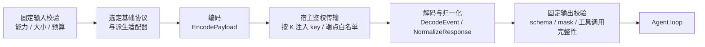

# LLM 基础协议、厂商派生适配器与请求管理

## 1. 分层

| 层 | 负责 | 不负责 |
|---|---|---|
| 基础协议适配器 | 一种线上协议的消息、内容块、工具声明、回复、流事件和结束状态。 | 厂商专有参数。 |
| 厂商派生适配器 | 某个厂商相对基础协议的差异：模型能力、请求字段、思考字段、流事件、错误映射。 | 鉴权、TLS、端点、mask、预算上限、工具申请路径、门禁、审计（K-28）。 |
| 请求管理 | 逻辑请求、attempt、排队、并发、预算、重试、取消、路由。 | 工具执行。 |
| 鉴权传输端口实现 | 宿主侧注入 API key（K），只允许已批准端点。 | 协议内容。 |

厂商参数不能写进 Agent loop。每个厂商的差异写在自己的派生文件里。

## 2. 四种基础协议

| 基础协议 | 必须保留的格式 | 适配条件 |
|---|---|---|
| Chat Completions | `messages`、角色、`tool_calls`、工具结果关联、流式 delta。 | 按端点和模型确认参数、结构化输出和工具能力。"OpenAI 风格接口"不能推导为各厂商完全等价。参见 [官方 OpenAI Chat Completions](https://developers.openai.com/api/reference/resources/chat/subresources/completions/methods/create)。 |
| Responses | 类型化 input / output Items、`function_call` / `function_call_output`、匹配的 `call_id`、语义流事件。 | 单独实现编码、事件和续接，不套用 Chat chunk 处理器。默认使用宿主控制的本地上下文和手工 Items；服务端续接与存储按登记策略显式启用。参见 [官方 OpenAI 格式说明](https://developers.openai.com/api/docs/guides/migrate-to-responses) 与 [上下文状态](https://developers.openai.com/api/docs/guides/conversation-state)。 |
| Claude Messages | 顶层 `system`、有序 content blocks、`tool_use`、`tool_result`、调用 ID、block 流事件。 | 保留块顺序、签名和协议要求的前缀。工具结果按 Claude 结构回传，不伪装成 OpenAI 的 `role=tool`。参见 [Claude 工具协议](https://platform.claude.com/docs/en/agents-and-tools/tool-use/overview) 与 [思考状态约束](https://platform.claude.com/docs/en/build-with-claude/preserved-thinking)。 |
| Gemini Generate Content | `contents` / `parts`、user / model 角色、`functionCall` / `functionResponse`、调用关联、`thoughtSignature`。 | 分别适配 `generateContent` 与 `streamGenerateContent`。签名随原 Part 保留，不移动、合并或改写。是否必需按模型能力确认。参见 [Gemini API](https://ai.google.dev/api/generate-content) 与 [签名约束](https://ai.google.dev/gemini-api/docs/generate-content/thought-signatures)。 |

共同要求：

- 公共模型类型保留有序内容块和工具调用关联。
- 缺失能力明确报告"不支持"。不能把工具调用退化成普通文本，不能静默丢字段。
- 无法无损表示的协议能力，明确禁用。

## 3. 厂商派生适配器

| 派生适配器 | 父适配器 | 重写的差异 | 适配条件 |
|---|---|---|---|
| GLM | `ChatAdapterBase` | 模型能力、请求字段、思考模式、工具参数、流事件、错误映射。 | 可参考 [智谱官方 OpenAI 风格示例](https://docs.bigmodel.cn/cn/best-practice/case/ai-search-engine)，但启用的能力须按实际 BigModel 端点和模型检验。不从其他厂商托管的同名模型推导直连接口行为。 |
| DeepSeek | `ChatAdapterBase` | 思考字段、`reasoning_content`、工具循环、参数、结束原因。 | 需要续接的思考字段按协议保留。不同模式下的 `tool_choice` 与采样参数单独检验。参见 [DeepSeek 请求格式](https://api-docs.deepseek.com/api/create-chat-completion/) 与 [Thinking Mode](https://api-docs.deepseek.com/guides/thinking_mode/)。不能为了通用格式静默清除必要字段。 |

### 3.1 结构

```text
ProtocolAdapter                  # 统一分派接口
  ChatAdapterBase
    GLMAdapter                   # 强制嵌入父类型，只重写差异
    DeepSeekAdapter              # 强制嵌入父类型，只重写差异
  ResponsesAdapterBase
    <responses_vendor_adapter>
  ClaudeMessagesAdapterBase
    <claude_vendor_adapter>
  GeminiAdapterBase
    <gemini_vendor_adapter>
```

### 3.2 强制嵌入与接口分派

Go 没有类继承。本项目用"强制嵌入 + 接口分派"表达派生关系。

| 规则 | 说明 |
|---|---|
| 强制嵌入 | 派生类型必须嵌入对应的基础适配器类型，并实现统一的 `ProtocolAdapter` 接口。不能改成可选组合，也不能另写一套完整实现。 |
| 复用父行为 | 未重写的方法直接用父适配器的共享转换和解析逻辑。 |
| 只重写差异 | 只重写登记过的扩展点（第 4 节）。 |
| 从最外层分派 | 分派器始终通过最外层派生对象的接口调用方法。 |
| 嵌入不是虚方法 | Go 的嵌入只做方法提升，不提供虚方法分派。基础对象内部调用同名方法时，不会自动转到派生对象。所以基础适配器的共享流程，要通过构造时传入的扩展接口（指向最外层派生对象）调用可重写方法。参见 [Go 嵌入与方法提升](https://go.dev/doc/effective_go#embedding)。 |
| 父适配器由协议决定 | 父适配器由实际线上协议确定：`ChatAdapterBase`、`ResponsesAdapterBase`、`ClaudeMessagesAdapterBase` 或 `GeminiAdapterBase`。 |
| 不换父 | 每个派生类型固定一个父适配器和版本。厂商改用新协议时，建立新的派生类型，不在运行中换父适配器。 |

### 3.3 登记与准入

- 父适配器、派生类型和版本链由管理员登记（K-20），变更即新版本（K-21）。
- `ModelProfile` 引用具体的派生适配器版本（见 [SDK 概览](41-sdk-overview.md) 第 8 节）。
- 准入验证三件事：
  1. 真实嵌入结构：派生类型确实嵌入了登记的父类型。
  2. 父行为复用：未重写的方法在语料上与父适配器输出一致。
  3. 重写生效：重写的方法确实经最外层派生对象分派到。
- 只实现同一接口、或只在文档里声明"继承自某基础"，不算通过。
- 宿主自定义的 `ModelPort` 也要通过同等的协议与派生契约验收，不能绕过派生适配器准入。

## 4. 可重写扩展点与固定校验

| 类别 | 内容 |
|---|---|
| 可重写 | `EncodePayload`（请求编码）、`DecodeEvent`（流事件解码）、`NormalizeResponse`（回复归一化）、能力描述、错误映射。 |
| 框架固定，不可重写 | 输入校验、能力校验、大小限制、输出 schema 校验、mask、工具请求校验。 |
| 宿主固定，不可触及 | 鉴权、TLS、端点白名单、API key 注入、预算上限、工具申请路径、执行门禁、审计。 |

派生适配器和 ContextPatch 是两回事。ContextPatch 编辑上下文（见 [上下文管理](43-context-management.md)），派生适配器适配协议差异。二者分别登记，都不能改门禁（K-28）。

## 5. 协议续接状态（sidecar）

| 规则 | 说明 |
|---|---|
| 单独保存 | 厂商续接状态（签名、加密思考、服务端响应 ID 等）保存在与会话绑定的 sidecar 里，经 `SessionStore` 的受控附属存储保存。 |
| 只暴露引用 | 公共 API 只暴露不透明引用。 |
| 绑定 | 绑定厂商、模型、协议、适配器版本和会话。 |
| 不可当文本 | 不能解码成普通摘要，不能跨厂商回传，不能写进事件、日志或观测。 |
| 冲突时暂停 | 无法同时做到敏感隔离和有效续接时，暂停相关能力。 |
| 未知字段 | 未知的可选字段只能存在审核过的 sidecar 结构里，不能自动获得执行含义。 |

## 6. 调用路径



- 厂商托管的自动执行工具（模型侧直接运行的工具）默认不启用。只有能证明同等门禁边界（执行预期、自审、dcg、策略、人工审核、审计）的适配路径才可以开放。原生工具不能在宿主 Harness 之前自行执行。
- 模型返回的 URL 不能成为新的模型端点。

## 7. 请求管理

### 7.1 逻辑请求与 attempt

| 概念 | 内容 |
|---|---|
| 逻辑请求 | 有固定 RequestID。固定 ModelRole、实际 ModelProfile 与配置版本、上下文快照、协议与派生适配器版本、工具目录和预算。 |
| attempt | 每次实际网络请求有独立 AttemptID。一个逻辑请求可以有多次 attempt。 |

### 7.2 预算与限额

请求管理器控制：排队、背压、并发、截止时间、取消、响应字节数、上下文 token、输出预算、有限重试。

- 统计记录实际选用的配置，以及估算用量和实际用量。
- 厂商没有返回的用量记为未知，未知费用不填 0（K-05）。

### 7.3 重试分类

| 错误类别 | 处理 |
|---|---|
| 限流、暂时故障（如 429、5xx、连接重置） | 固定退避 + 抖动 + 次数上限。 |
| 参数、鉴权、能力、schema 错误 | 不自动重试，直接报告。 |
| 流中断（已收到部分内容） | 丢弃不完整内容，按新 attempt 重新请求完整响应。不拼接两段流。已显示给用户的部分内容标为作废。 |
| 超时且无法确认远端状态 | attempt 记为未知。请求没有服务端副作用（未启用服务端存储或续接）时可以重试；否则停止并报告。 |

- 模型生成的重试和工具执行的幂等分开管理。工具在完整响应之前不会派发（第 8 节），所以重试模型请求不会重做工具。
- 不能用重放整个 Agent 轮次来修复断流。

### 7.4 取消语义

- 取消网络请求只说明本地停止等待，不证明厂商已停止生成。
- 取消事件和完成事件分开记录（见 [事件与 Hook](45-events-and-hooks.md)）。
- 取消不影响已提交给宿主的工具申请。工具申请的取消要经 `GatedToolRequestPort` 单独发出，结果以宿主回报为准。

## 8. 流式处理

| 规则 | 说明 |
|---|---|
| 按协议维护索引 | 按协议维护事件序号和内容块索引。 |
| 参数片段不派发 | 工具参数片段只用于缓冲，不派发工具，也不进入工具申请。 |
| 等终态 | 首版等完整响应终态和完整参数，再做固定 schema 和目录校验，然后进入工具申请路径（见 [工具目录](44-tool-catalog.md)）。 |
| 不合格不进申请 | 截断的 JSON、未知的必要事件、块顺序错误、重复且冲突的调用 ID、未完成的响应，都不能进入工具申请路径。 |
| 显示先 mask | 流式文本显示给用户前，先过 mask（K-17）。 |
| delta 只是进度 | 流事件 `goagent.model.stream.delta` 只表示过滤后的部分内容或进度，不能产生可执行工具。 |

## 9. 路由与故障转移

- 只在宿主固定的策略范围内路由和故障转移。
- 切换厂商、模型或协议时，先检验目标的能力和上下文表示，再创建明确的新分支。
- 不把旧厂商的 sidecar 转给新厂商。
- 不丢弃未完成的工具调用 / 结果对。
- 有已提交或结果未知的工具申请时，先取回它们的宿主状态。不能切换模型后重做同一操作。
- 切换后的模型仍按 ModelRole 绑定选取，不能临时改用未绑定的 Profile。

## 10. 适配器准入语料与复测

每个新增的协议、模型 Profile、厂商派生适配器同时提交版本清单和契约语料。

| 语料必须覆盖 | |
|---|---|
| 回复形态 | 普通回复、流式回复 |
| 工具调用 | 分片的工具参数、多个工具调用的关联 |
| 异常 | 错误、取消、截断、缺失用量、重复事件、未知字段 |
| 派生关系 | 父类型与版本、未重写行为沿用父实现、重写经派生对象分派、固定校验未改变 |
| 续接状态 | 必要状态不丢失；未知可选字段只进 sidecar |

规则：

- 契约回放只用记录的脱敏输入、模型事件和受控结果，不调用真实资产。
- 真实 API 兼容验收在单独授权的环境中进行。通过范围写入支持矩阵。
- HTTP 请求成功不能当作"全部协议能力兼容"。
- 发布门槛见 [测试与发布](../50-engineering/55-testing-and-release.md)。
