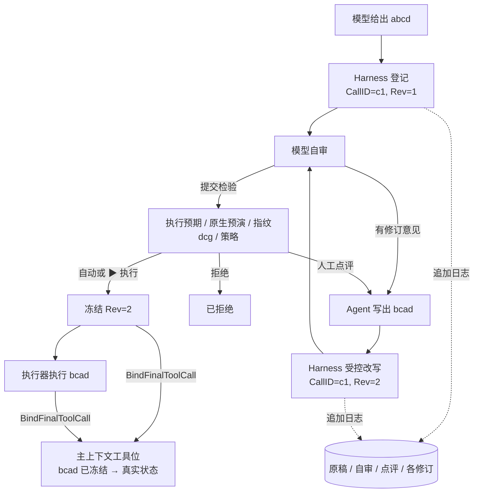

# 上下文管理、ContextPatch 与同一调用多修订

## 1. 定位

- 上下文管理是 SDK 的独立模块。它维护"主上下文投影"：页面展示和后续主模型输入使用的有效内容。
- 投影支持改写、插入、删除和压缩。编辑先在版本化草稿里做，校验通过后形成新快照，不覆盖原始记录。
- 原始消息、自审过程、人工点评和修订留在独立的追加日志里，不进投影（K-15）。
- 上下文不是事实库、执行申请、授权记录或审计。这些各自保存。

## 2. 四个数据层

| 数据层 | 内容 | 修改边界 |
|---|---|---|
| 原始与检验记录 | 原始模型候选、每个修订、自审记录、人工点评、Hook 意见与 Patch、来源、检验结果。追加保存，关联最终申请。 | 先 mask，不含 V。不可覆盖。旧候选不回灌主模型上下文。厂商不透明状态另存 sidecar，不进普通日志。 |
| 上下文草稿 | 普通对话的派生文本、显式思考文本或摘要、资料块、临时说明。 | 普通内容可由受控编辑入口、ContextMaintenance 或已登记 Hook 提出 Patch。工具内容只能走 Harness 受控改写（K-14）。记录来源和改写者。插入内容不能冒充用户授权或更高优先级的指令。 |
| 主上下文投影 | 已核验的普通内容、约束引用、事实来源，以及工具位的最终修订和真实状态。 | 用版本比较（CAS）提交新快照。工具位由框架按宿主的可信回报生成。模型或 Hook 不能写"已冻结"、批准结论，也不能伪造执行成功。 |
| 执行与协议状态 | 已冻结内容、目标、检验产物、人工审核、真实结果；工具 ID 与结果的关联、原生签名、续接引用。 | 由 Harness、执行器和协议适配器维护。上下文只能引用或安全摘要，不能改原始事实、签名、关联和授权。 |

保存位置：

- SDK 侧的原始候选、自审记录、草稿、快照经 `SessionStore` 保存。
- 执行申请的修订、审核和执行记录由 Harness 和审计存储保存（见 [状态与恢复](../10-architecture/13-state-and-recovery.md)）。SDK 只持有引用。

## 3. 思考内容的边界

| 类别 | 处理 |
|---|---|
| 已显式输出、获准使用的思考文本、工作笔记或摘要 | 可以编辑它的普通上下文副本。 |
| 模型未公开的内部思考 | 不可读取，不是编辑对象。 |
| 协议要求保留的原生思考、签名、不透明载荷 | 按厂商契约保存在 sidecar（见 [LLM 协议](42-llm-protocols.md) 第 5 节），不当普通文本改写。 |

完整思考内容不进事件和观测日志。

## 4. 公共类型

| 类型 | 内容 |
|---|---|
| `ContextDocument` | 一个分支上的有序块集合，带快照版本和摘要。 |
| `ContextBlock` | 稳定 BlockID、类型、来源、可编辑范围、版本。 |
| `ContextSnapshot` | 已提交的不可变版本。 |
| `ContextPatch` | 绑定分支、基准快照版本与摘要、操作者、原因、作用范围、有界操作列表。 |
| `ContextPatchPort` | 提交 Patch 的唯一入口。框架校验后经 `SessionStore` 按版本提交。 |

这些名称用来表达设计边界。具体字段在专项设计时确定。

### 4.1 块类型与可编辑范围

| 块类型 | 普通 Patch 可否编辑 |
|---|---|
| 固定约束（系统约束、权限与环境引用、模板版本） | 不可。来自宿主。 |
| 用户消息 | 不可改写原文。可以压缩为摘要，但最新用户要求必须保留。 |
| 模型回复（普通文本） | 可改写、删除、压缩。 |
| 显式思考文本或摘要 | 可改写、删除、压缩。 |
| 资料块 | 可插入、删除。保留来源和"不可信"标记（K-19）。 |
| 工具位 | 不可。只能由 `BindFinalToolCall` 更新。 |
| 摘要块 | 由压缩产生。可再压缩。 |
| 临时说明 | 可插入、删除。 |

## 5. Patch 操作

| 操作 | 用途 | 提交条件 |
|---|---|---|
| `ReplaceBlock` | 改写获准的普通上下文、显式思考文本、说明或摘要。 | 保留来源和改写记录。工具内容、固定约束、授权、原生协议状态和真实执行记录不接受普通替换。 |
| `InsertBefore` / `InsertAfter` | 插入已授权资料、结构化说明或业务提示。 | 指定稳定锚点、内容类型和来源。角色和优先级由固定规则赋予，不能注入越权指令。 |
| `RemoveBlock` | 去掉草稿噪声、重复说明或允许裁剪的完成历史。 | 只移出投影，不删原始日志。未完成工具调用的两侧、必要状态和固定约束不可移除。 |
| `CompactRange` | 把允许的历史范围改为结构化摘要和来源引用。 | 保留当前目标、最新用户要求、未知事项和工具状态。摘要不是执行事实或授权。 |
| `BindFinalToolCall` | 把工具位更新为最终修订和真实状态。CallID 不变，不新建调用。 | 只由框架根据宿主的可信回报生成。绑定最终 Revision、内容摘要和检验引用。模型和 Hook 都不能提交这个操作。 |

### 5.1 校验与提交

框架按顺序校验：

1. 编辑权限和作用范围。
2. 基准快照版本。
3. 字段 schema 和块类型。
4. 来源，固定约束是否完整。
5. mask。
6. 工具调用与结果的关联。
7. 协议可编码性（能否用当前协议无损表示）。
8. 输入预算。

全部通过后，经 `SessionStore` 按版本提交。

失败规则：

- 冲突、非法 Patch、超时或失败时，保留旧快照，阻断当前阶段。
- 不能应用一半后继续。
- 每个运行固定 Hook 注册、顺序、范围和预算。Agent 不能自行启用 Hook（K-20）。

### 5.2 Patch 与工具内容

- ContextPatch 只编辑上下文。厂商派生适配器只适配协议。二者分别登记，都不能改权限、审核链、执行预期、策略或审计（K-28）。
- Hook 想改工具内容时，只能提出修订意见。修订由 Agent 写出，由 Harness 受控改写写入（K-14）。见第 6 节和 [事件与 Hook](45-events-and-hooks.md)。

## 6. 同一次工具调用的多次修订

abcd、bcad 只是符号示例，不指具体命令或工具。Bash、SQL 和其他工具都按同一思路处理。

### 6.1 阶段

| 阶段 | 同一次调用与日志 | 主上下文的工具位 |
|---|---|---|
| 登记 | Harness 登记 CallID，Revision 1，内容 abcd。日志保存 abcd 和执行预期草稿。 | 一个工具位，状态"检验中"。 |
| 提出修订 | 修订意见来自 Agent 自审或人工点评。Agent 写出 bcad，经 Harness 受控改写写入：CallID 不变，Revision 2，重算内容摘要。日志保留 abcd、意见和修订。旧检验结果和人工批准作废（K-09、K-13）。 | 同一工具位，内容换成 bcad，状态仍为"检验中"。不新增调用。 |
| 从头检验 | bcad 从自审重新开始：自审 → 执行预期与原生预演 → 指纹 → dcg → 策略 → 适用的人工审核（见 [执行模型](../20-execution/21-execution-model.md)）。全部通过后冻结。 | bcad「已冻结」，附检验引用。 |
| 执行或拒绝 | 执行器执行前重算指纹，只执行 bcad。被拒绝则结束。实际结果绑定 Revision 2。 | 同一工具位显示最终内容和真实状态。 |

### 6.2 规则

- 修订来源只有两个：Agent 自审、人工点评。写入只走 Harness 受控改写（K-14）。Hook 的修订意见交给 Agent 自审参考，不直接写入。
- "已冻结"是框架根据 Harness 回报生成的状态，不是模型或 Hook 能写的文本。
- "已冻结"不等于已执行，也不是长期执行许可。执行器仍要重算指纹和核验摘要（K-04）。
- 冻结和开始执行之后，内容不能再改，结果也不能篡改（K-15）。
- 主上下文和后续模型输入只用最终修订。原稿和审核过程只在日志里查阅。
- SQL 同理：修订后的完整 SQL 按目标数据库重新分析。Bash 调用 SQL 时，两部分都要检验（见 [SQL](../20-execution/24-sql.md)）。

### 6.3 协议投影

- SDK 把待执行内容和厂商原始载荷分开保存。
- 受控改写保持同一 CallID 和结果关联，Revision 用来校验匹配。
- 原生签名、必要前缀和 sidecar 不做文本替换。
- 协议原生的 call ID 只用于协议关联，不当作执行权限或幂等依据。
- 重建上下文或建立模型请求分支时，仍引用同一 CallID，不重新派发工具，不重复执行。
- 某协议不能安全表达最终修订时，阻断这条适配路径。不静默带回原稿，不伪造签名或工具结果。
- 各协议的具体投影方式在接入设计时验收。

## 7. 上下文维护流程

| 步骤 | 做什么 |
|---|---|
| 1. 固定本轮约束 | 维护当前目标、最新用户指令、权限与环境引用、模板版本、事实来源和时效。系统约束和工具目录来自宿主，模型和 Hook 不能改写。 |
| 2. 形成候选 | 编辑入口形成候选 Patch 或压缩结果。按基准版本处理允许范围，保留来源。工具候选在 Harness 和追加日志里定稿，主上下文不追加原稿和审核过程。压缩保留未完成的调用与结果关联和必要协议状态。 |
| 3. 计算输入预算 | 给输出、思考和工具结果预留空间。按已登记模型的计数方法计算，或带余量估算。超限且无法安全压缩时暂停。ContextMaintenance 不开放任何工具。 |
| 4. 校验完整快照 | 按第 5.1 节校验。记录原始范围、策略、生成配置、版本和未确定项。 |
| 5. 按版本提交 | `SessionStore` 用版本比较防止覆盖并发消息。失败时保留旧的有效快照。原始日志和变更日志按受控策略保存。 |
| 6. 继续运行 | Agent loop 使用新快照继续。过期或冲突的事实重新查询（K-27）。切换模型前先检验上下文和工具状态，不能重放操作来修补文本。 |

### 7.1 分开保存

| 内容 | 保存在 |
|---|---|
| 上下文 | SDK `SessionStore` |
| 长期资料 | 宿主资料库，经 `ResourcePort` 取得已授权、已 mask、带来源的内容 |
| 运维事实 | 事实地图（见 [事实地图](../30-features/33-fact-map.md)） |
| 执行与审计 | Harness 库和审计存储 |

- 提示词、日志、文档和工具结果中的指令不能覆盖固定权限（K-19）。
- 服务端压缩、缓存或续接按独立策略登记，不替代本地的授权和上下文编辑契约。

## 8. 检查点与恢复

- 检查点保存会话、上下文快照和工具位状态，绑定 `SessionStore` 版本。
- 宿主恢复时，会话和上下文恢复，在途运行标为中断，在途工具申请不重新提交（K-24，见 [SDK 概览](41-sdk-overview.md) 第 10 节）。
- 恢复后的工具位显示宿主回报的状态，例如"已停止（恢复中断）"或"结果未知"。不能根据上下文文本把它们改成成功。
- 压缩失败或恢复失败时，不覆盖有效快照。

## 9. 上下文复测要求

| 场景 | 必须证明 |
|---|---|
| 并发写入 | 版本比较生效，后写者冲突，旧快照保留。 |
| 压缩失败 | 不覆盖有效快照，事件为 `compaction.failed`。 |
| 超预算 | 无法安全压缩时暂停，不静默截断固定约束。 |
| 固定约束保留 | 任何 Patch 和压缩后，固定约束和最新用户要求都在。 |
| 签名与前缀 | 原生签名、必要前缀、sidecar 在编辑和压缩后仍有效。 |
| 未完成工具对 | 不被移除或拆开。 |
| 跨模型分支 | 新分支不带旧厂商 sidecar，工具状态完整。 |
| 普通内容编辑 | 显式思考文本和普通内容的改写、插入、删除生效。 |
| 非法 Patch | 越权、改工具位、改固定约束、版本冲突都被拒绝，旧快照保留。 |
| 多修订投影 | 原稿、自审和点评不进主模型输入；工具位只显示最终修订；CallID 不变。 |
| 恢复 | 恢复后在途工具申请执行次数不增加，工具位状态来自宿主。 |

发布门槛见 [测试与发布](../50-engineering/55-testing-and-release.md)。
