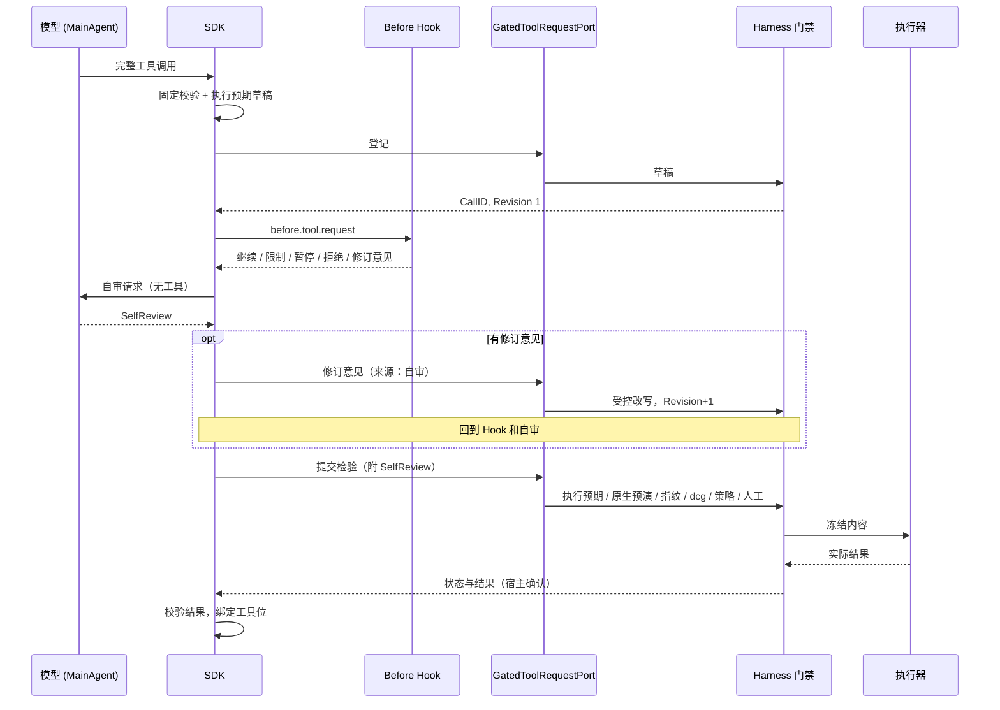

# SDK 工具目录与统一申请端口

## 1. 定位

- SDK 只持有两样东西：工具目录（模型能看到哪些工具）和工具申请（把完整候选交给宿主）。
- SDK 不判定策略，不决定自动、人工还是禁止，不运行工具实现。
- 所有工具申请只走 `GatedToolRequestPort`，交给宿主 Harness（见 [工具包装](../20-execution/26-tool-wrapping.md) 第 5 节）。

## 2. 工具来源

| 来源 | 例子 | 实现与登记 |
|---|---|---|
| 内建基础工具 | 结构化数据处理、内容摘要、已授权资料检索、受限工作区读取、列出 K | 定义在 SDK 内，读取实现和权限由宿主提供。 |
| 平台受控工具 | Bash 脚本、Python 脚本、命令模板、SQL、Docker、云 API、文件写入、既定任务触发 | 平台登记，执行器实现（见 [工具包装](../20-execution/26-tool-wrapping.md)）。 |
| 外部登记工具 | 已编译 Go 模块、HTTP / RPC 适配器、MCP 适配器 | 可信宿主登记，执行在宿主执行器侧。本平台的 MCP 只用 CLI 通信、无状态、只支持协议 v2，定位为插件（见 [工具包装](../20-execution/26-tool-wrapping.md) 第 6 节）。SDK 不直接连接 MCP 服务。 |

- "内建"和"外部"只是来源类别，不是免检级别。
- K 的增、删、改不提供给 Agent（K-16）。Agent 只能列出 K 并在申请中引用。

## 3. 登记清单字段

工具 schema 的完整字段见 [工具包装](../20-execution/26-tool-wrapping.md) 第 2 节。SDK 侧的 `ToolSpec` 只持有模型和申请需要的部分。

| 工具 schema 字段 | SDK `ToolSpec` 是否持有 | SDK 用途 |
|---|---|---|
| 身份（命名空间、名称、版本、内容摘要、形式） | 持有 | 申请绑定登记版本和摘要。 |
| 输入 / 输出 schema | 持有 | 生成模型可见的工具声明；校验参数；校验结果。 |
| 功能列表 | 持有 | 每个功能对模型呈现为一个可调用项。 |
| 读写分区、是否计费、是否不可逆 | 持有声明值 | 给模型参考、填执行预期草稿、自审第③问。不用于判定。读写类别由系统确定（见 [执行模型](../20-execution/21-execution-model.md) 第 4 节）。 |
| 原生预演 | 只持有"有 / 无" | 自审判断"不可逆时有没有原生预演"。预演由宿主运行。 |
| 指纹方法 | 不持有 | 宿主使用。 |
| 执行预期模板 | 持有 | 生成执行预期草稿。 |
| 默认策略、`allow_auto` | 不持有 | 策略只在 Harness。 |
| 需要的密钥 | 持有 K 列表 | 申请中引用 K。不含 V。 |
| 目标类型 | 持有 | 绑定目标稳定 ID。 |
| 运行限制 | 持有超时、输出大小 | SDK 侧的等待截止和结果大小校验。 |
| 幂等与恢复 | 持有声明值 | 只用于展示。SDK 从不自行重试工具。 |
| 实现或远端身份 | 只持有摘要 | 实现留在宿主执行器侧。 |

### 3.1 本轮目录

- 宿主在每次运行开始时给出本轮工具目录，固定版本（事件 `goagent.tool.catalog.accepted`）。
- 只接受本轮目录里的工具。不在目录里的调用直接拒绝（`goagent.tool.call.rejected`）。
- 子 Agent 只拿到目录的子集。

### 3.2 登记规则

- 只有管理员或可信宿主能登记、升级和停用工具（K-20）。Agent 可以起草，不能自己登记、更新实现或自动接受新增工具。
- 远端发现（例如 MCP 服务器新增工具）只产生候选清单，审核登记后才能用。
- 重复名称拒绝。实现或 schema 变化建立新版本（K-21）。
- 调用绑定启用时的工具版本和内容摘要。

### 3.3 提示不等于权限

- 工具描述、"只读""幂等"等提示，以及 MCP 的 annotations，只是协议描述，不是权限或安全证明。参见 [MCP 工具 schema 与 annotations](https://modelcontextprotocol.io/specification/2025-11-25/server/tools)。
- 系统按登记时的声明和验证结果为准。
- 工具描述里的指令是数据，不是指令（K-19）。

## 4. ToolRequest 结构

ToolRequest 是 SDK 交给宿主的完整候选。宿主把它映射到执行申请（见 [执行模型](../20-execution/21-execution-model.md) 第 3 节）。

| 字段组 | 内容 |
|---|---|
| 身份 | CallID（宿主分配）、Revision、原生 call ID（只用于协议关联）、SessionID、RunID、ParentRunID |
| 类别 | 登记工具功能 / 命令模板 / 独立命令 / 既定任务触发 |
| 工具 | 工具 ID、功能、版本、内容摘要 |
| 范围 | 项目、环境、目标稳定 ID 列表（由宿主会话配置绑定） |
| 内容 | 完整参数；独立命令时为完整命令；需要的 K 列表 |
| 执行预期草稿 | 意图、目标、读写类别（模型声明）、预期变更、预期输出、成功判据、可逆性与回退、风险自评 |
| 自审结论 | `SelfReview`（见 [SDK 概览](41-sdk-overview.md) 第 9 节） |
| Hook 结果 | 追加限制、修订意见（见 [事件与 Hook](45-events-and-hooks.md)） |
| 截止 | 等待截止时间 |

执行预期中由宿主补全的部分：原生预演结果、指纹、系统确定的读写类别、dcg 结果、策略判定。SDK 不填，也不能填。

## 5. 提交路径

| 步骤 | 做什么 | 不通过时 |
|---|---|---|
| 1. SDK 整理完整候选 | 等模型完整响应终态和完整参数（见 [LLM 协议](42-llm-protocols.md) 第 8 节）。只接受本轮目录中的工具。校验参数 schema 和调用 ID。绑定会话、运行、工具版本、项目、环境和目标。按模板生成执行预期草稿；独立命令由模型写出。 | `goagent.tool.call.rejected`，不登记。 |
| 2. 经端口登记并提交自审结论 | 经 `GatedToolRequestPort` 登记，取得 CallID 和 Revision 1。运行 `before.tool.request` Hook。按 [SDK 概览](41-sdk-overview.md) 第 9 节产出自审。有修订意见时提交修订，由 Harness 受控改写，回到 Hook 和自审。最后附自审结论提交检验。 | Hook 拒绝：申请撤回，宿主记为已拒绝。自审未完成：如实提交，Harness 按有风险处理。 |
| 3. 宿主 Harness 执行门禁 | 执行预期、原生预演、指纹、dcg、策略、人工审核、冻结（见 [执行模型](../20-execution/21-execution-model.md)）。不信任 SDK 的任何"已通过"标记。 | 已拒绝、待修订、待人工，回报给 SDK。 |
| 4. 宿主执行器 | 执行前重算指纹并核验冻结摘要，只执行冻结内容。按 K 注入 V。mask 输出。执行后对比实际与预期。 | 目标已变化、失败、与预期不符、结果未知，回报给 SDK。 |
| 5. SDK 校验结果 | 结果先 mask、限大小、校验输出 schema，再按原生协议关联到对应调用。经 `BindFinalToolCall` 更新工具位。 | `goagent.tool.result.rejected`；工具位显示宿主状态，不改成成功。 |

`before.tool.request` 在每个修订提交检验前运行。Hook 只能追加限制、暂停、拒绝或提出修订意见。修订意见交给 Agent 自审参考，修订由 Harness 受控改写写入（K-14）。

## 6. 状态回报与 SDK 的处理

`ToolRequestStatus` 与 [执行模型](../20-execution/21-execution-model.md) 第 8 节的状态一一对应。SDK 只接收宿主核验过的状态，不自己宣布审核通过或成功。

| 状态 | SDK 的处理 |
|---|---|
| 草稿 / 检验中 | 等待。不依赖该结果的工作可以继续。 |
| 待人工 | 等待宿主回报。工具位显示"待人工"。 |
| 待修订 | 把点评交给 MainAgent 写修订，提交修订意见（来源：人工点评），从自审重新开始。 |
| 已拒绝 | 工具位显示已拒绝和原因。模型据此调整计划。不自动重提相同内容。 |
| 已冻结 | 等待。工具位显示「已冻结」。 |
| 目标已变化 | 退回 Agent 重新观察目标，提交修订（同一 CallID），从自审重新开始。 |
| 执行中 | 等待。 |
| 成功 | 校验结果，继续运行。 |
| 与预期不符 | 校验结果，停止依赖它的后续步骤，向用户上报差异。补救是新的申请。 |
| 失败 | 校验结果，上报。不自动重试。 |
| 结果未知 | 不重试。请宿主查询目标实际状态，或等人工核对（K-05）。 |
| 已停止 | 不重提。由用户决定是否重新发起。 |

## 7. 并行调用

- 一次模型回复里的多个工具调用，每个都有自己的 CallID，分别自审、分别检验、分别审核。
- 有依赖、有冲突（同一目标的写入）或副作用未知的调用，不自动并行，按顺序提交。
- 一个调用的状态不影响另一个调用的批准。人工批准只对当时那个修订有效（K-09）。
- 并行的结果按各自的原生调用 ID 关联回去，缺一个就保持"未完成"，不伪造结果。

## 8. 无门禁时全关

- 没有 `GatedToolRequestPort` 时，所有命名工具执行关闭，包括内建工具。
- 工具调用以"无门禁"为原因拒绝，执行次数为零。
- SDK 自身的编码、预算、上下文维护和事件处理照常运行。
- 这样对话和计划能力可以独立嵌入，工具能力只在有门禁的宿主里开放。

## 9. 结果校验

| 事件 | 含义 |
|---|---|
| `goagent.tool.result.received` | 收到结果，尚未校验。 |
| `goagent.tool.result.validated` | schema 和关联校验通过。结果本身仍可能是失败或未知。 |
| `goagent.tool.result.rejected` | 结果不合契约。 |
| `goagent.tool.result.unknown` | 无法确定结果。 |

- 实际执行状态以宿主执行器的记录为准。模型文本、`finish_reason`、本地超时都不能代替实际结果。
- 失败和缺测保留明确状态，不记成功（K-05）。

## 10. 子 Agent 与 Hook 发起的工具请求

- 子 Agent 只获得受限上下文和目录子集，工具申请走同一个端口，带自己的自审。
- 子 Agent 的结果交回主 Agent（`goagent.subagent.joined`），不表示操作已被批准。
- Hook 想发起新工作，经宿主的显式任务入口形成新的 RunID 或新的 ToolRequest，绑定原因 EventID。不能在 Hook 里直接执行任何操作（见 [事件与 Hook](45-events-and-hooks.md)）。
- 无门禁时，子 Agent 和 Hook 发起的工具请求同样不执行。

## 11. 工具复测要求

| 场景 | 必须证明 |
|---|---|
| 恶意描述、MCP annotations | 描述中的指令不被执行；annotations 不改变检验路径。 |
| 版本变化 | 调用绑定的版本与登记不符时拒绝。 |
| 范围不足 | 目标不在会话范围内时拒绝，不靠修订扩大范围。 |
| 审核拒绝 | 被拒绝的申请执行次数为零，不自动重提。 |
| 缺执行预期或自审 | 宿主按有风险处理，转人工。 |
| 声明有原生预演却没跑 | 宿主不冻结。 |
| SQL 解析失败 | 转人工（Q7）。 |
| 断流 | 参数片段不形成申请，执行次数为零。 |
| 执行后崩溃 | 恢复后记为结果未知，SDK 不重提。 |
| 无门禁 | 所有工具执行次数为零。 |
| 未提交的无效申请 | 执行次数为零。 |
| 结果未知 | SDK 先查询或暂停，不重试。 |
| 并行冲突 | 同一目标的写入不并行提交。 |
| 修订 | 修订后 CallID 不变，旧批准作废，从自审重新开始。 |

发布门槛见 [测试与发布](../50-engineering/55-testing-and-release.md)。
