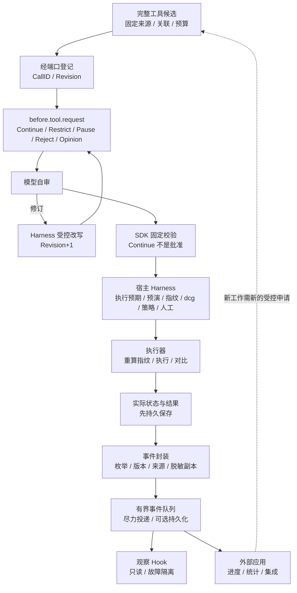

# 公开事件与 Hook 契约

## 1. 两个命名空间

| 命名空间 | 定义在 | 产生者 | 用途 |
|---|---|---|---|
| `goagent.*` | SDK 公共契约 | SDK | 运行、模型请求、上下文、工具申请、Hook 诊断 |
| `devops.*` | 平台公共契约 | 平台各服务（Harness、执行器、调度服务等） | 执行申请、检验、审核、执行、任务、调度、恢复、预授权、表格、部署、事实、告警 |

- 本文第 6 节是 `devops.*` 事件的唯一定义源。其他文档引用本表，不另定义。
- SDK 不依赖平台包。宿主通过显式桥接器把相关 `devops.*` 事件转成 SDK 能理解的状态（第 7 节）。
- 事件不是授权，不能代替审计或事实库。
- `EventType` 用类型化字符串常量定义，例如 `EventRunStarted = "goagent.run.started"`。名称和含义属于公共契约，不随枚举排列改变，不用可变的数字序号作外部协议（参见 [类型化常量](https://go.dev/ref/spec#Constant_declarations)）。
- 表中事件名称已固定。实现阶段逐项验收后才启用。

## 2. Event 公共字段

| 字段 | 说明 |
|---|---|
| `SchemaVersion` | 事件 schema 版本 |
| `EventID` | 唯一 ID。恢复重发同一记录时保留原 ID |
| `EventType` | 事件类型 |
| `StreamID` / `Sequence` | 所属事件流和流内序号。只在同一流内解释顺序，不假设跨进程有全局顺序 |
| `OccurredAt` / `ObservedAt` | 发生时间 / 观测到的时间 |
| `SourceKind` / `SourceRef` | 来源类别（第 3 节）和来源引用 |
| 关联 ID（适用时） | `SessionID`、`RunID`、`ParentRunID`、`RequestID`、`AttemptID`、`CallID`、`Revision`、`OperationID` |
| 范围引用 | 项目、环境、目标稳定 ID 的引用 |
| `Data` | 各事件自己的类型化 payload |

消费者按 `EventID` 去重，并识别序号缺口。

## 3. SourceKind

| 值 | 含义 |
|---|---|
| `SDKObserved` | SDK 自己观察到的本地状态转换。 |
| `ModelReported` | 模型或厂商报告的内容，例如用量、结束原因。只是报告，未经核验。 |
| `HostConfirmed` | 宿主核验过的状态，例如 Harness 和执行器回报的申请状态和结果。 |

工具申请的审核结论和执行结果只能来自 `HostConfirmed`。

## 4. 脱敏与副本

- 交给 Observer 和 Hook 的数据经过来源核验、字段白名单、mask 和大小限制（K-17）。
- 每个接收者拿到独立副本，不共享可修改的运行对象。
- 默认不含：Bash / SQL 原文、工具原始参数、模型原文、V、认证头、完整思考、厂商续接状态。只给摘要、状态和引用。
- Hook 不能产生保留命名空间（`goagent.*`、`devops.*`）中的事件，不能冒充来源。
- 未知事件类型只作观测诊断，不能产生执行含义。

## 5. goagent.* 事件枚举

### 5.1 运行

| EventType | 含义 |
|---|---|
| `goagent.run.created` | 运行已创建。 |
| `goagent.run.started` | 运行进入 loop。 |
| `goagent.run.waiting_input` | 等待用户输入。 |
| `goagent.run.paused` | 本地暂停。 |
| `goagent.run.resumed` | 在同一进程内从暂停恢复。 |
| `goagent.run.cancel_requested` | 收到取消意图。 |
| `goagent.run.cancelled` | 本地运行已结束。不证明外部操作已停止或回滚。 |
| `goagent.run.completed` | 运行正常结束。不表示项目部署等业务成功。 |
| `goagent.run.failed` | 运行失败。 |
| `goagent.run.interrupted` | 宿主恢复时，检查点中的在途运行被标为中断，不续跑（K-24）。 |

以上都表示 SDK 已接受或完成对应的本地状态转换。

### 5.2 模型请求

| EventType | 含义 |
|---|---|
| `goagent.model.request.queued` | 逻辑请求进入队列。关联固定 RequestID。 |
| `goagent.model.request.started` | 开始处理。 |
| `goagent.model.request.retry_scheduled` | 安排重试。不授权重做工具。 |
| `goagent.model.request.cancel_requested` | 收到取消意图。 |
| `goagent.model.request.cancelled` | 本地已停止等待。不证明厂商已停止生成。 |
| `goagent.model.request.completed` | 已取得并校验本次完整响应终态。 |
| `goagent.model.request.failed` | 请求失败。 |

### 5.3 请求尝试与流式

| EventType | 含义 |
|---|---|
| `goagent.model.attempt.started` | 一次实际网络请求开始。有独立 AttemptID。 |
| `goagent.model.attempt.completed` | 该次请求完成。 |
| `goagent.model.attempt.failed` | 该次请求失败。 |
| `goagent.model.attempt.unknown` | 无法确认该次请求的远端状态。 |
| `goagent.model.stream.delta` | 过滤后的部分内容或进度。不能产生可执行工具。 |
| `goagent.model.usage.reported` | 用量报告，保留厂商来源。缺失字段为未知，不填 0。 |

必要协议载荷和完整思考不进事件。

### 5.4 上下文

| EventType | 含义 |
|---|---|
| `goagent.context.snapshot.created` | 候选快照已形成，尚未生效。 |
| `goagent.context.snapshot.committed` | 版本比较成功，有效快照已保存。 |
| `goagent.context.snapshot.commit_conflict` | 版本冲突，旧快照保留。 |
| `goagent.context.compaction.started` | 开始压缩。 |
| `goagent.context.compaction.completed` | 压缩候选已形成。只有 `snapshot.committed` 才表示生效。 |
| `goagent.context.compaction.failed` | 压缩失败，有效快照不变。 |
| `goagent.context.patch.proposed` | Patch 已提出，不表示生效。 |
| `goagent.context.patch.committed` | 校验和版本比较后生效。 |
| `goagent.context.patch.rejected` | Patch 被拒绝。 |
| `goagent.context.patch.commit_conflict` | Patch 版本冲突。 |

只公开版本、来源范围和脱敏引用，不发送原始上下文或 sidecar。

### 5.5 工具目录与申请

| EventType | 含义 |
|---|---|
| `goagent.tool.catalog.accepted` | 本轮目录已由可信宿主验收并固定版本。 |
| `goagent.tool.call.proposed` | 模型给出完整候选。 |
| `goagent.tool.call.rejected` | 候选未通过 SDK 固定校验或被 Hook 拒绝，或无门禁。 |
| `goagent.tool.request.submitted` | 已向 `GatedToolRequestPort` 登记或提交。只表示提交。 |
| `goagent.tool.self_review.completed` | 某修订的自审完成，附结论（无风险 / 有风险）。不是批准。 |
| `goagent.tool.self_review.failed` | 自审未完成（超时、输出不合 schema、预算用尽）。按"未完成"如实提交。 |
| `goagent.tool.revision.proposed` | SDK 已提交修订意见（来源：自审或人工点评）。是否写入以宿主回报为准。 |
| `goagent.tool.request.status_received` | 收到宿主核验过的状态回报。同一 CallID，关联当前 Revision。SDK 不自己宣布审核通过或成功。 |

### 5.6 工具结果

| EventType | 含义 |
|---|---|
| `goagent.tool.result.received` | 收到结果，尚未校验 schema 和关联。 |
| `goagent.tool.result.validated` | 结果契约校验通过。结果本身仍可能是失败或未知。 |
| `goagent.tool.result.rejected` | 结果不合契约。 |
| `goagent.tool.result.unknown` | 无法确定结果。 |

实际执行状态以宿主执行器记录为准。模型文本、`finish_reason` 和本地超时不能代替实际结果。

### 5.7 检查点与子 Agent

| EventType | 含义 |
|---|---|
| `goagent.checkpoint.saved` | 检查点已保存，绑定 `SessionStore` 版本。 |
| `goagent.checkpoint.restored` | 检查点已恢复。只恢复会话和上下文，不续跑在途运行和工具申请。 |
| `goagent.subagent.created` | 子 Agent 已创建。子 Agent 自己的运行仍产生运行事件，带独立 RunID 和 ParentRunID。 |
| `goagent.subagent.joined` | 取得子任务结果。不表示操作已被批准。 |

### 5.8 Hook 诊断

| EventType | 含义 |
|---|---|
| `goagent.hook.failed` | Hook 返回错误或 panic。 |
| `goagent.hook.timed_out` | Hook 超时。 |
| `goagent.hook.queue_overflow` | 订阅队列满，有事件被合并或丢弃。 |
| `goagent.hook.disabled` | 故障订阅按阈值被停用。 |

这一组只发给宿主 Observer，不再分派给 Hook，防止 Hook 故障递归。业务通知由宿主的独立规则处理。

## 6. devops.* 平台事件总表

### 6.1 规则

- 事件在对应状态持久保存之后产生：同一事务写入状态和待发送记录，再由有界投递服务发出（outbox）。
- 至少一次投递。消费者按 `EventID` 去重。
- 信封沿用第 2 节的公共字段，另加 `Producer`（产生组件）和 `Status`（事件后的结果状态，取 [执行模型](../20-execution/21-execution-model.md) 第 8 节的枚举，适用时）。
- 内容默认只含摘要和引用，不含完整命令、SQL 原文或 V。完整记录在审计存储。
- `passed`、`approved`、`frozen` 都不是执行许可。执行器仍做最终核验（K-04）。
- 斜线前缀相同的事件名是各自独立的枚举项。

### 6.2 执行申请、检验与审核

| EventType | 产生者 | 含义 |
|---|---|---|
| `devops.call.proposed` | Harness | 执行申请登记为草稿，分配 CallID，Revision 1。 |
| `devops.call.revised` | Harness | 受控改写写入新修订（K-14）。附修订来源（自审 / 人工点评）。旧检验结果和批准作废。 |
| `devops.inspection.started` | Harness | 对某修订开始检验。 |
| `devops.inspection.passed` | Harness | 该修订的检验已完成：执行预期、原生预演、指纹、自审结论、dcg 结果都已取得，或已记下缺失原因（缺失按 K-08 转人工）。可以进入策略判定。不是批准。 |
| `devops.inspection.failed` | Harness | 检验不合格，不能进入策略判定。例如参数不符合语法、目标越出会话范围。附原因。转人工的情况（K-08）不算失败。 |
| `devops.policy.decided` | Harness | 策略判定结果：自动 / 人工 / 禁止。附来源层级和转人工原因。禁止时申请结束为已拒绝。 |
| `devops.review.requested` | Harness | 申请进入待人工。 |
| `devops.review.approved` | Harness | 人工 ▶ 执行（在核心容器的审核界面发起，Harness 核验并记录）。绑定当时的修订。 |
| `devops.review.rejected` | Harness | 人工 ✕ 拒绝。申请结束为已拒绝。 |
| `devops.review.commented` | Harness | 人工点评。申请转待修订。 |
| `devops.call.frozen` | Harness | 最终修订冻结（K-15）。 |
| `devops.call.target_changed` | 执行器 | 执行前重算指纹不一致，不执行。申请转"目标已变化"，退回 Agent。 |
| `devops.call.stopped` | Harness | 人工取消或恢复中断，申请转已停止。 |

### 6.3 执行

| EventType | 产生者 | 含义 |
|---|---|---|
| `devops.execution.started` | 执行器 | 已持久保存"开始执行"记录，开始执行。 |
| `devops.execution.completed` | 执行器 | 执行结束，实际结果与预期相符（成功）。 |
| `devops.execution.mismatched` | 执行器 | 执行结束，实际结果与预期不符。后续步骤停止。 |
| `devops.execution.failed` | 执行器 | 执行报错。 |
| `devops.execution.unknown` | 执行器；恢复时由 Harness 产生 | 无法确认实际结果（K-05）。等人工核对。 |

### 6.4 既定任务

| EventType | 产生者 | 含义 |
|---|---|---|
| `devops.task.started` | Harness | 任务运行开始。绑定任务版本、参数和触发来源。 |
| `devops.task.step_completed` | Harness | 一步结束。附步骤状态、结构化输出摘要和所选分支。 |
| `devops.task.stopped` | Harness | 任务停在某一步。附原因：不符、未知、失败、无匹配分支、人工取消、恢复中断。 |
| `devops.task.completed` | Harness | 全部步骤成功。 |

### 6.5 调度

| EventType | 产生者 | 含义 |
|---|---|---|
| `devops.schedule.cycle.submitted` | 持久调度服务 | 某周期已提交任务触发。附唯一周期键。 |
| `devops.schedule.cycle.missed` | 持久调度服务 | 某周期没有提交（服务停机或计划暂停）。按计划登记的补跑策略处理，见 [运维表格](../30-features/34-ops-tables.md) 第 9.6 节；恢复后暂停期间的漏跑，在用户恢复计划后处理（Q4）。 |
| `devops.schedule.paused` | 持久调度服务 | 计划暂停：人工暂停或恢复后暂停（Q4）。 |
| `devops.schedule.resumed` | 持久调度服务 | 计划经人工恢复。 |

### 6.6 恢复

| EventType | 产生者 | 含义 |
|---|---|---|
| `devops.recovery.started` | 进入恢复模式的服务（核心、Harness、执行器、调度服务） | 服务进入恢复模式（K-24）。 |
| `devops.recovery.completed` | 同上 | 恢复处理完成，恢复报告已生成：停止的任务、结果未知的执行、暂停的计划。 |

### 6.7 预授权

| EventType | 产生者 | 含义 |
|---|---|---|
| `devops.preauth.issued` | Harness | 完成检验和人工审核后签发预授权（K-11）。 |
| `devops.preauth.used` | 目标本地的预授权核验方，经执行器或监控旁路上报 | 使用一次。可能延迟到达，因为使用不依赖平台在线。 |
| `devops.preauth.exhausted` | 同上 | 达到次数上限，后续动作不执行。 |
| `devops.preauth.expired` | Harness 或目标本地核验方 | 过期，后续动作不执行。 |
| `devops.preauth.revoked` | Harness | 人工撤销。 |

预授权失效时的告警由监控旁路负责（`devops.alert.opened`），不依赖这些事件到达。

### 6.8 运维表格、部署、事实、告警、Agent

| EventType | 产生者 | 含义 |
|---|---|---|
| `devops.table.updated` | Harness | 运维表格记录已更新。附表格、周期、脚本与 schema 版本、运行引用。 |
| `devops.table.daily_cycle.completed` | Harness | 某自然日周期的维护完成。 |
| `devops.table.daily_cycle.failed` | Harness | 某自然日周期的维护失败。旧数据保留并标记状态。 |
| `devops.deployment.state_changed` | Harness（部署规程包的运行） | 项目部署状态变化。 |
| `devops.fact.updated` | 事实地图服务（核心容器） | 事实更新，带来源和时间（K-27）。 |
| `devops.fact.expired` | 事实地图服务 | 事实过期。 |
| `devops.fact.conflict` | 事实地图服务 | 事实冲突。 |
| `devops.alert.opened` | 监控旁路 | 告警产生。 |
| `devops.alert.resolved` | 监控旁路 | 告警恢复。 |
| `devops.alert.delivery_failed` | 监控旁路 | 告警通知投递失败。 |
| `devops.agent.injection_reported` | Agent Worker | Agent 在外部内容中发现疑似注入内容并上报（K-19）。只是提示。 |

表格、部署、事实、告警的业务细节见 [运维表格](../30-features/34-ops-tables.md)、[项目部署](../30-features/32-project-deployment.md)、[事实地图](../30-features/33-fact-map.md)、[监控](../30-features/36-monitoring.md)。

## 7. SDK 与平台事件的桥接

| 平台事件 | 经 `GatedToolRequestPort` 转成 | SDK 事件 |
|---|---|---|
| `devops.call.*`、`devops.inspection.*`、`devops.policy.decided`、`devops.review.*` | 对应的 `ToolRequestStatus` | `goagent.tool.request.status_received`（`HostConfirmed`） |
| `devops.execution.*` | 状态 + `ToolResult` | `goagent.tool.request.status_received`，随后 `goagent.tool.result.*` |
| 其他 `devops.*` | 不进入 SDK | — |

- 桥接器在 Agent Worker 里，只转发属于该会话的 CallID。
- SDK 不订阅 `devops.*`，也不导入平台契约。

## 8. Hook 契约

### 8.1 公共类型

| 类型 | 说明 |
|---|---|
| `HookSpec` | 登记信息：HookID、实现版本、内容摘要、订阅范围、HookPoint、输入与返回 schema、顺序、超时、队列和并发上限。 |
| `HookRegistry` | 可信宿主的注册表。每个运行固定注册表版本。 |
| `ObserverHook` | 观察 Hook：`Handle(ctx, Event) error`。 |
| `BeforeHook` | Before Hook：`Apply(ctx, HookInput) (HookDecision, error)`。 |
| `HookPoint` | Before Hook 的调用时点，第 8.3 节。 |
| `HookInput` | 候选的脱敏副本，按 HookPoint 的字段白名单生成。 |
| `HookDecision` | 返回决定，第 8.4 节。 |

登记规则：

- 管理员或可信宿主审核后登记（K-20）。Agent、模型输出、远端发现都不能注册或更新 Hook。
- 重复 HookID、无法确定的执行顺序，拒绝登记。
- 平台使用同一套注册规则。

### 8.2 两种扩展形式

| 形式 | 调用方式 | 允许 | 不允许 |
|---|---|---|---|
| 观察 Hook | 按 EventType 订阅，异步、有界投递。 | 展示进度、维护宿主统计、日志和集成投影。返回错误只作诊断。 | 修改 SDK 状态、工具结果或审核结论。观察事件没有可改写的返回值。 |
| Before Hook | 只在第 8.3 节的时点调用。按固定顺序串行处理。 | 第 8.4 节的决定。 | 扩大权限、替换固定指令、改原生签名状态、写门禁通过标记、改工具内容。 |

Before Hook 返回后，SDK 重新校验并生成完整候选。

### 8.3 HookPoint

| HookPoint | 调用时点 | 允许的决定 | 固定不变的部分 |
|---|---|---|---|
| `before.run.start` | 运行输入齐备后、进入 loop 前。 | Continue、Pause、Reject；可要求补充业务条件。 | 宿主身份、权限、目标和运行预算由框架检验，不能扩大范围。 |
| `before.model.submit` | 请求候选形成后、固定版本并发送前。 | Continue、Pause、Reject、Patch（获准的普通上下文）；添加资料和标签。 | 固定指令、协议状态、工具目录、端点、凭证和预算。先提交有效快照再编码，不改已发出的请求。 |
| `before.context.edit` | 上下文草稿形成后、快照提交前。 | Continue、Reject、Patch（改写显式思考或普通内容、插入资料、移除允许范围）。 | 按基准版本和 BlockID 提交。固定校验、工具关联、协议状态完整，版本比较通过才生效。 |
| `before.context.compact` | 压缩范围确定后、生成摘要前。 | Continue、Reject；要求保留更多已授权来源。 | 签名状态、未完成工具对和固定约束不可删除。最后按版本比较提交。 |
| `before.tool.request` | 每个修订提交检验前（首个修订在登记后）。 | Continue、Restrict（追加限制）、Pause、Reject、Opinion（修订意见）。 | 不能改工具内容。修订由 Agent 写出、Harness 受控改写写入（K-14）。Continue 不是批准。冻结后不再调用。 |

### 8.4 HookDecision

| 决定 | 含义 |
|---|---|
| `Continue` | 继续。不是批准。 |
| `Pause` | 暂停当前阶段，等宿主处理。 |
| `Reject` | 拒绝当前阶段。工具申请时，SDK 撤回申请，宿主记为已拒绝。 |
| `Patch` | 返回 ContextPatch，走 [上下文管理](43-context-management.md) 第 5.1 节的校验。只用于上下文相关的时点。 |
| `Restrict` | 追加更严格的条件，只能收紧：要求人工审核、缩短截止时间、禁止与其他调用并行、附加审核说明。随申请提交给 Harness。 |
| `Opinion` | 修订意见。交给 Agent 自审参考，并记入日志供人工审核查看。是否修订由 Agent 决定，写入由 Harness 完成。 |

某时点不允许的决定按非法处理。

### 8.5 失败规则

| 情况 | 处理 |
|---|---|
| 已启用的 Before Hook 报错、超时、panic、返回未知决定或非法 Patch | 阻断当前阶段。修正 Hook 版本或输入后重新检验。不用默认 Continue 兜底。 |
| 观察 Hook 失败 | 只影响该订阅。调度器记录诊断，按固定阈值停用故障订阅（`goagent.hook.disabled`）。不改变实际操作结论。 |
| 必须满足才能继续的业务条件 | 登记为 Before Hook 或既定任务的步骤，不能依赖观察事件到达。 |

### 8.6 Hook 发起新工作

- 经宿主的显式任务入口，形成新的 RunID 或新的 ToolRequest，绑定原因 EventID。
- 不能同步重入当前运行，不能递归分派事件。
- 不能在 Hook 的构造、注册或回调中直接执行 Bash、SQL、云 API、Docker 或密钥操作。
- 无门禁时，Hook 产生的工具请求同样不执行。

### 8.7 可信实现与超时

- 编译进宿主的 Go Hook 只接纳可信实现。
- context 取消需要实现配合。超时不证明 goroutine 已停止。
- 超时后的返回不再推进原阶段。仍未退出的回调继续占用并发额度，不无限创建替代回调。
- 外部或不可信实现使用受限的独立进程和版本化 RPC，另设资源和终止边界。
- SDK 的 Hook 接口不是任意宿主代码的安全沙箱。资产执行安全靠宿主权限隔离和执行器。

### 8.8 有界队列与持久事件适配器

| 项 | 规则 |
|---|---|
| 默认队列 | 有界内存队列，尽力投递，不承诺持久化。 |
| 满队列 | 按登记策略合并或丢弃低优先级事件，记录丢弃计数和序号缺口（`goagent.hook.queue_overflow`）。不无限背压 Agent。 |
| 需要恢复和重放的宿主 | 接入持久事件适配器：事件和对应状态先在受控存储中保存，再至少一次投递，消费者幂等处理。 |
| 必要保存 | 审核、审计、执行意图和检查点的保存走固定端口，不依赖可选的 Hook 队列。 |
| 重放 | 重放通知不能自动重复资产操作。 |
| 平台适配器的 SQL | 属于平台自身的固定 SQL，构建期分析（K-23，见 [SQL](../20-execution/24-sql.md)）。 |

### 8.9 与监控旁路的关系

- 采集、规则计算、持久告警和通知独立运行（K-25）。
- SDK Hook 或外部订阅器停机时，监控旁路照常工作。
- Hook 可以提出后续任务，但不能承担核心保活或告警链的唯一通路。

## 9. 路径图

运行、模型、上下文和子 Agent 事件用同一封装。Before Hook 在冻结前，观察 Hook 在事实产生后，二者都不能代替 Harness。

## 10. 事件与 Hook 回归要求

| 场景 | 必须证明 |
|---|---|
| 未知枚举或 schema | 只作诊断，不产生执行含义。 |
| 来源冒充 | Hook 不能产生保留命名空间事件；`HostConfirmed` 只来自宿主。 |
| 敏感字段 | 事件和 Hook 输入不含 V、认证头、完整思考、原始参数。 |
| Before 非法 Patch | 被拒绝，旧快照保留，当前阶段阻断。 |
| 阻断决定 | Pause、Reject 生效；工具申请被撤回时执行次数为零。 |
| 候选变化后 | 重新校验；修订后旧批准作废。 |
| 迟到返回、panic、超时 | 不推进原阶段；并发额度有界。 |
| 慢消费者、满队列 | 有丢弃计数和序号缺口；Agent 不被无限阻塞。 |
| 重复、乱序 | 按 EventID 去重；只在流内解释顺序。 |
| 恢复 | 重发保留 EventID；重放不重复资产操作；在途运行不续跑。 |
| 递归 | 诊断事件不再分派给 Hook；Hook 不能同步重入运行。 |
| 越权 | Hook 不能注入审批、绕过执行预期与策略、改工具内容或重复资产操作。 |
| 旁路独立 | 观察订阅停机不影响监控旁路。 |

公共字符串和 payload 的破坏性变化遵守 SDK 主版本规则（见 [SDK 概览](41-sdk-overview.md) 第 12 节）。发布门槛见 [测试与发布](../50-engineering/55-testing-and-release.md)。
