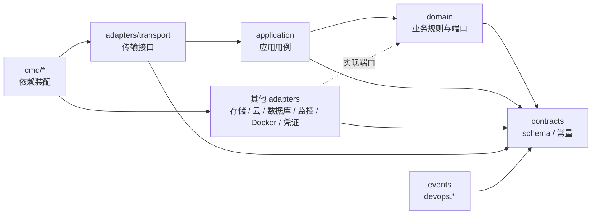

# 仓库与模块布局

本文是未来源码的目录约定。当前不创建 `go.mod`，不写源码（K-30）。

## 1. 模块划分

仓库里有两个 Go 模块：

| 模块 | 目录 | 说明 |
|---|---|---|
| GoAgent SDK | `sdk/agent/` | 独立、可发布的模块。不依赖平台。见 [SDK 概览](../40-sdk/41-sdk-overview.md)。 |
| 平台 | `platform/` | 平台的全部二进制。只有 Agent Worker 依赖 SDK。 |

`go.work` 只用于本地多模块开发：

- 建议不提交 `go.work`。CI 和发布构建用 `GOWORK=off` 分别构建两个模块。
- SDK 必须能在仓库外、没有 `go.work`、没有本地 `replace` 的条件下单独构建，并被第二宿主导入。
- 平台不能用本地 `replace` 掩盖它对 SDK 已发布版本的依赖。
- 模块导入路径跟随项目仓库：`github.com/LeXwDeX/DevOps-Agent/sdk/agent` 与 `github.com/LeXwDeX/DevOps-Agent/platform`。SDK 按 Go 子目录模块规则打标签（`sdk/agent/vX.Y.Z`）。

## 2. 顶层目录

```text
docs/                    # 设计文档库（本库）
sdk/agent/               # GoAgent SDK，独立模块
platform/                # 平台模块
go.work                  # 只在本地使用，不作为构建输入
```

## 3. SDK 模块

`sdk/agent/` 是独立、可发布的 Go 模块。它的公共 API、协议、上下文、工具和事件设计见 [41](../40-sdk/41-sdk-overview.md) 至 [45](../40-sdk/45-events-and-hooks.md)；模块内部的目录约定以 [SDK 概览](../40-sdk/41-sdk-overview.md) 第 13 节为准，本文不重复。

本文只约定 SDK 与仓库其他部分的关系：

| 规则 | 说明 |
|---|---|
| 不依赖平台 | `sdk/agent` 不导入 `platform` 的任何包。 |
| 独立构建 | 在仓库外、无 `go.work`、无本地 `replace` 的条件下可以构建，并被第二宿主导入。 |
| 公共类型干净 | 公共类型不暴露厂商类型和候选框架类型。 |
| 不碰资产 | SDK 不直接访问平台数据库、Docker、云资源、Bash、SQL 或资产凭证。 |
| 第二宿主样例 | 放在 SDK 模块内的 `examples/second-host/`。 |

## 4. 平台模块

```text
platform/
  go.mod
  cmd/                     # 每个二进制一个目录，只做依赖装配
    core/                  # 核心容器内的控制服务
    agent-worker/          # Agent Worker，嵌入 GoAgent SDK
    harness/               # 执行门禁与既定任务编排
    scheduler/             # 持久调度服务
    executor/              # 执行器，唯一操作项目目标的进程
    model-proxy/           # 模型出口代理
    substrate/             # 底座：底座控制服务与节点代理（Supervisor 托管）
    monitor-worker/        # 监控旁路节点
    migrate/               # 平台库迁移入口，只由底座作为受控执行调用
  internal/
    domain/                # 业务规则与端口定义
      project/  session/  request/  task/  policy/
      approval/  fact/  table/  secretref/  deploy/
    application/           # 用例、状态机、端口编排
    adapters/              # 端口的具体实现
      transport/           # HTTP/JSON、任务队列、节点通道
      storage/             # pgx + sqlc；按库分包
      agent/               # SDK 宿主端口实现（只供 agent-worker）
      cloud/               # 云适配器：抽象层、厂商对接、数据库类型派生，见 35 第 11 节
      database/            # SQL 方言解析与分类，见 24
      monitoring/          # 自研监控模块与派生解析器，见 36
      docker/              # Moby client（底座节点代理与执行器分别装配）
      secrets/             # 凭证库访问（只供 executor、model-proxy）
      dcg/                 # dcg 调用适配
      sandbox/             # 工具沙盒后端，见 12 第 10 节
    contracts/             # 按职责域集中的 schema、生成类型、常量与错误码
      request/  policy/  tool/  task/  model/  deploy/  errors/
    events/                # 平台运维事件 devops.*，独立于 SDK
  assets/                  # 出厂登记资产的源文件，见第 7 节
  migrations/              # 版本化 SQL 迁移文件，按库分目录
    core/  harness/  scheduler/  audit/  config/
  deploy/                  # 每个二进制的镜像构建文件、部署包模板、环境模板、supervisord 配置模板
  test/                    # 跨二进制的契约测试、负例语料、故障注入用例
```

说明：

- `cmd/<二进制>/` 只做依赖装配：决定这个二进制拿哪些适配器和哪些凭证。业务逻辑不写在 `cmd` 里。
- 每个常驻进程一个二进制。首版打成两个镜像：core 镜像含 `core`、`agent-worker`；runtime 镜像含 `harness`、`scheduler`、`executor`、`model-proxy`（见 [组件与边界](../10-architecture/11-components-and-boundaries.md) 第 5 节）。同容器的进程使用不同运行身份。
- 镜像只含二进制和静态文件，不含配置（K-31）。`deploy/` 下的配置模板在部署时写入外部配置目录。
- `migrate` 不是常驻服务。它只持有迁移账号，由底座在一次受控执行中调用（见 [部署底座](../10-architecture/12-deployment-substrate.md) 第 6.3 节）。
- 包内单元测试和 `testdata/` 放在各自包里；`test/` 只放跨二进制的契约测试和语料。

## 5. 依赖方向

平台采用"传输接口 → 应用用例 → 业务规则"的调用方向。业务规则定义所需的端口；适配器实现端口。



规则：

| 规则 | 说明 |
|---|---|
| 业务规则不依赖适配器 | `domain` 和 `application` 不导入任何 `adapters` 包。 |
| 厂商类型留在适配器 | 云 SDK、数据库驱动、Moby client、框架类型只出现在 `adapters` 下。 |
| contracts 是叶子 | `contracts` 不导入平台其他包。 |
| SDK 不依赖平台 | `sdk/agent` 不导入 `platform` 的任何包。 |
| 只有 Worker 依赖 SDK | 只有 `cmd/agent-worker` 和 `adapters/agent` 导入 SDK。Harness 接收的是 HTTP/JSON 执行申请，不依赖 SDK 类型。 |
| 只读与写入端口分开 | 只读观测端口和写操作端口是两个接口，不合并。 |
| 不暴露任意 SQL | 存储适配层只提供固定查询的类型化接口。 |
| 自动检查 | CI 用依赖检查（基于 `go list`）验证上述规则，见 [测试与发布](55-testing-and-release.md)。 |

## 6. 各二进制只拿本职责凭证

每个二进制在 `cmd` 里装配时，只拿到本职责需要的凭证和接口（K-18）。

| 二进制 | 可以持有 | 不能持有 |
|---|---|---|
| core | 核心业务库和事实库账号；审计库只读账号（审计页面）；调用 Harness 的接口凭证 | 任何 V；Docker socket；Harness 库和审计库的写权限；模型 API key |
| agent-worker | 任务队列访问；调用 Harness 和模型出口代理的接口凭证 | 任何 V；Docker socket；宿主 shell；数据库账号 |
| harness | Harness 库账号；审计库追加写账号；调用执行器的接口凭证 | 任何 V；Docker socket |
| scheduler | 调度服务库账号；向 Harness 提交触发的接口凭证 | 任何 V；直接调用执行器 |
| executor | 按 K 读取 V 的凭证库权限；审计库追加写账号；项目目标网络 | 模型 API key；修改策略或登记资产 |
| model-proxy | 只限模型 API key 的凭证库读权限；已批准的模型端点 | 资产凭证；项目目标网络 |
| substrate | 本机 Docker socket（只在节点代理）；节点通道证书 | 资产凭证；模型 API key |
| monitor-worker | 监控旁路自己的存储和只读采集配置（见 [监控](../30-features/36-monitoring.md)） | 写操作凭证；依赖核心或 Worker |
| migrate | 迁移账号 | 运行期业务账号以外的任何凭证 |

容器划分和挂载表见 [组件与边界](../10-architecture/11-components-and-boundaries.md) 第 5 节。凭证库的完整形态随 Q10 定。

## 7. 登记资产目录

`platform/assets/` 存放随版本发布的**出厂资产**源文件。导入不等于登记：导入后由管理员审核登记，固定版本和摘要才生效（K-20）。项目自己的资产（项目规程包、项目命令模板等）在平台里创建，保存在配置库，不进仓库。

```text
platform/assets/
  dcg-rules/           # 内置 dcg 规则包
  policies/            # 系统全局兜底策略、各 provider 的默认策略
  command-templates/   # 内置命令模板
  tasks/               # 内置既定任务定义
  procedures/          # 内置规程包（例如 OSS 部署为 systemd 服务）
  tools/               # 内建工具 schema
  providers/           # provider schema（每个云产品一份）
  mask-rules/          # 内置 mask 规则
  sandbox-policies/    # 沙盒策略
```

规则：

- 每个资产一个目录或文件，带清单：ID、版本、说明。内容摘要在构建时计算，不手写。
- CI 按对应 schema 校验每个资产（见 [Schema 与常量](52-schema-and-constants.md)）。
- 改内容就升版本（K-21）。旧版本保留到没有在途任务使用。
- 资产里不能有 V，只能引用 K。

## 8. 云适配器与监控解析器

- 云适配器（抽象层、厂商对接、数据库类型派生）的目录见 [云服务商](../30-features/35-cloud-providers.md) 第 11 节，放在 `platform/internal/adapters/cloud/` 下。
- 自研监控模块和派生解析器的目录见 [监控](../30-features/36-monitoring.md) 第 10 节，放在 `platform/internal/adapters/monitoring/` 下。
- provider schema 的出厂版本放在 `platform/assets/providers/`（第 7 节），随适配器版本一起登记。
- 共同规则：每个产品或派生类型一个独立文件；派生类型必须嵌入对应的基础类型，只重写差异，通过接口分派（K-28）；登记并固定父类型与派生版本。

## 9. 参考

- [Go 模块布局](https://go.dev/doc/modules/layout)
- [Go 模块版本号](https://go.dev/doc/modules/version-numbers)
- [Go 模块发布流程](https://go.dev/doc/modules/release-workflow)
