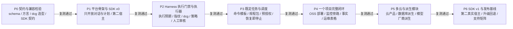

# 阶段交付与验收

## 1. 原则

- 按阶段交付，累积复测（K-29）。每个阶段交付一个可验收的范围。
- 阶段验收覆盖：本阶段新能力、所有已交付的安全关键路径、受影响的旧功能、兼容和恢复。
- 验收失败先修复再复测，不用推进下一阶段代替修复。
- 赶进度时缩小范围，不把已知的安全、一致性、兼容或恢复缺陷留到后面。
- 阶段完成不授予永久执行权。运行时每次执行仍先检验，再执行（K-01）。
- 没通过验收的能力关闭入口，不先开放再补门禁。

## 2. 阶段路线

每个箭头都是一道复测门槛。第 5 节的共用验收条件作用于所有阶段。

## 3. 各阶段范围与条件

### P0 · 契约与兼容检验

| 项 | 内容 |
|---|---|
| 目标 | 固定契约，用隔离原型证明关键技术路线可行。 |
| 可交付范围 | 模块依赖方向与目录（[53](53-repo-layout.md)）；schema 格式与生成工具；首批 schema：执行申请、执行预期、指纹方法、策略、工具 schema、命令模板、任务定义、预授权（[52](52-schema-and-constants.md) 第 3 节）；集中常量与错误码；dcg 选型评估（Q11）；SQL 方言 PoC（pg_query_go、TiDB parser 覆盖矩阵）；CGO 与 amd64/arm64 双架构构建；SDK 契约：公共类型、宿主端口、ModelRole、EventType、HookPoint、协议语料；凭证库最小设计（Q10）与 K→V、mask 契约；底座门禁形态；候选框架 PoC（Eino、Google ADK Go）；Temporal 评估结论（Q15，首版默认不采用）；模块发布路径。 |
| 不做 | 不开放任何真实资产执行。PoC 只在隔离环境。 |
| 进入 P1 的条件 | schema 和常量各有唯一定义源，生成一致性检查通过；执行申请能绑定内容摘要、目标、执行预期和指纹；同内容同摘要，改动任一字节摘要改变；不支持的 SQL 方言或解析失败判为转人工（Q7）；读写类别无法确定判为转人工；dcg 候选对规则样本集的结果有记录，选型结论已由用户确认（Q11）；SDK 在无 `go.work`、无 `replace` 的条件下独立构建；CGO 镜像在两种架构上运行；P1 依赖的待定项（Q10、模块路径）已有结论或明确的默认做法。 |

### P1 · 平台骨架与 SDK v0

| 项 | 内容 |
|---|---|
| 目标 | 平台能跑起来，用户能和 Agent 对话、做计划。所有工具执行关闭。 |
| 可交付范围 | 核心控制服务的模块骨架：项目、会话、对话、任务状态；Agent Worker 与版本化任务队列协议；GoAgent SDK v0：一种基础协议、请求管理、ModelRole 路由、上下文投影与 ContextPatch、快照与压缩、对话与计划、公开事件枚举、ObserverHook 与 BeforeHook、宿主端口；第二宿主样例；模型出口代理与凭证库最小实现（模型 API key 以 K 引用）；输入侧 mask 与自动转 K（[25](../20-execution/25-secrets.md) 第 5 节）；审计存储骨架；平台管理模块的身份与模型配置最小版（[38](../30-features/38-platform-admin.md)）；底座最小版：单 VM，supervisord 托管底座控制服务和节点代理，按固定 digest 部署和重启平台组件，人工 ▶ 执行。 |
| 开放能力 | 对话与计划。没有 Harness 时所有工具执行关闭（[26](../20-execution/26-tool-wrapping.md) 第 5 节）。 |
| 进入 P2 的条件 | 第二宿主不依赖平台服务就能运行；没有门禁时，工具请求执行次数为零；取消、限额、并发、子 Agent 和脱敏事件通过；Hook 越权、超时、panic、慢订阅和重复通知都有明确处理；非法 ContextPatch 或版本冲突时保留旧快照；压缩失败不覆盖有效快照；工具参数分片不提前派发；模型 API key 的 V 不出现在 Worker、日志、事件和上下文中；粘贴到对话里的密钥被转成 K；Worker 停止时核心页面和记录仍可用；服务重启后进入恢复模式（K-24）；平台自身固定 SQL 已完成构建期分析（K-23），迁移由底座作为受控执行运行。 |

### P2 · Harness 执行门禁与执行器

| 项 | 内容 |
|---|---|
| 目标 | 完整的执行门禁和执行器最小闭环。 |
| 可交付范围 | 执行申请全流程（[21](../20-execution/21-execution-model.md)）：执行预期、原生预演（有则必跑）、状态指纹、执行后对比；模型自审结论接入；dcg 接入与规则包登记；策略分层（K-07）与会话模式；转人工条件（[22](../20-execution/22-review-and-policy.md) 第 5 节）；人工审核界面 ▶ 执行 / ✕ 拒绝 / 点评；同一 CallID 修订（Revision 加一）与受控改写；冻结；执行前指纹核验；执行器按 K 注入 V 与输出 mask；追加式审计；命令模板库最小版（登记、参数语法）；独立命令只能人工执行（K-10、Q1）；人工终端逐条提交（Q6）；一种 SQL 方言的门禁（[24](../20-execution/24-sql.md)）；平台管理模块的策略中心、登记中心、K 管理、mask 规则、审计页面最小版；内建、外部、Hook 发起和子 Agent 发起的工具请求共用同一入口。 |
| 开放能力 | 命令模板按策略执行；独立命令经人工执行；一种 SQL 路径。只在授权的隔离环境验证。 |
| 进入 P3 的条件（负例） | 执行前指纹变化：不执行，状态为"目标已变化"；dcg 命中：不自动执行，转人工；dcg 规则标为禁止：直接拒绝；策略为禁止：任何会话模式下执行次数为零；修订后旧的检验结果和人工批准全部失效；缺少自审结论按"有风险"处理；读写类别无法确定、无法采集指纹、不可逆且无原生预演：都转人工（K-08、Q3）；SDK 或核心传来的"已批准"标记被忽略；冻结后的内容无法修改；执行器拒绝摘要不符的内容；`EXPLAIN ANALYZE` 不被当作预演；V 不出现在命令内容、输出、日志、上下文和审计中，`echo $变量` 的输出被 mask；执行中崩溃后状态为"结果未知"，先查询实际状态；重复消息不重复执行；dcg 不可用时不自动执行（K-08）。 |
| 进入 P3 的条件（正例） | 一条命令模板按自动策略执行成功并通过结果对比；一条独立命令经点评修订、▶ 执行成功；一条 SQL 在隔离测试库完成预期、预演、指纹、执行和对比；审计里能完整还原以上过程。 |

### P3 · 既定任务、规程与调度

| 项 | 内容 |
|---|---|
| 目标 | 日常运维的主路径：已登记的任务按步骤和分支运行，按计划触发。 |
| 可交付范围 | 既定任务编排（[23](../20-execution/23-harness-tasks.md)）：步骤、类型化分支条件、兜底分支、补偿步骤；命令模板库完善；规程包登记与版本；持久调度服务：时间表达式、时区、项目自然日、唯一周期键；预授权签发与本地确定性核验（K-11）；恢复即停止（K-24）：恢复模式、恢复报告、计划暂停（Q4）、从用户选定的步骤重新检验；项目 Agent 生成（[31](../30-features/31-project-workbench.md)）。 |
| 开放能力 | 已登记任务按策略运行；定时触发；预授权动作。 |
| 进入 P4 的条件 | 分支判断不调用模型；没有条件匹配时停止并转人工；步骤"与预期不符"或"结果未知"时不进入任何分支；登记不代替每一步的检验；Agent 不能跳步或改步骤内容；任务新版本不影响在途运行；同一周期不重复提交；核心、Worker、Harness 或执行器重启后，在途任务为"已停止（恢复中断）"，执行中的申请为"结果未知"，计划暂停，没有任何自动续跑；重新执行从头检验，不复用旧批准；预授权在内容摘要变化、次数超限或过期时拒绝执行；预授权核验不调用模型、不依赖平台在线。 |

### P4 · 一个项目的完整闭环

| 项 | 内容 |
|---|---|
| 目标 | 在一个真实授权的测试项目上跑通全部主路径。 |
| 可交付范围 | 接入一个授权测试项目；OSS 制品部署为 systemd 服务（[32](../30-features/32-project-deployment.md) 第 4 节），已审核的启动定义和重启配置作为预授权（32 第 6 节）；监控旁路独立节点、告警与通知（[36](../30-features/36-monitoring.md)）；定时巡检；事实地图（[33](../30-features/33-fact-map.md)）；首张运维表格与维护脚本（[34](../30-features/34-ops-tables.md)）；底座跨 VM 分发与迁移演练（[12](../10-architecture/12-deployment-substrate.md)、[13](../10-architecture/13-state-and-recovery.md) 第 4 节）。只开放一个云厂商和一种数据库类型。 |
| 开放能力 | 该项目范围内的部署、巡检、事实采集和运维表格。 |
| 进入 P5 的条件 | 按项目要求验收健康、日志、权限、回退和事实新鲜度；关闭 Worker 和核心后，监控采集和告警继续（K-25）；Harness 不可用时所有执行关闭；Worker 停机时持久调度服务仍能提交既定任务，门禁照常；跨 VM 迁移通过，同一逻辑实例只有一个活动实例；单一重启责任方验证通过；运维表格：维护脚本未登记时禁止建表、直接写入被拒绝、字段或统计规则变更需要新版本、周期不重复不漏记、缺测显示为未知而不是"否"或 0（K-05）、并发冲突有明确结果；事实带来源、时间和核验状态，过期和冲突明确显示（K-27）。 |

### P5 · 多云与派生模块

| 项 | 内容 |
|---|---|
| 目标 | 按产品、按类型逐个扩展，不改门禁。 |
| 可交付范围 | Azure、阿里云、腾讯云逐产品扩展（[35](../30-features/35-cloud-providers.md)）；MySQL、PostgreSQL 派生数据库类型；自研监控模块与派生解析器（[36](../30-features/36-monitoring.md)）；四种基础模型协议与 GLM、DeepSeek 等厂商派生适配器（[42](../40-sdk/42-llm-protocols.md)）。按 SDK 独立版本交付，不与某个云产品绑定。 |
| 进入 P6 的条件 | 每个新增适配器都有：独立文件、能力声明（原生预演、幂等、状态查询、失败恢复）、读写分区与默认策略、契约测试、失败恢复测试、版本矩阵；派生适配器证明复用了父实现、重写通过接口分派生效、门禁未改变（K-28）；解析失败仍转人工；冲突、缺测和解析失败不标为健康；新解析器回放旧证据不重复告警、不执行修复。 |

### P6 · SDK v1 与发布基线

| 项 | 内容 |
|---|---|
| 目标 | SDK 公共 API 稳定；平台有完整的发布和运维基线。 |
| 可交付范围 | 稳定的 SDK 公共 API 与 v1；第二个真实宿主接入；发布清单、升级与回退流程、支持矩阵、维护责任、运维恢复手册（[55](55-testing-and-release.md)）。 |
| 发布条件 | SDK 在最低和当前 Go 版本上与已有调用方通过；模型协议、流式、压缩、工具登记、事件和 Hook 的兼容与故障恢复矩阵通过，支持范围写清楚；服务协议、数据迁移、资源限额和恢复通过；已知阻断缺陷为零；功能、测试、观测和文档同时齐备。 |

## 4. 能力开放表

| 能力 | 开放阶段 | 前提 |
|---|---|---|
| 对话、计划、项目资料问答 | P1 | 工具执行关闭 |
| 独立命令（人工 ▶ 执行） | P2 | 门禁全流程通过负例 |
| 命令模板按策略自动执行 | P2 | 同上 |
| 测试库 SQL（一种方言） | P2 | SQL 门禁通过 |
| 人工终端 | P2 | Q6 默认形式 |
| 既定任务、规程包 | P3 | 编排负例通过 |
| 定时触发 | P3 | 唯一周期键、恢复后暂停 |
| 预授权 | P3 | 本地确定性核验 |
| 真实项目部署、监控旁路、事实地图、运维表格 | P4 | 一个项目、一个云厂商、一种数据库 |
| 多云产品、更多数据库类型、更多模型厂商 | P5 | 逐个验收 |
| SDK v1 | P6 | 兼容矩阵通过 |

## 5. 各阶段共用的验收条件

| 条件 | 说明 |
|---|---|
| 新能力 | 本阶段交付范围全部通过正例和负例。 |
| 累积复测 | 已交付的安全关键路径全部复测通过（清单见 [测试与发布](55-testing-and-release.md) 第 3 节）。 |
| 兼容 | 受影响的旧接口、schema、规程和在途版本按支持范围复测。 |
| 恢复 | 断点崩溃注入、恢复即停止、结果未知的处理通过。 |
| 观测 | 指标、mask 后的日志和事件到位。 |
| 文档 | 设计文档与实现一致；只记当前设计。 |
| 版本清单 | 依赖、schema 版本和发布清单条目更新。 |

## 6. 之后的迭代

- 后续迭代继续按同一套条件交付小范围增量。
- 新的宿主、云产品、数据库版本或模块类型，不能因为原有阶段已通过就自动进入支持矩阵。新增路径和受影响的旧路径都要重新检验。
