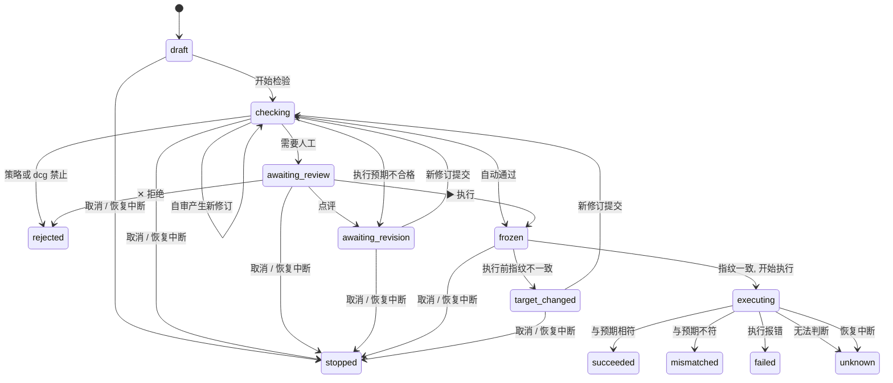

# core 层详细设计

## 1. 范围

本块交付 `platform/internal/core/`，以及它直接用到的 `internal/schema/` 和 `internal/model/` 部分。

| 做 | 不做 |
|---|---|
| 执行申请的数据模型、状态机和修订 | 任何真实外部 I/O（数据库、SSH、云、dcg 进程、模型） |
| 检验流水线：执行预期校验、预演结果接收、指纹比对、自审结论接收、dcg 结论接收、策略判定、转人工判断、人工审核、冻结 | HTTP 接口、页面、任务队列 |
| 策略解析（纯函数） | provider 的实现 |
| 既定任务编排引擎：步骤、分支条件、运行状态 | 持久调度服务的计时逻辑 |
| 恢复即停止的状态处理 | 预授权签发与本地核验（放到后面的块） |
| `devops.*` 事件的产生 | 凭证库和 K→V 注入（只定义端口） |
| 端口接口定义和内存测试替身 | SDK |

完成标准：所有逻辑在内存里用测试替身跑通，第 9 节的测试全部通过，第 10 节的审核清单全部满足。完成后不开放任何实际执行能力。

## 2. 包结构

```text
internal/
  schema/
    core/                 # SchemaID 常量；对外契约结构在有边界的块里加入
    consts/               # 状态、读写类别、策略模式等枚举
    errcode/              # 错误码
  model/
    request/              # ExecutionRequest 及其组成部分
    policy/               # PolicyRule、PolicySet
    task/                 # TaskDefinition、Step、Branch、Run
    ids/                  # CallID、Digest、Version 等值对象
  core/
    request/              # 执行申请状态机与修订
    pipeline/             # 检验流水线
    policy/               # 策略解析与转人工判断
    review/               # 人工审核动作与冻结
    orchestrator/         # 既定任务编排引擎
      expr/               # 条件表达式（分支条件与成功判据共用）
    recovery/             # 恢复即停止
    events/               # devops.* 事件构造
    ports/                # 全部端口接口
    coretest/             # 每个端口的内存测试替身和端口契约测试
    flowtest/             # 只含测试：流水线、编排、恢复联合跑通
  archtest/               # 只含测试：依赖方向检查
```

依赖：`core/*` 只导入 `model`、`schema` 和标准库。`core` 内部子包之间单向依赖，`pipeline` 和 `orchestrator` 在最上层。指纹的采集和比对放在 `pipeline`，不单设 `fingerprint` 包。`devops.*` 事件常量放在 `core/events`。

## 3. 核心类型（model 层）

### 3.1 执行申请

```text
ExecutionRequest
  CallID        稳定编号
  Revision      修订号，从 1 开始
  Digest        当前修订的内容摘要（覆盖 Content、Scope、Expectation）
  Source        来源：task_step / registered_tool / task_launch / ad_hoc / pre_authorized / human_terminal
  SessionID     会话 ID
  Task          任务运行 ID、步骤 ID（来源为 task_step 时必填，其他来源不得带；带了返回 `core.invalid_argument`）
  Scope         Project、Environment、Targets（稳定 ID 列表，排序去重）
  Content       UnitRef（已登记单元的 ID、版本、摘要；独立命令为空）、Rendered（展开后的完整内容）、Params、SecretKeys（K 列表）
  Expectation   执行预期（3.2）
  Submission    提交时附带的输入：SelfReview、Before Hook 是否要求人工及原因、内容是否无法分析及原因
  Fingerprint   采集方法与方法版本、采集时间、状态（collected / unavailable）、值
  Checks        Preview、SelfReview、DCG、PolicyDecision（各自带结论和时间）
  Versions      执行申请 SchemaID、策略版本与命中层、dcg 规则包版本、指纹方法版本
  Review        人工动作列表（动作、点评、人、时间、对应 Revision 和 Digest）
  Rejection     拒绝来源（human / policy_forbid / dcg_forbid / inspection_failed）、错误码、原因
  Stop          停止原因（cancelled_by_human / recovery_interrupted）
  Frozen        冻结摘要、冻结时间（未冻结为空）
  Execution     开始、结束、退出状态、输出引用、结构化输出、对比结论
  State         状态（第 4 节）
  Version       乐观锁版本号（CAS 用）
```

各子结构的取值：

| 字段 | 取值 |
|---|---|
| Preview 状态 | `none` 单元未声明预演、`passed` 预演成功、`failed` 预演失败 |
| SelfReview 结论 | `no_risk`、`risk`、`not_applicable`（只用于既定任务步骤）；缺失按 `risk` |
| DCG 结果 | `pass`、`hit`、`forbid`、`unavailable`，附规则 ID 和规则包版本 |

Checks 里每一项（Preview、SelfReview、DCG、PolicyDecision）的 `At` 都是流水线记录它的时间，取 `Clock.Now()`。端口返回的 Preview 和 DCG 结果若自带时间，保留；没有就由流水线补。SelfReview 和 PolicyDecision 的时间一律由流水线写：提交时附带的 `Submission.SelfReview` 不带时间，既定任务步骤记的 `not_applicable` 自审也有时间。纯函数 `policy.Resolve` 和 `Escalate` 不读时钟，返回的 `Decision.At` 为零值，由流水线填写。

Harness 和执行器的实现版本由装配层填写，不在 core 里。

### 3.2 执行预期

```text
Expectation
  Intent          一句话意图
  Targets         稳定 ID
  Category        read_only / write / delete / permission_change / start_stop / billing / unknown
  ExpectedChange  预期变更（文字 + 可选的结构化范围，例如影响行数区间）
  ExpectedOutput  预期输出
  SuccessCriteria 成功判据（结构化，见 3.3）
  Reversible      reversible / irreversible / unknown
  Rollback        可逆时的回退方法
  Preview         单元是否声明原生预演；结果记在 Checks.Preview
  RiskNote        风险自评
```

`Category`、`Reversible` 和 `Preview` 以登记声明为准，不信任提交方填的值：已登记单元用登记值（登记值为空按 `unknown`）。独立命令没有登记单元：Category 和 Reversible 一律是 `unknown`，Preview 一律为空（不调用预演端口），提交方填的值被忽略。dcg 和解析器的结论由以后的块接入。所以独立命令的权限区一律是 `write`，谎报 `read_only` 绕不过 write 区的禁止规则。

必填字段：Intent、Targets、Category、ExpectedChange、ExpectedOutput、SuccessCriteria（至少一项）、Reversible。Reversible 为 `reversible` 时 Rollback 必填。Expectation.Targets 必须与 Scope.Targets 是同一个集合，每个目标 ID 去掉空白后不能为空。

### 3.3 成功判据

结构化的判据列表，每项是一个条件表达式（与第 7.3 节分支条件同一种表达式），作用在本次执行结果的结构化输出上，不加前缀，例如 `exit_code == 0`、`rows_affected <= 120`。写不成表达式的判据保留为文字，这类结果对比交给人工，结论记为 `unknown`。运行时判据引用的字段不存在，结论也记为 `unknown`。

## 4. 执行申请状态机

状态取自 [执行模型](../20-execution/21-execution-model.md) 第 8 节，常量值见 [Schema 与常量](../50-engineering/52-schema-and-constants.md)。



规则：

- 状态转换只能经 `core/request` 的转换函数，每个转换校验当前状态和前置条件。从终态发起的任何转换返回 `core.terminal_state`；终态以外、不在表里的转换返回 `core.invalid_transition`。
- 终态：`rejected`、`succeeded`、`mismatched`、`failed`、`unknown`、`stopped`。终态不再转换。
- `unknown` 没有出口。人工核对的结论另记一条审核记录，不改状态。要重做就发起新的申请（新 CallID，13 第 2.2 节）。
- 申请创建时为 `draft`，产生 `devops.call.proposed`。
- 每次转换写入新的 `Version`，存储端口用 CAS 提交（见 [状态与恢复](../10-architecture/13-state-and-recovery.md) 第 3 节）。
- 转换成功并持久保存后才产生事件。

## 5. 检验流水线

`pipeline.Inspect(request)` 按固定顺序执行，任何一步失败都停在当前步并给出原因。

| 步骤 | 做什么 | 结果 |
|---|---|---|
| 1 范围校验 | 目标在会话的项目和环境范围内；已登记单元的版本和摘要与登记一致 | 不符 → `rejected`，拒绝来源 `inspection_failed`，错误码 `core.scope_violation` / `core.unit_mismatch`，产生 `devops.inspection.failed` |
| 2 执行预期校验 | 必填字段齐全（3.2）；Category、Reversible、Preview 按登记值覆盖（独立命令见 3.2） | 不合格 → `awaiting_revision`，错误码 `core.expectation_invalid` |
| 3 原生预演 | 单元声明有预演时，经 `PreviewPort` 运行并保存结果 | 预演失败 → 转人工，附预演输出 |
| 4 采集指纹 | 经 `FingerprintPort` 采集并保存 | 采集不到 → 标记，转人工 |
| 5 自审结论 | 接收提交时附带的 `SelfReview`；既定任务步骤记为 `not_applicable`；其余来源缺失按 `risk` | — |
| 6 dcg | 经 `DCGPort` 检查最终内容 | 命中 / 不可用 → 标记；禁止规则 → `rejected` |
| 7 策略判定 | `policy.ResolveValidated`（第 6 节）：先校验策略集，再 `Resolve` | auto / manual / forbid |
| 8 转人工判断 | `policy.Escalate`：按 K-08 汇总第 3 至 7 步的标记 | 最终 auto / manual / forbid |
| 9 去向 | auto → 冻结；manual → `awaiting_review`；forbid → `rejected` | — |

事件：开始时 `devops.inspection.started`；第 6 步后 `devops.inspection.passed`；第 8 步后 `devops.policy.decided`；然后按去向产生 `devops.call.frozen`、`devops.review.requested` 或无额外事件（禁止时 `policy.decided` 已说明结束为已拒绝）。

执行前的最后核验 `pipeline.PreExecute(request)` 由执行器所在进程调用：核对冻结摘要、重新采集指纹并比对。摘要不一致 → 返回 `core.digest_mismatch`，不执行；检验时采集到了指纹，而执行前指纹不一致或采集不到 → `target_changed`（`core.fingerprint_changed`），不执行。

检验时指纹不可用（第 4 步标记，申请因此转了人工），且人工已对当前 Revision 和 Digest 点了 ▶ 执行：执行前不做指纹比对，照常执行。人工是在知道没有指纹的情况下批准的；否则这类申请批准后永远执行不了。`devops.execution.started` 事件和开始执行的审计记录里带 `fingerprint_unavailable_human_confirmed: true` 和说明"指纹不可用，人工已确认"。检验时指纹不可用而没有人工批准就已冻结的申请，以及指纹记录缺失或状态不是 `collected` / `unavailable` 的申请（都不是检验写下的结果，正常流程不会出现），仍按 `target_changed` 处理。

核验通过后先持久保存 `executing`（即"开始执行"记录，产生 `devops.execution.started`），再写开始审计，再调用 `ExecutorPort`。开始审计写不进去时不调用执行器，申请直接结束为 `failed`，所以 `failed` 也包括"执行器没有被调用"。哪个二进制调用这些函数，在装配时决定。

执行后 `pipeline.Compare(request, result)`：按成功判据和预期给出 `succeeded` / `mismatched` / `failed` / `unknown`。

## 6. 策略解析

### 6.1 输入与输出

```text
输入：PolicySet（已登记的全部策略层）、请求的 provider/工具、功能、权限区、环境、会话模式
输出：Decision{ Mode: auto|manual|forbid, Layer: 命中的层, AllowAuto: bool, Reasons: []string }
```

### 6.2 算法

1. 从细到粗依次查找：具体功能 → 权限区 → provider 或工具全局 → 系统全局兜底（K-07）。每一层先查当前环境的配置，再查不分环境的配置。第一个命中的规则给出 Mode。
2. 与请求匹配的所有层（包括第一个命中层以下的粗层，也包括比命中层更细、但没有给出 Mode 的层）中，任何一条出现 `allow_auto: false`，则 Mode 为 auto 时改为 manual。细层只写 `allow_auto: false` 同样生效，比"只看命中层"更保守。
3. 与请求匹配的所有层中，任何一条为 forbid，结果为 forbid（禁止优先于一切）。
4. 会话为手工模式时，auto 改为 manual（预授权来源除外）。
5. 系统兜底出厂值为 manual。

策略集在门禁处先校验（`ResolveValidated`）：有不合法的规则时，丢掉这些规则，用剩下的规则解析，结果不是 forbid 的一律改为 manual（层记为 `system`，`AllowAuto` 为 false），并在 Reasons 里说明。合法的 forbid 规则保留。规则里的 Mode 不是已知值时，`Resolve` 按 manual 处理，不会落到放行（52 第 4.2 节）。

规则的匹配键：`action` 层按 provider 或工具加功能名；`zone` 层按 provider 或工具加权限区；`global` 层按 provider 或工具；`system` 层不带键。一条规则可以只写 `allow_auto` 不写 Mode，它不给出 Mode，只参与第 2 步。

权限区：已登记单元用登记时声明的权限区（22 第 4.2 节）。没有声明，或是独立命令，按读写类别推出：`read_only` → `read`；其余类别和 `unknown` → `write`。

### 6.3 转人工判断 `Escalate`

输入策略结果和流水线标记，输出最终 Mode。forbid 保持 forbid；否则下列任一成立就变成 manual（K-08）：

- 自审有风险或缺失（既定任务步骤记为 `not_applicable`，不算缺失）
- 原生预演失败
- dcg 命中或不可用
- 无法采集指纹
- Category 为 unknown
- Reversible 不是 `reversible`（`irreversible`、`unknown`、空值和未知值都算，未知按不可逆处理），且原生预演结果不是 `passed`（没有预演、声明了但没跑、失败都算）
- 内容无法分析（例如 SQL 方言不支持或解析失败，由以后的 SQL 块设置这个标记）
- Before Hook 要求人工
- 来源是独立命令（K-10）

`Resolve` 和 `Escalate` 是纯函数，用表驱动测试覆盖所有组合。

## 7. 修订、冻结与既定任务编排

### 7.1 修订（受控改写）

`request.Revise(req, newContent, source)`：

- 只允许在 `checking`、`awaiting_revision`、`target_changed` 状态调用；`frozen` 及之后返回 `core.frozen_immutable`（K-15）。
- `source` 只能是 `self_review` 或 `human_comment`（K-14）。
- Revision 加一，重算 Digest，清空 Checks、Fingerprint 和本修订之前的人工批准，状态回到 `checking`。
- 旧修订完整写入修订日志端口（追加），不覆盖。

### 7.2 冻结

- 冻结摘要覆盖规范化后的：Content、Params、SecretKeys（只含 K）、Scope、Expectation、Fingerprint 值、PolicyDecision、Revision。
- PolicyDecision 整体进入摘要，包括模式、层、`allow_auto`、策略版本、原因和判定时间 `At`。`At` 按 UTC 取值并截到微秒。同一时刻换时区表示，或经过只保存到微秒的存储往返，都不改变摘要。SelfReview 及其时间不进入摘要。
- 规范化格式：字段排序后的 JSON，再取 SHA-256。规范化函数单独测试并做 fuzz。
- 任何字符串（含对象键）不是合法 UTF-8 时，规范化返回 `core.canonical_unsupported`。否则不同的非法字节会被换成同一个 U+FFFD，摘要对这类改动失效（K-13、K-15）。
- 人工 ▶ 绑定当时的 Revision 和 Digest；冻结时校验二者未变。

### 7.3 编排引擎

- 输入：已登记的 `TaskDefinition`（步骤、分支、参数 schema），以及当时的启用版本。
- 每一步生成一个执行申请（Source = task_step），送进流水线；等待它进入终态。
- 步骤成功后，按分支条件选下一步。条件表达式是一个小的类型化表达式：支持字段访问、`==` `!=` `<` `<=` `>` `>=`、`&&` `||` `!`、`in`、字符串和数字字面量；只读当前任务的参数和已完成步骤的结构化输出。不支持函数调用、循环和赋值。
- 命名：分支条件里，步骤输出用步骤 ID 作前缀（`D.exit_code`），任务参数用 `params.` 前缀；成功判据不加前缀（3.3）。
- 字面量支持字符串、数字、`true`、`false`；不支持 `null`。`in` 的右边是列表字面量（`["a", "b"]`）或列表类型的字段。
- 运行时字段不存在：分支条件按"运行停止"处理，成功判据按 `unknown` 处理。不按"假"处理。
- 数字按 float64 比较，超过 2^53 的整数不精确。
- 表达式在登记时做语法和类型检查，运行时不再解析新表达式。
- 没有分支匹配，或步骤终态不是 succeeded：运行停止，记录停止的步骤和原因（[既定任务](../20-execution/23-harness-tasks.md) 第 2.6 节的运行状态）。没有分支匹配就是兜底分支：停止并等人工。
- 任务步骤进入 `target_changed` 时，运行停止。登记过的步骤不由 Agent 修订。
- 运行开始时绑定任务版本，之后不变（第 2.7 节）。`Start` 不指定版本时用当前启用版本；指定版本只给受控的重跑入口用，不限于启用版本，调用方负责保证该版本被允许。
- 参数和输出里的数字回读：存储 provider 解码 JSON 时必须用 `UseNumber`，或直接存规范化 JSON。普通解码会把大整数变成 float64，摘要随之改变。
- 步骤的内容和执行预期由 `Registry` 端口按任务参数和前序输出生成，core 不实现模板语法。
- 步骤申请只由编排引擎创建。`pipeline.Submit` 和 `Revise` 拒绝 `task_step` 来源（`core.source_not_supported`），因为这个来源的自审记为不适用。

### 7.4 任务运行状态

运行状态取 23 第 2.6 节的 8 个值：`pending`、`running`、`awaiting_review`、`awaiting_input`、`completed`、`stopped`、`cancelled`、`recovery_interrupted`。终态：`completed`、`stopped`、`cancelled`、`recovery_interrupted`。

| 当前步骤或事件 | 运行状态 |
|---|---|
| 运行已创建，必需参数齐全 | `pending`（不单独保存：同一次保存直接进入 `running`，并产生 `devops.task.started`） |
| 缺必需参数，或任务需要的 K 在凭证库里还没有 | `awaiting_input`；补齐后回到 `pending`（同一次保存直接进入 `running`） |
| 当前步骤在 `draft`、`checking`、`frozen`、`executing` | `running` |
| 当前步骤在 `awaiting_review`、`awaiting_revision` | `awaiting_review` |
| 最后一步 `succeeded`，没有后续 | `completed` |
| 步骤终态不是 `succeeded`，或进入 `target_changed`，或没有分支匹配 | `stopped` |
| 用户取消，或步骤申请已是 `stopped` 且原因为 `cancelled_by_human` | `cancelled` |
| 恢复，或步骤申请已是 `stopped` 且原因为 `recovery_interrupted` | `recovery_interrupted` |

停止原因（运行和申请共用一张表）：`mismatched`、`unknown`、`failed`、`rejected`、`target_changed`、`no_branch_matched`、`cancelled_by_human`、`recovery_interrupted`。

缺什么的检查：`Start` 和补输入的入口（`ProvideInput`）都检查两样。必需参数由参数 schema 对照运行参数；K 由任务定义的 `SecretKeys` 经 `SecretKeys` 端口（第 8.3 节）按运行的项目和环境查询，端口只回答哪些 K 还没有登记，没有读取 V 的方法（K-16）。缺的参数记在运行的 `MissingParams`，缺的 K 记在 `MissingKeys`，两者分开列出。K 在凭证库里补好，不经过参数；补好后再调一次 `ProvideInput`（可以不带参数）。任务没有声明 K 时不查询端口。查询端口出错时返回错误：`Start` 不保存运行（没有运行记录，调用方可以原样重试），`ProvideInput` 保持运行原样，合并的参数也不保存。不能把查不到当成都有。

`Advance` 处理已是 `stopped` 的步骤申请时，运行的终态跟着停止原因走（见上表）。这是为取消或恢复时申请已保存、运行保存失败的情况收尾。

`StepRecord.State` 只在运行状态变化时更新，可能落后于申请的实际状态；以申请存储里的状态为准。

登记校验：版本号 >= 1；摘要合法（64 位小写十六进制）；步骤 ID 唯一；步骤 ID、输出字段名、参数名符合 `[A-Za-z_][A-Za-z0-9_]*`（条件表达式用 `.` 逐级取值，名字里带 `.` 会让类型检查和运行时查找对不上）；分支去向存在；步骤图无环；每个条件按参数 schema 和各步骤的输出 schema 通过类型检查。

## 8. 恢复、事件与端口

### 8.1 恢复即停止

`recovery.OnStartup(store)`：

- 开始时经 `EventSink` 产生 `devops.recovery.started`，结束时产生 `devops.recovery.completed`。列出非终态对象失败时同样产生 completed，Data 的 `error` 字段带错误文本。
- 所有非终态的执行申请：`executing` → `unknown`（产生 `devops.execution.unknown`），其余 → `stopped`（产生 `devops.call.stopped`），原因 `recovery_interrupted`。
- 所有非终态的任务运行 → `已停止（恢复中断）`。运行里当前步骤的记录同步为申请的状态：本次改写了申请就用改写后的状态；申请已是终态（上次恢复已改、运行保存失败）就按 CallID 读一次申请的当前状态。读不到申请不阻止运行停止，记入报告的 Errors。
- 返回恢复报告数据（停止的申请和运行列表、结果未知列表），供页面展示。暂停的计划由持久调度服务加入报告。
- 调度计划的暂停由持久调度服务处理，不在 core 内。

### 8.2 事件

状态转换和它的事件一起交给存储端口：`RequestStore` 和 `TaskStore` 的保存方法同时接收新状态和待发事件，由 provider 在同一事务里写入（outbox）。`EventSink` 只用于不伴随状态保存的事件，例如恢复开始和结束。事件名以 [事件与 Hook](../40-sdk/45-events-and-hooks.md) 的平台事件总表为准。事件不触发执行。

事件信封按 45 第 2 节的公共字段：SchemaVersion、EventID、EventType、StreamID 与 Sequence（执行申请以 CallID 为流，任务运行以 RunID 为流）、OccurredAt、SourceKind（`HostConfirmed`）、关联 ID、范围引用、Data。`Producer` 由装配它的二进制填写。

### 8.3 端口清单

| 端口 | 用途 | 首批 provider |
|---|---|---|
| `RequestStore` | 执行申请的读写；保存时按 Version 做 CAS，并在同一事务写入待发事件 | PostgreSQL |
| `RevisionLog` | 修订日志，追加写 | PostgreSQL |
| `TaskStore` | 任务定义（含版本与启用指针）和任务运行；保存运行时按 Version 做 CAS，并在同一事务写入待发事件 | PostgreSQL |
| `PolicySource` | 读取已登记的策略层 | PostgreSQL |
| `Registry` | 查询已登记单元的版本、摘要、读写声明、预演和指纹方法；按任务参数和前序输出生成步骤的内容和执行预期 | PostgreSQL |
| `ScopeSource` | 查询会话的项目、环境、会话模式，以及目标稳定 ID 是否属于该项目和环境 | PostgreSQL |
| `SecretKeys` | 查询任务需要的 K 在凭证库里哪些还没有登记；只返回 K 名，没有读取 V 的方法（K-16） | 凭证库 |
| `PreviewPort` | 运行原生预演 | 执行通道 |
| `FingerprintPort` | 采集目标指纹 | 执行通道 |
| `DCGPort` | 检查内容，返回放行 / 命中（规则 ID）/ 不可用 | dcg |
| `ExecutorPort` | 提交冻结后的申请并取回结果 | 执行器 |
| `EventSink` | 发出事件（outbox） | PostgreSQL |
| `AuditSink` | 追加审计记录 | PostgreSQL |
| `Clock`、`IDGen` | 时间和 ID | 标准库实现 |

每个端口在 `coretest` 里有内存实现，可注入故障（超时、返回错误、返回不一致的指纹）。

每个端口在 `coretest` 里还有契约测试，是导出函数 `XxxContract(t, 工厂)`。需要预置数据的端口（策略、登记表、范围），工厂收到契约定义的种子，provider 的测试把种子写进真实存储后返回端口。内存替身和 provider 跑同一套。契约至少覆盖：`core.not_found`、返回值不与调用方或后续调用共享内存、入参申请不被修改、已取消的 ctx 返回错误、审计保持追加顺序、时钟返回非零时间。

## 9. 测试清单

| 类别 | 内容 |
|---|---|
| 状态机 | 表中每个转换的正例；终态以外、不在表中的转换返回 `core.invalid_transition`；从终态发起的转换返回 `core.terminal_state` |
| 策略解析 | 表驱动覆盖：四层命中顺序、环境覆盖、`allow_auto: false`、forbid 优先、手工模式、系统兜底 |
| 转人工 | K-08 每个条件单独触发；组合触发；forbid 不被降级 |
| 修订 | 冻结后修订被拒绝；修订后 Checks 和人工批准作废；修订来源只允许两种；旧修订进日志 |
| 冻结 | 摘要对字段顺序不敏感；任何一个字段变化摘要都变；fuzz 规范化函数 |
| 指纹 | 执行前指纹不一致 → `target_changed`，执行端口调用次数为 0 |
| dcg | 命中 → manual；不可用 → manual；禁止规则 → rejected，执行次数为 0 |
| 不可逆 | Reversible=false 且无预演 → manual，即使策略为 auto；有预演 → 按策略 |
| 独立命令 | 任何策略和会话模式下都是 manual |
| 编排 | 分支选路；无分支匹配 → 停止；步骤 mismatched / unknown → 停止；运行绑定版本不随启用版本变化 |
| 表达式 | 语法和类型错误在登记时报出；fuzz 解析器；不支持的语法拒绝 |
| 恢复 | 非终态全部按规则改写；终态不受影响；重复执行 OnStartup 结果相同 |
| 并发 | CAS 冲突返回明确错误；两个调用方同时推进同一步骤只有一个成功；`go test -race` 通过 |
| 依赖方向 | CI 检查 core 不导入 provider、module 和任何外部库 |
| 文档与常量 | 52 第 4 节的枚举表与代码常量一致（52 第 6.2 节） |
| 事件 | 每个转换产生 45 第 6 节规定的事件，并与状态在同一次保存中交给存储端口 |

## 10. 审核清单

开发完成后，我按下面的清单审核，并给出审核报告：

1. 实现与本文一致；偏离的地方在报告里列出并说明原因。
2. 内核规则 K-04、K-05、K-06、K-08、K-10、K-13 至 K-15、K-24 在代码和测试中都有对应。
3. 依赖方向检查通过，core 没有外部 I/O。
4. 第 9 节测试全部通过，含 race 和 fuzz 种子语料。
5. 错误码全部来自 `schema/errcode`，没有裸字符串错误。
6. 端口都有内存测试替身和端口契约测试，供后面的 provider 复用。
7. 没有已知的阻断缺陷；非阻断问题列入报告。

## 11. 已确认的决定

| 点 | 决定 |
|---|---|
| schema 层 | 常量体和配置定义的集合，直接用 Go 编写，不依赖代码生成 |
| 摘要算法与规范化 | 字段排序 JSON + SHA-256 |
| 条件表达式 | 用第 7.3 节的最小语法，自己实现小型解析器，不引入通用脚本引擎 |
| 预授权 | 不在本块，放到编排之后的块。`pre_authorized` 来源的值先定义，流水线暂不接受这个来源 |
| 枚举取值 | 用 52 的命名风格，补齐 61 需要的值（申请来源 6 个；读写类别、可逆性加 `unknown`），52 同步修改 |
| 策略的禁止与 `allow_auto` | 第一个命中层给出 Mode；所有匹配层里的 forbid 和 `allow_auto: false` 都生效（第 6.2 节） |
| 补充的转换 | `checking → awaiting_revision`、`target_changed → stopped`；`unknown` 保持终态 |
| 范围校验失败 | `rejected`，拒绝来源 `inspection_failed` |
| 独立命令的类别 | Category、Reversible 一律 `unknown`，Preview 为空，忽略提交方的值（第 3.2 节） |
| 指纹不可用时的人工批准 | 人工 ▶ 之后不做指纹比对，照常执行，事件和审计记"指纹不可用，人工已确认"（第 5 节） |
| 策略集不合法 | 门禁处丢掉不合法的规则，结果不是 forbid 就转人工（第 6.2 节） |
| 缺 K 的检查 | core 定义 `SecretKeys` 端口并在启动和补输入时检查；凭证库的真实实现等凭证块（第 7.4 节） |
| 步骤停止到运行终态 | 步骤申请已 `stopped` 时，按停止原因映射运行终态（第 7.4 节） |
| 执行结果 `failed` | 包括执行结果带错误，也包括开始审计写不进去、执行器没有被调用（第 5 节）。执行器返回 Go 错误（没有可信结果）是 `unknown` |
| SQL 转人工 | core 只有通用的"内容无法分析"标记，SQL 块以后设置它 |
| 事件与状态 | 存储端口在同一事务保存状态和待发事件 |
| 补充字段 | 会话 ID、任务运行与步骤 ID、拒绝来源与原因、定义版本 |
| 包结构 | 以本文第 2 节为准，53 和 52 同步修改 |
| 任务运行 | 第 7.4 节；任务步骤 `target_changed` 时运行停止 |
| 条件表达式 | 第 7.3 节的命名和缺失字段规则 |
| 本块不做 | 预授权、步骤超时与重试、补偿步骤、Worker 租约、迟到结果去重、断点崩溃注入、审计内容、mask、独立审核模型（K-12）的输入 |
