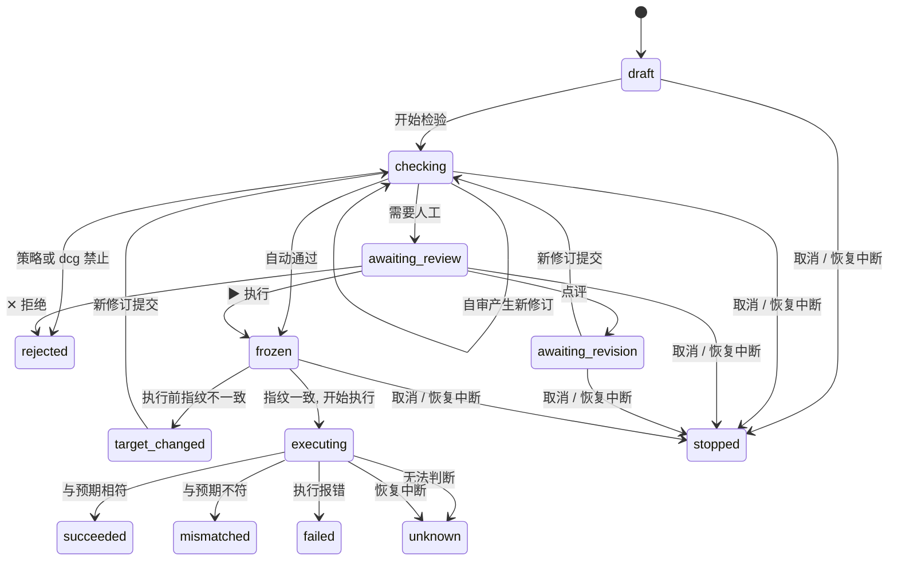

# core 层详细设计

## 1. 范围

本块交付 `platform/internal/core/`，以及它直接用到的 `internal/schema/` 和 `internal/model/` 部分。

| 做 | 不做 |
|---|---|
| 执行申请的数据模型、状态机和修订 | 任何真实外部 I/O（数据库、SSH、云、dcg 进程、模型） |
| 检验流水线：执行预期校验、预演结果接收、指纹比对、自审结论接收、dcg 结论接收、策略判定、转人工判断、人工审核、冻结 | HTTP 接口、页面、任务队列 |
| 策略解析（纯函数） | provider 的实现 |
| 既定任务编排引擎：步骤、分支条件、运行状态 | 持久调度服务的计时逻辑 |
| 恢复即停止的状态处理 | 预授权签发与本地核验（放到后面的块） |
| `devops.*` 事件的产生 | 凭证库和 K→V 注入（只定义端口） |
| 端口接口定义和内存测试替身 | SDK |

完成标准：所有逻辑在内存里用测试替身跑通，第 9 节的测试全部通过，第 10 节的审核清单全部满足。完成后不开放任何实际执行能力。

## 2. 包结构

```text
internal/
  schema/
    core/                 # 执行申请、执行预期、策略、任务定义的契约结构与校验（Go 编写）
    consts/               # 状态、读写类别、策略模式等枚举
    errcode/              # 错误码
  model/
    request/              # ExecutionRequest 及其组成部分
    policy/               # PolicyRule、PolicySet
    task/                 # TaskDefinition、Step、Branch、Run
    ids/                  # CallID、Digest、Version 等值对象
  core/
    request/              # 执行申请状态机与修订
    pipeline/             # 检验流水线
    policy/               # 策略解析与转人工判断
    review/               # 人工审核动作与冻结
    orchestrator/         # 既定任务编排引擎与条件表达式
    recovery/             # 恢复即停止
    events/               # devops.* 事件构造
    ports/                # 全部端口接口
    coretest/             # 每个端口的内存测试替身
```

依赖：`core/*` 只导入 `model`、`schema` 和标准库。`core` 内部子包之间单向依赖，`pipeline` 和 `orchestrator` 在最上层。

## 3. 核心类型（model 层）

### 3.1 执行申请

```text
ExecutionRequest
  CallID        稳定编号
  Revision      修订号，从 1 开始
  Digest        当前修订的内容摘要
  Source        来源：task_step / registered_tool / task_launch / adhoc_command / preauth / human_terminal
  Scope         Project、Environment、Targets（稳定 ID 列表）
  Content       UnitRef（已登记单元的 ID、版本、摘要；独立命令为空）、Rendered（展开后的完整内容）、Params、SecretKeys（K 列表）
  Expectation   执行预期（3.2）
  Fingerprint   采集方法、采集时间、值
  Checks        Preview、SelfReview、DCG、PolicyDecision（各自带结论和时间）
  Review        人工动作列表（动作、点评、人、时间、对应 Revision）
  Frozen        冻结摘要、冻结时间（未冻结为空）
  Execution     开始、结束、退出状态、输出引用、对比结论
  State         状态（第 4 节）
  Version       乐观锁版本号（CAS 用）
```

### 3.2 执行预期

```text
Expectation
  Intent          一句话意图
  Targets         稳定 ID
  Category        read / write / delete / permission / start_stop / billing / unknown
  ExpectedChange  预期变更（文字 + 可选的结构化范围，例如影响行数区间）
  ExpectedOutput  预期输出
  SuccessCriteria 成功判据（结构化，见 3.3）
  Reversible      true / false / unknown
  Rollback        可逆时的回退方法
  Preview         有无原生预演；有则引用预演结果
  RiskNote        风险自评
```

`Category` 和 `Reversible` 以登记声明为准：已登记单元用登记值；独立命令用 dcg 和解析器的结论；都没有就是 `unknown`。

### 3.3 成功判据

结构化的判据列表，每项是一个条件表达式（与第 7.3 节分支条件同一种表达式），作用在执行结果的结构化输出上，例如 `exit_code == 0`、`rows_affected <= 120`。写不成表达式的判据保留为文字，这类结果对比交给人工，结论记为 `unknown`。

## 4. 执行申请状态机

状态取自 [执行模型](../20-execution/21-execution-model.md) 第 8 节，常量值见 [Schema 与常量](../50-engineering/52-schema-and-constants.md)。



规则：

- 状态转换只能经 `core/request` 的转换函数，每个转换校验当前状态和前置条件。不在表里的转换返回 `core.invalid_transition`。
- 终态：`rejected`、`succeeded`、`mismatched`、`failed`、`unknown`、`stopped`。终态不再转换。
- 每次转换写入新的 `Version`，存储端口用 CAS 提交（见 [状态与恢复](../10-architecture/13-state-and-recovery.md) 第 3 节）。
- 转换成功并持久保存后才产生事件。

## 5. 检验流水线

`pipeline.Inspect(request)` 按固定顺序执行，任何一步失败都停在当前步并给出原因。

| 步骤 | 做什么 | 结果 |
|---|---|---|
| 1 范围校验 | 目标在会话的项目和环境范围内；已登记单元的版本和摘要与登记一致 | 不符 → `rejected`，原因 `core.scope_violation` / `core.unit_mismatch` |
| 2 执行预期校验 | 必填字段齐全；Category、Reversible 按登记值覆盖 | 缺字段 → 退回 Agent 修订 |
| 3 原生预演 | 单元声明有预演时，经 `PreviewPort` 运行并保存结果 | 预演失败 → 转人工，附预演输出 |
| 4 采集指纹 | 经 `FingerprintPort` 采集并保存 | 采集不到 → 标记，转人工 |
| 5 自审结论 | 接收提交时附带的 `SelfReview`；既定任务步骤跳过；缺失按"有风险" | — |
| 6 dcg | 经 `DCGPort` 检查最终内容 | 命中 / 不可用 → 标记；禁止规则 → `rejected` |
| 7 策略判定 | `policy.Resolve`（第 6 节） | auto / manual / forbid |
| 8 转人工判断 | `policy.Escalate`：按 K-08 汇总第 3 至 7 步的标记 | 最终 auto / manual / forbid |
| 9 去向 | auto → 冻结；manual → `awaiting_review`；forbid → `rejected` | — |

执行前的最后核验 `pipeline.PreExecute(request)` 由执行器所在进程调用：核对冻结摘要、重新采集指纹并比对。不一致 → `target_changed`，不执行。

执行后 `pipeline.Compare(request, result)`：按成功判据和预期给出 `succeeded` / `mismatched` / `failed` / `unknown`。

## 6. 策略解析

### 6.1 输入与输出

```text
输入：PolicySet（已登记的全部策略层）、请求的 provider/工具、功能、权限区、环境、会话模式
输出：Decision{ Mode: auto|manual|forbid, Layer: 命中的层, AllowAuto: bool, Reasons: []string }
```

### 6.2 算法

1. 从细到粗依次查找：具体功能 → 权限区 → provider 或工具全局 → 系统全局兜底（K-07）。每一层先查当前环境的配置，再查不分环境的配置。第一个命中的规则给出 Mode。
2. 沿途任何一层出现 `allow_auto: false`，则 Mode 为 auto 时改为 manual。
3. 任何一层出现 forbid，结果为 forbid（禁止优先于一切）。
4. 会话为手工模式时，auto 改为 manual（预授权来源除外）。
5. 系统兜底出厂值为 manual。

### 6.3 转人工判断 `Escalate`

输入策略结果和流水线标记，输出最终 Mode。forbid 保持 forbid；否则下列任一成立就变成 manual（K-08）：

- 自审有风险或缺失（既定任务步骤除外）
- dcg 命中或不可用
- 无法采集指纹
- Category 为 unknown
- Reversible 为 false 且没有原生预演
- Before Hook 要求人工
- 来源是独立命令（K-10）

`Resolve` 和 `Escalate` 是纯函数，用表驱动测试覆盖所有组合。

## 7. 修订、冻结与既定任务编排

### 7.1 修订（受控改写）

`request.Revise(req, newContent, source)`：

- 只允许在 `checking`、`awaiting_revision`、`target_changed` 状态调用；`frozen` 及之后返回 `core.frozen_immutable`（K-15）。
- `source` 只能是 `self_review` 或 `human_comment`（K-14）。
- Revision 加一，重算 Digest，清空 Checks、Fingerprint 和本修订之前的人工批准，状态回到 `checking`。
- 旧修订完整写入修订日志端口（追加），不覆盖。

### 7.2 冻结

- 冻结摘要覆盖规范化后的：Content、Params、SecretKeys（只含 K）、Scope、Expectation、Fingerprint 值、PolicyDecision、Revision。
- 规范化格式：字段排序后的 JSON，再取 SHA-256。规范化函数单独测试并做 fuzz。
- 人工 ▶ 绑定当时的 Revision 和 Digest；冻结时校验二者未变。

### 7.3 编排引擎

- 输入：已登记的 `TaskDefinition`（步骤、分支、参数 schema），以及当时的启用版本。
- 每一步生成一个执行申请（Source = task_step），送进流水线；等待它进入终态。
- 步骤成功后，按分支条件选下一步。条件表达式是一个小的类型化表达式：支持字段访问、`==` `!=` `<` `<=` `>` `>=`、`&&` `||` `!`、`in`、字符串和数字字面量；只读当前任务的参数和已完成步骤的结构化输出。不支持函数调用、循环和赋值。
- 表达式在登记时做语法和类型检查，运行时不再解析新表达式。
- 没有分支匹配，或步骤终态不是 succeeded：运行停止，记录停止的步骤和原因（[既定任务](../20-execution/23-harness-tasks.md) 第 2.6 节的运行状态）。
- 运行开始时绑定任务版本，之后不变（第 2.7 节）。

## 8. 恢复、事件与端口

### 8.1 恢复即停止

`recovery.OnStartup(store)`：

- 所有非终态的执行申请：`executing` → `unknown`，其余 → `stopped`，原因 `recovery_interrupted`。
- 所有非终态的任务运行 → `已停止（恢复中断）`。
- 返回恢复报告数据（停止的申请和运行列表、结果未知列表），供页面展示。
- 调度计划的暂停由持久调度服务处理，不在 core 内。

### 8.2 事件

core 在状态转换持久保存后，经 `EventSink` 产生 `devops.*` 事件。事件名以 [事件与 Hook](../40-sdk/45-events-and-hooks.md) 的平台事件总表为准。事件不触发执行。

### 8.3 端口清单

| 端口 | 用途 | 首批 provider |
|---|---|---|
| `RequestStore` | 执行申请的读写，按 Version 做 CAS | PostgreSQL |
| `RevisionLog` | 修订日志，追加写 | PostgreSQL |
| `TaskStore` | 任务定义（含版本与启用指针）和任务运行 | PostgreSQL |
| `PolicySource` | 读取已登记的策略层 | PostgreSQL |
| `Registry` | 查询已登记单元的版本、摘要、读写声明、预演和指纹方法 | PostgreSQL |
| `PreviewPort` | 运行原生预演 | 执行通道 |
| `FingerprintPort` | 采集目标指纹 | 执行通道 |
| `DCGPort` | 检查内容，返回放行 / 命中（规则 ID）/ 不可用 | dcg |
| `ExecutorPort` | 提交冻结后的申请并取回结果 | 执行器 |
| `EventSink` | 发出事件（outbox） | PostgreSQL |
| `AuditSink` | 追加审计记录 | PostgreSQL |
| `Clock`、`IDGen` | 时间和 ID | 标准库实现 |

每个端口在 `coretest` 里有内存实现，可注入故障（超时、返回错误、返回不一致的指纹）。

## 9. 测试清单

| 类别 | 内容 |
|---|---|
| 状态机 | 表中每个转换的正例；每个不在表中的转换返回 `core.invalid_transition`；终态不可转换 |
| 策略解析 | 表驱动覆盖：四层命中顺序、环境覆盖、`allow_auto: false`、forbid 优先、手工模式、系统兜底 |
| 转人工 | K-08 每个条件单独触发；组合触发；forbid 不被降级 |
| 修订 | 冻结后修订被拒绝；修订后 Checks 和人工批准作废；修订来源只允许两种；旧修订进日志 |
| 冻结 | 摘要对字段顺序不敏感；任何一个字段变化摘要都变；fuzz 规范化函数 |
| 指纹 | 执行前指纹不一致 → `target_changed`，执行端口调用次数为 0 |
| dcg | 命中 → manual；不可用 → manual；禁止规则 → rejected，执行次数为 0 |
| 不可逆 | Reversible=false 且无预演 → manual，即使策略为 auto；有预演 → 按策略 |
| 独立命令 | 任何策略和会话模式下都是 manual |
| 编排 | 分支选路；无分支匹配 → 停止；步骤 mismatched / unknown → 停止；运行绑定版本不随启用版本变化 |
| 表达式 | 语法和类型错误在登记时报出；fuzz 解析器；不支持的语法拒绝 |
| 恢复 | 非终态全部按规则改写；终态不受影响；重复执行 OnStartup 结果相同 |
| 并发 | CAS 冲突返回明确错误；`go test -race` 通过 |
| 依赖方向 | CI 检查 core 不导入 provider、module 和任何外部库 |

## 10. 审核清单

开发完成后，我按下面的清单审核，并给出审核报告：

1. 实现与本文一致；偏离的地方在报告里列出并说明原因。
2. 内核规则 K-04、K-05、K-06、K-08、K-10、K-13 至 K-15、K-24 在代码和测试中都有对应。
3. 依赖方向检查通过，core 没有外部 I/O。
4. 第 9 节测试全部通过，含 race 和 fuzz 种子语料。
5. 错误码全部来自 `schema/errcode`，没有裸字符串错误。
6. 端口都有内存测试替身和端口契约测试，供后面的 provider 复用。
7. 没有已知的阻断缺陷；非阻断问题列入报告。

## 11. 已确认的决定

| 点 | 决定 |
|---|---|
| schema 层 | 常量体和配置定义的集合，直接用 Go 编写，不依赖代码生成 |
| 摘要算法与规范化 | 字段排序 JSON + SHA-256 |
| 条件表达式 | 用第 7.3 节的最小语法，自己实现小型解析器，不引入通用脚本引擎 |
| 预授权 | 不在本块，放到编排之后的块 |
