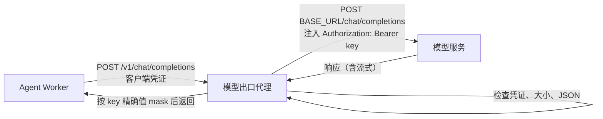

# provider 层详细设计（第一块）：PostgreSQL 存储与模型出口代理

## 1. 范围

[阶段交付](../50-engineering/54-phases-and-acceptance.md) 第 1.1 节的 provider 块拆成两块。本文是第一块。

| 做 | 不做（放到 provider 第二块或 module 块） |
|---|---|
| `RequestStore`、`RevisionLog`、`TaskStore`、`EventSink`（outbox）、`AuditSink` 的 PostgreSQL 实现 | dcg、凭证库、执行通道（provider 第二块） |
| outbox 的读取与标记已投递（供以后的投递服务用） | `PolicySource`、`Registry`、`ScopeSource`：数据来自登记中心和会话模块，随 module 块实现 |
| 三个库的版本化迁移文件，以及测试用的迁移执行函数 | 迁移的受控执行（由底座发起，K-23） |
| `Clock`、`IDGen` 的标准实现 | `cmd/*` 装配、HTTP 接口、任务队列 |
| 模型出口代理：读取模型接入变量、端点限制、key 注入、mask、流式转发、可用性状态 | GoAgent SDK 的其余部分：运行循环、上下文、工具、`AuthenticatedTransportPort` 适配（SDK 块） |
| SDK 的 Chat Completions 基础适配器和 DeepSeek 派生适配器（支持 `reasoning_content`，第 5.4 节） | 其他三种基础协议、GLM 派生适配器、请求管理、sidecar 持久化 |
| core 容器的环境变量检查函数 | 数据库角色与授权（部署块） |

完成标准：存储实现通过 `core/coretest` 的全部端口契约测试，并在真实 PostgreSQL 上通过第 8 节的测试；模型出口代理通过第 8 节的测试；第 9 节的审核清单全部满足。

### 1.1 按任务交付

本设计按 [开发台账](../../plans/dev-ledger.md) 拆成三项任务。每项只验收自己的实现，后续任务的测试不计为本项通过或跳过。

| 任务 | 实现范围 | 对应验证 |
|---|---|---|
| L01 | 第 4 节时钟与 ID、第 5.1 至 5.3 节模型出口代理与 core 检查、第 6 节九个错误码、provider 依赖规则；恢复本文及阶段表拆分 | 第 8 节的时钟与 ID、接入变量、代理、mask、core 检查、依赖方向；真实端点测试可选 |
| L02 | 第 3 节 PostgreSQL 存储、迁移文件和测试库 | 第 7 节及第 8 节的存储、事务、并发、迟到结果、文档、固定 SQL、审计、outbox、修订日志 |
| L03 | 第 5.4 节 SDK 协议层 | 第 8 节协议适配器及台账 L03 的独立宿主构建验证 |

第 9 节审核清单按此映射核对。L01 不装配 `cmd/model-proxy`，不决定客户端凭证文件位置。

HTTP 服务的并发上限、入站请求头与请求体读时限、客户端响应写时限由 L06 装配层设置并验证；具体配置由 L04 定下。L01 的 handler 负责上游超时、取消传播及请求与响应大小限制，不把装配层的资源限制计为已验证。

## 2. 包结构

```text
platform/
  migrations/
    migrations.go          # embed 三个库的迁移文件，按文件名顺序提供
    harness/0001_init.sql  # 执行申请、修订日志、任务运行、outbox
    config/0001_init.sql   # 任务定义与启用版本
    audit/0001_init.sql    # 审计记录（只追加）
  internal/
    schema/core/           # 新增：持久化文档结构 v1（第 3.3 节）
    provider/
      storage/
        pgstore/           # 端口实现、固定 SQL、文档转换
        pgtest/            # 只用于测试：启动临时 PostgreSQL，执行迁移
      system/              # Clock、IDGen
      modelgw/             # 模型出口代理
```

依赖（由 `archtest` 检查）：

- provider 可以导入标准库、schema、model、`core/ports`、`core/events` 和第三方库。
- provider 不导入 `core` 的其他包和 `module`。测试文件可以导入 `core/coretest`。
- 第三方库只用 `github.com/jackc/pgx/v5`，限存储实现。模型出口代理的外部依赖只用标准库，平台内只导入集中错误码 `schema/errcode`；不另定义错误码。
- L01 的检查拒绝 provider 导入第三方库；L02 接入存储时才为存储范围开放 `pgx/v5`。provider 的内部实现可以组合；modelgw 的非测试代码仍只允许标准库与 `schema/errcode`。

## 3. PostgreSQL 存储

### 3.1 库和表

按 [组件与边界](../10-architecture/11-components-and-boundaries.md) 的划分，用三个库。每个库有自己的迁移目录和连接池。

| 库 | 表 | 主键与约束 | 用途 |
|---|---|---|---|
| harness | `requests` | `call_id`；`version > 0`；`state` 有索引（只索引非终态） | 执行申请，`doc` 为 JSONB 文档 |
| harness | `request_revisions` | `(call_id, revision, digest)` 唯一 | 修订日志。重复写入同一修订不报错，也不产生第二行 |
| harness | `task_runs` | `run_id`；`state` 有索引（只索引非终态） | 任务运行 |
| harness | `outbox` | 自增 `id`；`event_id` 唯一；`(stream_id, sequence)` 唯一 | 待发事件，`delivered_at` 为空表示未投递 |
| config | `task_definitions` | `(task_id, version)` | 任务定义，带摘要 |
| config | `task_active` | `task_id` | 当前启用版本指针 |
| audit | `audit_records` | 自增 `id` | 审计记录。触发器拒绝 UPDATE、DELETE、TRUNCATE |

每张主表都有独立列保存查询需要的字段（状态、版本、时间、关联 ID），完整内容放在 `doc` 列。`doc` 列旁边存 `schema_id`。

### 3.2 事务与 CAS

| 操作 | 做法 |
|---|---|
| `Create` | 一个事务：插入主表行，插入事件。主键冲突返回 `core.already_exists` |
| `Save` / `SaveRun` | 一个事务：`UPDATE ... WHERE 主键 = $1 AND version = $2`。影响 0 行时再查一次：不存在返回 `core.not_found`，存在返回 `core.cas_conflict`。更新成功后插入事件。任何一步失败整体回滚 |
| `RevisionLog.Append` | `INSERT ... ON CONFLICT DO NOTHING` |
| `EventSink.Emit` | 一个事务插入全部事件 |
| `AuditSink.Append` | 单条插入 |
| 读取 | 只按主键或非终态状态读取，返回新对象，不共享内存 |

- 新版本号由调用方设置：`r.Version == expected.Next()`，否则返回 `core.invalid_argument`（与内存替身一致）。
- 迟到的结果靠 CAS 拒绝：它基于旧版本，保存时返回 `core.cas_conflict`，不覆盖较新的记录（[状态与恢复](../10-architecture/13-state-and-recovery.md) 第 3 节）。
- 事务隔离级别用 `READ COMMITTED`。CAS 由带版本条件的 UPDATE 保证。

### 3.3 持久化文档

- 文档结构放在 `schema/core`：`RequestDocV1`、`RunDocV1`、`TaskDefinitionDocV1`、`EventDocV1`、`AuditRecordDocV1`，字段用固定的 JSON 名。SchemaID 分别为 `devops.execution.request/v1`、`devops.task.run/v1`、`devops.task.definition/v1`、`devops.event/v1`、`devops.audit.record/v1`。
- model 与文档之间的转换函数放在 `pgstore`。每个转换都有往返测试：model → 文档 → model 结果相同（[仓库布局](../50-engineering/53-repo-layout.md) 第 4.3 节）。
- 读取时 `schema_id` 不认识，或 JSON 有未知字段，返回 `storage.decode_failed`，不猜测（[Schema 与常量](../50-engineering/52-schema-and-constants.md) 第 6.3 节）。
- 枚举字段读取后按 `consts.ParseX` 校验，非法值同样返回 `storage.decode_failed`。

### 3.4 固定 SQL

- 全部 SQL 是 `pgstore` 里的常量，集中在一个清单里。不拼接 SQL，不接受调用方传入 SQL（[仓库布局](../50-engineering/53-repo-layout.md) 第 5 节"不暴露任意 SQL"）。
- 构建期分析：测试在迁移后的真实库上对清单里的每条 SQL 执行 `PREPARE`，全部成功才通过（K-23）。
- 不用 sqlc。理由：本块 SQL 只有二十条左右，手写常量加 `PREPARE` 检查能达到同样的类型和语法检验，不多引入一个代码生成工具。SQL 增多后再评估。

### 3.5 outbox 读取

`pgstore` 另外提供两个方法，供以后的投递服务使用：

- `PendingEvents(ctx, limit)`：按 `id` 顺序返回未投递的事件。
- `MarkDelivered(ctx, eventIDs)`：设置 `delivered_at`。

至少一次投递。消费者按 `EventID` 去重（[事件与 Hook](../40-sdk/45-events-and-hooks.md) 第 6.1 节）。

### 3.6 迁移

- 迁移文件是审核过的 SQL 文件，按文件名顺序执行。服务启动时不执行迁移（[Go 技术选型](../50-engineering/51-go-stack.md) 第 3 节）。
- `migrations.go` 用 `embed` 提供文件。本块只有测试用的执行函数（`pgtest`）。以后 `cmd/migrate` 复用同一组文件。

### 3.7 测试数据库

`pgtest` 按下面的顺序准备 PostgreSQL：

1. 环境变量 `DEVOPS_TEST_PG_DSN` 有值：用它（例如 CI 的服务容器）。这是测试专用变量，不属于运行时环境变量表。
2. 本机有 PostgreSQL 服务端程序（`initdb`、`pg_ctl`）：在临时目录初始化一个临时实例，用 Unix socket 连接，测试结束删除。
3. 都没有：测试跳过，并在输出里写明原因。

每个测试包建三个新库并执行迁移，测试之间不共享数据。

## 4. 系统时钟与 ID

| 实现 | 规则 |
|---|---|
| `system.Clock` | 返回非零 UTC 时间，截断到微秒（和 PostgreSQL `timestamptz` 精度一致）。同一实例通过互斥保护最后返回值；墙钟回拨时返回前值，直到墙钟追上。可并发调用，满足 `ports.Clock` 的不倒退契约 |
| `system.IDGen` | 按 `kind` 加前缀：`<kind>_<26 位 ULID 风格编码>`。前 48 位是逻辑毫秒时间，后 80 位以 `crypto/rand` 初始化。同一毫秒内递增；时钟回拨时沿用前一次逻辑毫秒；随机部分溢出时推进逻辑毫秒并重新取随机数 |

- ID 首次调用必须读取随机源，包括 Unix 毫秒时间为 0 的情况。时间范围为 `0` 至 `2^48-1` 毫秒。
- `ports.IDGen` 没有错误返回值。随机源失败、时间越界或逻辑毫秒耗尽时立即 panic，不产生 ID。panic 使用固定文本，不附加底层错误；生成器不提交失败时的中间状态，并释放互斥。

## 5. 模型出口代理

语义来源：[组件与边界](../10-architecture/11-components-and-boundaries.md) 第 5.4 节（模型接入变量）、[密钥](../20-execution/25-secrets.md) 第 7 节。

### 5.1 模型接入变量

| 变量 | 检查 | 不通过时的状态 |
|---|---|---|
| `DEVOPS_LLM_BASE_URL` | 必须是 `https`；有主机名；不含用户名、密码、查询参数和片段；路径末尾不是 `/chat/completions`；末尾的 `/` 去掉 | 缺失或无效 |
| `DEVOPS_LLM_API_KEY` | 不能为空；不能含空白和控制字符 | 缺失或无效 |

- `modelgw.LoadConfig(lookup func(string) (string, bool)) Config` 只读这两个变量。程序不读表外的环境变量（K-31）。
- `Config.Status()` 返回 `available`、`missing` 或 `invalid`，原因里只写变量名，不写值。
- 检查不通过时代理不退出。它拒绝所有模型请求，返回 503 和 `modelgw.unavailable`。

### 5.2 代理接口



| 接口 | 行为 |
|---|---|
| `POST /v1/chat/completions` | 转发 OpenAI Chat Completions 请求 |
| `GET /v1/status` | 返回 `{"status": "available" / "missing" / "invalid", "reason": "..."}`，不含端点和 key |
| 其他路径和方法 | 404 或 405 |

转发规则：

1. 客户端必须带有效的客户端凭证。校验函数由装配层注入（`ClientAuth`），代理提供常量时间比对的 `StaticTokenAuth`。不通过返回 401 `modelgw.unauthorized`。
2. 请求体上限默认 4 MiB，超过返回 413 `modelgw.too_large`。
3. 请求体必须是 JSON 对象，`model` 为非空字符串，`messages` 为数组。否则返回 400 `modelgw.bad_request`。请求体其余部分原样转发，代理不改协议内容。
4. 只发往 `<DEVOPS_LLM_BASE_URL>/chat/completions`。客户端请求里的任何 URL、主机名或头都不影响目标地址。
5. 出站请求只带 `Content-Type: application/json`、`Accept` 和 `Authorization: Bearer <key>`。客户端的其他请求头一律丢弃。
6. 不跟随重定向。上游返回 3xx 时，代理返回 502 `modelgw.redirect_refused`。
7. 上游超时默认 120 秒，可配置。非流式覆盖整个请求；流式覆盖收到响应头之前，此后作为相邻两块数据之间的空闲超时。响应头发送前，超时和连接错误返回 502 `modelgw.upstream_error`；流式响应头发送后，中断连接并记录同一错误码，不把部分结果当作完整成功。
8. 非流式响应：转发上游的状态码和响应体，上游响应体与遮盖后输出均受默认 16 MiB 上限约束。遮盖可能扩张内容，分配输出前先检查长度；超限返回 502 `modelgw.too_large`，不输出部分内容。
9. 流式响应（请求里 `"stream": true` 且上游返回 `text/event-stream`）：边收边转，每块写出后立即 flush。
10. 所有返回给客户端的内容、错误信息和日志，都按 key 的精确值 mask（K-17）。流式 mask 保留不超过 key 长度减一的尾部字节，跨块出现的 key 也能遮盖。

- mask 按原始字节匹配，不解码模型回复。缺失的空 key 没有匹配目标；无效但非空的 key 仍用于遮盖。配置、代理的指针和值在格式化时都只显示脱敏描述。
- key 不设厂商格式或最小长度限制。遮盖标记自身含 key，或可能在替换边界重新拼出 key 时，换用安全标记；状态原因、格式化描述和日志消息及属性的文本内容也经过遮盖。
- 代理自己生成的 JSON 保持固定字段名、状态枚举和集中错误码，只在序列化前遮盖自由文本。HTTP 固定字段名、状态码、长度和服务自动生成的协议元数据也不携带 V；它们与短 key 恰好同字节不代表输出了凭证。来自配置或上游的 V 不得进入输出。
- 上游响应仍按原始字节遮盖。若 key 与上游 JSON 的结构恰好相同，遮盖可能改变结构；协议适配器不得把解码失败当作有效回复或执行许可（42 第 5 节）。代理不解析或解释替换后的内容。
- 上游流中途出错时丢弃尚未输出的尾部并中断连接。客户端写入、flush 或最终尾部写入失败也记为 `modelgw.upstream_error`，不追加完整结束标记。

### 5.3 core 容器检查

`modelgw.ForbidInCore(environ []string) error`：环境里有任一模型接入变量就返回 `config.forbidden_env`，错误信息只写变量名。core 容器的入口进程以后调用它，失败就拒绝启动。

### 5.4 Chat Completions 适配器与 `reasoning_content`

测试端点上的部分模型（例如别名 `deepseek`）在回复里返回非标准字段 `reasoning_content`，推理也计入 `max_tokens`。`max_tokens` 太小时 `content` 为空、`finish_reason` 为 `length`。按 [LLM 协议](../40-sdk/42-llm-protocols.md) 第 3 节，用派生适配器处理这个差异。代理（第 5.2 节）不解析回复，原样转发。

代码在 SDK 模块（[SDK 概览](../40-sdk/41-sdk-overview.md) 第 13 节），不依赖平台：

```text
sdk/agent/
  protocol/
    types.go      # 公共模型类型：Message、Block（text / thinking / tool_call / tool_result）、Request、Response、FinishReason、Usage
    adapter.go    # ProtocolAdapter 接口与扩展点接口
    chat.go       # ChatAdapterBase：标准 Chat Completions 编解码
  providers/
    deepseek.go   # DeepSeekAdapter：嵌入 ChatAdapterBase，只重写差异
```

| 规则 | 说明 |
|---|---|
| 厂商自定义字段一律用派生适配器 | DeepSeek 等厂商的自定义字段（不只 `reasoning_content`），都写在该厂商的派生适配器里（42 第 3 节的"派生"，旧称 PATCH）。基础适配器不加任何厂商字段。新发现一个自定义字段，就在对应派生适配器里加处理和语料，升适配器版本（K-21） |
| 基础适配器保持标准 | `ChatAdapterBase` 只处理标准字段。回复里的未知字段不丢弃，原样放进 `Response.Sidecar`（只读的原始 JSON），不获得执行含义（42 第 5 节） |
| 派生适配器强制嵌入 | `DeepSeekAdapter` 嵌入 `ChatAdapterBase`，只重写"读取回复"（`NormalizeResponse`、`DecodeEvent`）和"回传历史"（`EncodePayload`）。基础流程通过构造时传入的扩展接口调用这些方法，保证从最外层派生对象分派（42 第 3.2 节） |
| 读取回复 | `reasoning_content` 变成 `thinking` 内容块，放在文本块之前。流式时 `delta.reasoning_content` 变成 thinking 增量 |
| 回传历史 | 按 DeepSeek 官方 [思考模式文档](https://api-docs.deepseek.com/zh-cn/guides/thinking_mode/)（[英文版](https://api-docs.deepseek.com/guides/thinking_mode/)）：请求带 `tools` 时，历史里每条带 thinking 块的 assistant 消息都把 thinking 原样写回 `reasoning_content`，否则接口返回 400；请求不带 `tools` 时，不回传（接口会忽略）。其他厂商的回传规则以各自官方文档为准，写在各自的派生适配器里 |
| 不按模型名猜 | 用哪个适配器由 ModelProfile 指定，代码不根据模型名切换 |
| 输出被截断 | 框架固定校验：`finish_reason` 为 `length`，且没有文本和工具调用时，返回 `goagent.model.output_truncated`，不当作空回答 |
| 默认 `max_tokens` | 请求没写时用 4096，避免推理占满额度后正文为空 |

## 6. 错误码

新增到 `schema/errcode`：

| 错误码 | 含义 | 可重试 |
|---|---|---|
| `storage.unavailable` | 数据库连接或执行失败 | 是 |
| `storage.decode_failed` | 文档的 SchemaID、字段或枚举不认识 | 否 |
| `modelgw.unavailable` | 模型接入变量缺失或无效 | 否 |
| `modelgw.unauthorized` | 客户端凭证无效 | 否 |
| `modelgw.bad_request` | 请求体不合格 | 否 |
| `modelgw.too_large` | 请求或响应超过上限 | 否 |
| `modelgw.redirect_refused` | 上游返回重定向 | 否 |
| `modelgw.upstream_error` | 上游超时或连接失败 | 是 |
| `config.forbidden_env` | 容器收到了不该收到的环境变量 | 否 |

端口契约要求的错误码（`core.not_found`、`core.already_exists`、`core.cas_conflict`、`core.invalid_argument`）照常使用。

## 7. 和 core 的衔接

- 存储实现必须通过 `coretest.RequestStoreContract`、`RevisionLogContract`、`TaskStoreContract`、`EventSinkContract`，和内存替身表现一致。
- 跨包流程测试（`core/flowtest` 的同类场景）在 PostgreSQL 存储上再跑一遍：一个任务从开始到完成，事件和状态都写进同一事务。

## 8. 测试清单

| 类别 | 内容 |
|---|---|
| 端口契约 | 四套契约测试在真实 PostgreSQL 上通过 |
| 事务 | 事件插入失败时状态也不变（注入 `event_id` 冲突）；CAS 冲突时事件不写入 |
| 并发 | 多个 goroutine 同时 Save 同一申请，只有一个成功；`go test -race` 通过 |
| 迟到结果 | 用旧版本保存被拒绝，记录不变 |
| 文档 | 往返测试；未知字段、未知 SchemaID、非法枚举都返回 `storage.decode_failed` |
| 固定 SQL | 清单里每条 SQL 都能 `PREPARE` |
| 审计 | UPDATE、DELETE、TRUNCATE 都被拒绝 |
| outbox | 按顺序读取；标记后不再返回；同一 `event_id` 不重复 |
| 修订日志 | 同一修订写两次只有一行 |
| 时钟与 ID | coretest 的 Clock/IDGen 契约；ID 唯一、有前缀、同一毫秒内递增；首次时间为 0、时钟回拨、随机尾部溢出、随机源失败、时间越界、并发；Clock 为 UTC 微秒，回拨不倒退 |
| 接入变量 | 每条检查规则的正例和负例；状态原因里不出现变量值 |
| 代理 | key 注入；客户端头被丢弃；目标地址固定；重定向被拒；超时；请求和响应超限（含遮盖后扩张、恰好到上限、整数边界）；凭证无效；不可用时上游收到 0 次请求 |
| mask | 上游错误体、流式响应（key 跨块）、日志文本里都不出现实际 key；标记碰撞与替换边界不重新拼出 key；短 key 不破坏代理生成的状态/错误 JSON 及枚举/错误码；对流式 mask 做 fuzz |
| 协议适配器 | 标准回复、带 `reasoning_content` 的回复（非流式和流式）、空 `content` 加 `length` 判为截断、工具调用回传 `reasoning_content`、未知字段进 Sidecar；派生准入三项检查：确实嵌入父类型、未重写的方法与父类型输出一致、重写经最外层对象分派；对流式解码做 fuzz |
| 真实端点（可选） | 设置测试变量后，经代理调用真实端点，默认模型 `deepseek`；不设置时跳过 |
| core 检查 | 有任一变量时报错，错误信息不含值 |
| 依赖方向 | `archtest` 增加 provider 规则 |

## 9. 审核清单

1. 实现与本文一致；偏离处列出原因。
2. 存储通过 core 的全部端口契约测试；状态和事件同一事务（45 第 6.1 节、13 第 3 节）。
3. K-05（迟到结果不覆盖）、K-16 与 K-17（key 不外泄、精确值 mask）、K-23（固定 SQL 构建期检查）、K-31（只读环境变量表里的变量）在代码和测试中都有对应。
4. 依赖方向检查通过：core 仍然只用标准库；provider 只用登记的第三方库。
5. 第 8 节测试全部通过，含 race 和 fuzz 种子语料；没有 PostgreSQL 时测试明确跳过，不假装通过。
6. 错误码全部来自 `schema/errcode`。
7. 没有已知的阻断缺陷；非阻断问题列入报告。

## 10. 采用的决定

| 点 | 决定 | 理由 |
|---|---|---|
| provider 块拆分 | 第一块：存储和模型出口代理；第二块：dcg、凭证库、执行通道 | dcg 还要先核实许可证和调用方式（Q11），凭证库要先完成 Q10 的最小设计；先交付不受这些影响的部分 |
| `PolicySource`、`Registry`、`ScopeSource` | 随 module 块实现 | 数据来自登记中心和会话，表结构属于那些模块 |
| sqlc | 本块不用，手写固定 SQL 常量加 `PREPARE` 检查 | 第 3.4 节 |
| 文档存储 | 主表关键字段建列，完整内容放 JSONB | 查询只按主键和状态；完整内容随 SchemaID 版本化 |
| 三个库 | harness、config、audit 分库，各自迁移 | 与 11、53 第 6 节的账号划分一致 |
| 审计只追加 | 触发器拒绝修改和删除 | 11 第 2 节"被修改或删除"列为不能做的事 |
| 测试数据库 | 优先用 `DEVOPS_TEST_PG_DSN`，否则用本机 PostgreSQL 程序起临时实例；均无则说明原因并跳过 | CI 可提供服务容器，本地回退不依赖 Docker 守护进程 |
| 代理客户端凭证 | 校验函数由装配层注入 | 凭证的挂载位置属于部署设计 |
| 代理依赖 | 标准库加平台 `schema/errcode`，没有第三方依赖 | 同时满足代理轻量实现与错误码唯一定义源 |
| 时钟回拨与 ID 失败 | Clock 钳制到最后返回值；ID 使用逻辑毫秒，失败立即停止生成 | 满足 main 的端口契约，不因回拨重复 ID，不降级随机来源 |
| 流式超时 | 响应头前使用请求超时，之后使用空闲超时 | 正常长流可持续输出；中断必须让客户端识别为失败 |
| 短 key 的遮盖 | 不限制厂商 key 形态；安全标记避免自身及替换边界产生 key，文本内容统一遮盖；自生成 JSON 的字段、枚举、错误码保持固定 | 保留接入兼容性与协议稳定性；固定协议元数据不作为凭证值处理 |
| 非流式输出上限 | 上游输入和遮盖后的输出都受上限约束，分配前检查输出长度 | 防止短 key 被大量替换时放大内存占用 |
| 工具链补丁版本 | 使用 51 第 2 节的 Go 1.27.2 基线 | 标准库安全问题随补丁修复，复测和漏洞扫描仍走统一入口 |
| `reasoning_content` | 用 SDK 的 DeepSeek 派生适配器处理；代理不解析回复 | 用户决定用派生（补丁）方式支持；42 第 3 节已把它列为 DeepSeek 的差异 |
| SDK 错误码 | SDK 自持错误码，前缀 `goagent.`，不导入平台的 errcode | SDK 不依赖平台（K-22） |
