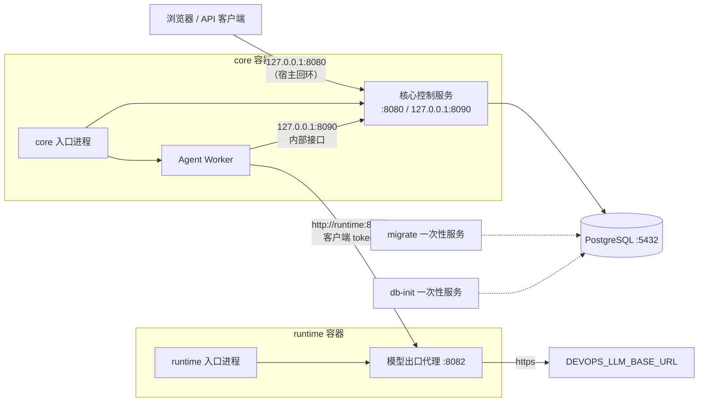

# M1 平台骨架详细设计

## 1. 范围

M1 的目标：两容器（core、runtime）加 PostgreSQL 用 `docker compose` 起来；用户经页面或 API 和 Agent 对话；模型请求经模型出口代理发往 `DEVOPS_LLM_BASE_URL`；工具执行全部关闭。

- M1 是 [54](../50-engineering/54-phases-and-acceptance.md) P1 的子集。哪些 P1 条目在 M1 验收、哪些后移，以 54 第 3 节"P1 的 M1 子集"表为准。M1 完成不等于 P1 完成。
- 本设计只补上游设计没有写清的部分。语义仍以上游文档为准：组件与权限边界见 [11](../10-architecture/11-components-and-boundaries.md)，重启与迁移见 [12](../10-architecture/12-deployment-substrate.md)，恢复见 [13](../10-architecture/13-state-and-recovery.md)。
- 本设计按章节分步写成。第 2 至 16 节（部署与进程，L04.1）已定。核心控制服务与任务队列（L04.2）、SDK v0 与平台依赖方式（L04.3）、账号、凭证库最小版与页面（L04.4）由后续章节补充；在它们写成之前，下游任务不得按自己的理解补齐。

| 章节 | 内容 | 供下游 |
|---|---|---|
| 第 2 至 4 节 | 部署总览、镜像、Compose 服务、进程、入口进程 | L06.2、L13.1、L13.2 |
| 第 5 至 8 节 | 运行身份、网络与端口、配置文件、引导密钥文件与挂载 | L05、L06、L13 |
| 第 9 至 11 节 | HTTP 资源限制、启动、停止与重启 | L06、L08.4、L13 |
| 第 12 节 | 数据库引导与受控迁移 | L05、L13.2、L14 |
| 第 13 至 16 节 | 新增错误码、验证防泄密、下游任务清单、审核清单 | L05、L06、L13、L14 |

## 2. 部署总览

- 宿主上只发布一个端口：core 的 `8080`，默认只绑定宿主回环地址 `127.0.0.1`。远程使用经 SSH 隧道。
- PostgreSQL、模型出口代理不发布到宿主。
- `migrate` 和 `db-init` 是一次性服务，只由管理员手动运行（第 12 节）。
- M1 没有底座、监控旁路、Harness、持久调度服务和执行器。

## 3. 镜像、Compose 服务与进程

### 3.1 镜像

| 镜像 | 内容（只含程序，K-31） | 基础镜像 |
|---|---|---|
| core | `/opt/devops-agent/bin/entry`、`core`、`agent-worker`；页面静态文件（L04.4 定） | 按 digest 固定，不用 `latest`。具体选型由 L13.1 定，要求：无包管理器、无需 shell |
| runtime | `/opt/devops-agent/bin/entry`、`model-proxy`、`migrate`（含 `bootstrap` 子命令） | 同上 |

- `migrate` 在 runtime 镜像里，不代表它常驻运行。runtime 入口进程不启动它（第 4 节）。
- 数据库引导也由 `migrate` 的 `bootstrap` 子命令完成，程序随镜像按 digest 固定，不从宿主挂载脚本（第 12.2 节）。
- Harness、调度、执行器的二进制在 M2 之后加入 runtime 镜像。
- 镜像里没有配置文件、密钥、`.env`，也没有测试用程序。

### 3.2 Compose 服务

Compose 项目名固定为 `devops-agent`。

| 服务 | 镜像 | 启动方式 | 重启 | 发布端口 |
|---|---|---|---|---|
| `postgres` | PostgreSQL 16 官方镜像，按 digest 固定 | `up -d` | `"no"` | 无 |
| `core` | core | `up -d` | `"no"` | `${CORE_BIND:-127.0.0.1:8080}:8080` |
| `runtime` | runtime | `up -d` | `"no"` | 无 |
| `migrate` | runtime（覆盖 entrypoint） | `--profile migrate run --rm migrate` | `"no"` | 无 |
| `db-init` | runtime（覆盖 entrypoint，运行 `migrate bootstrap`） | `--profile bootstrap run --rm db-init` | `"no"` | 无 |

- `profiles` 只决定默认是否启动，不是权限门禁。一次性服务的权限由它的挂载和环境决定（第 8 节）。
- `migrate`、`db-init` 服务独立定义，不用 `extends` 或 YAML 锚点继承 `runtime` 的环境和挂载。它们没有 `DEVOPS_LLM_*`。

### 3.3 进程

| 容器 | 进程 | 二进制 | 运行身份（UID:GID） | M1 是否启动 |
|---|---|---|---|---|
| core | core 入口进程 | `entry core` | `0:0`，能力受限（第 5 节） | 是 |
| core | 核心控制服务 | `core` | `10001:10001` | 是 |
| core | Agent Worker | `agent-worker` | `10002:10002` | 是 |
| runtime | runtime 入口进程 | `entry runtime` | `0:0`，能力受限 | 是 |
| runtime | 模型出口代理 | `model-proxy` | `10011:10011` | 是 |
| runtime | Harness | `harness` | `10012:10012`（预留） | 否，M2 |
| runtime | 持久调度服务 | `scheduler` | `10013:10013`（预留） | 否，M2 之后 |
| runtime | 执行器 | `executor` | `10014:10014`（预留） | 否，M2 |
| migrate | 迁移程序 | `migrate plan` / `migrate apply` | `10020:10020` | 一次性 |
| db-init | 数据库引导 | `migrate bootstrap` | `10021:10021` | 一次性 |

- M1 不为验证环境隔离而启动占位的 Harness、调度或执行器。
- 进程表编译进 `entry` 二进制，按参数 `core` 或 `runtime` 选择。没有配置文件或命令行能增加、替换子进程。

## 4. 入口进程

入口进程是一个只用标准库的 Go 二进制（`platform/cmd/entry`）。它只做启动与收尾，不是通用进程管理器。

### 4.1 启动

1. 核对自身环境：
   - `entry core`：调用 `modelgw.ForbidInCore`。环境里有任一模型接入变量就以非 0 退出，输出只含变量名（[62](62-provider-storage-modelgw.md) 第 5.3 节）。
   - `entry runtime`：不检查模型接入变量是否存在。缺失时代理照常运行并报告不可用（[11](../10-architecture/11-components-and-boundaries.md) 第 5.4 节）。
2. 按进程表顺序启动子进程。每个子进程：
   - 用固定的绝对路径启动，不经 shell，参数固定。
   - 用 `SysProcAttr.Credential` 切换到表里的 UID、GID，附加组为空。
   - 环境变量按白名单从空环境构造（第 4.3 节），不继承入口进程的环境。
   - 标准输出和标准错误接到入口进程的标准输出和标准错误。
3. 任一子进程启动失败：停止已启动的兄弟进程（第 4.2 节），以非 0 退出。

### 4.2 退出与信号

| 情况 | 入口进程的做法 |
|---|---|
| 任一子进程退出，包括退出码 0 | 视为故障。向其余子进程发 SIGTERM，等待最多 20 秒，仍未退出的发 SIGKILL；全部回收后以非 0 退出 |
| 收到 SIGTERM 或 SIGINT | 向全部子进程转发 SIGTERM，等待最多 20 秒，再 SIGKILL；全部回收后退出。全部子进程都在宽限期内退出时退出码为 0 |
| 多个子进程同时退出 | 按第一个观察到的退出处理，其余照常回收 |

- 入口进程只用每个子进程自己的 `cmd.Wait` 回收，不设通用的 `wait(-1)` 回收循环，避免争抢退出状态。M1 的子进程都不再启动子进程（[11](../10-architecture/11-components-and-boundaries.md) 第 5.4 节对代理的要求；核心控制服务和 Worker 同样不启动子进程）。
- 入口进程每个动作写一行结构化日志：子进程名、PID、退出码或信号。不写环境变量的值。
- Compose 的 `stop_grace_period` 设为 30 秒，大于入口进程的 20 秒宽限。
- 每个服务进程收到 SIGTERM 后调用 `http.Server.Shutdown`，宽限 15 秒。

### 4.3 子进程环境白名单

| 子进程 | 环境变量 |
|---|---|
| 核心控制服务 | 无 |
| Agent Worker | 无 |
| 模型出口代理 | 入口进程环境里存在的 `DEVOPS_LLM_BASE_URL`、`DEVOPS_LLM_API_KEY`，原样传递；不存在就不传 |

- 程序不读取表外的环境变量（K-31）。配置一律来自配置文件（第 7 节）。
- 入口进程的初始环境里仍有模型接入变量。隔离靠运行身份：其他子进程的 UID 不同，读不到入口进程和代理的 `/proc/<pid>/environ`（[11](../10-architecture/11-components-and-boundaries.md) 第 5.4 节）。

## 5. 运行身份与权限

### 5.1 容器安全选项

core、runtime 两个服务：

| 选项 | 值 | 理由 |
|---|---|---|
| `user` | `"0:0"` | 入口进程要切换到两个不同 UID 启动子进程，非 root 做不到 |
| `cap_drop` | `[ALL]` | — |
| `cap_add` | `[SETUID, SETGID, KILL]` | 只够切换身份和向其他 UID 的子进程发信号 |
| `security_opt` | `[no-new-privileges:true]` | 子进程不能重新获得权限 |
| `read_only` | `true` | 根文件系统只读；可写目录只有挂载的数据和临时目录 |
| Docker socket、宿主 PID 命名空间、`privileged` | 都不用 | K-18 |

- 子进程从 root 切换到非 root UID 后，有效、允许、可继承、环境能力集都为空；边界集（bounding set）保持容器的 SETUID、SETGID、KILL，但 `no-new-privileges` 下子进程不能再获得它们。L06.2 第 4 项核对的是有效、允许、环境三个集合为空。
- 入口进程没有 `CAP_DAC_OVERRIDE`、`CAP_DAC_READ_SEARCH`，以自身身份读不到属于其他 UID、权限 0400 的密钥文件，也不读。但它有 `CAP_SETUID`，能切换到任一身份，所以它是受信组件：信任依据是进程表编译固定、不经 shell、只用标准库、代码受审（第 15.2 节审核项），不是文件权限。

`migrate` 服务：`user: "10020:10020"`；`db-init` 服务：`user: "10021:10021"`。两者都是 `cap_drop: [ALL]`，`no-new-privileges`，`read_only: true`。

### 5.2 文件可读矩阵

| 文件（容器内路径） | 属主 | 权限 | 能读的进程 |
|---|---|---|---|
| `/run/secrets/devops-agent/core-service/db-password` | 10001 | 0400 | 核心控制服务 |
| `/run/secrets/devops-agent/agent-worker/model-proxy-token` | 10002 | 0400 | Agent Worker |
| `/run/secrets/devops-agent/model-proxy/client-token`（runtime） | 10011 | 0400 | 模型出口代理 |
| `/run/secrets/devops-agent/db-password`（migrate） | 10020 | 0400 | 迁移程序 |
| `/run/secrets/devops-agent/superuser-password`、`migrate-db-password`、`core-db-password`（db-init） | 10021 | 0400 | 数据库引导 |
| `/run/secrets/postgres/superuser-password`（postgres） | PostgreSQL 镜像的 `postgres` 用户 | 0400 | PostgreSQL 初始化 |
| `/etc/devops-agent/*.json` | root | 0444 | 同容器全部进程 |

- 每个身份一个子目录，属主是该身份，权限 0500。父目录属主 root，权限 0755，只用于遍历。目录不能是 0400，否则无法进入。
- 核心控制服务读不到 Worker 的代理 token；Worker 读不到数据库口令。
- 宿主目录的属主和权限由宿主目录准备脚本设置并核对（第 15.3 节 L13.2）。Compose v5 对文件型 `secrets` 的 `uid`、`gid`、`mode` 不生效，所以用 bind mount，并核对实际属主和权限，不能只审 YAML。

## 6. 网络与端口

### 6.1 Compose 网络

| 网络 | 类型 | 成员 | 用途 |
|---|---|---|---|
| `app` | `internal: true` | postgres、core、runtime、migrate、db-init | 平台内部通信，没有外网出口 |
| `edge` | 普通 bridge | core | 只为发布 `8080` 端口 |
| `egress` | 普通 bridge | runtime | 模型出口代理访问 `DEVOPS_LLM_BASE_URL` |

- core 在 `edge` 上有外网出口。这放宽了 [12](../10-architecture/12-deployment-substrate.md) 第 8 节"核心容器、Agent Worker 不允许访问项目目标、模型厂商"的网络约束：M1 不用网络强制这一条（12 第 8 节已加 M1 例外）。
- M1 靠以下两点限制影响：core 和 Worker 不持有模型 key、任何 V 和资产凭证；工具执行全部关闭。管理员可以另用宿主防火墙限制 core 出口，M1 不要求也不验证。
- 网络检查分三类：**允许**（runtime 经 `egress` 出网；core 经 `edge` 发布端口）；**禁止且验证**（`app` 网络本身没有外网出口；runtime 不发布端口；PostgreSQL 不发布端口）；**禁止但 M1 不由网络强制**（core、Worker 直连项目目标或模型厂商）。第三类不能写成通过项。
- runtime 不在 `edge` 上，不发布端口。
- 发布端口在仅 `internal` 网络的容器上不生效，所以 core 需要 `edge`。L13.2 要验证这一点。

### 6.2 监听地址

| 进程 | 监听地址 | 对谁开放 |
|---|---|---|
| 核心控制服务（公开接口） | `0.0.0.0:8080` | 宿主 `127.0.0.1:8080`（可由 `CORE_BIND` 改）；`app` 网络 |
| 核心控制服务（内部接口） | `127.0.0.1:8090` | 只有同容器的 Worker |
| 模型出口代理 | `0.0.0.0:8082` | `app` 网络（core 容器的 Worker） |
| Harness | `:8081` | 预留，M1 不监听 |
| PostgreSQL | `5432` | `app` 网络 |

- 内部接口（任务队列等）只在容器回环地址上，不经 `8080` 暴露。接口内容和鉴权由 L04.2 定。
- `CORE_BIND` 改为非回环地址时，由管理员自行负责访问控制；页面登录见 L04.4。

## 7. 配置文件

### 7.1 通用规则

- 格式：JSON，UTF-8。用标准库 `encoding/json`，开启 `DisallowUnknownFields`。不引入新的配置库（[51](../50-engineering/51-go-stack.md) 第 3 节）。
- 每个文件有 `schema` 字段，取值固定（见下表）。缺失、取值不符、未知字段、类型错误、超出范围，进程都以非 0 退出，错误码 `config.invalid`，信息里写字段路径，不写字段值。
- 文件里只有非敏感参数和密钥文件的路径。不写口令、token、模型端点。
- 时长写成 Go 时长字符串，例如 `"30s"`。大小写成字节数。
- 每个进程只读自己的文件。路径固定，不由环境变量或参数改。
- 配置变更要重启容器，按恢复处理（K-24）。M1 不支持热加载。

| 文件（容器内） | `schema` | 读取进程 |
|---|---|---|
| `/etc/devops-agent/core.json` | `devops.config.core/v1` | 核心控制服务 |
| `/etc/devops-agent/agent-worker.json` | `devops.config.agent-worker/v1` | Agent Worker |
| `/etc/devops-agent/model-proxy.json` | `devops.config.model-proxy/v1` | 模型出口代理 |
| `/etc/devops-agent/migrate.json` | `devops.config.migrate/v1` | 迁移程序 |
| `/etc/devops-agent/bootstrap.json` | `devops.config.bootstrap/v1` | 数据库引导（db-init） |

入口进程没有配置文件。

### 7.2 字段

下表是本部分定下的字段。L04.2 至 L04.4 可以给同一文件追加字段，追加时在本节补表；在那之前，下游实现不得自行加字段。

**`core.json`**

| 字段 | 类型 | 默认 | 说明 |
|---|---|---|---|
| `schema` | string | 必填 | `devops.config.core/v1` |
| `listen.public` | string | `0.0.0.0:8080` | 公开接口 |
| `listen.internal` | string | `127.0.0.1:8090` | 内部接口，必须是回环地址，否则 `config.invalid` |
| `database.host` | string | 必填 | 例如 `postgres` |
| `database.port` | int | `5432` | 1 至 65535 |
| `database.user` | string | 必填 | 例如 `devops_core` |
| `database.password_file` | string | 必填 | `/run/secrets/devops-agent/core-service/db-password` |
| `database.sslmode` | string | `disable` | `disable` 或 `require`。Compose 内部网络用 `disable` |
| `database.max_conns` | int | `10` | 1 至 100 |
| `http.public` | 对象 | 见第 9 节 | 公开接口的资源限制 |
| `http.internal` | 对象 | 见第 9 节 | 内部接口的资源限制 |

**`agent-worker.json`**

| 字段 | 类型 | 默认 | 说明 |
|---|---|---|---|
| `schema` | string | 必填 | `devops.config.agent-worker/v1` |
| `core_internal_url` | string | `http://127.0.0.1:8090` | 必须是回环地址的 `http` URL |
| `model_proxy.url` | string | `http://runtime:8082` | 代理地址 |
| `model_proxy.token_file` | string | 必填 | `/run/secrets/devops-agent/agent-worker/model-proxy-token` |
| `concurrency` | int | `2` | 0 至 16。`0` 表示进程存活但不领取任务（第 11.3 节） |

**`model-proxy.json`**

| 字段 | 类型 | 默认 | 说明 |
|---|---|---|---|
| `schema` | string | 必填 | `devops.config.model-proxy/v1` |
| `listen` | string | `0.0.0.0:8082` | — |
| `client_token_file` | string | 必填 | `/run/secrets/devops-agent/model-proxy/client-token` |
| `upstream.timeout` | duration | `120s` | 传给 `modelgw.Options.Timeout`（62 第 5.2 节第 7 条） |
| `upstream.max_request_bytes` | int | `4194304` | 传给 `Options.MaxRequestBytes` |
| `upstream.max_response_bytes` | int | `16777216` | 传给 `Options.MaxResponseBytes` |
| `http` | 对象 | 见第 9 节 | 资源限制。请求体上限只用 `upstream.max_request_bytes`，`http` 里没有 `max_body_bytes` |

- 没有模型端点字段。模型端点只来自 `DEVOPS_LLM_BASE_URL`（[11](../10-architecture/11-components-and-boundaries.md) 第 5.4 节）。
- 客户端 token 文件缺失、不可读、为空或含空白字符：代理以非 0 退出，错误码 `config.secret_unreadable`，信息只写文件路径。

**`migrate.json`**

| 字段 | 类型 | 默认 | 说明 |
|---|---|---|---|
| `schema` | string | 必填 | `devops.config.migrate/v1` |
| `instance_id` | string | 必填 | 与 Compose 变量 `INSTANCE_ID` 相同；进入计划摘要（第 12.3 节） |
| `database.host`、`database.port`、`database.sslmode` | — | 同 `core.json` | — |
| `database.user` | string | 必填 | `devops_migrate` |
| `database.password_file` | string | 必填 | `/run/secrets/devops-agent/db-password` |
| `databases` | string 数组 | 必填 | M1 为 `["core", "harness", "config", "audit"]`；只能取内嵌迁移集里存在的库名 |

**`bootstrap.json`**（db-init 读取，容器内 `/etc/devops-agent/bootstrap.json`，`schema` 为 `devops.config.bootstrap/v1`）

| 字段 | 类型 | 默认 | 说明 |
|---|---|---|---|
| `schema` | string | 必填 | `devops.config.bootstrap/v1` |
| `database.host`、`database.port`、`database.sslmode` | — | 同 `core.json` | — |
| `superuser` | string | `postgres` | — |
| `superuser_password_file` | string | 必填 | `/run/secrets/devops-agent/superuser-password` |
| `migrate_password_file` | string | 必填 | `/run/secrets/devops-agent/migrate-db-password` |
| `core_password_file` | string | 必填 | `/run/secrets/devops-agent/core-db-password` |
| `databases` | string 数组 | 必填 | 同 `migrate.json` |

## 8. 引导密钥文件与挂载

### 8.1 引导密钥文件

| 宿主文件（相对 `${DATA_ROOT}/${INSTANCE_ID}/`） | 内容 | 生成 | 挂进 |
|---|---|---|---|
| `secrets/postgres/superuser-password` | PostgreSQL 超级用户口令 | 准备脚本生成 | postgres |
| `secrets/migrate/db-password` | `devops_migrate` 口令 | 准备脚本生成 | migrate |
| `secrets/core/core-service/db-password` | `devops_core` 口令 | 准备脚本生成 | core |
| `secrets/bootstrap/superuser-password`、`migrate-db-password`、`core-db-password` | 上面三个口令的副本，属主 10021 | 准备脚本复制 | db-init |
| `secrets/core/agent-worker/model-proxy-token` | Worker 访问代理的客户端 token | 准备脚本生成，与下一行同值 | core |
| `secrets/runtime/model-proxy/client-token` | 代理校验用的客户端 token | 准备脚本复制上一行 | runtime |

- 口令和 token 都是 32 字节随机数的 base64url 编码，不含换行。
- 准备脚本只在文件不存在时生成。已存在就不覆盖，也不输出值。
- 两个 token 文件必须同值。轮换时同时替换两份，再重启 core 和 runtime。
- `secrets/bootstrap/` 的三个文件与原文件必须同值。准备脚本每次运行都核对，不同就退出。轮换口令时同时替换原文件和副本，再运行 db-init。
- 代理 token 不是资产凭证，也不是模型 key。它只证明请求来自本实例的 Worker（[53](../50-engineering/53-repo-layout.md) 第 6 节）。
- 只有模型出口代理（凭 token）能回答模型状态。核心控制服务不读代理 token；页面的模型状态由 Worker 查询代理后报告给核心，报告带时间，过期显示"未知"（K-05）。报告协议由 L04.2 定。

### 8.2 M1 挂载

宿主路径都在 `${DATA_ROOT}/${INSTANCE_ID}/` 下。`DATA_ROOT` 默认 `/srv/devops-agent`，`INSTANCE_ID` 默认 `local`。

| 服务 | 容器内路径 | 宿主路径 | 方式 |
|---|---|---|---|
| core | `/etc/devops-agent` | `config/core/` | 只读 |
| core | `/run/secrets/devops-agent` | `secrets/core/` | 只读 |
| core | `/var/lib/devops-agent` | `data/core/` | 读写 |
| core | `/var/tmp/devops-agent` | `tmp/core/` | 读写 |
| runtime | `/etc/devops-agent` | `config/runtime/` | 只读 |
| runtime | `/run/secrets/devops-agent` | `secrets/runtime/` | 只读 |
| runtime | `/var/tmp/devops-agent` | `tmp/runtime/` | 读写 |
| migrate | `/etc/devops-agent` | `config/migrate/` | 只读 |
| migrate | `/run/secrets/devops-agent` | `secrets/migrate/` | 只读 |
| postgres | `/var/lib/postgresql/data` | `pgdata/` | 读写 |
| postgres | `/run/secrets/postgres` | `secrets/postgres/` | 只读 |
| db-init | `/etc/devops-agent` | `config/bootstrap/` | 只读 |
| db-init | `/run/secrets/devops-agent` | `secrets/bootstrap/` | 只读 |
| postgres | `/var/backups/devops-agent` | `backup/` | 读写 |

- 凭证库、制品、工作区、出厂资产包的挂载在 M1 不使用（[11](../10-architecture/11-components-and-boundaries.md) 第 5.3 节）。M1 凭证库最小版的位置由 L04.4 定。
- 准备脚本按本表建目录、设属主和权限，再核对。缺失或不符就退出，不启动容器（12 第 3 节）。

### 8.3 环境变量

| 变量 | 用途 | 接收者 |
|---|---|---|
| `DEVOPS_LLM_BASE_URL`、`DEVOPS_LLM_API_KEY` | 模型接入变量 | 只有 `runtime` 服务 |
| `POSTGRES_PASSWORD_FILE=/run/secrets/postgres/superuser-password` | PostgreSQL 官方镜像初始化超级用户 | 只有 `postgres` 服务 |
| `DATA_ROOT`、`INSTANCE_ID`、`CORE_BIND`、镜像 digest | Compose 插值，只用于生成服务定义 | 不进入任何容器 |

- 本项目的程序只读模型接入变量（[11](../10-architecture/11-components-and-boundaries.md) 第 5.4 节）。`POSTGRES_PASSWORD_FILE` 是第三方镜像的变量，值是路径，不是口令。
- `.env` 只放在部署目录，权限 0600，不进仓库。仓库只提供 `.env.example`，只有变量名。

## 9. HTTP 资源限制

三个 HTTP 服务各有一个配置对象：`core.json` 的 `http.public`、`http.internal`，`model-proxy.json` 的 `http`。字段缺失时用默认值；字段为 0、负数、超出范围或违反关系约束时，进程以非 0 退出，`config.invalid`。没有字段用 0 表示"不限"。

| 字段 | 类型 | 公开接口 | 内部接口 | 代理 | 允许范围 | 落实方式 |
|---|---|---|---|---|---|---|
| `max_header_bytes` | int | 16384 | 16384 | 16384 | 4096 至 1048576 | `http.Server.MaxHeaderBytes` |
| `read_header_timeout` | duration | `5s` | `5s` | `5s` | 1s 至 60s，且不大于 `read_timeout` | `http.Server.ReadHeaderTimeout` |
| `read_timeout` | duration | `15s` | `15s` | `30s` | 1s 至 10m | `http.Server.ReadTimeout`，含请求体 |
| `max_body_bytes` | int | 1048576 | 4194304 | 无此字段 | 1024 至 67108864 | `http.MaxBytesReader`；超过返回 413，`http.body_too_large`。代理的请求体上限只用 `upstream.max_request_bytes`，由 modelgw 执行 |
| `write_timeout` | duration | `30s` | `30s` | 无此字段 | 1s 至 10m | `http.Server.WriteTimeout`（socket 写期限，从读完请求头开始计） |
| `handler_timeout` | duration | `30s` | `30s` | 无此字段 | 1s 至 10m，且不大于 `write_timeout` | 中间件给请求 context 设期限，处理函数必须遵守 context。到期且还没写响应头时返回 503，`core.unavailable` |
| `write_block_timeout` | duration | 无此字段 | 无此字段 | `30s` | 1s 至 5m | 每次写出和 flush 前 `http.ResponseController.SetWriteDeadline(now+值)`；写出错误按客户端断开处理，取消上游请求 |
| `request_max_duration` | duration | 无此字段 | 无此字段 | `10m` | 1m 至 1h，且大于 `upstream.timeout` | 中间件给请求 context 设期限，流式与非流式都适用。到期时 modelgw 按取消处理上游请求（62 第 5.2 节） |
| `idle_timeout` | duration | `60s` | `60s` | `60s` | 1s 至 10m | `http.Server.IdleTimeout` |
| `max_in_flight` | int | 128 | 32 | 16 | 1 至 1024 | 信号量，在读请求体之前占用；占不到立即返回 503，`http.busy`，不排队 |
| `shutdown_grace` | duration | `15s` | `15s` | `15s` | 1s 至 19s | `http.Server.Shutdown` 的 context 期限；必须小于入口进程的 20 秒宽限（第 4.2 节） |

- 代理的 `http.Server.WriteTimeout` 在代码里固定为 0，不可配置。固定的 socket 写期限会截断合法的流式响应。
- 代理的时间约束分三层：`upstream.timeout` 约束上游连接与响应间隔（modelgw，62 第 5.2 节第 7 条）；`write_block_timeout` 约束每次向客户端写出的阻塞时间，覆盖客户端写出阶段；`request_max_duration` 约束整个请求。
- `write_timeout` 是 socket 层期限，不能取消处理函数；`handler_timeout` 是处理期限，让处理函数及时停止。两者都设，前者兜底。
- 内部接口如果用长轮询领取任务，单次等待必须小于 `handler_timeout`（L04.2 定）。

## 10. 启动

### 10.1 顺序

- `core` 在 Compose 里 `depends_on: postgres`，条件 `service_healthy`。postgres 的健康检查用 `pg_isready`。
- `core` 不依赖 `runtime`。代理不在时 Worker 把模型报告为不可用，核心页面照常可用。
- `core` 不依赖 `migrate`。迁移由管理员显式运行，服务启动时不迁移（[12](../10-architecture/12-deployment-substrate.md) 第 6.3 节）。

### 10.2 启动时的检查

| 进程 | 检查 | 不通过 |
|---|---|---|
| core 入口进程 | 环境里没有模型接入变量 | 非 0 退出，`config.forbidden_env` |
| 核心控制服务 | 配置文件合法；密钥文件可读 | 非 0 退出，`config.invalid` / `config.secret_unreadable` |
| 核心控制服务 | 连接数据库，最多重试 30 秒 | 非 0 退出，`storage.unavailable` |
| 核心控制服务 | 所需库的迁移版本等于本程序编译时的期望版本 | 非 0 退出，`storage.schema_mismatch`，信息写库名、期望版本、实际版本 |
| 核心控制服务 | 恢复处理（`recovery.OnStartup`）完成之前，内部接口不交出任务 | — |
| Agent Worker | 配置文件合法；代理 token 文件可读；环境里没有模型接入变量 | 非 0 退出 |
| 模型出口代理 | 配置文件合法；客户端 token 文件可读 | 非 0 退出 |
| 模型出口代理 | 模型接入变量缺失或无效 | 不退出；拒绝模型请求，`/v1/status` 报告 `missing` 或 `invalid` |

- 期望版本是迁移集里每个库的最大版本号，编译时由内嵌迁移文件得出。库版本较旧（缺迁移）或较新（程序比库旧）都拒绝启动。
- 恢复处理和恢复报告的内容由 L04.2 定。

## 11. 停止、退出与重启

### 11.1 重启策略

M1 所有服务用 `restart: "no"`。Docker Engine 不自动重启任何容器。

- 12 第 4 节要求重启策略带次数上限、超过上限由监控旁路告警，并把已审核的重启策略视为预授权（K-11）。M1 没有监控旁路，也没有预授权的有效期核验。`unless-stopped` 没有次数上限，`on-failure:N` 有上限但无法满足其余要求。
- 所以 M1 关闭自动重启：故障后由管理员核对，再手动重启。这是 M1 的运行限制，宿主重启后也要手动 `up -d`。
- 已核实：Compose v2.40.3、v5.1.0 在非 Swarm 下只把 `deploy.restart_policy` 的 `condition`、`max_attempts` 映射为重启策略，不映射 `delay`、`window`。以后启用自动重启时，不能用这两个字段承诺重启间隔。

### 11.2 Worker 不单独重启

- Worker 是 core 容器的子进程。Worker 退出时，core 入口进程停止核心控制服务并退出，整个 core 容器停止（第 4.2 节）。
- 管理员重启 core 容器后进入恢复模式：未完成的对话任务标为"已停止（恢复中断）"，不自动续跑（K-24、Q5）。
- M1 不提供单独启停 Worker 的操作。12 第 6.2 节的"按组件分别操作"在 M1 指按容器操作。

### 11.3 停用 Worker 消费

把 `agent-worker.json` 的 `concurrency` 设为 `0`，重启 core 容器。

- Worker 进程存活，不领取任务。核心页面、项目、会话、历史消息照常可用；新消息显示"等待处理"。
- 这是"停止 Worker"的 M1 做法，供 L14 验收第 6 项使用。它和"Worker 进程崩溃"是两个不同的验收项。

### 11.4 人工恢复步骤

1. `docker compose -p devops-agent ps` 确认停止的服务。
2. `docker compose -p devops-agent logs --tail 200 <服务>` 查看原因。日志已经 mask。
3. 修正原因，`docker compose -p devops-agent up -d <服务>`。
4. 查看恢复报告（接口由 L04.2 定），人工决定是否重新发起任务。

## 12. 数据库引导与受控迁移

### 12.1 数据库与账号

| 账号 | 用途 | 持有者 |
|---|---|---|
| `postgres` | 超级用户。只用于数据库引导和备份 | postgres 服务、db-init |
| `devops_migrate` | 各库的属主，执行迁移 | migrate |
| `devops_core` | 核心控制服务的运行账号 | 核心控制服务 |

- M1 的库：`core`、`harness`、`config`、`audit`。
- 审计写入：M1 只有核心控制服务产生审计事件（登录、ModelProfile 变更、K 的增删改，见任务表 L04.2）。`devops_core` 在 `audit` 库只有 `audit_records` 的 `INSERT` 和 `SELECT`（审计页面），没有 `UPDATE`、`DELETE`、`TRUNCATE`；表上的触发器另外拒绝这三种操作（[62](62-provider-storage-modelgw.md) 第 3.1 节）。core 只写平台管理事件，不写执行审计。这改变了 [53](../50-engineering/53-repo-layout.md) 第 6 节"core 不能持有审计库写权限"，53 已同步。
- `devops_core` 在其他库的权限矩阵由 L04.2 定。
- runtime 在 M1 不持有任何数据库账号。

### 12.2 db-init（数据库引导）

`db-init` 服务用 runtime 镜像运行 `migrate bootstrap`（L05），读 `bootstrap.json`：

1. 用超级用户连接 postgres 服务。
2. 账号 `devops_migrate`、`devops_core` 不存在就创建；存在就把口令设为口令文件里的值。
3. 库不存在就创建，属主 `devops_migrate`。`CREATE DATABASE` 不能在事务里执行，每个库单独执行。
4. 收回 `PUBLIC` 在各库上的 `CONNECT` 和 `public` schema 的 `CREATE`，再显式授予 `devops_migrate`、`devops_core` 对所需库的 `CONNECT`。
5. 授予 `devops_migrate` 执行 `pg_control_system()` 的权限，用于读取集群标识（第 12.3 节）。
6. 可重复运行，结果相同。不删除任何账号、库或数据。
7. 输出每一步的结果，不输出口令。

### 12.3 迁移

迁移程序 `migrate`（L05）只做迁移，只持有迁移账号。它分两步：先生成计划，再按计划执行。

| 命令 | 行为 |
|---|---|
| `migrate plan` | 只读。输出执行预期（见下表）和计划摘要。不创建任何对象，包括版本表 |
| `migrate apply --plan <摘要> --backup-ref <备份标识>` | 两个参数都必填，缺任一个以非 0 退出，`config.invalid`。重新计算计划，摘要不同就拒绝，`migrate.plan_mismatch`。相同就逐库、逐文件执行，最后做结果核对 |

`plan` 输出的执行预期（K-01、[12](../10-architecture/12-deployment-substrate.md) 第 6.3 节、[21](../20-execution/21-execution-model.md)）：

| 项 | 内容 |
|---|---|
| 目标身份 | `instance_id`（配置）；连接的 `host:port`；集群标识 `system_identifier`（`pg_control_system()`） |
| 迁移集版本 | 内嵌迁移集的摘要（全部文件名和 SHA-256 的有序列表的 SHA-256） |
| 逐库预期变更 | 库名、当前版本、目标版本、待执行文件名及 SHA-256 |
| 可逆性 | M1 迁移只向前，不提供逆向文件。每个文件输出"可逆：否"，恢复方式是按备份标识恢复备份 |
| 成功判据 | 每个库的版本等于目标版本；版本表新增行与待执行文件逐一相同（文件名、SHA-256），并记录本次备份标识 |

- 计划摘要是对"目标身份、迁移集版本、逐库预期变更"规范化 JSON 的 SHA-256。改连接目标（换实例或集群）、预览后新增或修改文件、库版本变化，都会让摘要不同。
- 每个库有版本表 `schema_migrations`：版本号、文件名、文件 SHA-256、执行时间、`backup_ref`。
- 每个文件在一个事务里执行，同一事务写版本表。迁移文件里不能有事务控制语句（`BEGIN`、`COMMIT`、`ROLLBACK`、`SAVEPOINT`）和不能在事务内执行的语句（例如 `CREATE DATABASE`、`CREATE INDEX CONCURRENTLY`）。构建期测试扫描内嵌文件，发现就失败。
- 已执行文件的 SHA-256 与内嵌文件不同：拒绝执行，`migrate.digest_mismatch`。
- 库版本比内嵌迁移集还新：拒绝执行，`migrate.unsupported_state`。
- 同一库同时只有一个迁移：执行一个库之前，在一条专用连接上取该库的 `pg_try_advisory_lock`，取不到就拒绝，`migrate.locked`。整个库执行完毕后在同一连接上显式释放。锁不代替计划重算。
- 结果核对：全部文件执行后，重新读取每个库的版本表，按成功判据逐库比较，输出每个库"相符"或"不符"。任何一个库不符，以非 0 退出，`migrate.result_mismatch`。
- 某个文件失败：停止，已提交的文件保留，不自动回滚，不自动重试，以非 0 退出。
- 进程中断或连接断开，结果未知：每个文件和它的版本记录在同一事务，重新运行 `plan` 就能看到实际已执行到哪个文件。
- 跨库不保证原子性。
- 连接失败以非 0 退出，`storage.unavailable`，错误信息里没有口令。

### 12.4 管理员流程

1. 核对目标：`docker compose -p devops-agent ps`，确认是本项目的服务。
2. 停止应用写入：`docker compose -p devops-agent stop core runtime`。postgres 保持运行。
3. 备份：运行 L13.2 的备份脚本 `backup.sh`。它对每个库 `pg_dump`，成功时以 0 退出，输出备份标识和集群标识 `system_identifier`。退出码非 0 或没有输出备份标识：停止，不继续。
4. 预览：`docker compose -p devops-agent --profile migrate run --rm migrate plan`。
5. 核对计划：目标身份与备份输出的 `instance_id`、`system_identifier` 相同；库、当前版本、目标版本、待执行文件符合本次发布；可逆性和成功判据已读。不符就停止。
6. 执行：`docker compose -p devops-agent --profile migrate run --rm migrate apply --plan <摘要> --backup-ref <备份标识>`。
7. 判断结果：只有 `apply` 以 0 退出、且每个库都输出"相符"，才进入下一步。失败、不符或结果未知（进程中断、连接断开）时，不启动 core 和 runtime；重新运行 `plan` 查看实际状态，由管理员决定修正后从第 3 步重来，或用备份恢复。
8. 启动：`docker compose -p devops-agent up -d runtime core`。core 启动时再核对版本（第 10.2 节）。

- 首次部署在第 3 步之前先按第 12.2 节运行 `docker compose -p devops-agent --profile bootstrap run --rm db-init`。
- 这是 M1 的人工受控迁移：检验（plan，写出执行预期）→ 人工核对 → 绑定计划执行 → 程序结果核对 → core 启动核对。
- 用备份恢复的流程在 M1 不自动化，由管理员按 PostgreSQL 的方法执行。这是 M1 的已知限制。底座阶段由底座在受控执行中调用同一程序（[12](../10-architecture/12-deployment-substrate.md) 第 6.3 节）。
- 迁移不经平台 API，Agent 不能发起迁移。

## 13. 新增错误码

下游任务把这些码加进 `platform/internal/schema/errcode`。

| 错误码 | 含义 | 加入者 |
|---|---|---|
| `config.invalid` | 配置文件缺失、格式错、未知字段、取值越界 | L05（首个使用者） |
| `config.secret_unreadable` | 密钥文件缺失、不可读、为空或格式错 | L05 |
| `http.busy` | 在途请求达到并发上限 | L06.1 |
| `storage.schema_mismatch` | 库的迁移版本与程序期望不同 | L08.4 |
| `migrate.plan_mismatch` | 执行时的计划摘要与给定摘要不同 | L05 |
| `migrate.digest_mismatch` | 已执行文件的 SHA-256 与内嵌文件不同 | L05 |
| `migrate.unsupported_state` | 库版本比内嵌迁移集新 | L05 |
| `migrate.locked` | 同一库有其他迁移在执行 | L05 |
| `migrate.result_mismatch` | 执行后的版本表与计划的成功判据不符 | L05 |
| `http.body_too_large` | 请求体超过 `max_body_bytes` | L08.4 |

入口进程的失败只用退出码和日志表达，不新增错误码。

## 14. 验证过程防泄密

- `docker compose config`、`docker inspect`、`docker compose exec ... env` 会输出展开后的变量值，可能含真实 key。
- L13 的检查只用假值（例如 `DEVOPS_LLM_API_KEY=test-not-a-key`）。
- L14 在测试机上不打印这些命令的完整输出。检查写成脚本，只输出结论，例如"core 环境里没有 `DEVOPS_LLM_` 开头的变量：是"。
- 日志检查用字面量匹配计数（`grep -cF -f <文件>`），key 经文件或标准输入传入，不出现在命令行参数里，不回显匹配行。读取日志或搜索失败时报"检查失败"，不算计数为 0。

## 15. 下游任务

### 15.1 L05 `cmd/migrate`

| 项 | 内容 |
|---|---|
| 范围 | 第 7.2 节 `migrate.json`、`bootstrap.json`；第 12.2 节 `bootstrap` 子命令；第 12.3 节两条命令、执行预期、结果核对；版本表；迁移文件构建期扫描；第 13 节 `config.*`、`migrate.*` 错误码 |
| 测试 | 1. 空库 `plan` 列出全部文件，库里不出现任何新对象（执行前后比对 `pg_catalog`）。2. `apply` 后表全部存在，版本表记录完整。3. 再 `plan` 为空，再 `apply` 无变化，退出码 0。4. `plan` 后新增一个迁移文件，用旧摘要 `apply` 被拒绝。5. 改一个已执行文件，被拒绝。6. 库版本比迁移集新，被拒绝。7. 两个 `apply` 同时运行，一个被拒绝。8. 文件中途失败，之前的文件保留，失败文件没有版本记录。9. 连不上数据库，退出码非 0，输出里没有口令。10. 未知配置字段，`config.invalid`。11. `plan` 后把 `migrate.json` 指向另一个库名和版本都相同的 PostgreSQL 实例，用旧摘要 `apply` 被拒绝（`migrate.plan_mismatch`）。12. `apply` 缺 `--plan` 或 `--backup-ref` 被拒绝。13. 在文件执行中杀掉进程，再 `plan` 显示该文件仍待执行，版本表里没有它。14. 用测试替身让结果核对读到与计划不同的版本，`apply` 以 `migrate.result_mismatch` 非 0 退出。15. `plan` 输出包含目标身份、迁移集版本、逐库变更、可逆性、成功判据。16. 内嵌迁移文件含 `COMMIT` 或 `CREATE INDEX CONCURRENTLY` 时构建期测试失败。17. `bootstrap` 重复运行结果相同；`PUBLIC` 不能连接各库，`devops_migrate`、`devops_core` 能连接；不删除任何对象 |
| 审核 | `plan`、`apply` 只持有迁移账号，`bootstrap` 只在 db-init 服务里拿到超级用户口令；不被任何服务启动时调用；没有回滚；没有 `--force` 之类绕过摘要或结果核对的选项 |

### 15.2 L06 `cmd/model-proxy` 与入口进程

| 项 | 内容 |
|---|---|
| L06.1 范围 | 第 7.2 节 `model-proxy.json`；第 9 节代理一列；`http.busy` |
| L06.1 测试 | 任务表 L06.1 的四项，另加：17 个并发请求时第 17 个立即得到 503 `http.busy`；流式响应超过 30 秒仍正常（不被 `WriteTimeout` 截断）；上游两个数据块之间停顿 60 秒（大于 `write_block_timeout`、小于 `upstream.timeout`）时流式响应仍正常；客户端停止读取时 30 秒内中断并取消上游请求；请求超过 `request_max_duration` 被中断；`http` 各字段的越界值、0 值和关系约束违反都拒绝启动；未知配置字段拒绝启动 |
| L06.2 范围 | 第 4 节入口进程（`core`、`runtime` 两张进程表）；第 5.1 节对身份的要求 |
| L06.2 测试 | 1. 子进程启动失败时已启动的兄弟进程被停止，入口非 0 退出。2. 子进程以 0 或非 0 退出，入口都非 0 退出，其余子进程被回收。3. SIGTERM 转发、20 秒后 SIGKILL、无遗留进程。4. 子进程的 UID、GID、附加组为空；有效、允许、环境能力集为空（Linux；非 Linux 跳过并说明）。5. 用测试子进程验证非代理子进程的环境没有 `DEVOPS_LLM_`，代理子进程只有这两个变量。测试子进程只在测试里构造，不进入发布的进程表。6. `entry core` 遇到模型接入变量拒绝启动，输出只有变量名 |
| 审核 | 进程表编译固定；无 shell；只用标准库；不读环境里的值进日志；入口进程不读任何密钥文件 |

### 15.3 L13 镜像与 Compose

| 项 | 内容 |
|---|---|
| L13.1 范围 | 第 3.1 节两个镜像 |
| L13.1 测试 | 任务表 L13.1 的四项。第 4 项改为：业务子进程非 root；入口进程按第 5.1 节的能力集运行 |
| L13.2 范围 | 第 3.2 节五个服务；第 5.1 节安全选项；第 6 节网络；第 8 节挂载、密钥和环境变量；宿主目录准备脚本 `prepare-host.sh`（含 `secrets/bootstrap/` 副本的生成与同值核对）；备份脚本 `backup.sh`（`pg_dump` 每个库到 `backup/`，成功时输出备份标识和 `system_identifier`，任一库失败就以非 0 退出且不输出备份标识）；`.env.example` |
| L13.2 测试 | 任务表 L13.2 的四项，另加：1. `docker compose -p devops-agent config` 显示所有服务 `restart: "no"`；只有 core 发布端口且绑定 `127.0.0.1`；`migrate` 没有 `DEVOPS_LLM_*`。2. 准备脚本重复运行不改已有密钥；权限不符时退出。3. 文件可读矩阵（第 5.2 节）在运行的容器里逐项核对。4. `db-init` 重复运行结果相同。5. 发布端口在 `edge` 网络上可访问（第 6.1 节）。6. runtime 能访问外网；只接入 `app` 网络的测试容器不能访问外网（只证明 `app` 网络无出口，不证明 core 无出口；core 经 `edge` 出网是第 6.1 节记录的 M1 例外，不作为通过项）。7. `backup.sh` 在某个库失败时以非 0 退出，不输出备份标识。8. `secrets/bootstrap/` 副本与原文件不同值时准备脚本退出。检查全部用假 key（第 14 节） |
| L13.3 | 把上述检查写进 `verify.sh`，CI 运行 |
| 审核 | 镜像只含程序；没有 `latest`；`.env` 不进仓库；没有 Docker socket 挂载；一次性服务不继承 runtime 的环境 |

### 15.4 L14 的调整

- 第 3 项：除入口进程和代理外，runtime 里没有其他进程；入口进程的初始环境里有模型接入变量是已知例外（第 4.3 节）。
- 第 6 项：按第 11.3 节停用 Worker 消费。
- 部署步骤第 5 步：按第 12.2 节运行 `db-init`，再按第 12.4 节迁移。
- 第 4、5、6 项测试后恢复正常配置并确认恢复，再做下一项。
- 所有检查按第 14 节只输出结论。

## 16. 审核清单（第一部分）

- [ ] 54 有"P1 的 M1 子集"表，后移项没有被写成已通过。
- [ ] 镜像、Compose 服务、进程三张表互相一致；`migrate` 不常驻。
- [ ] 每个进程的 UID、GID、能力、配置、密钥文件、环境变量都写明。
- [ ] 监听地址、宿主绑定、网络归属写明；8081 只预留。
- [ ] 每个配置文件的 `schema`、字段、默认值、非法值处理写明。
- [ ] 三个 HTTP 服务的资源限制逐字段写明类型、默认值、范围和落实方式；流式响应单独处理。
- [ ] 启动依赖、启动检查、恢复完成前不交出任务写明。
- [ ] 退出联动、信号、宽限、重启策略、人工恢复步骤写明。
- [ ] Worker 并发为 0 与 Worker 崩溃分开写。
- [ ] 挂载表、密钥文件属主与权限、目录权限写明，并已同步到 11 第 5.3 节。
- [ ] 迁移计划绑定目标身份；执行预期含可逆性和成功判据；备份、执行、结果核对、失败与结果未知的处理写明，并已同步到 12 第 6.3 节、53 第 4.1 节。
- [ ] 网络检查分开"允许""禁止且验证""禁止但 M1 不由网络强制"。
- [ ] 审计写入有合法归属，且与 53 第 6 节一致。
- [ ] L05、L06、L13 的范围、测试、审核清单写明；任务表已同步。
- [ ] 没有修改 1.0 目标和内核规则。

## 17. 采用的决定

| 决定 | 理由 |
|---|---|
| M1 用 Compose；底座、SDK 的 ContextPatch、压缩、Hook 执行、子 Agent 后移；54 记录对应表 | M1 只需对话、工具执行为零。缩小范围不降低已开放能力的要求（K-29） |
| 入口进程用标准库 Go，进程表编译固定 | tini 不能多身份启动；supervisord、s6 增加依赖准入和第二个重启者的风险 |
| 入口进程以受限 root 运行（SETUID、SETGID、KILL） | 非 root 不能启动两个不同 UID 的子进程 |
| M1 runtime 只启动入口进程和代理；8081 预留 | 不为验证隔离而启动占位的生产进程 |
| 核心内部接口在 `127.0.0.1:8090` | 任务队列等内部接口不经宿主端口暴露 |
| 配置用 JSON 和标准库，拒绝未知字段 | 不引入新依赖；配置写错立即暴露 |
| 每个身份一个密钥子目录 | 目录要可进入；文件只给对应身份 |
| 代理 token 只给 Worker；模型状态由 Worker 报告 | 核心控制服务不持有访问模型通道的凭证 |
| 代理不设 `WriteTimeout`，改用单次写时限和流式总时限 | 固定 `WriteTimeout` 会截断合法的流式响应 |
| 迁移用 plan/apply 两步，apply 必须带计划摘要和备份标识；摘要绑定目标身份；apply 最后做结果核对 | 只检查已执行文件被改，不能证明执行的就是管理员核对过的计划和目标 |
| 数据库引导用 runtime 镜像里的 `migrate bootstrap`，不从宿主挂载脚本；db-init 用独立身份和口令副本 | 程序随镜像按 digest 固定；口令文件只给对应身份 |
| 每进程一个配置文件，而不是推荐默认的每容器一个 | 同容器的进程身份不同，各自只读本职责的配置；文件只读 0444，不含敏感值 |
| 12 第 6.2 节的 Worker 操作直接统一为按容器操作，而不是推荐默认的"底座阶段再定" | M1 已经确定 Worker 不单独重启，留空会让 L14 第 6 项没有依据 |

**改变已定设计的决定**（单独列出，原文档已同步修改）：

| 决定 | 原设计 | 修改位置 |
|---|---|---|
| M1 所有服务 `restart: "no"`，故障后人工重启 | 12 第 4 节：重启策略带次数上限，由监控旁路告警 | 12 第 4 节增加 M1 说明 |
| Worker 不单独重启；"停止 Worker"用并发 0 | 12 第 6.2 节："Worker 可以单独重启" | 12 第 6.2 节；11 第 3、5.1 节 |
| M1 迁移由管理员按 plan/apply 流程手动运行 | 12 第 6.3 节、51 第 3 节、53 第 4.1 节、56 第 3.2 节、62 第 1 节：由底座发起 | 这些位置改为按阶段区分 |
| `migrate` 打进 runtime 镜像 | 53 第 4.1 节：runtime 镜像没有 `migrate` | 53 第 4.1 节 |
| 密钥目录改为每身份子目录；增加代理 token 文件 | 11 第 5.3 节：`secrets/core/`、`secrets/runtime/` 只读 0400 | 11 第 5.3 节 |
| M1 只启动代理；入口进程初始环境例外写进验收 | 11 第 5.1 节四进程；54 P1"其他进程环境没有模型接入变量" | 11 第 5.1、5.4 节；54 P1 |
| M1 是 P1 的子集 | 54 P1 含底座和 SDK 高级能力；56 第 3.2 节先做底座 | 54 第 3 节；56 第 3.2 节 |
| M1 不用网络阻断 core、Worker 访问项目目标和模型厂商 | 12 第 8 节网络边界：核心容器、Worker 不允许访问项目目标、模型厂商 | 12 第 8 节加 M1 例外；63 第 6.1 节 |
| M1 的 core 可以向 `audit_records` 追加平台管理事件 | 53 第 6 节：core 不能持有审计库写权限 | 53 第 6 节；12 第 8 节 |
| Worker 进程退出时页面不再可用（core 容器停止） | 31 第 3 节：Worker 故障时页面和记录仍可用 | 31 第 3 节；72 L08.4 |

以上都不改变 1.0 目标，不修改内核规则。
