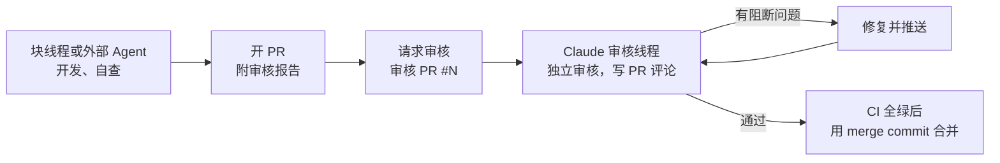

# 交接指引

本文和 [任务表](72-task-board.md) 组成交接文档。读者是接手写代码的 Agent（Claude 块线程、Codex 等外部 Agent）和开发者。

- 70 目录不是设计文档，是进度和任务记录。设计的唯一来源仍是 `docs/` 的 00 至 60 目录。交接文档只引用设计章节，不重复设计。两者冲突时以设计为准，并在 PR 里指出冲突。
- 协作规则以根目录 `AGENTS.md` 为准。本文只补充"接手时具体怎么做"。
- 本文写"怎么做"，很少变；任务和状态只写在 [任务表](72-task-board.md)，每个任务的 PR 顺手更新它。

## 1. 当前进度

快照日期：2026-10-12。之后的进度以 [任务表](72-task-board.md) 第 2 节的状态列为准。

| 项 | 状态 | 位置 |
|---|---|---|
| core 层（schema、model、core） | 已合并，PR [#2](https://github.com/LeXwDeX/DevOps-Agent/pull/2) | `platform/internal/{schema,model,core}`；设计 [61](../60-design/61-core-layer.md) |
| core 的已知限制 | 见 61 第 8.3 节、第 11 节"本块不做" | 例如：步骤内容和执行预期由 `Registry` 端口生成；`core/request` 的状态转换函数是导出的 |
| provider 第一块的 L01 | 已合并，PR [#6](https://github.com/LeXwDeX/DevOps-Agent/pull/6)、[#7](https://github.com/LeXwDeX/DevOps-Agent/pull/7)；Claude 审核通过 | `provider/system`、`provider/modelgw`、9 个错误码；设计 [62](../60-design/62-provider-storage-modelgw.md) |
| L02、L03 的草稿 | 在提交 `bd95582` 里，未完成，见第 4 节 | 不在 `main` 的工作树里 |
| SDK 模块 | 只有目录骨架和 `go.mod` | `sdk/agent/` |
| `platform/cmd/*`、`deploy/`、`test/` | 空目录 | `platform/` |
| CI | `scripts/check.sh --vuln`：gofmt、vet、`go test -race`、govulncheck | `.github/workflows/ci.yml` |

下一步可以并行开工：L02.1、L03.1、L04.1（任务表第 2 节）。

## 2. 开工步骤

1. 读 `AGENTS.md`。
2. 读必读集：[01](../00-overview/01-system-positioning.md)、[02](../00-overview/02-glossary.md)、[03](../00-overview/03-kernel-rules.md)。
3. 在 [任务表](72-task-board.md) 选一个状态为"未开始"、依赖都已合并的子任务。
4. 读这个子任务和它所属任务的"依据"列出的章节。不要一次读全部文档。
5. 从最新 `main` 开分支：Claude 用 `claude/<子任务号>-<短名>`，外部 Agent 用 `codex/<子任务号>-<短名>`，例如 `codex/L02.1-pgtest`。依赖的 PR 还没合并时，从依赖分支的最新提交开出，PR 描述第一行写"依赖 #N，先合并它"（AGENTS.md 第 6 节）。
6. 把任务表里这个子任务的状态改成"进行中 + 分支名"，随第一个 PR 提交。
7. 标"先写设计"的任务：先在 `docs/60-design/` 写或补详细设计，再写代码。设计和代码可以在同一个 PR，设计提交在前。

一个子任务对应一个 PR。相邻的两个小子任务可以合成一个 PR，在 PR 描述里写明包含哪些子任务。

## 3. 完成标准

每个子任务都要满足：

| 项 | 要求 |
|---|---|
| 本地检查 | `scripts/check.sh` 全部通过。 |
| 验证项 | 子任务的每条验证都有对应的测试或命令输出。没有 PostgreSQL 或 Docker 时测试跳过，并在输出里写明原因，不能假装通过。 |
| 依赖方向 | `platform/internal/archtest` 通过。新增的层或包要在 archtest 里加规则。 |
| 错误码 | 全部来自 `platform/internal/schema/errcode`（SDK 用自己的 `goagent.*` 错误码）。没有裸字符串错误。 |
| 文档 | 设计改了就同步改 `docs/`。新术语先加进 02。新文档加 front matter，并更新 `docs/README.md` 的目录和任务路由（AGENTS.md 第 9 节）。 |
| 任务表 | 同一个 PR 里把子任务状态改成"已合并 #PR号"（合并前写"待审核 #PR号"）。发现新任务或拆分变化时，同时改任务表。 |
| PR | 先开草稿 PR。描述带审核报告（AGENTS.md 第 4 节的五项）。自查完成后改为 ready。 |

## 4. 草稿代码的取回

L02、L03 有一份未完成的草稿，在提交 `bd95582`（原分支名 `provider-wip`）。这个提交已经在 `main` 的历史里：L01 合并了它，再删掉了 L02、L03 的路径。所以任何克隆都能直接取回，不需要 bundle。

```bash
git restore --source=bd95582 -- platform/internal/provider/storage platform/migrations
```

```bash
git restore --source=bd95582 -- sdk/agent/protocol sdk/agent/providers
```

| 路径 | 草稿状态 | 归属 |
|---|---|---|
| `platform/internal/provider/storage/pgtest/`、`platform/migrations/` | 能编译，测试不全 | L02.1 |
| `platform/internal/provider/storage/pgstore/` | 能编译，没有测试 | L02.2 至 L02.5 |
| `sdk/agent/protocol/` 与 testdata | 没跑过测试 | L03.1 至 L03.3 |
| `sdk/agent/providers/deepseek.go` 与测试 | 没跑过测试 | L03.4 |
| `platform/go.mod` 的 pgx 依赖 | 需要手动合入 | L02.1 |

注意：

- 草稿写在 core 审核修复之前。之后 `core/ports/ports.go`、`model/request`、`model/task`、`coretest` 都改过。取回后先 `go build ./...`、`go vet ./...`，按 `main` 的端口签名改草稿，再补测试。
- 只取回本子任务需要的文件。不要整体合并 `bd95582` 的其他路径，那些是旧版本。
- 用户电脑上的 `.handoff/` 目录是旧的交接文件（bundle、L01 的日志），不提交，也不再需要。

## 5. 审核与合并



1. 开 PR 后，把 PR 号告诉协调者或用户。
2. 审核线程按 AGENTS.md 第 4 节第 5 至 7 步审核，在 PR 上写评审意见。
3. 逐条修复，推送，回复每条意见。
4. 审核线程在 PR 评论里写"通过"，并且 CI 在最新提交上全绿后，才能合并。外部 Agent 不能自己判定"通过"。
5. 合并只用 merge commit（`merge_method: merge`）。不用 squash 或 rebase，不开自动合并。

## 6. 一律不做

| 不做 | 依据 |
|---|---|
| 推送 `main`；强推任何分支；改写已推送的历史 | AGENTS.md 第 6 节 |
| 不先改 03 就改变内核规则 | AGENTS.md 第 3、9 节 |
| 在 `internal/core` 里做外部 I/O，或导入标准库以外的包 | 53 第 5 节；archtest |
| `module` 导入 `provider`；`sdk/agent` 导入 `platform` | 53 第 5 节 |
| 引入 51 第 3 节以外的第三方依赖。确实需要时先写准入说明（51 第 4 节），在 PR 里单独列出 | 51 第 3、4 节 |
| 提交真实密钥、`.env`、真实模型 key。测试只用假 key | K-16、K-31 |
| 在日志、错误、测试输出里打印 `DEVOPS_LLM_API_KEY` 的值 | K-17；11 第 5.4 节 |
| 服务启动时自动运行数据库迁移 | 12 第 6.3 节；51 第 3 节 |
| 恢复后自动续跑任务 | K-24 |
| 在 M1 里开放任何工具执行 | 54 P1"开放能力" |
| 读写本地的 `hermes/` 目录 | AGENTS.md 第 1 节 |
| 碰测试机 `/DATA/AppData/AGENT-OPS` 以外的文件，或本项目以外的 Docker 对象 | AGENTS.md 第 7.1 节 |

## 7. 停下问用户的情况

只在下面几种情况停下（AGENTS.md 第 3 节）：

- 要改变 1.0 目标。
- 要做无法撤销的操作：删数据、动生产、对外发消息、强推 `main`、`docker compose down -v`。
- 需要用户的账号、密钥或设备，例如新的 GitHub token、模型 key、测试机访问。

其余情况自己决定，采用推荐做法，把决定写进设计文档和审核报告。
