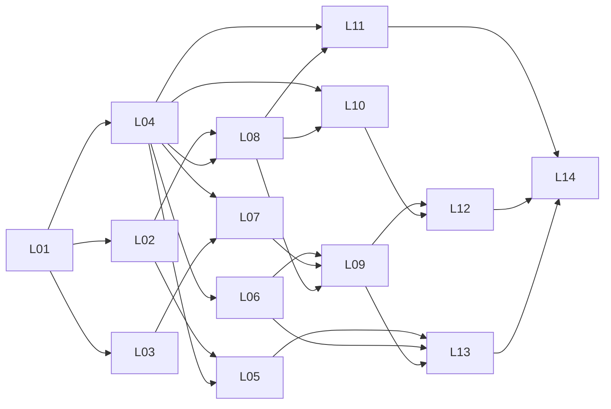
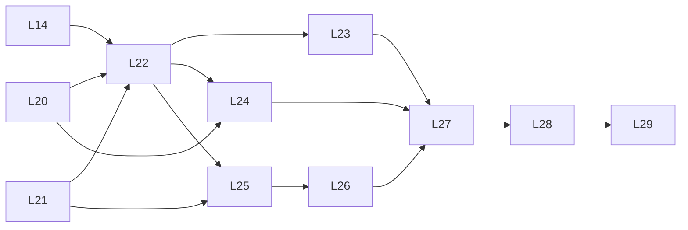

# 任务表

怎样接手、开工和交付，见 [交接指引](71-handoff-guide.md)。本文只列任务。

## 1. 编号和里程碑

- **任务**用 `Lxx` 编号，例如 L02。一个任务对应设计里的一块范围。
- **子任务**用 `Lxx.n` 编号，例如 L02.1。一个子任务对应一个 PR，是交接和审核的单位。
- 任务卡片里的"依据"和"边界"对它下面的所有子任务都适用，子任务不再重复。
- 子任务的"依赖"写到子任务级。只要依赖都已合并，就可以开工，不用等整个任务完成。

里程碑：

- **M1 本地 Docker 能对话**：两容器加 PostgreSQL 用 `docker compose` 起来；用户经页面或 API 和 Agent 对话；模型请求经模型出口代理发往 `DEVOPS_LLM_BASE_URL`；工具执行全部关闭。范围是 54 P1 的子集，取舍见 54 第 3 节"P1 的 M1 子集"。
- **M2 门禁与执行器最小闭环**：一条命令模板按策略自动执行，一条独立命令经人工 ▶ 执行。范围是 54 P2 的子集。
- **M3 以后**：54 P3 至 P6。只列方向，开工前再拆。

## 2. 总表

状态取值：未开始 / 进行中（分支名）/ 待审核 #PR / 已合并 #PR。

| 子任务 | 内容 | 里程碑 | 依赖 | 状态 |
|---|---|---|---|---|
| L01 | 62 设计、错误码、Clock/IDGen、模型出口代理 | M1 | — | 已合并 [#6](https://github.com/LeXwDeX/DevOps-Agent/pull/6)、[#7](https://github.com/LeXwDeX/DevOps-Agent/pull/7) |
| L02.1 | 测试库、迁移文件、CI 的 PostgreSQL | M1 | L01 | 未开始 |
| L02.2 | 持久化文档与转换 | M1 | L02.1 | 未开始 |
| L02.3 | `RequestStore`、`RevisionLog`、`EventSink` | M1 | L02.2 | 未开始 |
| L02.4 | `TaskStore` 与任务定义 | M1 | L02.2 | 未开始 |
| L02.5 | outbox 读取、`AuditSink`、固定 SQL 检查、整流程复测 | M1 | L02.3、L02.4 | 未开始 |
| L03.1 | SDK 公共协议类型与错误码 | M1 | L01 | 未开始 |
| L03.2 | Chat 基础适配器：请求编码与普通回复 | M1 | L03.1 | 未开始 |
| L03.3 | Chat 基础适配器：流式解码 | M1 | L03.2 | 未开始 |
| L03.4 | DeepSeek 派生适配器 | M1 | L03.3 | 未开始 |
| L04.1 | 设计 63：部署与进程 | M1 | L01 | 待审核 [#12](https://github.com/LeXwDeX/DevOps-Agent/pull/12) |
| L04.2 | 设计 63：核心控制服务与任务队列 | M1 | L04.1 | 未开始 |
| L04.3 | 设计 63：SDK v0 与平台依赖方式 | M1 | L04.1 | 未开始 |
| L04.4 | 设计 63：账号、凭证库最小版、页面 | M1 | L04.2 | 未开始 |
| L05 | `cmd/migrate` 迁移程序 | M1 | L02.1、L04.1 | 未开始 |
| L06.1 | `cmd/model-proxy` 装配 | M1 | L04.1 | 未开始 |
| L06.2 | runtime 入口进程 | M1 | L06.1 | 未开始 |
| L07.1 | SDK 公共 API、端口、事件 | M1 | L03.1、L04.3 | 未开始 |
| L07.2 | SDK 请求管理 | M1 | L03.3、L07.1 | 未开始 |
| L07.3 | SDK 有界运行循环 | M1 | L07.2 | 未开始 |
| L07.4 | 第二宿主样例与 SDK 发版 | M1 | L03.4、L07.3 | 未开始 |
| L08.1 | core 库迁移与存储 | M1 | L02.5、L04.2 | 未开始 |
| L08.2 | 项目与会话模块 | M1 | L08.1 | 未开始 |
| L08.3 | 任务队列 | M1 | L08.1 | 未开始 |
| L08.4 | HTTP 接口与 `cmd/core` 装配 | M1 | L08.2、L08.3 | 未开始 |
| L09.1 | `cmd/agent-worker` 装配 | M1 | L07.4、L08.4 | 未开始 |
| L09.2 | Worker 端到端测试 | M1 | L06.1、L09.1 | 未开始 |
| L10.1 | 本地账号与登录 | M1 | L04.4、L08.4 | 未开始 |
| L10.2 | ModelProfile 与角色绑定 | M1 | L10.1 | 未开始 |
| L11.1 | 输入侧 mask 规则 | M1 | L04.4 | 未开始 |
| L11.2 | 最小凭证库与自动转 K | M1 | L08.4、L11.1 | 未开始 |
| L12.1 | 页面：登录、项目、会话 | M1 | L10.1 | 未开始 |
| L12.2 | 页面：对话与模型状态 | M1 | L09.2、L10.2、L12.1 | 未开始 |
| L13.1 | 两个镜像 | M1 | L05、L06.2、L09.1 | 未开始 |
| L13.2 | compose、宿主目录与数据库角色脚本 | M1 | L13.1 | 未开始 |
| L13.3 | 部署检查脚本与 CI 镜像构建 | M1 | L13.2 | 未开始 |
| L14 | 测试机部署与 M1 验收 | M1 | M1 其余全部 | 未开始 |
| L20 | Q11 dcg 核实 | M2 | — | 未开始 |
| L21 | Q10 凭证库设计 | M2 | — | 未开始 |
| L22 | 设计 64：Harness 服务、执行器、执行通道 | M2 | L14、L20、L21 | 未开始 |
| L23 | 策略、登记表、范围的 PostgreSQL 实现 | M2 | L22 | 未开始 |
| L24 | dcg provider | M2 | L20、L22 | 未开始 |
| L25 | 凭证库 provider 与执行器注入 | M2 | L21、L22 | 未开始 |
| L26 | 执行通道与 `cmd/executor` | M2 | L22、L25 | 未开始 |
| L27 | `cmd/harness`：执行申请 HTTP 接口 | M2 | L23、L24、L26 | 未开始 |
| L28 | 审核界面、策略中心、登记中心、审计页面最小版 | M2 | L27 | 未开始 |
| L29 | M2 验收 | M2 | L28 | 未开始 |

M1 的任务级依赖（子任务级依赖以上表为准）：

M2 的依赖：

L02、L03、L04 三条线可以并行。L20、L21 不依赖 M1，可以随时开始。

## 3. M1 任务卡片

### L02 PostgreSQL 存储

| 项 | 内容 |
|---|---|
| 目标 | core 存储端口的 PostgreSQL 实现：`RequestStore`、`RevisionLog`、`TaskStore`、`EventSink`（outbox）、`AuditSink`。 |
| 依据 | 62 第 3、7、8、9 节；61 第 8.2、8.3 节；13 第 3 节；45 第 6.1 节；K-05、K-23 |
| 草稿 | 从 `bd95582` 取回，见交接指引第 4 节。 |
| 不做 | `PolicySource`、`Registry`、`ScopeSource`（L23）；core 库的表（L08.1）；迁移程序（L05）；数据库角色与授权（L13.2）。 |
| 边界 | 第三方库只用 `github.com/jackc/pgx/v5`。不拼接 SQL，不接受调用方传入的 SQL。不用 sqlc（62 第 3.4 节）。 |

#### L02.1 测试库、迁移文件、CI 的 PostgreSQL

| 项 | 内容 |
|---|---|
| 做 | 取回 `pgtest/`、`platform/migrations/{harness,config,audit}/0001_init.sql`、`migrations.go`；`go.mod` 加 pgx；`ci.yml` 加 PostgreSQL 16 服务容器并设置 `DEVOPS_TEST_PG_DSN`。 |
| 产出 | `platform/internal/provider/storage/pgtest/`；`platform/migrations/`；`ci.yml`。 |
| 验证 | 1. `pgtest` 三条路径（62 第 3.7 节）：有 DSN 用 DSN；有 `initdb` 起临时实例；都没有跳过并写明原因。2. 每个测试包新建三个库并迁移，测试之间不共享数据。3. 迁移后 62 第 3.1 节列出的表、唯一约束、部分索引都存在。4. 对 `audit_records` 执行 UPDATE、DELETE、TRUNCATE 都失败。5. CI 里这些测试真正运行，不是跳过（看 CI 日志）。 |

#### L02.2 持久化文档与转换

| 项 | 内容 |
|---|---|
| 做 | `schema/core` 的五个文档结构 v1 与 SchemaID（62 第 3.3 节）；`pgstore/convert.go`、`doc.go`、`errors.go`。 |
| 产出 | `platform/internal/schema/core/` 的文档结构；`pgstore` 的转换与解码。 |
| 验证 | 1. 每种文档 model → 文档 → model 往返相同。2. 未知字段、未知 SchemaID、非法枚举都返回 `storage.decode_failed`。3. 文档字段用固定 JSON 名，有字段名快照测试。 |

#### L02.3 `RequestStore`、`RevisionLog`、`EventSink`

| 项 | 内容 |
|---|---|
| 做 | `pgstore/harness.go`、`events.go` 里执行申请、修订日志、事件写入；状态和事件同一事务（62 第 3.2 节）。 |
| 验证 | 1. `coretest.RequestStoreContract`、`RevisionLogContract`、`EventSinkContract` 在真实库上通过。2. 注入 `event_id` 冲突后状态不变；CAS 冲突时事件不写入。3. 10 个 goroutine 同时 Save 同一申请，只有一个成功，`-race` 通过。4. 用旧版本保存返回 `core.cas_conflict`，记录不变。5. 同一修订写两次只有一行。6. `r.Version != expected.Next()` 返回 `core.invalid_argument`。 |

#### L02.4 `TaskStore` 与任务定义

| 项 | 内容 |
|---|---|
| 做 | `pgstore/tasks.go`：任务运行（harness 库）、任务定义与启用版本（config 库）。 |
| 验证 | 1. `coretest.TaskStoreContract` 在真实库上通过。2. `SaveRun` 的 CAS 与迟到结果同 L02.3 第 3、4 项。3. 只按主键或非终态状态读取，返回新对象（改返回值不影响库里记录）。 |

#### L02.5 outbox 读取、`AuditSink`、固定 SQL 检查、整流程复测

| 项 | 内容 |
|---|---|
| 做 | `PendingEvents`、`MarkDelivered`（62 第 3.5 节）；`pgstore/audit.go`；`queries.go` 的 SQL 清单与 `PREPARE` 测试；archtest 的存储规则。 |
| 验证 | 1. outbox 按 `id` 顺序读取；`MarkDelivered` 后不再返回；同一 `event_id` 不重复。2. 清单里每条 SQL 都能在迁移后的库上 `PREPARE`；清单外没有 SQL 字符串（测试扫描包内常量）。3. `AuditSink` 只追加。4. `core/flowtest` 的一个完整任务场景在 PostgreSQL 存储上再跑一遍。5. 62 第 9 节审核清单全部核对。 |

### L03 SDK 协议层

| 项 | 内容 |
|---|---|
| 目标 | SDK 能把公共模型类型编码成 Chat Completions 请求，解码普通和流式回复；DeepSeek 的 `reasoning_content` 由派生适配器处理。 |
| 依据 | 62 第 5.4 节；42 第 2、3、4、5、8、10 节；41 第 11、13 节；55 第 9 节"协议语料"；K-22、K-28；DeepSeek 思考模式文档 <https://api-docs.deepseek.com/zh-cn/guides/thinking_mode/> |
| 草稿 | 从 `bd95582` 取回，见交接指引第 4 节。 |
| 不做 | 其他三种基础协议；GLM 派生；请求管理与重试（L07.2）；sidecar 持久化。 |
| 边界 | SDK 不导入 `platform`。公共类型不暴露厂商类型。厂商字段只写在派生适配器里。不按模型名选适配器，由 ModelProfile 指定。所有测试命令：`cd sdk/agent && GOWORK=off go test -race ./...`。 |

#### L03.1 SDK 公共协议类型与错误码

| 项 | 内容 |
|---|---|
| 做 | `protocol/types.go`、`adapter.go`（适配器接口与 `ChatAdapterBase` 的嵌入约定）、`errors.go`（`goagent.*` 错误码）。 |
| 验证 | 1. 公共类型里没有厂商专属字段。2. 错误码全部来自集中定义，没有裸字符串错误。3. 在仓库外的临时目录，用 `GOWORK=off` 和无 `replace` 的 `go.mod` 导入 SDK 能构建（41 第 11 节），写成脚本或测试。 |

#### L03.2 Chat 基础适配器：请求编码与普通回复

| 项 | 内容 |
|---|---|
| 做 | `protocol/chat.go` 的请求编码与非流式解码；协议语料 testdata 的 `resp_*`。 |
| 验证 | 1. 语料：标准回复、多工具关联、错误、缺失用量（记为未知，不填 0）、重复字段、未知字段。2. 未知字段进 `Response.Sidecar`，不丢弃，不获得执行含义。3. `finish_reason` 为 `length` 且没有文本和工具调用 → `goagent.model.output_truncated`。 |

#### L03.3 Chat 基础适配器：流式解码

| 项 | 内容 |
|---|---|
| 做 | SSE 流式解码；testdata 的 `stream_*`。 |
| 验证 | 1. 语料：标准流、分片的工具参数、截断、结束后又有内容、有 `[DONE]` 没有 `finish_reason`、有 `finish_reason` 没有 `[DONE]`、格式错误。2. 取消 ctx 后解码在限定时间内返回。3. 对流式解码做 fuzz，种子语料随测试运行。 |

#### L03.4 DeepSeek 派生适配器

| 项 | 内容 |
|---|---|
| 做 | `providers/deepseek.go` 与测试；`reasoning_*` 语料。 |
| 验证 | 1. `reasoning_content` → thinking 块，在文本块之前；流式 `delta.reasoning_content` → thinking 增量。2. 请求带 `tools` 时，历史里带 thinking 的 assistant 消息写回 `reasoning_content`；不带 `tools` 时不写回。3. `reasoning_content` 不是字符串时按协议错误处理。4. 派生准入三项：确实嵌入 `ChatAdapterBase`；未重写的方法输出与父类型相同；重写经最外层对象分派生效。5. 62 第 9 节审核清单中和协议有关的条目全部核对。 |

### L04 设计 63：M1 平台骨架

| 项 | 内容 |
|---|---|
| 目标 | 写 `docs/60-design/63-m1-platform-skeleton.md`，把 M1 要用、但设计里还没写清的部分定下来。L05 至 L13 按它编码。只写文档，不写代码。 |
| 依据 | 54 P1；56 第 3.2 节；11 第 2 至 5 节；12 第 4、6.3 节；13；25 第 5 节；31；38 第 2、3 节；41 第 2、5、8、10、11 节；42 第 7、8 节；43；45 第 6、7 节；53 第 4、6 节 |
| 做法 | 四个子任务按章节逐步写同一篇 63。L04.1 建文件、front matter 和 `docs/README.md` 条目；后面的子任务追加章节。每个决定写决定和理由；改变已定设计的，先改原文档，在审核报告里单独列出。 |
| 每个子任务都要 | 1. 下面列出的事项都有决定。2. 改过的原文档与 63 一致。3. 写出本子任务覆盖的下游子任务（见各子任务"供下游"）的范围、测试清单和审核清单。 |
| 边界 | 不改变 1.0 目标。不改内核规则；需要改时先改 03 并单独列出。 |

下面各表括号里是推荐默认，可以在设计里改，改了要写理由。

#### L04.1 部署与进程

供下游：L05、L06、L13。结果见 63 第 2 至 17 节。与下表推荐默认的差异：重启策略改为 `restart: "no"`（63 第 11.1 节）；M1 的 runtime 只启动入口进程和代理，8081 只预留；迁移改为 plan/apply 两步并绑定计划摘要（63 第 12.3 节）；核心内部接口放在容器回环 `127.0.0.1:8090`；每进程一个配置文件；数据库引导用 `migrate bootstrap`；M1 的 core 有外网出口（63 第 6.1 节例外）；core 可向审计库追加平台管理事件（63 第 12.1 节）。

| 事项 | 现状 | 推荐默认 |
|---|---|---|
| M1 和 54 P1 的差别 | P1 含底座最小版（supervisord、节点代理）；SDK v0 含 ContextPatch、快照与压缩、Hook | M1 用 `docker compose` 部署，底座推迟到 M2 之后；SDK v0 不做 ContextPatch、压缩、Hook 执行和子 Agent；P1"进入 P2 的条件"里对应条目随之推迟。54 写明这两项取舍 |
| 进程监听地址与端口 | 没写 | 核心控制服务 `:8080`（唯一映射到宿主的端口）；Harness `:8081`；模型出口代理 `:8082`，只在 compose 内部网络；PostgreSQL 不映射到宿主 |
| HTTP 服务资源限制 | 62 第 1.1 节留给装配层 | 并发上限、入站请求头与请求体读时限、响应写时限，每个服务给出具体值 |
| 配置文件与引导密钥文件 | 11 第 5.3 节只写了目录和内容 | 每个容器一个配置文件，格式和字段在 63 列出；数据库口令、客户端 token 各一个文件，文件名写进 11 第 5.3 节挂载表 |
| Worker → 模型出口代理的客户端凭证 | 62 留给装配层 | 部署时生成随机 token：`secrets/core/model-proxy-token`（只给 Worker 运行身份）和 `secrets/runtime/model-proxy-token`（只给代理运行身份）。先改 11 第 5.3 节 |
| 迁移在 compose 下怎样运行 | 12 第 6.3 节由底座运行；53 第 4.1 节 runtime 镜像没有 `migrate` | 迁移程序放进 runtime 镜像（先改 53 第 4.1 节）；compose 里一次性服务 `migrate`，`profiles: [migrate]`，只挂迁移账号口令；管理员手动 `docker compose -p devops-agent --profile migrate run --rm migrate`，运行前先备份 |
| 容器内进程管理与运行身份 | 11 第 5.1、5.4 节 | 每个容器一个 Go 写的入口进程：按固定用户启动子进程、给每个子进程准备环境变量、任一子进程退出就整体退出。runtime 入口进程删除模型接入变量后再启动其他进程 |
| Worker 能否单独重启（12 第 4 节与第 6.2 节矛盾） | 未解决 | M1 不支持单独重启 Worker，重启 core 容器；12 第 6.2 节改为"底座阶段再定"。定下 L14 第 6 项"停止 Worker"的做法（推荐：配置里把 Worker 并发设为 0）。写明 M1 接受 Worker 崩溃时 core 容器整体重启 |
| 重启策略（12 第 4 节） | 没写次数和间隔 | compose 的 `restart: unless-stopped`；次数和间隔底座阶段再细化 |

#### L04.2 核心控制服务与任务队列

供下游：L08。

| 事项 | 现状 | 推荐默认 |
|---|---|---|
| 核心控制服务的接口 | 31、38、39 只描述功能 | 版本化 HTTP/JSON，前缀 `/api/v1`。M1 只有：登录、项目、会话、消息、模型可用性、健康、恢复报告、内部任务队列。列出每个接口的请求、响应和错误码 |
| core 库的表 | 没写 | 项目、会话、消息、对话任务；表结构写进 63 |
| 任务队列协议 | 11 第 4 节只说"版本化、持久保存" | 存在 core 库；Worker 没有数据库账号（53 第 6 节），经内部 HTTP 接口领取任务和回写结果；领取用租约，租约只用于领取，不用于续跑（13 第 3 节、K-24） |
| 恢复模式 | 13、K-24 | 启动时调用 `recovery.OnStartup`，生成恢复报告，接口可查询；未完成的对话任务标为"已停止（恢复中断）" |
| outbox 投递 | 45 第 6.1 节没写放在哪个进程 | M1 没有消费者，事件留在 outbox；L22 再定 |
| 审计骨架 | 54 P1 | 用 L02 的 `AuditSink`；M1 记录登录、ModelProfile 变更、K 的增删改 |

#### L04.3 SDK v0 与平台依赖方式

供下游：L07、L09。

| 事项 | 现状 | 推荐默认 |
|---|---|---|
| SDK v0 范围 | 41、42、43 很大 | 只做 Chat Completions、请求管理（42 第 7 节的预算、超时、取消、重试分类）、ModelRole 路由（`MainAgent`、`ContextMaintenance`）、对话与计划、上下文投影最小版、公开事件枚举、宿主端口。没有 `GatedToolRequestPort` 时工具全部关闭（41 第 2 节）。不引入 Eino 或 Google ADK Go |
| 平台对 SDK 的依赖方式 | 53 第 1 节：不用本地 `replace`；仓库私有 | 给 SDK 打标签 `sdk/agent/v0.1.0`；平台 `go.mod` 按版本引用；`GOPRIVATE=github.com/LeXwDeX/*`；CI 用 `GITHUB_TOKEN` 改写 git URL 下载；镜像构建前在仓库外 `go mod vendor` 或用 BuildKit secret。本地可用不提交的 `go.work` 联调，CI 和镜像构建一律 `GOWORK=off`。CI 拿不到私有模块、需要新 token 时停下问用户 |
| Worker 的结构 | 41 第 5、10 节 | 写清 Worker 的宿主端口实现：传输端口指向模型出口代理并带客户端 token；对话端口接任务队列；不注入工具门禁端口 |

#### L04.4 账号、凭证库最小版、页面

供下游：L10、L11、L12。

| 事项 | 现状 | 推荐默认 |
|---|---|---|
| 首个 owner 的初始化 | 38 第 2 节 | `cmd/core` 的一次性子命令创建，口令只从终端输入 |
| 登录会话 | 没写 | 服务端会话，HttpOnly Cookie；写清过期时间和口令哈希算法 |
| M1 最小凭证库放在哪 | 11 第 5.3 节：凭证库在 runtime，只有执行器能读；M1 没有执行器，识别密钥的是 core 侧 | 由 63 定，先改 11 第 5.3 节。无论放哪：core 没有读出 V 的接口（K-16）；V 加密落盘；写明 L21 怎样迁到完整凭证库 |
| 页面技术选型 | 39 只描述功能 | 不引入前端构建链：标准库 `html/template` 加少量原生 JS，由核心控制服务提供 |

### L05 `cmd/migrate` 迁移程序

| 项 | 内容 |
|---|---|
| 目标 | 一个只做迁移的命令行程序。 |
| 依据 | 63；12 第 6.3 节；53 第 4.1、6 节；K-23 |
| 做 | 63 第 12.2 节的 `bootstrap` 子命令；63 第 12.3 节的 `plan`、`apply` 两条命令：读取 `platform/migrations` 内嵌的文件，按库、按文件名顺序执行；执行预期、计划摘要（绑定目标身份）和结果核对；版本表 `schema_migrations`；`apply` 必须带计划摘要和备份标识；迁移文件构建期扫描。63 第 13 节的 `config.*`、`migrate.*` 错误码。 |
| 产出 | `platform/cmd/migrate/`；迁移版本表。 |
| 验证 | 63 第 15.1 节的 17 项测试。 |
| 边界 | `plan`、`apply` 只持有迁移账号；`bootstrap` 只在 db-init 服务里运行。不被任何服务在启动时调用。不自动回滚。 |

### L06 runtime 入口进程与 `cmd/model-proxy`

| 项 | 内容 |
|---|---|
| 目标 | runtime 容器能启动模型出口代理；模型接入变量只交给代理。 |
| 依据 | 63；11 第 5.1、5.4 节；62 第 1.1、5 节；K-17、K-18、K-31 |
| 边界 | 代理不启动子进程。配置文件里不写模型端点。 |

#### L06.1 `cmd/model-proxy` 装配

| 项 | 内容 |
|---|---|
| 做 | 读模型接入变量、读客户端凭证文件、按 63 监听并设置 HTTP 资源限制、装配 `modelgw`。 |
| 产出 | `platform/cmd/model-proxy/`。 |
| 验证 | 1. 变量缺失时代理照常运行，`GET /v1/status` 返回 `missing`，聊天请求返回 503 `modelgw.unavailable`。2. 客户端凭证文件缺失或为空时拒绝启动，错误只含文件名。3. 63 定下的资源限制都有测试（慢请求头、超大请求体、慢客户端）。4. 用假 key 跑一遍完整请求后，日志输出里搜不到 key。5. 63 第 15.2 节 L06.1 的追加测试（并发上限、流式写时限、未知配置字段）。 |

#### L06.2 runtime 入口进程

| 项 | 内容 |
|---|---|
| 做 | `platform/cmd/entry`：63 第 4 节的入口进程，`core`、`runtime` 两张进程表。 |
| 验证 | 63 第 15.2 节 L06.2 的 6 项测试。 |

### L07 SDK v0 运行循环与第二宿主样例

| 项 | 内容 |
|---|---|
| 目标 | 宿主可以用 SDK 跑一轮对话和计划。没有门禁端口时，工具全部关闭。 |
| 依据 | 63；41 第 2 至 8、10 至 13 节；42 第 6 至 9 节；43（最小版范围以 63 为准）；45 第 2 至 5、7 节 |
| 不做 | 子 Agent、Hook 的执行（只定义契约）、压缩器、工具目录与受控申请的实现（M2 之后）。 |
| 边界 | SDK 不导入平台；不引入候选框架；SDK 自审、`Continue` 或任何标记都不算批准（41 第 6 节）。所有测试用重放的模型响应，结果确定（55 第 1 节）。 |

#### L07.1 SDK 公共 API、端口、事件

| 项 | 内容 |
|---|---|
| 做 | `agent.go`、`ports.go`、`types.go`、`model_profiles.go`、`events.go`：公共 API、宿主端口、ModelRole、公开事件枚举与脱敏封装。 |
| 验证 | 1. 公共 API 不暴露 `internal` 和厂商类型。2. 事件经脱敏封装（45 第 4 节）；公共字段与 45 第 2 节一致；事件枚举与 45 第 5 节一致（枚举比对测试）。3. 慢订阅不阻塞发布方（测试）。 |

#### L07.2 SDK 请求管理

| 项 | 内容 |
|---|---|
| 做 | `internal/llm`：预算、超时、取消、重试分类（42 第 7 节），经 L03 的适配器发请求。 |
| 验证 | 1. 预算和超时到达时请求被拒绝，错误码来自 `goagent.*`。2. 调用方取消 ctx 后，请求在限定时间内结束。3. 流式中断：丢弃部分输出，不拼接，按重试分类处理（42 第 7.3 节）。4. 不可重试的错误不重试；可重试的错误按上限重试。 |

#### L07.3 SDK 有界运行循环

| 项 | 内容 |
|---|---|
| 做 | `internal/runtime`：对话与计划、ModelRole 路由、上下文投影最小版、步数上限。 |
| 验证 | 1. 不注入 `GatedToolRequestPort` 时，模型返回工具调用，工具执行次数为 0，事件里记录"工具关闭"。2. 缺少 `MainAgent` 绑定时对话能力关闭，不改用别的角色。3. 运行在步数上限处停止，状态明确。4. 取消后状态为已取消。 |

#### L07.4 第二宿主样例与 SDK 发版

| 项 | 内容 |
|---|---|
| 做 | `examples/second-host/`；按 L04.3 准备 `sdk/agent/v0.1.0` 标签。打标签前在 PR 里说明，合并后由开 PR 的线程打标签并推送。 |
| 验证 | 1. 第二宿主样例在仓库外、无 `go.work`、无 `replace` 构建并运行，用重放的模型响应完成一轮对话。2. 标签推送后，在干净目录按版本 `go get` 能拉到（需要私有模块访问时按 L04.3 处理）。 |

### L08 核心控制服务骨架

| 项 | 内容 |
|---|---|
| 目标 | core 容器里的核心控制服务能管理项目、会话和消息，把对话交给 Worker，并在 Worker 停止领取任务时照常提供页面和记录。 |
| 依据 | 63；11 第 2、3、5 节；13；31 第 1 至 3 节；45 第 6 节；K-24、K-31 |
| 不做 | 事实、运维表格、SOP、审核界面（M2 及以后）。 |
| 边界 | 核心控制服务不持有模型 key 和任何 V；不直接调用模型；不执行命令或 SQL。 |

#### L08.1 core 库迁移与存储

| 项 | 内容 |
|---|---|
| 做 | `platform/migrations/core/`；core 库存储的 provider（固定 SQL，沿用 L02 的做法）。 |
| 验证 | 1. 迁移后 63 列出的表都存在。2. 每条 SQL 都能 `PREPARE`。3. 文档往返测试，未知字段返回 `storage.decode_failed`。4. 迟到的写入（旧版本）被拒绝，不覆盖较新的记录。 |

#### L08.2 项目与会话模块

| 项 | 内容 |
|---|---|
| 做 | `module/project`、`module/session`；对应的 schema 契约结构。 |
| 验证 | 1. 每个 schema 契约结构和 model 之间的转换有往返测试（53 第 4.3 节）。2. archtest：`module` 不导入 `provider`；加规则"只有 `core/*` 能导入 `core/request`"（core 已知限制）。 |

#### L08.3 任务队列

| 项 | 内容 |
|---|---|
| 做 | 对话任务的入队、租约领取、回写结果；内部 HTTP 接口（按 63）。 |
| 验证 | 1. 两个 Worker 同时领取同一任务，只有一个成功。2. 租约到期的任务不自动重发，按 K-24 处理。3. 迟到的 Worker 结果不覆盖较新的记录。4. 队列有上限，超限时返回明确错误。 |

#### L08.4 HTTP 接口与 `cmd/core` 装配

| 项 | 内容 |
|---|---|
| 做 | `/api/v1` 接口；`cmd/core` 装配；启动时 `ForbidInCore` 检查和 `recovery.OnStartup`；健康与恢复报告接口。 |
| 验证 | 1. 环境里有 `DEVOPS_LLM_BASE_URL` 或 `DEVOPS_LLM_API_KEY` 时，`cmd/core` 以非 0 退出，输出只含变量名。2. 发消息的接口立即返回，不等模型（11 第 3 节）。3. Worker 停止领取任务时（测试里不启动 Worker 或并发为 0），项目、会话、历史消息接口照常可用，新消息显示"等待处理"。Worker 进程退出导致 core 容器停止，由 L06.2 第 2 项和 L14 第 7 项验证，不在本项。4. 重启后未完成的对话任务标为"已停止（恢复中断）"，不自动重发；恢复报告接口能看到它们。 |

### L09 `cmd/agent-worker`

| 项 | 内容 |
|---|---|
| 目标 | Worker 从核心领取对话任务，用 SDK 经模型出口代理调用模型，写回结果。 |
| 依据 | 63；11 第 2 至 4 节；41 第 5、8、10 节；53 第 6 节；K-18 |
| 边界 | 只有 `cmd/agent-worker` 和对应 provider 导入 SDK（53 第 5 节）。 |

#### L09.1 `cmd/agent-worker` 装配

| 项 | 内容 |
|---|---|
| 做 | 按 L04.3 装配 SDK：传输端口指向模型出口代理并带客户端 token；宿主端口接任务队列接口；不注入工具门禁端口；并发和队列上限。 |
| 验证 | 1. Worker 的环境和配置里没有模型 key、数据库口令、Docker socket（启动时检查，有就拒绝启动）。2. 并发设为 0 时不领取任务（L14 第 6 项用它）。3. 模型不可用时，任务结果为"模型不可用"，原因只写变量名。 |

#### L09.2 Worker 端到端测试

| 项 | 内容 |
|---|---|
| 做 | 端到端测试：假模型服务 + 真代理 + 真核心（测试库）+ Worker。 |
| 验证 | 1. 一条消息得到回复。2. 积压时核心接口照常响应。3. Worker 重启后不重发未完成的模型请求，对应任务按 K-24 停止。4. 模型回复里请求工具调用时，执行次数为 0。 |

### L10 平台管理最小版

| 项 | 内容 |
|---|---|
| 目标 | 单一 owner 本地账号登录；管理员登记 ModelProfile 并绑定 `MainAgent`、`ContextMaintenance`。 |
| 依据 | 63；38 第 2、3、5 节；41 第 8 节；11 第 5.4 节第 5 步；K-20、K-21 |
| 边界 | SSO、MFA、多用户只留接口（Q9）。Agent 不能登记或修改 ModelProfile。 |

#### L10.1 本地账号与登录

| 项 | 内容 |
|---|---|
| 做 | `module/admin` 的身份部分；owner 初始化子命令；登录、登出、会话。 |
| 验证 | 1. 未登录访问业务接口返回 401。2. 口令以慢哈希保存，接口和日志里不出现口令。3. 业务代码通过 `IdentityProvider`、`Authorizer` 等接口判断权限，不直接写"是不是 owner"（38 第 3 节）。4. 登录写审计。 |

#### L10.2 ModelProfile 与角色绑定

| 项 | 内容 |
|---|---|
| 做 | `module/admin` 的模型配置；ModelProfile 版本；角色绑定接口。 |
| 验证 | 1. ModelProfile 修改产生新版本；在途请求继续用旧版本。2. 端点只能选 `DEVOPS_LLM_BASE_URL`，凭证只能选 K `DEVOPS_LLM_API_KEY`；填其他值被拒绝。3. 每次变更写审计。4. Worker 按绑定选 ModelProfile。 |

### L11 输入侧 mask 与自动转 K

| 项 | 内容 |
|---|---|
| 目标 | 用户在对话里粘贴的密钥，在进入模型之前被识别、存成 K，对话里只留 K。 |
| 依据 | 63；25 第 2、4、5 节；54 P1；Q10 当前默认；K-16、K-17 |
| 边界 | core 侧只写入、不读出 V。M2 的完整凭证库（L21、L25）会替换它，替换时要有迁移方案。 |

#### L11.1 输入侧 mask 规则

| 项 | 内容 |
|---|---|
| 做 | 25 第 4 节列出的内置识别规则，纯函数，不落盘。 |
| 验证 | 1. `sk-...`、`password=...`、`Authorization: Bearer ...`、私钥块都被识别，给出位置和种类。2. 普通文本不误判（负例语料）。3. 对规则做 fuzz。 |

#### L11.2 最小凭证库与自动转 K

| 项 | 内容 |
|---|---|
| 做 | 按 63 的位置和加密方式存 V；发消息时先识别、存 V、替换为 K，再入队；K 的列出接口只返回 K、备注、状态。 |
| 验证 | 1. 发给 Worker 和模型的内容里只有 K。2. 消息历史、事件、审计、日志里没有原值。3. 没有任何接口返回 V。4. 凭证库文件不在镜像里，在挂载目录（11 第 5.3 节）。5. K 的增删改写审计。 |

### L12 对话页面

| 项 | 内容 |
|---|---|
| 目标 | 浏览器里能登录、选项目、开会话、发消息、看回复、看模型可用性。 |
| 依据 | 63；31 第 3.3 节；39 第 0 节（顶部健康状态）；38 第 3 节 |
| 边界 | 页面只读，改动走接口和审计。页面不提供任何执行入口。 |

#### L12.1 页面：登录、项目、会话

| 项 | 内容 |
|---|---|
| 做 | 由核心控制服务提供静态页面（按 L04.4 的选型）：登录、项目列表与新建、会话列表与新建。 |
| 验证 | 1. HTTP 测试走一遍：登录 → 新建项目 → 新会话。2. 未登录访问页面跳转登录。 |

#### L12.2 页面：对话与模型状态

| 项 | 内容 |
|---|---|
| 做 | 对话页面；顶部健康状态。 |
| 验证 | 1. 用 Playwright 或 HTTP 测试走一遍：发消息 → 收到回复（假模型）。2. 模型不可用时显示"模型不可用"，不显示端点和 key。3. 状态未知时显示"未知"，不显示"正常"（K-05）。4. 页面没有执行入口。 |

### L13 镜像与 `docker compose`

| 项 | 内容 |
|---|---|
| 目标 | 本地一条命令起来：PostgreSQL、runtime、core 三个服务；迁移手动运行。 |
| 依据 | 63；11 第 5 节；12 第 7 节；53 第 4.1 节；51 第 3 节；K-31 |
| 边界 | 镜像只含程序（K-31）。`.env` 不进仓库。compose 项目名固定 `devops-agent`。`DATA_ROOT` 必须可配置（测试机要设到 `/DATA/AppData/AGENT-OPS` 下）。云端会话没有 Docker，需要 Docker 的检查在 CI 或本机运行。 |

#### L13.1 两个镜像

| 项 | 内容 |
|---|---|
| 做 | `platform/deploy/` 下两个 Dockerfile：core 镜像含 `core`、`agent-worker` 和 core 入口进程；runtime 镜像含 `model-proxy`、`migrate` 和 runtime 入口进程。 |
| 验证 | 1. 两个镜像都能构建。2. 镜像里没有配置文件和密钥（检查写成脚本）。3. 基础镜像按 digest 固定，不用 `latest`。4. 业务子进程不以 root 运行；入口进程按 63 第 5.1 节的能力集运行。 |

#### L13.2 compose、宿主目录与数据库角色脚本

| 项 | 内容 |
|---|---|
| 做 | 63 第 15.3 节 L13.2 的范围：`compose.yaml`（`migrate`、`bootstrap` 两个 profile）；`.env.example`（只有变量名）；`prepare-host.sh`；`backup.sh`。数据库引导程序是 L05 的 `migrate bootstrap`，这里只定义 `db-init` 服务。 |
| 验证 | 1. `docker compose -p devops-agent config` 显示：只有 runtime 有 `DEVOPS_LLM_*`；只有 core 映射端口到宿主；PostgreSQL 不映射端口。2. 把 `DEVOPS_LLM_API_KEY` 错误地加给 core 时，core 拒绝启动。3. 删除并重建容器后，项目、会话、消息都还在。4. 每个服务的数据库账号只能访问自己的库。5. 63 第 15.3 节 L13.2 的追加测试。 |

#### L13.3 部署检查脚本与 CI 镜像构建

| 项 | 内容 |
|---|---|
| 做 | 把 L13.1、L13.2 的检查写成 `platform/deploy/verify.sh`；CI 加一个构建镜像并运行它的 job。 |
| 验证 | 1. `verify.sh` 在有 Docker 的机器上全部通过；没有 Docker 时退出并说明原因。2. CI 的镜像 job 是绿的。 |

### L14 测试机部署与 M1 验收

| 项 | 内容 |
|---|---|
| 目标 | 在测试机上按 L13 部署，跑完 M1 验收清单。 |
| 依据 | AGENTS.md 第 7.1 节；54 P1"进入 P2 的条件"中和 M1 有关的条目；55 第 3 节中模型接入变量的三条负例 |
| 谁来做 | 测试机 `root@192.168.33.110` 只能从用户电脑访问。由用户电脑上的 Agent 执行，或由用户执行。 |
| 边界 | 只在 `/DATA/AppData/AGENT-OPS` 内建文件：源码 `src/`，数据 `DATA_ROOT=/DATA/AppData/AGENT-OPS/data`，`.env` 放 `deploy/.env`（权限 0600）。每条 compose 命令都加 `--env-file /DATA/AppData/AGENT-OPS/deploy/.env`。只用 `docker compose -p devops-agent`。操作前用 `docker compose -p devops-agent ps` 确认对象属于本项目。不运行 `docker system prune`、`docker rm` 其他容器、`docker compose down -v`。key 由用户填进 `.env`，Agent 不读、不打印它。 |

部署步骤：

1. 把指定提交的源码放到 `/DATA/AppData/AGENT-OPS/src/`。
2. 运行宿主目录准备脚本，`DATA_ROOT=/DATA/AppData/AGENT-OPS/data`。
3. 用户在 `/DATA/AppData/AGENT-OPS/deploy/.env` 写入 `DEVOPS_LLM_BASE_URL=https://llms.ycgame.com/v1` 和 `DEVOPS_LLM_API_KEY=<key>`。
4. `docker compose -p devops-agent build`。
5. `docker compose -p devops-agent up -d postgres`，按 63 第 12.2 节运行 `db-init`，再按 63 第 12.4 节备份和迁移。
6. `docker compose -p devops-agent up -d runtime core`。
7. 跑下面的验收清单，把结果写进 PR。检查写成脚本，只输出结论，不打印环境变量和 `docker compose config` 的完整输出（63 第 14 节）。

M1 验收清单：

| # | 检查 | 期望 |
|---|---|---|
| 1 | 页面登录，新建项目和会话，用模型别名 `deepseek` 发一条消息 | 收到回复 |
| 2 | core 容器的环境（脚本检查，只输出结论） | 没有 `DEVOPS_LLM_` 开头的变量 |
| 3 | runtime 里的进程 | 只有入口进程和代理；入口进程的初始环境有模型接入变量是已知例外（63 第 4.3 节） |
| 4 | 临时给 core 加 `DEVOPS_LLM_API_KEY=x` 再启动 | core 拒绝启动；去掉后重建 core，确认正常 |
| 5 | 把 `.env` 里的地址改成 `http://...`，重建 runtime | 页面显示模型不可用，原因只写变量名；其他页面照常。改回原地址，重建 runtime，确认模型恢复可用 |
| 6 | 停止 Worker：按 63 第 11.3 节把并发设为 0 并重启 core | 项目、会话、历史消息照常可看；新消息显示"等待处理"。改回原并发，重启 core，确认新消息被处理 |
| 7 | 重启 core 容器 | 进入恢复模式；未完成的对话任务为"已停止（恢复中断）"；没有自动续跑 |
| 8 | 删除并重建 core、runtime 容器 | 数据都在 |
| 9 | 在对话里粘贴一个假的 `sk-...` | 回复和历史里只有 K |
| 10 | `docker compose -p devops-agent logs` 全文搜索 key：脚本从 `.env` 读入 key，用字面量匹配（`grep -cF`，key 经标准输入或文件传入，不出现在命令行参数里），不回显 | 计数为 0。读取日志或搜索命令失败时输出"检查失败"，不算计数为 0 |
| 11 | Agent 回复里请求执行工具 | 执行次数为零，显示工具关闭 |

## 4. M2 任务卡片

M2 的卡片比 M1 粗。L22 写完设计 64 后，按 64 把 L23 至 L29 拆成子任务，更新本表。

### L20 Q11 dcg 核实

| 项 | 内容 |
|---|---|
| 目标 | 给出 dcg（destructive_command_guard）能否用、怎样调用的结论。 |
| 依据 | Q11；22 第 2.2 节；24 第 5 节；51 第 3、4、6 节 |
| 做 | 核实四件事：许可证是否允许本项目使用；机器可读的调用方式（输入、输出、退出码）；SQL 规则覆盖；能否追加项目规则。在隔离环境用规则样本集跑一遍，记录命中结果。固定版本和二进制摘要。 |
| 产出 | 结论写进 22 第 2.2 节和 51 第 4.3 节；Q11 有结论就从 04 删除；样本集放 `platform/test/dcg/`。 |
| 验证 | 样本集里 22 第 2.2 节和 24 第 5 节列出的每一类都有命中或未命中的记录。 |
| 停下问用户 | 许可证不允许使用，或需要换组件时。 |

### L21 Q10 凭证库设计

| 项 | 内容 |
|---|---|
| 目标 | 定下凭证库：K 命名、存储加密、主密钥、备份、迁移、轮换。 |
| 依据 | Q10；25；11 第 5.3 节；K-16、K-17 |
| 产出 | 写进 25 第 8 节；Q10 从 04 删除；说明 L11.2 的最小凭证库怎样迁移过来。 |
| 验证 | 设计里有：没有读取 V 的接口；只有执行器运行身份能读；主密钥丢失时的处理；备份加密。 |
| 边界 | 只写设计。依赖新加密库时按 51 第 4 节写准入。 |

### L22 设计 64：Harness 服务、执行器、执行通道

| 项 | 内容 |
|---|---|
| 目标 | 写 `docs/60-design/64-*.md`：Harness 的 HTTP 接口、执行器、执行通道（SSH）、`PolicySource`/`Registry`/`ScopeSource` 的表结构、审核界面接口、outbox 投递、M2 范围。 |
| 依据 | 54 P2；21；22；23 第 3 节；24；25；26；11 第 2、4 节；61 第 8.3 节；Q6、Q12、Q16、Q24 |
| 验证 | 每个 core 端口都有对应的 provider 计划和契约测试计划；55 第 3 节的每条负例都映射到一个测试；L23 至 L29 拆成子任务写回本表。 |

### L23 至 L29

| 编号 | 目标 | 关键验证 |
|---|---|---|
| L23 | `PolicySource`、`Registry`、`ScopeSource` 的 PostgreSQL 实现 | `coretest` 对应契约测试在真实库上通过；`allow_auto: false` 配成自动时被拒绝或按人工处理 |
| L24 | dcg provider（`DCGPort`） | 命中 → 转人工；禁止规则 → 拒绝，执行次数 0；dcg 不可用 → 转人工（K-08） |
| L25 | 凭证库 provider 与执行器注入 | 只有执行器能取 V；V 以环境变量注入；`echo $变量` 的输出被 mask；命令内容里有 V 时拒绝 |
| L26 | 执行通道与 `cmd/executor` | 摘要不符不执行；执行前重算指纹，不一致不执行；"开始执行"先落盘；崩溃后为"结果未知"，先查实际状态（55 第 4 节） |
| L27 | `cmd/harness`：执行申请 HTTP 接口 | SDK 或核心传来的"已批准"标记被忽略；修订后旧批准失效；冻结后不能改；重复消息不重复执行 |
| L28 | 审核界面（▶ 执行、✕ 拒绝、点评）、策略中心、登记中心、审计页面最小版 | 点评后 Revision 加一、CallID 不变，从头检验；审计能还原整个过程；Agent 不能登记 |
| L29 | M2 验收 | 55 第 3 节门禁负例全部通过；54 P2 的正例：一条命令模板按自动策略执行成功并通过结果对比；一条独立命令经点评修订后 ▶ 执行成功 |

## 5. M3 以后（方向）

| 方向 | 依据 | 备注 |
|---|---|---|
| 既定任务、命令模板库、规程包、持久调度、预授权 | 54 P3；23；13；K-11、K-24 | 开工前写设计 65 |
| 一种 SQL 方言门禁 | 54 P2；24；Q7 | 先做 pg_query_go 的 CGO 双架构 PoC（51 第 6 节） |
| 底座最小版（supervisord、节点代理） | 54 P1；12 | M1 用 compose 推迟了它 |
| 一个项目完整闭环：部署、监控旁路、事实、运维表格 | 54 P4 | — |
| 多云、更多数据库、更多模型厂商 | 54 P5 | 每个派生适配器独立文件，嵌入基础类型（K-28） |
| SDK v1 与发布基线 | 54 P6；55 第 6 至 8 节 | — |
| 跨 VM 迁移是否在 1.0 内 | 12 | 不在 M1、M2；1.0 范围有变化时停下问用户 |
