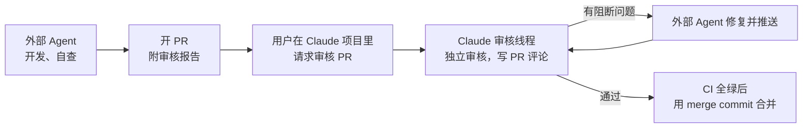
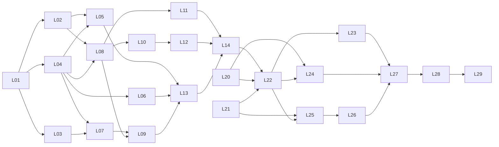

# 开发台账（core 之后）

本文是任务台账，不是设计文档。它列出 core 层之后要做的每一项任务，写清依据、产出、验证方式和边界。读者是接手写代码的 Agent（例如 Codex）和开发者。

- 设计的唯一来源仍是 `docs/`。台账只引用设计章节，不重复设计。台账和设计冲突时，以设计为准，并在 PR 里指出冲突。
- 协作规则以根目录 `AGENTS.md` 为准。本文第 2 节只补充"外部 Agent 怎样按 AGENTS.md 工作"。
- 每项任务完成后，在同一个 PR 里把第 4 节总表的"状态"改成"已合并 #PR号"。

## 1. 当前状态

| 项 | 状态 | 位置 |
|---|---|---|
| core 层（schema、model、core） | 已合并，PR #2，合并提交 `2fc2551` | `platform/internal/{schema,model,core}`，设计见 `docs/60-design/61-core-layer.md` |
| core 的已知限制 | 见 61 第 8.3 节、第 11 节"本块不做"，以及 L08 验证第 7 项 | 例如：步骤内容和执行预期由 `Registry` 端口生成，core 不展开模板；`core/request` 的状态转换函数是导出的 |
| provider 第一块（L01） | 已合并，PR [#6](https://github.com/LeXwDeX/DevOps-Agent/pull/6)；Claude 项目审核完成；评审补修 [#7](https://github.com/LeXwDeX/DevOps-Agent/pull/7) 待 Claude 正式审核 | 62 设计、错误码、Clock/IDGen、模型出口代理；仅交付 L01。L02/L03 草稿仍在 bundle，见第 3 节 |
| SDK 模块 | 只有目录骨架和 `go.mod`（`go 1.26`） | `sdk/agent/` |
| `platform/cmd/*`、`deploy/`、`test/`、`migrations/*` | 空目录 | `platform/` |
| CI | `scripts/check.sh --vuln`：gofmt、vet、`go test -race`、govulncheck | `.github/workflows/ci.yml` |

## 2. 每项任务都要遵守的规则

### 2.1 开工步骤

1. 读 `AGENTS.md`。
2. 读必读集：`docs/00-overview/01-system-positioning.md`、`02-glossary.md`、`03-kernel-rules.md`。
3. 读任务卡片"依据"一栏列出的章节。不要一次读全部文档。
4. 从最新 `main` 开分支，名称 `codex/<任务编号>-<短名>`，例如 `codex/L02-pgstore`。依赖的任务 PR 还没合并时，从依赖分支的最新提交开出，PR 描述第一行写"依赖 #N，先合并它"（AGENTS.md 第 6 节）。
5. 卡片标"先写设计"的任务：先在 `docs/60-design/` 写或补详细设计，再写代码。设计和代码可以在同一个 PR，设计提交在前。

### 2.2 完成标准（每项都要满足）

| 项 | 要求 |
|---|---|
| 本地检查 | `scripts/check.sh` 全部通过。 |
| 卡片的验证项 | 每条都有对应的测试或命令输出。没有 PostgreSQL 或 Docker 时测试跳过，并在输出里写明原因，不能假装通过。 |
| 依赖方向 | `platform/internal/archtest` 通过。新增的层或包要在 archtest 里加规则。 |
| 错误码 | 全部来自 `platform/internal/schema/errcode`（SDK 用自己的 `goagent.*` 错误码）。没有裸字符串错误。 |
| 文档 | 设计改了就同步改 `docs/`。新术语先加进 `02-glossary.md`。新文档加 front matter，并更新 `docs/README.md` 的目录和任务路由（AGENTS.md 第 9 节）。 |
| PR | 先开草稿 PR。描述带审核报告（AGENTS.md 第 4 节的五项）。自查完成后改为 ready。 |

### 2.3 审核与合并

1. 外部 Agent 开 PR 后，把 PR 号告诉用户。
2. 用户在 Claude 项目里说"审核 PR #N"。项目开一个审核线程，按 AGENTS.md 第 4 节第 5 至 7 步审核。
3. 审核线程在 PR 上写评审意见。外部 Agent 逐条修复，推送，回复每条意见。
4. 审核线程在 PR 评论里写"通过"，并且 CI 在最新提交上全绿后，才能合并。外部 Agent 不能自己判定"通过"。
5. 合并只用 merge commit（`merge_method: merge`）。不用 squash merge，不用 rebase merge，不开自动合并。

### 2.4 一律不做

| 不做 | 依据 |
|---|---|
| 推送 `main`；强推任何分支；改写已推送的历史 | AGENTS.md 第 6 节 |
| 不先改 `03-kernel-rules.md` 就改变内核规则 | AGENTS.md 第 3 节、第 9 节 |
| 在 `internal/core` 里做任何外部 I/O，或导入标准库以外的包 | 53 第 5 节；archtest |
| `module` 导入 `provider`；`sdk/agent` 导入 `platform` | 53 第 5 节 |
| 引入 51 第 3 节以外的第三方依赖。确实需要时先写准入说明（51 第 4 节），在 PR 里单独列出 | 51 第 3、4 节 |
| 提交真实密钥、`.env`、真实模型 key。测试只用假 key | K-16、K-31 |
| 在日志、错误、测试输出里打印 `DEVOPS_LLM_API_KEY` 的值 | K-17、11 第 5.4 节 |
| 服务启动时自动运行数据库迁移 | 12 第 6.3 节；51 第 3 节 |
| 恢复后自动续跑任务 | K-24 |
| 在 M1 里开放任何工具执行 | 54 P1"开放能力" |
| 读写本地仓库里的 `hermes/` 目录 | AGENTS.md 第 1 节 |
| 碰测试机 `/DATA/AppData/AGENT-OPS` 以外的文件，或本项目以外的 Docker 对象 | AGENTS.md 第 7.1 节 |

### 2.5 停下问用户的情况

只在下面几种情况停下（AGENTS.md 第 3 节）：

- 要改变 1.0 目标。
- 要做无法撤销的操作：删数据、动生产、对外发消息、强推 `main`、`docker compose down -v`。
- 需要用户的账号、密钥或设备，例如新的 GitHub token、模型 key。

其余情况自己决定，采用推荐做法，把决定写进设计文档和审核报告。

## 3. provider 草稿

core 块之后的 provider 草稿以 git bundle 交接。L01 已恢复完成部分并推送到 [PR #6](https://github.com/LeXwDeX/DevOps-Agent/pull/6)。L02、L03 的未完成草稿仍在 bundle 中，本次不交付：

- 用户电脑上的本地仓库：`.handoff/provider-wip.bundle`（不要提交这个目录）。
- 分支名：`claude/project-thread-y492dg-provider`，基于 core 提交 `3b58672`。

恢复方法：

1. `git fetch .handoff/provider-wip.bundle claude/project-thread-y492dg-provider:provider-wip`
2. `git switch -c codex/L01-provider-modelgw main`
3. `git merge --no-ff provider-wip`
4. 解决冲突。已知只有一处：`docs/50-engineering/54-phases-and-acceptance.md` 第 1.1 节的块表。保留 `main` 的写法，再把第 2 行拆成 2a（存储与模型出口代理）和 2b（dcg、凭证库、执行通道）。

bundle 内的草稿内容（保留交接时状态，当前交付进度以第 4 节为准）：

| 提交 | 内容 | 状态 |
|---|---|---|
| `91b14a4` | 设计 `docs/60-design/62-provider-storage-modelgw.md`；54 拆 2a、2b | 完成，未经独立审核 |
| `9b2a258` | 9 个错误码：`storage.*`、`modelgw.*`、`config.forbidden_env` | 完成 |
| `e9ec582`、`c8c4818`、`eff03e9` | 62 第 5.4 节：派生适配器与 `reasoning_content` 回传 | 完成 |
| `3a58988` | 模型出口代理 `provider/modelgw`；`provider/system`（Clock、IDGen） | 完成。race、fuzz 种子通过，未经独立审核 |
| `bd95582` | `pgstore`、`pgtest`、迁移文件、SDK `protocol` 与 `providers/deepseek.go` | 未完成。能编译；`pgstore` 没有测试；SDK 部分没跑过测试 |

拿不到 bundle 时，按 62 从零写。62 的全文也在 bundle 里；同时有一份副本在 Claude 项目文件夹 `provider/62-provider-storage-modelgw.md`，可以请用户转交。

## 4. 总表

里程碑：

- **M1 本地 Docker 能对话**：两容器加 PostgreSQL 用 `docker compose` 起来；用户经页面或 API 和 Agent 对话；模型请求经模型出口代理发往 `DEVOPS_LLM_BASE_URL`；工具执行全部关闭。范围是 54 P1 的子集（见 L04 的取舍）。
- **M2 门禁与执行器最小闭环**：一条命令模板按策略自动执行，一条独立命令经人工 ▶ 执行。范围是 54 P2 的子集。
- **M3 以后**：54 P3 至 P6。本台账只列方向，开工前再细化。

| 编号 | 任务 | 里程碑 | 依赖 | 先写设计 | 状态 |
|---|---|---|---|---|---|
| L01 | 恢复草稿：62 设计、错误码、Clock/IDGen、模型出口代理 | M1 | — | 已有（62） | 已合并，PR [#6](https://github.com/LeXwDeX/DevOps-Agent/pull/6)；Claude 正式审核通过；补修 [#7](https://github.com/LeXwDeX/DevOps-Agent/pull/7) 开发、自查、独立会审及终审完成，待 Claude 正式审核 |
| L02 | PostgreSQL 存储、迁移文件、测试库 | M1 | L01 | 已有（62 第 3 节） | 未开始 |
| L03 | SDK 协议层：Chat 基础适配器、DeepSeek 派生适配器 | M1 | L01 | 已有（62 第 5.4 节） | 未开始 |
| L04 | 设计 63：M1 平台骨架 | M1 | L01 | 本任务就是设计 | 未开始 |
| L05 | `cmd/migrate` 迁移程序 | M1 | L02、L04 | 63 | 未开始 |
| L06 | runtime 入口进程与 `cmd/model-proxy` | M1 | L01、L04 | 63 | 未开始 |
| L07 | SDK v0 运行循环与第二宿主样例 | M1 | L03、L04 | 63 | 未开始 |
| L08 | 核心控制服务骨架：项目、会话、对话、任务队列 | M1 | L02、L04 | 63 | 未开始 |
| L09 | `cmd/agent-worker` | M1 | L07、L08 | 63 | 未开始 |
| L10 | 平台管理最小版：本地账号、ModelProfile 与角色绑定 | M1 | L08 | 63 | 未开始 |
| L11 | 输入侧 mask 与自动转 K（凭证库最小版） | M1 | L08 | 63 | 未开始 |
| L12 | 对话页面 | M1 | L08、L10 | 63 | 未开始 |
| L13 | 镜像与 `docker compose` | M1 | L05、L06、L08、L09 | 63 | 未开始 |
| L14 | 测试机部署与 M1 验收 | M1 | L13 及以上全部 | — | 未开始 |
| L20 | Q11 dcg 核实 | M2 | — | 写结论 | 未开始 |
| L21 | Q10 凭证库设计 | M2 | — | 本任务就是设计 | 未开始 |
| L22 | 设计 64：Harness 服务、执行器、执行通道 | M2 | L14、L20、L21 | 本任务就是设计 | 未开始 |
| L23 | 策略、登记表、范围的 PostgreSQL 实现 | M2 | L22 | 64 | 未开始 |
| L24 | dcg provider | M2 | L20、L22 | 64 | 未开始 |
| L25 | 凭证库 provider 与执行器注入 | M2 | L21、L22 | 64 | 未开始 |
| L26 | 执行通道与 `cmd/executor` | M2 | L22、L25 | 64 | 未开始 |
| L27 | `cmd/harness`：执行申请 HTTP 接口 | M2 | L23、L24、L26 | 64 | 未开始 |
| L28 | 审核界面、策略中心、登记中心、审计页面最小版 | M2 | L27 | 64 | 未开始 |
| L29 | M2 验收：55 第 3 节门禁负例全部复测 | M2 | L28 | — | 未开始 |

L02、L03、L04 可以并行。L20、L21 不依赖 M1，可以随时开始。

## 5. M1 任务卡片

### L01 恢复草稿：62 设计、错误码、Clock/IDGen、模型出口代理

| 项 | 内容 |
|---|---|
| 目标 | 把草稿里已完成的部分合进 `main`：62 设计、54 的 2a/2b 拆分、9 个错误码、`provider/system`、`provider/modelgw`。 |
| 依据 | 62 全文（重点第 4、5.1 至 5.3、6、8、9 节）；11 第 5.4 节；25 第 7 节；K-17、K-31 |
| 做 | 按第 3 节恢复分支。本 PR 只保留上面列出的部分。`pgstore`、`pgtest`、`migrations`、`sdk/agent` 的改动移到 L02、L03：在本分支上去掉这些路径的改动（`main` 上已有的文件用 `git restore --source=main`，草稿新增的目录用 `git rm -r`），再在 L02、L03 的分支上从 `provider-wip` 取回。注意：草稿基于 `3b58672`，之后 core 的审核修复改了 `core/ports/ports.go`、`model/request`、`model/task` 和 `coretest`。合并后先 `go build ./...` 和 `go vet ./...`，按 `main` 的端口签名改草稿，再补测试。补齐 62 第 8 节里"时钟与 ID""接入变量""代理""mask""core 检查"五类测试中缺的部分。 |
| 不做 | `cmd/model-proxy` 装配（L06）；客户端凭证文件的位置（L04）。 |
| 产出 | `docs/60-design/62-*.md`；`docs/README.md` 目录与路由；`schema/errcode` 新增码；`platform/internal/provider/system/`；`platform/internal/provider/modelgw/`；archtest 的 provider 规则。 |
| 验证 | 1. `scripts/check.sh` 通过。2. `cd platform && GOWORK=off go test -race -run . ./internal/provider/...` 通过。3. fuzz 种子：`go test -run Fuzz ./internal/provider/modelgw/`。4. 负例测试至少包括：`http://` 地址、带用户名的地址、带查询参数的地址、以 `/chat/completions` 结尾的地址、空 key、含空白的 key，各自让 `Status()` 为 `invalid` 或 `missing`，原因里不含值。5. 上游返回 302 时代理返回 502 `modelgw.redirect_refused`，上游不收到第二个请求。6. key 跨两个流式块时，客户端收到的内容里没有 key。7. 不可用时上游收到 0 次请求。8. `ForbidInCore` 遇到任一变量返回 `config.forbidden_env`，错误文本只含变量名。 |
| 可选的真实端点测试 | 设置 `DEVOPS_LLM_LIVE_TEST=1`、`DEVOPS_LLM_BASE_URL=https://llms.ycgame.com/v1`、`DEVOPS_LLM_API_KEY`（用户提供，不写进任何文件）后运行 `go test -run Live ./internal/provider/modelgw/`。模型别名 `deepseek`，`max_tokens` 默认 4096。不设置时测试跳过。 |
| 边界 | 代理只用标准库。代理不解析回复内容。程序只读 `DEVOPS_LLM_BASE_URL`、`DEVOPS_LLM_API_KEY` 两个变量（`DEVOPS_LLM_LIVE_TEST` 只在测试文件里读）。 |

### L02 PostgreSQL 存储、迁移文件、测试库

| 项 | 内容 |
|---|---|
| 目标 | core 存储端口的 PostgreSQL 实现：`RequestStore`、`RevisionLog`、`TaskStore`、`EventSink`（outbox）、`AuditSink`。 |
| 依据 | 62 第 3 节、第 7 至 9 节；61 第 8.2、8.3 节；13 第 3 节；45 第 6.1 节；K-05、K-23 |
| 做 | 从 `provider-wip` 取回 `pgstore`、`pgtest`、`platform/migrations/{harness,config,audit}` 和 `migrations.go`。草稿写在 core 审核修复之前，先按 `main` 的 `core/ports` 和 `model` 改到能编译并通过契约测试，再补齐测试。 |
| 不做 | `PolicySource`、`Registry`、`ScopeSource`（L23）；core 库的表（L08）；迁移程序（L05）；数据库角色与授权（L13）。 |
| 产出 | `platform/internal/provider/storage/pgstore/`、`pgtest/`；`platform/migrations/`；`schema/core` 的持久化文档结构 v1。 |
| 验证 | 1. 四套契约测试在真实 PostgreSQL 上通过：`coretest.RequestStoreContract`、`RevisionLogContract`、`TaskStoreContract`、`EventSinkContract`。2. 同一事务：注入 `event_id` 冲突后，状态不变；CAS 冲突时事件不写入。3. 10 个 goroutine 同时 Save 同一申请，只有一个成功，`-race` 通过。4. 用旧版本保存返回 `core.cas_conflict`，记录不变（迟到结果）。5. model → 文档 → model 往返相同；未知字段、未知 SchemaID、非法枚举都返回 `storage.decode_failed`。6. 固定 SQL 清单里每条都能在迁移后的库上 `PREPARE`。7. 对 `audit_records` 执行 UPDATE、DELETE、TRUNCATE 都失败。8. outbox 按 `id` 顺序读取；`MarkDelivered` 后不再返回。9. 同一修订写两次只有一行。10. `core/flowtest` 的一个完整任务场景在 PostgreSQL 存储上再跑一遍。 |
| 测试库 | 按 62 第 3.7 节：先用 `DEVOPS_TEST_PG_DSN`；否则用本机 `initdb` 起临时实例；都没有就跳过并说明原因。CI 里给 `ci.yml` 加 PostgreSQL 16 服务容器并设置 `DEVOPS_TEST_PG_DSN`，让这些测试在 CI 真正运行。 |
| 边界 | 第三方库只用 `github.com/jackc/pgx/v5`。不拼接 SQL，不接受调用方传入的 SQL。不用 sqlc（62 第 3.4 节的决定）。 |

### L03 SDK 协议层：Chat 基础适配器、DeepSeek 派生适配器

| 项 | 内容 |
|---|---|
| 目标 | SDK 能把公共模型类型编码成 Chat Completions 请求，并解码普通和流式回复；DeepSeek 的 `reasoning_content` 由派生适配器处理。 |
| 依据 | 62 第 5.4 节；42 第 2、3、4、5、8、10 节；41 第 13 节；55 第 9 节"协议语料"；K-22、K-28；DeepSeek 思考模式文档 <https://api-docs.deepseek.com/zh-cn/guides/thinking_mode/> |
| 做 | 从 `provider-wip` 取回 `sdk/agent/protocol/`、`sdk/agent/providers/deepseek.go` 和 testdata，补齐测试。 |
| 不做 | 其他三种基础协议；GLM 派生；请求管理与重试（L07）；sidecar 持久化。 |
| 产出 | `sdk/agent/protocol/{types,adapter,chat,errors}.go`；`sdk/agent/providers/deepseek.go`；协议语料 testdata。 |
| 验证 | 1. `cd sdk/agent && GOWORK=off go test -race ./...` 通过。2. 语料覆盖 55 第 9 节"协议语料"一行：普通与流式、分片的工具参数、多工具关联、错误、取消、缺失用量（记为未知，不填 0）、截断、重复字段、未知字段。3. `reasoning_content` → thinking 块，在文本块之前；流式 `delta.reasoning_content` → thinking 增量。4. 请求带 `tools` 时，历史里带 thinking 的 assistant 消息写回 `reasoning_content`；不带 `tools` 时不写回。5. `finish_reason` 为 `length` 且没有文本和工具调用 → `goagent.model.output_truncated`。6. 未知字段进 `Response.Sidecar`，不丢弃，不获得执行含义。7. 派生准入三项：确实嵌入 `ChatAdapterBase`；未重写的方法输出与父类型相同；重写经最外层对象分派生效。8. 对流式解码做 fuzz（种子语料随测试运行）。9. 在仓库外的临时目录，用 `GOWORK=off` 和无 `replace` 的 `go.mod` 导入 SDK 能构建（41 第 11 节）。 |
| 边界 | SDK 不导入 `platform`。公共类型不暴露厂商类型。厂商字段只写在派生适配器里，基础适配器不加。不按模型名选适配器，由 ModelProfile 指定。 |

### L04 设计 63：M1 平台骨架

| 项 | 内容 |
|---|---|
| 目标 | 写 `docs/60-design/63-m1-platform-skeleton.md`，把 M1 要用、但设计里还没写清的部分定下来。L05 至 L13 按它编码。只写文档，不写代码。 |
| 依据 | 54 P1；56 第 3.2 节；11 第 2 至 5 节；12 第 4、6.3 节；13；25 第 5 节；31；38 第 2、3 节；41 第 2、5、8、10、11 节；42 第 7、8 节；43；45 第 6、7 节；53 第 4、6 节 |
| 必须定下的事项 | 见下表。每项写决定和理由。改变已定设计的，先改原文档，在审核报告里单独列出。 |
| 验证 | 1. 文档有 front matter，加进 `docs/README.md` 的目录和任务路由。2. 下表每一项都有决定。3. 修改的原文档（11、12、53、54 等）与 63 一致。4. 有 L05 至 L13 每个任务的范围、测试清单和审核清单。5. `scripts/check.sh` 通过（文档改动不应影响它）。 |
| 边界 | 不改变 1.0 目标。不改内核规则；需要改时先改 `03-kernel-rules.md` 并单独列出。 |

63 必须定下的事项（括号里是推荐默认，可以在设计里改，改了要写理由）：

| 事项 | 现状 | 推荐默认 |
|---|---|---|
| M1 和 54 P1 的差别 | P1 含底座最小版（supervisord、节点代理）；SDK v0 含 ContextPatch、快照与压缩、ObserverHook 与 BeforeHook | M1 用 `docker compose` 部署（11 第 5.4 节已写本地 compose 路径），底座推迟到 M2 之后；SDK v0 先不做 ContextPatch、压缩、Hook 执行和子 Agent（见 L07"不做"），P1"进入 P2 的条件"里对应的条目随它们推迟。54 写明这两项取舍 |
| 进程监听地址与端口 | 文档没写 | 核心控制服务 `:8080`（唯一映射到宿主的端口）；Harness `:8081`；模型出口代理 `:8082`，只在 compose 内部网络；PostgreSQL 不映射到宿主 |
| 配置文件与引导密钥文件 | 11 第 5.3 节只写了目录和内容，没写文件名和格式 | 每个容器一个配置文件，格式和字段在 63 列出；数据库口令、客户端 token 各一个文件，文件名写进 11 第 5.3 节挂载表 |
| Worker → 模型出口代理的客户端凭证 | 62 留给装配层 | 部署时生成随机 token，写成 `secrets/core/model-proxy-token`（只给 Worker 运行身份）和 `secrets/runtime/model-proxy-token`（只给代理运行身份）。先改 11 第 5.3 节挂载表 |
| 任务队列协议 | 11 第 4 节只说"版本化、持久保存" | 存在 core 库；Worker 没有数据库账号（53 第 6 节），经核心控制服务的内部 HTTP 接口领取任务和回写结果；领取用租约，租约只用于领取，不用于续跑（13 第 3 节、K-24） |
| 迁移在 compose 下怎样运行 | 12 第 6.3 节：由底座作为受控执行运行；53 第 4.1 节的 runtime 镜像清单没有 `migrate` | 迁移程序放进 runtime 镜像（先改 53 第 4.1 节的镜像清单）；compose 里定义一次性服务 `migrate`，放在 `profiles: [migrate]` 下，不随 `up` 启动，只挂迁移账号的口令文件；管理员手动 `docker compose -p devops-agent --profile migrate run --rm migrate`，运行前先备份。启动服务不迁移 |
| 容器内进程管理与运行身份 | 11 第 5.1、5.4 节 | 每个容器一个 Go 写的入口进程，只做三件事：按固定用户启动子进程、给每个子进程准备环境变量、任一子进程退出就整体退出。runtime 入口进程删除模型接入变量后再启动 Harness、调度、执行器（M1 里只启动实际存在的进程） |
| 12 第 4 节和第 6.2 节的矛盾（容器内不设第二个重启者，又说 Worker 可以单独重启） | 未解决 | M1 不支持单独重启 Worker；重启 core 容器。12 第 6.2 节改为"底座阶段再定"。同时定下 L14 第 6 项"停止 Worker"怎样做（入口进程在子进程退出时就退出，所以不能直接 kill；推荐：向 Worker 发 `SIGSTOP`，或在配置里把 Worker 并发设为 0）。11 第 3 节说 Worker 故障只影响相关任务，但入口进程会让整个 core 容器重启；M1 接受 Worker 崩溃时页面短暂不可用，63 写明 |
| 核心控制服务的接口 | 31、38、39 只描述功能 | 版本化 HTTP/JSON，前缀 `/api/v1`。M1 只有：登录、项目、会话、消息、模型可用性、健康、恢复报告、内部任务队列 |
| SDK v0 范围 | 41、42、43 很大 | 只做 Chat Completions、请求管理（42 第 7 节的预算、超时、取消、重试分类）、ModelRole 路由（`MainAgent`、`ContextMaintenance`）、对话与计划、上下文投影的最小版、公开事件枚举、宿主端口。没有 `GatedToolRequestPort` 时工具全部关闭（41 第 2 节）。不引入 Eino 或 Google ADK Go（它们在 51 里只是候选，先要 PoC） |
| 平台对 SDK 的依赖方式 | 53 第 1 节：不用本地 `replace`；仓库是私有仓库 | 给 SDK 打标签 `sdk/agent/v0.1.0`；平台 `go.mod` 按版本引用；`GOPRIVATE=github.com/LeXwDeX/*`；CI 用 workflow 自带的 `GITHUB_TOKEN` 做 git URL 改写来下载；镜像构建前在仓库外执行 `go mod vendor` 或用 BuildKit secret。打标签前先在 PR 里说明。本地开发可以用不提交的 `go.work` 联调 SDK 和平台（53 第 1 节），CI 和镜像构建一律 `GOWORK=off`，按版本依赖。如果 CI 拿不到私有模块，需要新的 token，停下问用户 |
| 恢复模式 | 13、K-24 | 核心控制服务启动时调用 `recovery.OnStartup`，生成恢复报告，接口可查询。M1 没有在途执行申请，但要有测试 |
| 审计骨架 | 54 P1 | 用 L02 的 `AuditSink`；M1 记录登录、ModelProfile 变更、K 的增删改 |
| M1 最小凭证库放在哪 | 11 第 5.3 节：凭证库在 runtime 的 `data/vault/`，只有执行器能读；M1 没有执行器，识别密钥的是 core 侧 | 由 63 定，先改 11 第 5.3 节。无论放哪：core 没有读出 V 的接口（K-16）；V 加密落盘；L21 要说明怎样迁到完整凭证库 |

### L05 `cmd/migrate` 迁移程序

| 项 | 内容 |
|---|---|
| 目标 | 一个只做迁移的命令行程序。 |
| 依据 | 63；12 第 6.3 节；53 第 4.1、6 节；K-23 |
| 做 | 读取 `platform/migrations` 内嵌的文件，按库、按文件名顺序执行；记录已执行的版本；支持 `--dry-run`，只列出将要执行的文件和摘要，不写库。 |
| 产出 | `platform/cmd/migrate/`；迁移版本表；使用说明写进 63。 |
| 验证 | 1. 空库执行一次后，所有表存在。2. 再执行一次，没有变化，退出码 0。3. `--dry-run` 不改库（执行前后比对 `pg_catalog`）。4. 迁移文件被改了内容（摘要不符）时拒绝执行。5. 连不上数据库时退出码非 0，错误里不含口令。 |
| 边界 | 只持有迁移账号。不被任何服务在启动时调用。不自动回滚。 |

### L06 runtime 入口进程与 `cmd/model-proxy`

| 项 | 内容 |
|---|---|
| 目标 | runtime 容器能启动模型出口代理；模型接入变量只交给代理。 |
| 依据 | 63；11 第 5.1、5.4 节；62 第 5 节；K-17、K-18、K-31 |
| 做 | `cmd/model-proxy` 只做装配：读模型接入变量、读客户端凭证文件、监听端口、装配 `modelgw`。runtime 入口进程按 63 启动子进程。 |
| 产出 | `platform/cmd/model-proxy/`；runtime 入口进程（目录按 63）。 |
| 验证 | 1. 入口进程启动的非代理子进程，`/proc/<pid>/environ` 里没有 `DEVOPS_LLM_`（用测试子进程验证）。2. 代理不是 root 运行。3. 任一子进程退出，入口进程以非 0 退出。4. 变量缺失时代理照常运行，`GET /v1/status` 返回 `missing`，聊天请求返回 503 `modelgw.unavailable`。5. 日志里搜索不到 key（测试用假 key 跑一遍完整请求后检查日志输出）。 |
| 边界 | 代理不启动子进程。配置文件里不写模型端点。 |

### L07 SDK v0 运行循环与第二宿主样例

| 项 | 内容 |
|---|---|
| 目标 | 宿主可以用 SDK 跑一轮对话和计划。没有门禁端口时，工具全部关闭。 |
| 依据 | 63；41 第 2 至 8、10 至 13 节；42 第 6 至 9 节；43（最小版范围以 63 为准）；45 第 2、3、7 节 |
| 做 | 公共 API（`agent.go`、`ports.go`、`types.go`、`model_profiles.go`、`events.go`）；`internal/llm` 请求管理；`internal/runtime` 有界循环；`examples/second-host/`。 |
| 不做 | 子 Agent、Hook 的执行（只定义契约）、压缩器、工具目录与受控申请的实现（M2 之后）。 |
| 验证 | 1. 第二宿主样例在仓库外、无 `go.work`、无 `replace` 构建并运行，用重放的模型响应完成一轮对话。2. 不注入 `GatedToolRequestPort` 时，模型返回工具调用，工具执行次数为 0，事件里记录"工具关闭"。3. 取消：调用方取消 ctx 后，运行在限定时间内结束，状态为已取消。4. 预算和超时到达时请求被拒绝，错误码来自 `goagent.*`。5. 流式中断：丢弃部分输出，不拼接，按重试分类处理（42 第 7.3 节）。6. 缺少 `MainAgent` 绑定时对话能力关闭，不改用别的角色。7. 事件经脱敏封装；慢订阅不阻塞运行。8. 所有测试用重放的模型响应，结果确定（55 第 1 节）。 |
| 边界 | SDK 不导入平台；不引入候选框架；SDK 自审、`Continue` 或任何标记都不算批准（41 第 6 节）。 |

### L08 核心控制服务骨架：项目、会话、对话、任务队列

| 项 | 内容 |
|---|---|
| 目标 | core 容器里的核心控制服务能管理项目、会话和消息，把对话交给 Worker，并在 Worker 停止时照常提供页面和记录。 |
| 依据 | 63；11 第 2、3、5 节；13；31 第 1 至 3 节；45 第 6 节；K-24、K-31 |
| 做 | `module/project`、`module/session`；core 库迁移文件 `platform/migrations/core/`；core 存储的 provider（固定 SQL）；HTTP 接口；任务队列接口；`cmd/core` 装配；启动时 `ForbidInCore` 检查和恢复。 |
| 不做 | 事实、运维表格、SOP、审核界面（M2 及以后）。 |
| 验证 | 1. 环境里有 `DEVOPS_LLM_BASE_URL` 或 `DEVOPS_LLM_API_KEY` 时，`cmd/core` 以非 0 退出，输出只含变量名。2. 发消息的接口立即返回，不等模型（11 第 3 节）。3. 没有 Worker 时，项目、会话、历史消息接口照常可用，新消息显示"等待处理"。4. 任务领取：两个 Worker 同时领取同一任务，只有一个成功。5. 重启后：未完成的对话任务标为"已停止（恢复中断）"，不自动重发给 Worker；恢复报告接口能看到它们。6. 迟到的 Worker 结果不覆盖较新的记录。7. archtest：`module` 不导入 `provider`；建议加规则"只有 `core/*` 能导入 `core/request`"（core 已知限制）。8. 每个 schema 契约结构和 model 之间的转换有往返测试（53 第 4.3 节）。 |
| 边界 | 核心控制服务不持有模型 key 和任何 V；不直接调用模型；不执行命令或 SQL。 |

### L09 `cmd/agent-worker`

| 项 | 内容 |
|---|---|
| 目标 | Worker 从核心领取对话任务，用 SDK 经模型出口代理调用模型，写回结果。 |
| 依据 | 63；11 第 2 至 4 节；41 第 5、8、10 节；53 第 6 节；K-18 |
| 做 | 装配 SDK：传输端口指向模型出口代理并带客户端 token；宿主端口接核心的任务队列接口；不注入工具门禁端口。 |
| 验证 | 1. 端到端测试：假模型服务 + 真代理 + 真核心（测试库），一条消息得到回复。2. Worker 的环境和配置里没有模型 key、数据库口令、Docker socket。3. Worker 有并发和队列上限；积压时核心接口照常响应。4. Worker 重启后不重发未完成的模型请求，对应任务按 K-24 停止。5. 模型不可用时，消息显示"模型不可用"，原因只写变量名。 |
| 边界 | 只有 `cmd/agent-worker` 和对应 provider 导入 SDK（53 第 5 节）。 |

### L10 平台管理最小版：本地账号、ModelProfile 与角色绑定

| 项 | 内容 |
|---|---|
| 目标 | 单一 owner 本地账号登录；管理员登记 ModelProfile 并绑定 `MainAgent`、`ContextMaintenance`。 |
| 依据 | 63；38 第 2、3、5 节；41 第 8 节；11 第 5.4 节第 5 步；K-20、K-21 |
| 做 | `module/admin` 的身份与模型配置；首个 owner 的初始化方式按 63（推荐：首次启动时由 `cmd/core` 的一次性子命令创建，口令只从终端输入）。 |
| 验证 | 1. 未登录访问业务接口返回 401。2. 口令以慢哈希保存，接口和日志里不出现口令。3. 业务代码通过 `IdentityProvider`、`Authorizer` 等接口判断权限，不直接写"是不是 owner"（38 第 3 节）。4. ModelProfile 修改产生新版本；在途请求继续用旧版本。5. ModelProfile 的端点只能选 `DEVOPS_LLM_BASE_URL`，凭证只能选 K `DEVOPS_LLM_API_KEY`；填其他值被拒绝。6. 每次变更写审计。 |
| 边界 | SSO、MFA、多用户只留接口（Q9）。Agent 不能登记或修改 ModelProfile。 |

### L11 输入侧 mask 与自动转 K（凭证库最小版）

| 项 | 内容 |
|---|---|
| 目标 | 用户在对话里粘贴的密钥，在进入模型之前被识别、存成 K，对话里只留 K。 |
| 依据 | 25 第 2、4、5 节；54 P1；Q10 当前默认；K-16、K-17 |
| 做 | 内置 mask 规则（25 第 4 节列出的形态）；最小凭证库：只存输入侧自动转 K 的值，存放位置和加密方式按 63；K 的列出接口只返回 K、备注、状态。 |
| 验证 | 1. 消息里含 `sk-...`、`password=...`、`Authorization: Bearer ...`、私钥块时，发给 Worker 和模型的内容里只有 K。2. 消息历史、事件、审计、日志里没有原值。3. 没有任何接口返回 V。4. 对 mask 规则做 fuzz。5. 凭证库文件不在镜像里，在挂载目录（11 第 5.3 节）。 |
| 边界 | core 侧只写入、不读出 V。M2 的完整凭证库（L21、L25）可能替换它，替换时要有迁移方案。 |

### L12 对话页面

| 项 | 内容 |
|---|---|
| 目标 | 浏览器里能登录、选项目、开会话、发消息、看回复、看模型可用性。 |
| 依据 | 63；31 第 3.3 节；39 第 0 节（顶部健康状态）；38 第 3 节 |
| 做 | 由核心控制服务提供静态页面和接口。技术选型按 63（推荐：不引入前端构建链，标准库 `html/template` 加少量原生 JS）。 |
| 验证 | 1. 用 Playwright 或 HTTP 测试走一遍：登录 → 新建项目 → 新会话 → 发消息 → 收到回复（假模型）。2. 模型不可用时页面显示"模型不可用"，不显示端点和 key。3. 状态未知时显示"未知"，不显示"正常"（K-05）。4. 页面不提供任何执行入口。 |
| 边界 | 页面只读，改动走接口和审计。 |

### L13 镜像与 `docker compose`

| 项 | 内容 |
|---|---|
| 目标 | 本地一条命令起来：PostgreSQL、runtime、core 三个服务；迁移手动运行。 |
| 依据 | 63；11 第 5 节；12 第 7 节；53 第 4.1 节；51 第 3 节；K-31 |
| 做 | `platform/deploy/` 下：两个 Dockerfile（core 镜像含 `core`、`agent-worker`；runtime 镜像含 `model-proxy`、`migrate`，以后加 `harness`、`scheduler`、`executor`）；`compose.yaml`；`.env.example`（只有变量名，没有值）；宿主目录准备脚本（按挂载表建目录、设属主和权限，不对就退出）；数据库角色与授权脚本（每个服务一个账号，迁移账号单独）。 |
| 验证 | 1. `docker build` 两个镜像；镜像里没有配置文件和密钥（`docker run --rm <镜像> find / -name '*.env' -o -name 'config*'` 之类的检查写成脚本）。2. 基础镜像按 digest 固定，不用 `latest`。3. `docker compose -p devops-agent config` 显示：只有 runtime 服务有 `DEVOPS_LLM_*`；只有 core 映射端口到宿主；PostgreSQL 不映射端口。4. 把 `DEVOPS_LLM_API_KEY` 错误地加给 core 服务时，core 容器拒绝启动。5. 删除并重建容器后，项目、会话、消息都还在。6. 云端会话没有 Docker：这些检查写成脚本 `platform/deploy/verify.sh`，在 CI 或有 Docker 的机器上运行；CI 加一个构建镜像的 job。 |
| 边界 | 镜像只含程序（K-31）。`.env` 不进仓库。compose 项目名固定 `devops-agent`。`DATA_ROOT` 必须可配置（测试机要设到 `/DATA/AppData/AGENT-OPS` 下）。 |

### L14 测试机部署与 M1 验收

| 项 | 内容 |
|---|---|
| 目标 | 在测试机上按 L13 部署，跑完 M1 验收清单。 |
| 依据 | AGENTS.md 第 7.1 节；54 P1"进入 P2 的条件"中和 M1 有关的条目；55 第 3 节中模型接入变量的三条负例 |
| 谁来做 | 测试机 `root@192.168.33.110` 只能从用户电脑访问。由用户电脑上的 Agent 执行，或由用户执行。 |
| 边界 | 只在 `/DATA/AppData/AGENT-OPS` 内建文件：源码 `src/`，数据 `DATA_ROOT=/DATA/AppData/AGENT-OPS/data`，`.env` 放 `deploy/.env`（权限 0600）。`.env` 不在 compose 文件所在目录，所以每条 compose 命令都加 `--env-file /DATA/AppData/AGENT-OPS/deploy/.env`。只用 `docker compose -p devops-agent`。操作前用 `docker compose -p devops-agent ps` 确认对象属于本项目。不运行 `docker system prune`、`docker rm` 其他容器、`docker compose down -v`。key 由用户填进 `.env`，Agent 不读、不打印它。 |

部署步骤：

1. 把指定提交的源码放到 `/DATA/AppData/AGENT-OPS/src/`。
2. 运行宿主目录准备脚本，`DATA_ROOT=/DATA/AppData/AGENT-OPS/data`。
3. 用户在 `/DATA/AppData/AGENT-OPS/deploy/.env` 写入 `DEVOPS_LLM_BASE_URL=https://llms.ycgame.com/v1` 和 `DEVOPS_LLM_API_KEY=<key>`。
4. `docker compose -p devops-agent build`。
5. `docker compose -p devops-agent up -d postgres`，再按 63 手动运行迁移。
6. `docker compose -p devops-agent up -d runtime core`。
7. 跑下面的验收清单，把结果写进 PR 或项目文件。

M1 验收清单：

| # | 检查 | 期望 |
|---|---|---|
| 1 | 页面登录，新建项目和会话，用模型别名 `deepseek` 发一条消息 | 收到回复 |
| 2 | `docker compose -p devops-agent exec core env` | 没有 `DEVOPS_LLM_` 开头的变量 |
| 3 | runtime 里 Harness、调度、执行器进程（M1 有哪个查哪个）的环境 | 没有 `DEVOPS_LLM_` 开头的变量 |
| 4 | 临时给 core 加 `DEVOPS_LLM_API_KEY=x` 再启动 | core 拒绝启动；改回后正常 |
| 5 | 把 `.env` 里的地址改成 `http://...`，重建 runtime | 页面显示模型不可用，原因只写变量名；其他页面照常 |
| 6 | 停止 Worker（按 63 的方式） | 项目、会话、历史消息照常可看 |
| 7 | 重启 core 容器 | 进入恢复模式；未完成的对话任务为"已停止（恢复中断）"；没有自动续跑 |
| 8 | 删除并重建 core、runtime 容器 | 数据都在 |
| 9 | 在对话里粘贴一个假的 `sk-...` | 回复和历史里只有 K |
| 10 | `docker compose -p devops-agent logs` 全文搜索 key | 搜不到 |
| 11 | Agent 回复里请求执行工具 | 执行次数为零，显示工具关闭 |

## 6. M2 任务卡片

M2 的卡片比 M1 粗。L22 写完设计 64 后，按 64 补齐 L23 至 L29 的细节，并更新本台账。

### L20 Q11 dcg 核实

| 项 | 内容 |
|---|---|
| 目标 | 给出 dcg（destructive_command_guard）能否用、怎样调用的结论。 |
| 依据 | Q11；22 第 2.2 节；24 第 5 节；51 第 3、4、6 节 |
| 做 | 核实四件事：许可证是否允许本项目使用；机器可读的调用方式（输入、输出、退出码）；SQL 规则覆盖；能否追加项目规则。在隔离环境用规则样本集跑一遍，记录命中结果。固定版本和二进制摘要。 |
| 产出 | 结论写进 22 第 2.2 节和 51 第 4.3 节；Q11 有结论就从 04 删除；样本集放 `platform/test/dcg/`。 |
| 验证 | 样本集里 22 第 2.2 节和 24 第 5 节列出的每一类都有命中或未命中的记录。 |
| 停下问用户 | 许可证不允许使用，或需要换组件时（改变已选定的设计，影响 1.0 交付）。 |

### L21 Q10 凭证库设计

| 项 | 内容 |
|---|---|
| 目标 | 定下凭证库：K 命名、存储加密、主密钥、备份、迁移、轮换。 |
| 依据 | Q10；25；11 第 5.3 节；K-16、K-17 |
| 产出 | 写进 25 第 8 节；Q10 从 04 删除；说明 L11 的最小凭证库怎样迁移过来。 |
| 验证 | 设计里有：没有读取 V 的接口；只有执行器运行身份能读；主密钥丢失时的处理；备份加密。 |
| 边界 | 只写设计。依赖新加密库时按 51 第 4 节写准入。 |

### L22 设计 64：Harness 服务、执行器、执行通道

| 项 | 内容 |
|---|---|
| 目标 | 写 `docs/60-design/64-*.md`：Harness 的 HTTP 接口、执行器、执行通道（SSH）、`PolicySource`/`Registry`/`ScopeSource` 的表结构、审核界面接口、M2 范围。 |
| 依据 | 54 P2；21；22；23 第 3 节；24；25；26；11 第 2、4 节；61 第 8.3 节；Q6、Q12、Q16、Q24 |
| 验证 | 每个 core 端口都有对应的 provider 计划和契约测试计划；55 第 3 节的每条负例都映射到一个测试。 |

### L23 至 L29

| 编号 | 目标 | 关键验证 |
|---|---|---|
| L23 | `PolicySource`、`Registry`、`ScopeSource` 的 PostgreSQL 实现 | `coretest` 对应契约测试在真实库上通过；`allow_auto: false` 配成自动时被拒绝或按人工处理 |
| L24 | dcg provider（`DCGPort`） | 命中 → 转人工；禁止规则 → 拒绝，执行次数 0；dcg 不可用 → 转人工（K-08） |
| L25 | 凭证库 provider 与执行器注入 | 只有执行器能取 V；V 以环境变量注入；`echo $变量` 的输出被 mask；命令内容里有 V 时拒绝 |
| L26 | 执行通道与 `cmd/executor` | 摘要不符不执行；执行前重算指纹，不一致不执行；"开始执行"先落盘；崩溃后为"结果未知"，先查实际状态（55 第 4 节） |
| L27 | `cmd/harness`：执行申请 HTTP 接口 | SDK 或核心传来的"已批准"标记被忽略；修订后旧批准失效；冻结后不能改；重复消息不重复执行 |
| L28 | 审核界面（▶ 执行、✕ 拒绝、点评）、策略中心、登记中心、审计页面最小版 | 点评后 Revision 加一、CallID 不变，从头检验；审计能还原整个过程；Agent 不能登记 |
| L29 | M2 验收 | 55 第 3 节门禁负例全部通过；54 P2 的正例：一条命令模板按自动策略执行成功并通过结果对比；一条独立命令经点评修订后 ▶ 执行成功 |

## 7. M3 以后（方向）

| 方向 | 依据 | 备注 |
|---|---|---|
| 既定任务、命令模板库、规程包、持久调度、预授权 | 54 P3；23；13；K-11、K-24 | 开工前写设计 65 |
| 一种 SQL 方言门禁 | 54 P2；24；Q7 | 需要先做 pg_query_go 的 CGO 双架构 PoC（51 第 6 节） |
| 底座最小版（supervisord、节点代理） | 54 P1；12 | M1 用 compose 推迟了它 |
| 一个项目完整闭环：部署、监控旁路、事实、运维表格 | 54 P4 | — |
| 多云、更多数据库、更多模型厂商 | 54 P5 | 每个派生适配器独立文件，嵌入基础类型（K-28） |
| SDK v1 与发布基线 | 54 P6；55 第 6 至 8 节 | — |

## 8. 设计里已知的空缺

这些空缺由对应任务在设计里定下，不要在代码里各自假设。

| 空缺 | 由谁定 |
|---|---|
| 进程端口和监听地址 | L04 |
| 重启次数上限和间隔（12 第 4 节） | L04 写 compose 的 `restart` 策略；底座阶段再细化 |
| Worker 能否单独重启（12 第 4 节与第 6.2 节矛盾） | L04 |
| outbox 投递服务放在哪个进程（45 第 6.1 节） | L04 写 M1 的做法（推荐：M1 没有消费者，事件留在 outbox）；L22 再定 |
| 底座是否在 1.0 内 | L04 写 M1 的取舍；1.0 范围有变化时停下问用户 |
| 跨 VM 迁移是否在 1.0 内 | 不在 M1、M2；M3 以后再定 |
